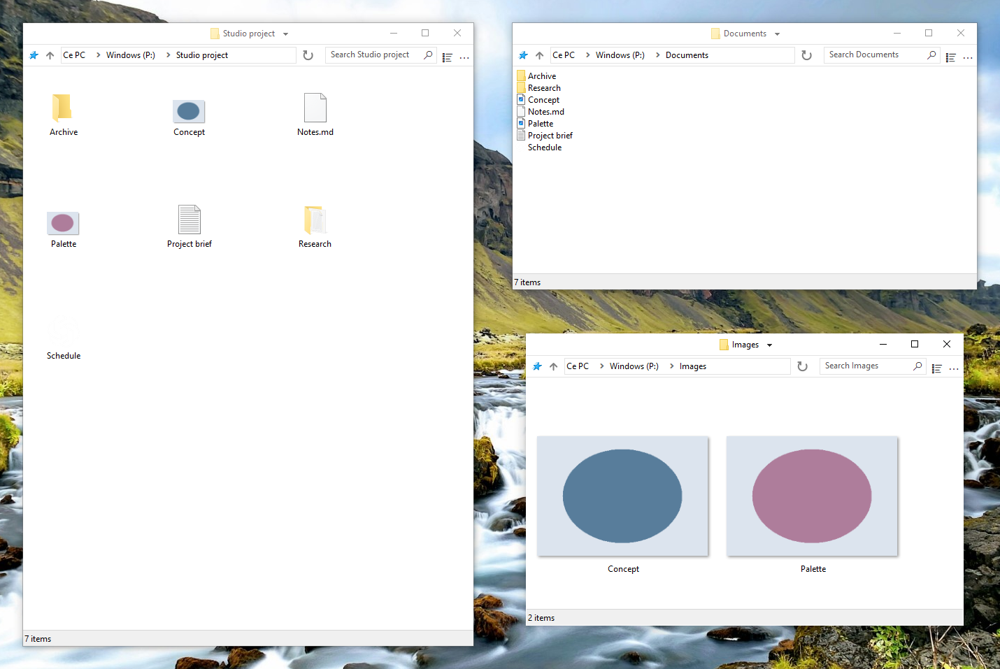

    

# FileSpacer

FileSpacer is a file manager for Windows built around the [spatial paradigm](https://en.wikipedia.org/wiki/Spatial_file_manager): each folder has a single window that remembers its position, size and view settings. This provides [stable visual landmarks](https://www.csse.canterbury.ac.nz/~andy/papers/transforms.pdf), allowing [spatial memory](https://www.microsoft.com/en-us/research/wp-content/uploads/1998/01/p153-robertson.pdf) to help you recognize familiar folders at a glance. In a navigational file manager, the same window displays different folders in succession: its position and dimensions alone cannot identify the current folder, so you need to look at its contents to determine where you are. By preserving distinct landmarks for each folder, the spatial approach can help reduce the cognitive load of finding your way around your files. Tabs are incompatible with the spatial model and will never be added.

FileSpacer prioritizes a lightweight and uncluttered experience. To address the accumulation of windows, a recognized drawback of the spatial paradigm, FileSpacer closes the source window by default when a folder is opened. Hold Ctrl while opening a folder to keep the source window open when you want to work with several folders at once. FileSpacer also keeps its interface deliberately understated, unlike some cluttered interfaces that leave just enough room between the buttons to glimpse a file.

**System & Languages:** Windows 10 or later, x64. Available in English, French, German, Italian, Spanish, Portuguese (Portugal) and Greek.

**Privacy:** **No telemetry, usage tracking or advertising**. Update checks contact GitHub; weekly checks are optional and off by default. Downloading and installing require confirmation. [Privacy policy](docs/user-guide.md#privacy).

**Documentation:**

_FileSpacer is a fork of [ChromaFiler](https://github.com/vanjac/chromafiler), originally created by J. van't Hoog. See [Credits](#license-and-credits) below for details._

## Features

- **One window per folder**, reused if the folder is already open. Its position,
  size, view settings and icon layout are restored between visits.
  [Spatial navigation](docs/user-guide.md#window-navigation).
- **Arrange icons freely**, with their positions saved and restored for each
  folder. [Icon layout](docs/user-guide.md#icon-layout).
- **Move and resize windows** from anywhere in the file area, preserving
  selection. Mouse shortcuts are configurable; defaults are Alt + left drag
  and Alt + right drag. [Window gestures](docs/user-guide.md#moving-and-resizing).
- **Switch between open folders** from the title-bar menu, close parent
  windows, or reopen the last closed window with Ctrl+Shift+T.
  [Window navigation](docs/user-guide.md#window-navigation).
- **Lock a window's saved layout** while allowing temporary changes to its
  position, size and view settings.
  [Window state locking](docs/user-guide.md#locking-a-saved-layout).
- **Filter the current folder** and reuse its recent searches.
  [Search and history](docs/user-guide.md#search-and-history).
- **Preserve selection when activating a window** by clicking its background.
  [Selection and activation](docs/user-guide.md#selection-and-activation).
- **Reduce overlap between windows** when opening folders without a saved
  position. [Window placement](docs/user-guide.md#window-placement).
- **Customize the title-bar menu** with layout and window actions, and save
  named groups of open folders.
  [Menu customization](docs/user-guide.md#customize-the-title-bar-menu) ·
  [Folder groups](docs/user-guide.md#folder-groups).

## Integration

FileSpacer can be set as the default file manager during installation or later in Settings. Files open with their usual Windows applications; network folders use Windows' usual handling. [Windows integration](docs/user-guide.md#windows-integration).

With **Everything**, advanced searches can be launched from FileSpacer's search field, in the current folder and its subfolders or across all indexed files. Results open in Everything. [Integration and usage](docs/user-guide.md#everything).

With **Nilesoft Shell**, FileSpacer's menus can use its themes and custom commands. Configuration adjustments are recommended for a consistent appearance. [Integration and configuration](docs/user-guide.md#nilesoft-shell).

## Build

Builds use MSVC/NMAKE, Visual Studio 2022 Build Tools with ATL and a Windows SDK,
Inkscape and ImageMagick. NSIS is required for the installer; SQLite is bundled.
See the [build guide](docs/build.md).

Regression tests combine PowerShell scenarios with C++ and C# helpers for
internal checks and real Windows UI/Shell tests. Run them through `tests.cmd`,
locally or in a configured Hyper-V VM.
See the [test guide](tests/regression/README.md).

## License and credits

### Copyright and License
FileSpacer is distributed under the  license. 
Copyright © 2026 Benco for FileSpacer modifications. The complete license is in [LICENSE](LICENSE) in the source tree, or `LICENSE.txt` in the installation folder. FileSpacer comes without warranty; redistribution and modification are permitted under that license.

### Fork and Upstream Credits
FileSpacer is a fork of [ChromaFiler](https://github.com/vanjac/chromafiler) (original ChromaFiler code © 2023 J. van't Hoog.), created by J. van't Hoog (vanjac). Many thanks to vanjac for the foundation!

### Third-Party Notices
See [third-party notices](THIRD_PARTY_NOTICES.md) and the [privacy policy](docs/privacy-policy.md).
