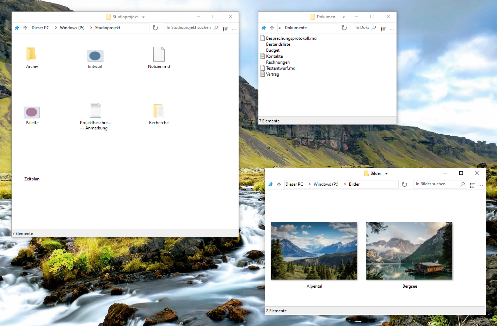

    

# FileSpacer

 &emsp;

FileSpacer ist ein Dateimanager für Windows nach dem [räumlichen Prinzip](https://en.wikipedia.org/wiki/Spatial_file_manager): Jeder Ordner hat genau ein Fenster, das sich Position, Größe und Ansichtseinstellungen merkt. So entstehen [beständige visuelle Orientierungspunkte](https://www.csse.canterbury.ac.nz/~andy/papers/transforms.pdf), mit denen das [räumliche Gedächtnis](https://www.microsoft.com/en-us/research/wp-content/uploads/1998/01/p153-robertson.pdf) vertraute Ordner auf einen Blick wiedererkennen kann. In einem navigationsbasierten Dateimanager zeigt dasselbe Fenster nacheinander verschiedene Ordner an. Seine Position und Abmessungen allein verraten daher nicht, welcher Ordner gerade geöffnet ist. Dazu muss man den Inhalt betrachten. Indem jeder Ordner seine eigenen Orientierungspunkte behält, kann der räumliche Ansatz die Orientierung zwischen den Dateien erleichtern. Registerkarten sind mit dem räumlichen Modell unvereinbar und werden niemals hinzugefügt.

FileSpacer legt Wert auf eine schlanke und übersichtliche Bedienung. Damit sich nicht zu viele Fenster ansammeln – ein bekannter Nachteil dieses Prinzips –, schließt FileSpacer beim Öffnen eines Ordners standardmäßig das Ausgangsfenster. Halten Sie beim Öffnen Strg gedrückt, um es geöffnet zu lassen, wenn Sie mit mehreren Ordnern gleichzeitig arbeiten möchten. FileSpacer hält seine Oberfläche bewusst zurückhaltend, während manche überladenen Oberflächen zwischen all den Schaltflächen gerade noch einen Blick auf eine Datei erlauben.

**System und Sprachen:** Windows 10 oder neuer, x64. In zehn Sprachen verfügbar: Englisch, Französisch, Deutsch, Italienisch, Spanisch, Portugiesisch (Portugal), Griechisch, Polnisch, Niederländisch und Ukrainisch.

**Datenschutz:** **Keine Telemetrie, Nutzungsverfolgung oder Werbung.** Update-Prüfungen verbinden sich mit GitHub. Wöchentliche Prüfungen sind optional und standardmäßig aus. Herunterladen und Installieren erfordern eine Bestätigung. [Datenschutz](user-guide.md#privacy).

**Installation:**

- **Manuelle Installation:** <a href="https://github.com/LeBenco/FileSpacer/releases/download/v1.4.1/FileSpacer-1.4.1-install.exe" id="last-release-url">das Installationsprogramm der neuesten Version</a> herunterladen und ausführen.
- **WinGet:** `winget install --id Benco.FileSpacer --exact`
- **Chocolatey** (Terminal als Administrator): `choco install filespacer -y`

Die WinGet-Pakete warten auf die Freigabe im Katalog.

## Funktionen

- **Ein Fenster pro Ordner**. Position, Größe, Ansichtsmodus und Symbolpositionen [werden gespeichert](user-guide.md#window-navigation). Symbole lassen sich frei anordnen oder am [klassischen Raster ausrichten](user-guide.md#icon-layout).
- **Fensteranordnung**. Beim Öffnen eines anderen Ordners wird das Ausgangsfenster standardmäßig geschlossen. Fenster ohne gespeicherte Position werden so platziert, dass sie sich [möglichst wenig überlappen](user-guide.md#window-placement).
- **Fenster verwalten**. Fenster mit [Mausgesten](user-guide.md#moving-and-resizing) verschieben oder ihre Größe ändern. [Ordnergruppen](user-guide.md#folder-groups) speichern und erneut öffnen. [Die Fensteranordnung sperren](user-guide.md#locking-a-saved-layout).

**Dokumentation:**

## Integration

FileSpacer lässt sich bei der Installation oder später in den Einstellungen zum Standard-Dateimanager machen. Dateien öffnen sich in ihrer üblichen Windows-Anwendung. Netzwerkordner verwenden das gewohnte Windows-Verhalten. [Windows-Integration](user-guide.md#windows-integration).

Mit **Everything** lassen sich erweiterte Suchanfragen aus FileSpacers Suchfeld starten: im aktuellen Ordner samt Unterordnern oder in allen indizierten Dateien. Die Ergebnisse erscheinen in Everything. [Integration und Verwendung](user-guide.md#everything).

Mit **Nilesoft Shell** können FileSpacers Menüs dessen Designs und angepasste Befehle verwenden. Für ein stimmiges Erscheinungsbild empfiehlt sich eine angepasste Konfiguration. [Integration und Konfiguration](user-guide.md#nilesoft-shell).

## Kompilieren

Zum Kompilieren werden MSVC/NMAKE, Visual Studio 2022 Build Tools mit ATL und einem Windows SDK, Inkscape sowie ImageMagick verwendet. Für das Installationsprogramm wird NSIS benötigt. SQLite ist enthalten. Siehe [Build-Anleitung](../en/build.md).

Die Regressionstests verbinden PowerShell-Szenarien mit C++- und C#-Hilfsprogrammen für interne Prüfungen und echte Windows-Oberflächen- und Shell-Tests. Der [Regressionsworkflow in GitHub Actions](https://github.com/LeBenco/FileSpacer/actions/workflows/regression.yml) führt diese Anwendungstests auf Anfrage und automatisch vor einer Veröffentlichung aus. Dieselben Fälle lassen sich mit `tests.cmd` auf einem lokalen Windows-Desktop oder in einer eingerichteten Hyper-V-VM ausführen. Fallauswahl, Voraussetzungen und Ergebnisse beschreibt die [Testanleitung](../en/tests/regression/README.md).

## Lizenz und Danksagung

### Urheberrecht und Lizenz
FileSpacer wird unter folgender Lizenz veröffentlicht: . 
Copyright © 2026 Benco für die FileSpacer-Änderungen. Die vollständige Lizenz steht in [LICENSE](../../LICENSE) im Quelltext oder in `LICENSE.txt` im Installationsordner. FileSpacer wird ohne Gewährleistung bereitgestellt. Weitergabe und Änderung sind nach Maßgabe dieser Lizenz erlaubt.

### Ursprung und Danksagung
FileSpacer ist eine Abspaltung von [ChromaFiler](https://github.com/vanjac/chromafiler), entwickelt von J. van’t Hoog (vanjac). Vielen Dank an vanjac für diese Grundlage! Ursprünglicher ChromaFiler-Code © 2023 J. van’t Hoog.

### Drittanbieterhinweise
Siehe [Drittanbieterhinweise](THIRD_PARTY_NOTICES.md) und [Datenschutzerklärung](privacy-policy.md).
