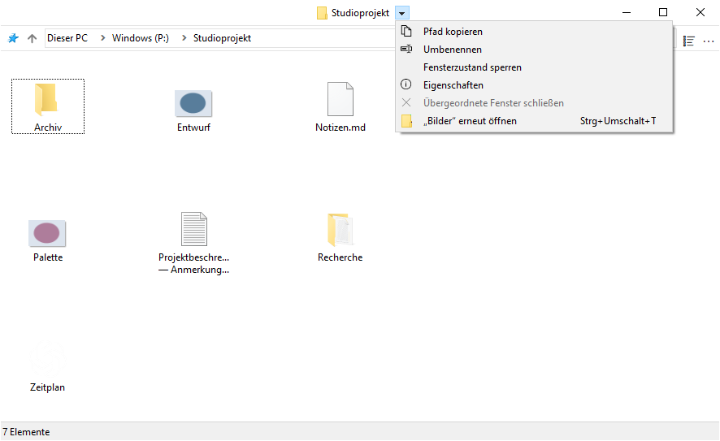
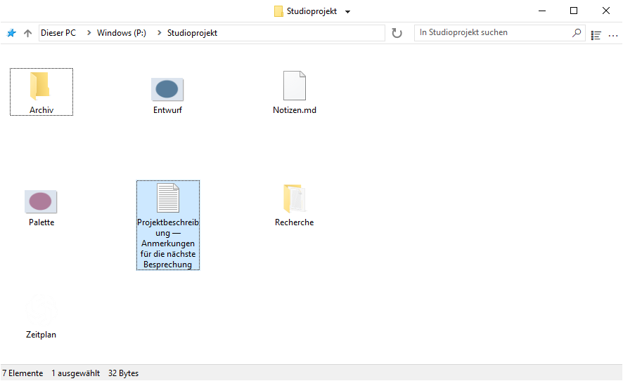
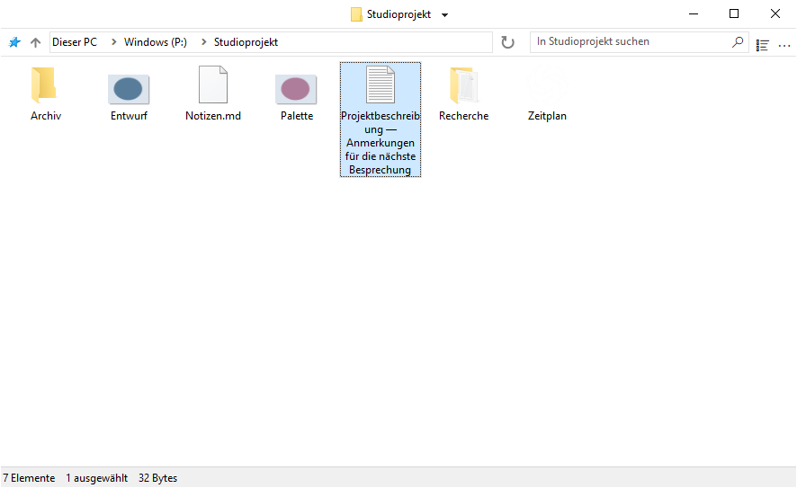
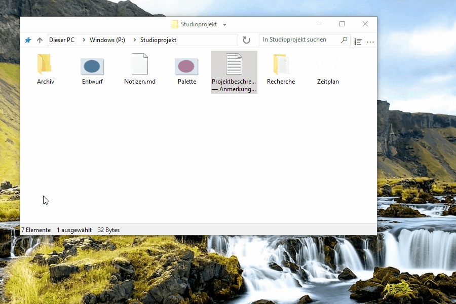
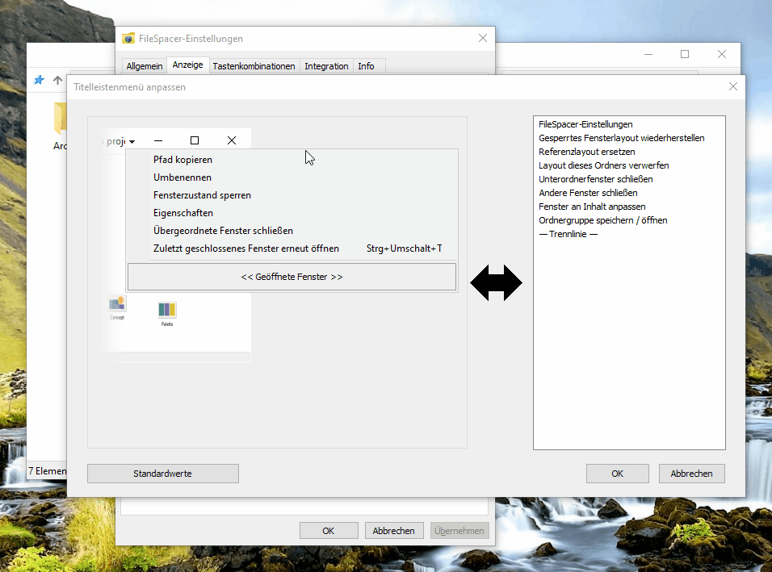
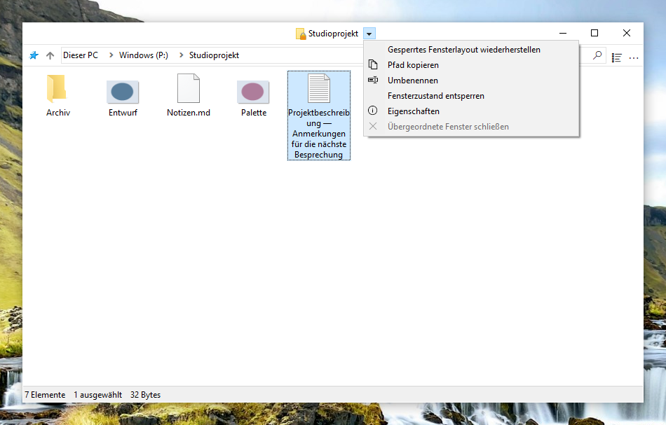
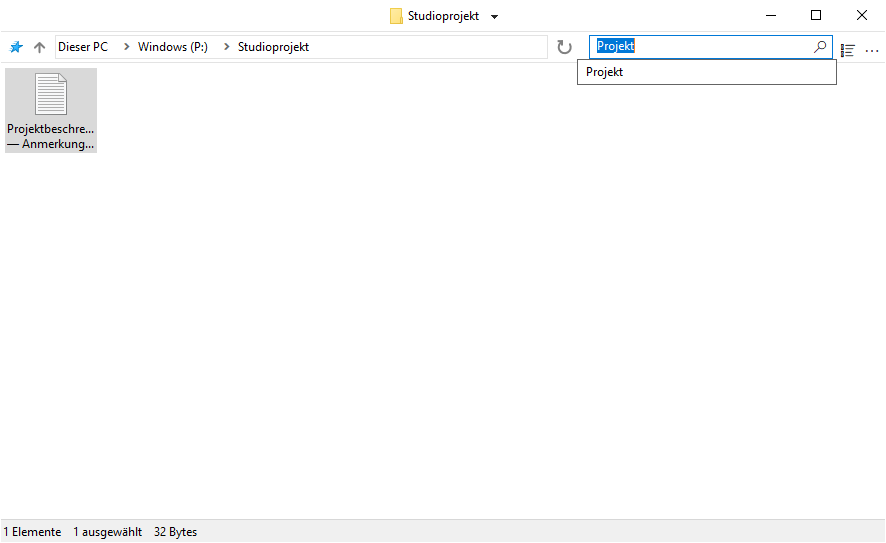
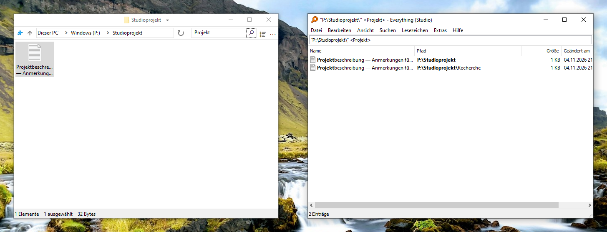
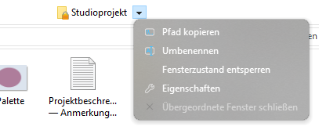

# FileSpacer verwenden

## Fensternavigation

FileSpacer bietet eine flüssige, schlichte und anpassbare Oberfläche nach dem räumlichen Prinzip:

- **Ein Ordner, ein Fenster.** Erneutes Öffnen eines bereits geöffneten Ordners bringt sein Fenster nach vorn. Position, Größe, Ansichtseinstellungen und Symbolanordnung bleiben auch nach dem Verschieben oder Umbenennen des Ordners erhalten.
- Beim Öffnen eines Ordners oder seines übergeordneten Ordners wird das Ausgangsfenster standardmäßig geschlossen. Mit gedrückter Strg-Taste bleibt das Ausgangsfenster beim Öffnen eines Ordners geöffnet. Die Standardeinstellung lässt sich unter **Einstellungen > Allgemein** ändern. Beim Öffnen mehrerer ausgewählter Ordner bleibt das Ausgangsfenster geöffnet.
- Das Menü neben dem Ordnertitel wechselt zwischen geöffneten Ordnern. **Übergeordnete Fenster schließen** schließt die geöffneten übergeordneten Ordnerfenster.
- **Strg+Umschalt+T** öffnet den zuletzt geschlossenen Ordner mit seiner Anordnung und Auswahl erneut. Der Befehl steht auch im Titelleistenmenü. Die Sprungliste der Taskleiste öffnet diesen Ordner oder schon früher geschlossene Ordner.
- Über die Sprungliste der Taskleiste lassen sich auch Ordner öffnen, die im Schnellzugriff des Datei-Explorers angeheftet sind.

Beim Wechsel zum übergeordneten Ordner wird der Ausgangsordner nicht ausgewählt. Ein bereits geöffnetes übergeordnetes Fenster behält seine Auswahl.



## Ansicht und Anordnung

### Symbolanordnung

In einer Symbolansicht können Sie Dateien und Unterordner frei platzieren, wenn **Symbole automatisch anordnen** deaktiviert ist. Ihre Positionen werden unabhängig von Fenstergröße und -position gespeichert, auch bei gesperrtem Fensterzustand.

### Ansichtsoptionen

**Vollständigen Namen einer ausgewählten Datei anzeigen** unter **Einstellungen > Anzeige** macht den Namen einer einzelnen ausgewählten Datei in der Symbolansicht vollständig lesbar.



**Ansichtsmodi im Ansichtsmenü vorab anzeigen** zeigt den jeweiligen Modus beim Darüberfahren an. Ein Klick übernimmt ihn. Esc oder das Verlassen der Vorschau stellt die ursprüngliche Ansicht wieder her. Die Vorschau ist vorübergehend und ersetzt nicht die gespeicherte Anordnung.

**Ordner und Dateien beim Sortieren mischen** sortiert beide gemeinsam, wie unter [macOS](https://support.apple.com/en-au/guide/mac-help/mchlp1745/27/mac/27) und [Linux](https://www.gnu.org/s/coreutils/manual/html_node/Sorting-the-output.html). Die Option unter **Einstellungen > Anzeige > Dateien** gilt für Details, Liste und automatisch angeordnete Symbole. Virtuelle Ordner und Archive behalten die Windows-Sortierung.



### Fensterpositionierung

Ordner ohne gespeicherte Position öffnen sich auf freiem Platz oder mit möglichst geringer Überlappung, wenn der Platz nicht reicht. Die Einstellung befindet sich unter **Einstellungen > Allgemein > Neue Fenster auf freiem Platz anordnen**.

### Auswahl und Aktivierung

Wenn **Einstellungen > Allgemein > Auswahl beim Klicken auf inaktives Fenster beibehalten** aktiviert ist, aktiviert ein Klick auf den Hintergrund eines inaktiven Ordnerfensters dieses Fenster, ohne die Auswahl aufzuheben. Sobald das Fenster aktiv ist, lässt sich durch Klicken und Ziehen auf seinem Hintergrund ein Auswahlrechteck aufziehen.

## Fenster verwalten

### Verschieben und Größenänderung

Fenster lassen sich durch Ziehen im Dateibereich verschieben oder in der Größe ändern, auch über einem Element. Standardmäßig gelten:

| Aktion | Tastenkombination |
| --- | --- |
| Fenster verschieben | Alt + Ziehen mit der linken Maustaste |
| Größe von der unteren rechten Ecke aus ändern | Alt + Ziehen mit der rechten Maustaste |




Die Auswahl bleibt erhalten. Esc bricht den Vorgang ab.

Unter **Einstellungen > Tastenkombinationen** lässt sich jede Aktion einzeln konfigurieren. Linke und rechte Maustaste erfordern Alt. Die mittlere funktioniert auch ohne Alt.

### Gespeicherten Fensterzustand sperren

Eine Sperre hält Position, Größe und Ansicht eines Ordners für das erneute Öffnen fest. **Einstellungen > Allgemein > Sperren des Fensterzustands aktivieren** ist standardmäßig deaktiviert. Nach dem Aktivieren steht neben dem Ordnertitel **Fensterzustand sperren** zur Verfügung. Ein Schloss am Ordnersymbol kennzeichnet die Sperre.


Vorübergehende Änderungen bleiben möglich. Beim erneuten Öffnen kehrt der gesperrte Zustand zurück. Einzelne Symbolpositionen werden weiterhin gespeichert. **Fensterzustand entsperren** behält die aktuelle Anordnung bei.

Das Deaktivieren der Funktion erfordert eine Bestätigung und entfernt alle Sperren, auch bei geschlossenen Ordnern. Erneutes Aktivieren stellt sie nicht wieder her.

### Titelleistenmenü anpassen

Das Menü lässt sich unter **Einstellungen > Anzeige > Oberflächenelemente > Titelleistenmenü anpassen** bearbeiten. Eine Aktion aus der rechten Liste in das Menü ziehen, einen Eintrag verschieben, um die Reihenfolge zu ändern, oder aus dem Menü ziehen, um ihn zu entfernen.

Von Nilesoft Shell verwaltete Einträge lassen sich hier nicht ändern, da dessen Regeln Vorrang haben. Siehe [Nilesoft-Shell-Integration](#nilesoft-shell).





- **Gesperrtes Fensterlayout wiederherstellen** stellt die Referenzanordnung des Fensters wieder her. **Referenzlayout ersetzen** speichert nach Bestätigung die aktuelle Anordnung als neue gesperrte Referenz.

- **Layout dieses Ordners verwerfen** löscht die gespeicherte Anordnung und Sperre, behält aber den Suchverlauf. Im aktuellen Fenster bleibt das Speichern bis zum Schließen ausgesetzt. Beim nächsten Öffnen gelten die Standardeinstellungen. Das Sperren einer neuen Anordnung aktiviert das Speichern wieder.

### Ordnergruppen

**Ordnergruppe speichern / öffnen** speichert die geöffneten Ordner unter einem Namen. Beim Aufrufen der Gruppe öffnen sie sich mit ihren gespeicherten Anordnungen.

## Suche und Verlauf

Geben Sie einen Datei- oder Ordnernamen ganz oder teilweise ein und drücken Sie die Eingabetaste, um den aktuellen Ordner zu filtern. **Einstellungen > Allgemein > Beim Eingeben filtern** wendet den Filter bereits während der Eingabe an.

Das Feld bietet letzte Suchanfragen und bei aktivierter Integration **In Everything suchen** für eine externe Suche an. Ohne ausgewählten Vorschlag wendet die Eingabetaste den lokalen Filter an. Strg+F aktiviert das Feld.

Der Suchverlauf wird pro Ordner geführt. Die Anzahl gespeicherter bestätigter Suchanfragen lässt sich in den allgemeinen Einstellungen festlegen. 0 leert und deaktiviert den Verlauf. [Everything](#everything) durchsucht auch Unterordner oder alle indizierten Dateien.



## Integration

### Windows-Integration

FileSpacer lässt sich bei der Installation oder später unter **Einstellungen > Integration** mit **Als Standard-Dateibrowser festlegen** zum Standard-Dateimanager machen. **Standard-Dateibrowser zurücksetzen** übergibt das Öffnen von Ordnern wieder an den Datei-Explorer.

Das Kontextmenü von Ordnern bietet **In FileSpacer öffnen**, beziehungsweise **Im Windows-Datei-Explorer öffnen**, wenn FileSpacer der Standard ist. Das gilt auch für Laufwerke, ZIP-Ordner, Netzwerkadressen und Ordnerhintergründe. Die Standardanwendung muss dafür nicht geändert werden.

**Datei-Explorer-Optionen** öffnet gemeinsame Ordnereinstellungen, von denen einige auch für FileSpacer gelten.

### PowerToys Grab And Move

Wenn Grab And Move in den PowerToys-Einstellungen aktiviert ist, setzt FileSpacer seine Gesten zum Verschieben und zur Größenänderung für die betroffenen Fenster aus, auch wenn PowerToys nicht läuft.

Um die FileSpacer-Gesten weiterzuverwenden, `FileSpacer.exe` zur Liste der ausgeschlossenen Apps von Grab And Move hinzufügen oder das Hilfsprogramm in PowerToys deaktivieren.

### PowerToys Peek

**Vorschau mit der Leertaste** unter **Einstellungen > Integration** öffnet mit der **Leertaste** allein eine Peek-Vorschau ausgewählter Dateien oder Ordner. Die Option ist standardmäßig deaktiviert.

Peek muss auch in PowerToys aktiviert sein. Die Integration erfordert PowerToys 0.96 oder neuer, für Mehrfachauswahl 0.102 oder neuer.

### Everything

Ein vorhandenes [Everything](https://www.voidtools.com/) lässt sich einbinden, um erweiterte Suchanfragen direkt aus FileSpacers Suchfeld zu starten. Die Ergebnisse erscheinen in Everything.

Die Option wird unter **Einstellungen > Integration** aktiviert. Everything wird automatisch erkannt. Eine portable Ausgabe lässt sich manuell auswählen. Die Suche umfasst den aktuellen Ordner und seine Unterordner oder mit **Überall** alle indizierten Dateien. Für virtuelle Ordner muss Überall gewählt werden.

**In Everything suchen** startet die externe Suche mit der Everything-Syntax. Nach erfolgreichem Start werden das Suchfeld und der lokale Filter in FileSpacer geleert.



### Nilesoft Shell

[Nilesoft Shell](https://nilesoft.org/) kann FileSpacers Menüs gestalten und ihre Befehle anpassen. Für ein stimmiges Erscheinungsbild empfiehlt sich eine angepasste Konfiguration, insbesondere mit eckigen Menüs an Titel- und Symbolleiste.

FileSpacer stellt zunächst das Titelleistenmenü zusammen. Danach wendet Nilesoft Shell seine Regeln an, die Befehle umbenennen, verschieben, ausblenden oder hinzufügen können und somit Vorrang haben. Grau dargestellte Einträge werden in den Konfigurationsdateien von Nilesoft Shell geändert.

FileSpacer-Aktionen lassen sich in der Nilesoft-Shell-Konfiguration verwenden. Die [Konfigurationsreferenz](nilesoft-shell.md) enthält Einstellungen und Aktions-IDs. Beispiel mit der dort definierten Bedingung `filespacer_title`:

```nss
item(type='*' mode='multiple' where=filespacer_title
     title='Gesperrtes Fensterlayout wiederherstellen' cmd=window.command(1123))
```

Die Bilder unten zeigen das Modern-Design mit den standardmäßigen Rundungen und mit den empfohlenen eckigen Menüs.

**Navigationsmenü**

| Standardecken | Empfohlene eckige Menüs |
| --- | --- |
|  |  |

**Hauptmenü (…)**

| Standardecken | Empfohlene eckige Menüs |
| --- | --- |
|  |  |

## Einstellungen und Updates

Strg+, öffnet die Einstellungen. F1 öffnet das Offline-Handbuch. Die Oberfläche folgt der Windows-Anzeigesprache. Ein Sprachwechsel erfordert einen Neustart.

Unter **Einstellungen > Info** lassen sich Updates suchen und optionale wöchentliche Prüfungen aktivieren. Diese sind standardmäßig deaktiviert. Herunterladen und Installieren erfordern eine Bestätigung. Anschließend öffnen sich die zuvor geöffneten Ordner mit ihrer gespeicherten Anordnung.

## Lokale Daten

Anordnungen, Sperren, Verläufe und Einstellungen werden lokal gespeichert. Die Speicherorte sind im [technischen Hinweis zur Fehlerbehebung](../en/README.md#local-data) beschrieben (auf Englisch).

**Einstellungen > Info > Wartung > Alle Ordnerzustände zurücksetzen** schließt die Ordnerfenster und löscht deren gespeicherte Anordnungen, Verläufe und Sperren. Dateien und allgemeine Einstellungen bleiben erhalten.

Zur Fehlerbehebung setzt `FileSpacer.exe /reset-options` allgemeine Einstellungen zurück. `/reset-all` löscht zusätzlich die gespeicherten Ordnerzustände. Dateien bleiben bei diesen Befehlen erhalten.

## Datenschutz

FileSpacer enthält weder Telemetrie noch Nutzungsverfolgung oder Werbung. Absturzberichte werden nicht automatisch versendet. Diagnoseberichte bleiben unter `%LOCALAPPDATA%\FileSpacer`. Ihre Weitergabe ist freiwillig und kann Dateipfade oder Teile des Prozessspeichers offenlegen.

Update-Prüfungen und Downloads verbinden sich per HTTPS mit GitHub. GitHub erhält übliche Verbindungsinformationen, darunter IP-Adresse und Anwendungsversion, aber keine Ordnerzustände, Dateipfade oder Diagnoseberichte.

Zugangsdaten für Netzlaufwerke werden wie im Datei-Explorer von Windows entgegengenommen und verarbeitet. FileSpacer liest oder speichert sie nicht. Bei einer Everything-Suche werden die Anfrage und bei einer Ordnersuche dessen Pfad an die lokale Everything-Anwendung übergeben.
