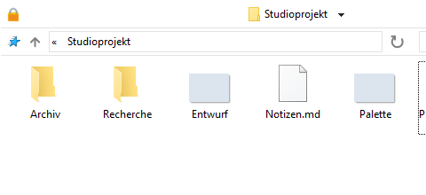
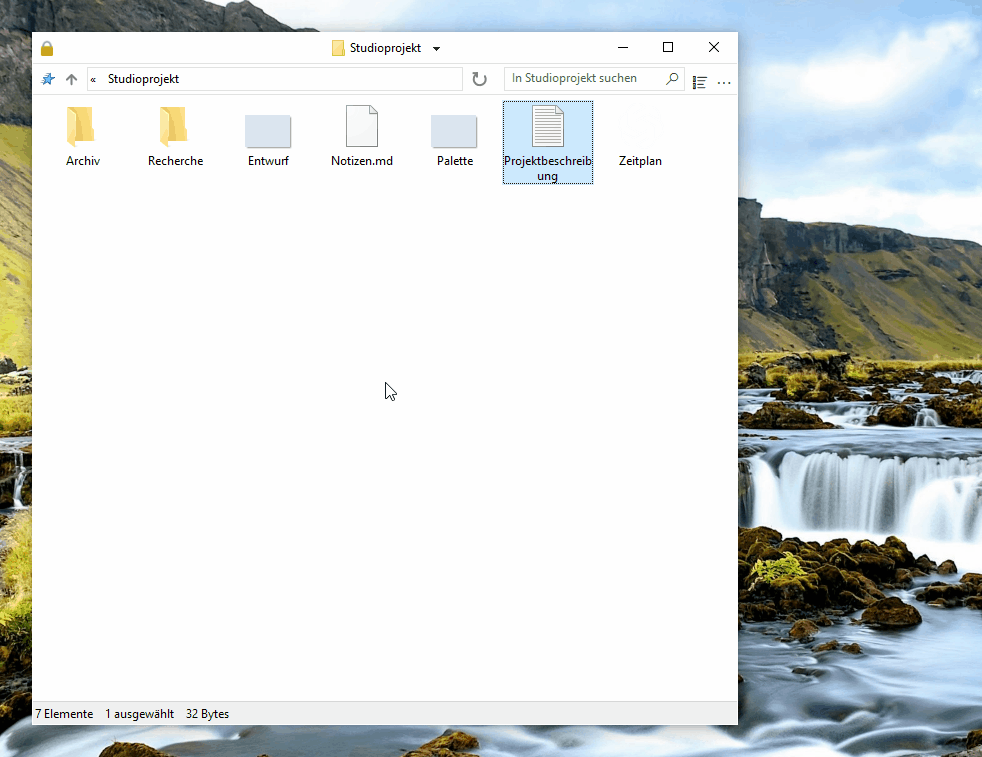
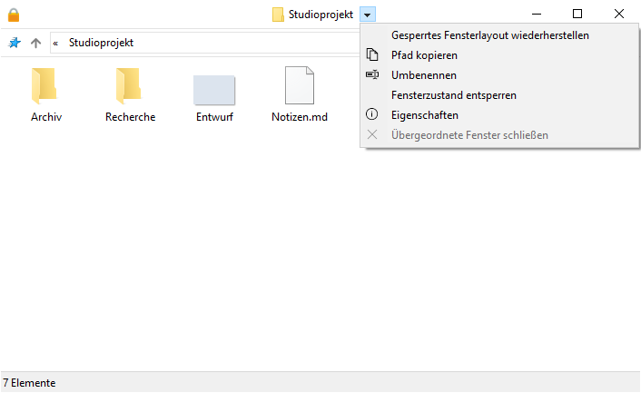
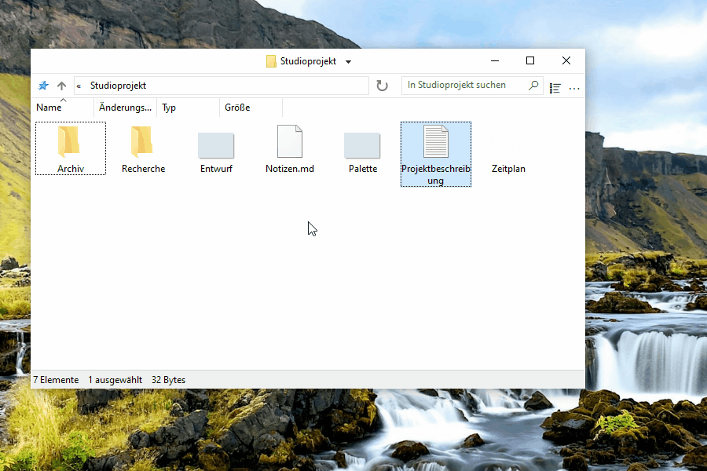
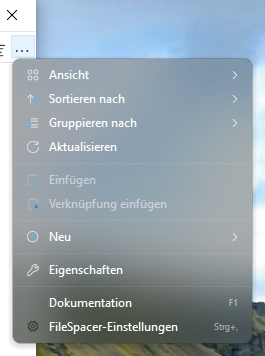
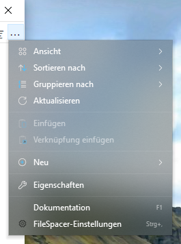

# FileSpacer verwenden

FileSpacer merkt sich Position und Aussehen jedes Fensters beim erneuten Öffnen. Ordner kehren an ihren vertrauten Platz zurück, ähnlich wie Gegenstände auf einem Schreibtisch. Dazu kommen anpassbare Tastenkombinationen, Schnellaktionen und eine aufgeräumte, anpassbare Oberfläche.

FileSpacer lässt sich bei der Installation oder unter **Einstellungen > Integration** mit **Als Standard-Dateibrowser festlegen** als Standard-Dateimanager festlegen. Das Kontextmenü von Ordnern bietet **In FileSpacer öffnen** bzw. **Im Windows-Datei-Explorer öffnen**, wenn FileSpacer als Standard festgelegt ist.

## Navigation und Anordnung der Fenster

**Jeder Ordner hat sein eigenes Fenster.** Ist er bereits geöffnet, holt FileSpacer dieses Fenster in den Vordergrund. Position, Größe, Ansicht, Symbolanordnung und Scrollposition bleiben auch nach dem Verschieben oder Umbenennen des Ordners erhalten. Fenster ohne gespeicherte Position werden so platziert, dass sie sich möglichst wenig überlappen (Option unter **Einstellungen > Allgemein**).

**Die aktuelle Position, Größe und Ansicht eines Ordners lassen sich sperren, um sie bei jedem erneuten Öffnen wiederherzustellen.** Spätere Änderungen sind vorübergehend. Symbolpositionen werden weiterhin gespeichert. Die **gesperrte Anordnung lässt sich wiederherstellen**, ohne das Fenster zu schließen.

**Fensterzustand entsperren** behält die aktuelle Anordnung bei und ermöglicht wieder das Speichern von Änderungen.

Die Sperrfunktion wird unter **Einstellungen > Allgemein** aktiviert. Dort lassen sich auch die Anzeige des Schlosses links in der Titelleiste anpassen und das Sperren oder Entsperren des Fensterzustands per Klick auf das Symbol aktivieren. Das Abschalten der Funktion entfernt alle Sperren und blendet das Symbol aus.

Beim Öffnen eines Ordners oder seines übergeordneten Ordners wird das Ausgangsfenster standardmäßig geschlossen. **Strg beim Öffnen gedrückt halten**, um es offen zu lassen. Das Verhalten lässt sich unter **Einstellungen > Allgemein** ändern. Beim Öffnen mehrerer ausgewählter Ordner bleibt das Ausgangsfenster offen.

Das Menü neben dem Titel wechselt zwischen geöffneten Ordnern und schließt übergeordnete Fenster. **Strg+Umschalt+T** öffnet den zuletzt geschlossenen Ordner mit seiner Anordnung und Auswahl erneut. Die Sprungliste der Taskleiste bietet auch zuletzt geschlossene und im Schnellzugriff angeheftete Ordner.

**Ordnergruppe speichern / öffnen** im Titelmenü öffnet mehrere Ordner gemeinsam mit ihren gespeicherten Anordnungen.

## Anzeige der Ordnerinhalte

In FileSpacer lassen sich die Inhalte eines Ordners in einem Raster anordnen, wie im Datei-Explorer, oder frei platzieren, wie auf dem Windows-Desktop. Die freie Platzierung ist bei jeder Symbolgröße und in der Ansicht **Kacheln** möglich. Die Ansichten **Liste** und **Details** unterstützen keine freie Platzierung. Dazu **Symbole automatisch anordnen** ausschalten. Die Ausrichtung am Raster bleibt möglich. Das Menü **Ansicht** in jedem Fenster bietet schnellen Zugriff auf die Symboleinstellungen, einschließlich der zusätzlichen Optionen von FileSpacer.

Standardmäßig stehen Ordner vor Dateien, wie im Datei-Explorer. **Ordner und Dateien beim Sortieren mischen** unter **Einstellungen > Anzeige** sortiert beide gemeinsam, wie unter [macOS](https://support.apple.com/en-au/guide/mac-help/mchlp1745/27/mac/27) und [Linux](https://www.gnu.org/s/coreutils/manual/html_node/Sorting-the-output.html). Das gilt für Details, Liste und automatisch angeordnete Symbole. Virtuelle Ordner und Archive behalten die Windows-Sortierung.

In denselben Einstellungen macht **Vollständigen Namen einer ausgewählten Datei anzeigen** auch sehr lange Namen in der Symbolansicht vollständig lesbar. Das gilt bei genau einer ausgewählten Datei.

Ein Klick auf den Hintergrund eines inaktiven Fensters hebt dessen Auswahl standardmäßig auf, wie im Datei-Explorer. **Auswahl beim Klicken auf inaktives Fenster beibehalten** unter **Einstellungen > Allgemein** aktiviert es ohne Verlust der Auswahl.

## Anpassung

### Oberfläche anpassen

Das **Titelleistenmenü** lässt sich unter **Einstellungen > Anzeige > Oberflächenelemente** anpassen. Befehle werden durch Ziehen und Ablegen hinzugefügt und umgeordnet. Zum Entfernen einen Eintrag aus dem Menü herausziehen.

Von Nilesoft Shell verwaltete Einträge werden in dessen Konfiguration geändert, da seine Regeln Vorrang vor denen von FileSpacer haben ([siehe Integration unten](#nilesoft-shell)).

**Mausgesten zum Verschieben und Ändern der Fenstergröße** lassen sich direkt im Dateiinhalt verwenden, auch durch Ziehen über einer Datei. Standardbelegung:

| Aktion | Geste |
| --- | --- |
| Verschieben | Alt + Ziehen mit der linken Maustaste |
| Größe ändern | Alt + Ziehen mit der rechten Maustaste |

Sind Dateien ausgewählt, bleibt die Auswahl erhalten. Esc bricht die Aktion ab. Die Belegung lässt sich unter **Einstellungen > Tastenkombinationen** anpassen. Linke und rechte Maustaste erfordern Alt. Die mittlere kann allein verwendet werden.

### Integration

[Everything](https://www.voidtools.com/) findet Dateien und Ordner schnell anhand ihres Namens. FileSpacer kann es über das Suchfeld eines Ordners starten. Die Integration wird unter **Einstellungen > Integration** aktiviert, mit automatischer Erkennung oder manueller Auswahl einer portablen Version.

**In Everything suchen** startet [die Suche](https://www.voidtools.com/support/everything/searching/) im Ordner und seinen Unterordnern oder mit **Überall** in allen [indizierten Dateien](https://www.voidtools.com/support/everything/indexes/). Die Ergebnisse öffnen sich in Everything. Für virtuelle Ordner Überall wählen. Ein erfolgreicher Start leert das Suchfeld und entfernt den lokalen Filter von FileSpacer.

[Nilesoft Shell](https://nilesoft.org/) ist eine Windows-Erweiterung zum Anpassen von Aussehen und Befehlen der Kontextmenüs. Bei Verwendung kann sie auch die Menüs von FileSpacer verwalten.

FileSpacer stellt das Titelleistenmenü zusammen. Danach wendet Nilesoft Shell seine Regeln an, die Vorrang haben. Die [Konfigurationsreferenz](nilesoft-shell.md) beschreibt die Darstellung und den Zugriff auf FileSpacer-Aktionen.

Für die Menüs der Titelleiste und der Symbolleiste werden [Ecken ohne Abrundung](nilesoft-shell.md#recommended-menu-appearance) empfohlen.

**Navigationsmenü**

| Standardecken | Empfohlene eckige Menüs |
| --- | --- |
|  |  |

**Hauptmenü**

| Standardecken | Empfohlene eckige Menüs |
| --- | --- |
|  |  |

[PowerToys](https://learn.microsoft.com/de-de/windows/powertoys/) ist eine Sammlung von Microsoft-Werkzeugen zum Erweitern und Anpassen von Windows.

**Peek** zeigt eine Dateivorschau. In FileSpacer öffnet **Vorschau mit der Leertaste** unter **Einstellungen > Integration** die Vorschau mit der Leertaste. Peek muss in PowerToys aktiviert sein. Mindestversion: 0.96 bzw. 0.102 für Mehrfachauswahl.

**Grab And Move** verschiebt Fenster und ändert ihre Größe direkt aus dem Fensterinhalt. Ist es aktiviert, werden die entsprechenden FileSpacer-Gesten ausgesetzt, auch wenn PowerToys geschlossen ist. Für FileSpacer-Gesten `FileSpacer.exe` in Grab And Move ausschließen oder das Werkzeug abschalten.

## Updates und Fehlerbehebung

**Einstellungen > Info** bietet die Suche nach Updates und wöchentliche Prüfungen, die standardmäßig ausgeschaltet sind. Download und Installation erfordern eine Bestätigung.

Auf derselben Seite schließt **Wartung > Alle Ordnerzustände zurücksetzen** die Fenster und löscht deren Anordnungen, Verlauf und Sperren. Dateien und allgemeine Einstellungen bleiben erhalten.

Das Zurücksetzen der Einstellungen und die erweiterte Fehlerbehebung beschreibt die [technische Notiz](../en/README.md#local-data) auf Englisch.

## Datenschutz

FileSpacer enthält weder Telemetrie noch Nutzungsverfolgung oder Werbung. Absturzberichte werden nie automatisch versendet. Ihre Weitergabe ist freiwillig und kann Dateipfade oder Speicherinhalte offenlegen.

Updates kontaktieren GitHub. Dabei werden IP-Adresse und Anwendungsversion übermittelt, aber keine Dateipfade oder Ordnerzustände.

Anmeldedaten für Netzlaufwerke werden direkt von Windows verwaltet. FileSpacer liest oder speichert sie nicht.

Eine Everything-Suche übergibt die Suchanfrage und bei einer auf einen Ordner begrenzten Suche dessen Pfad an die lokale Everything-Anwendung.
