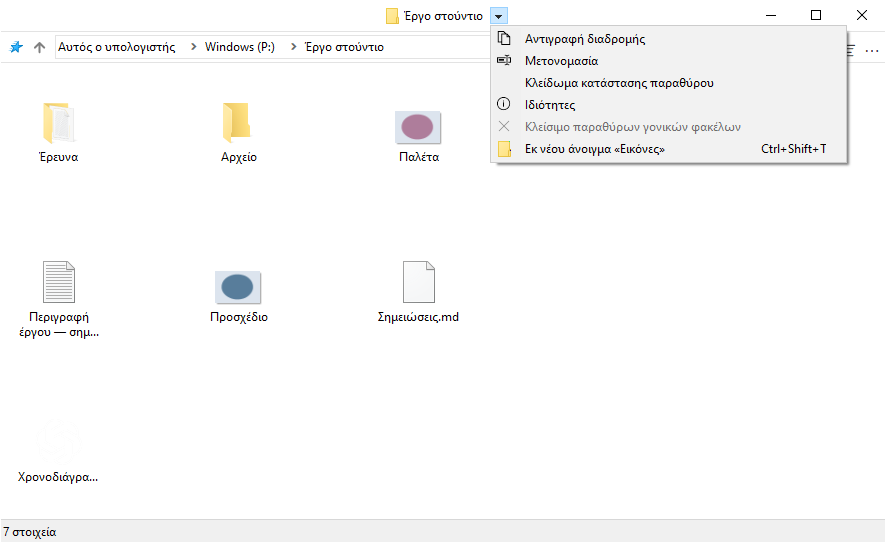
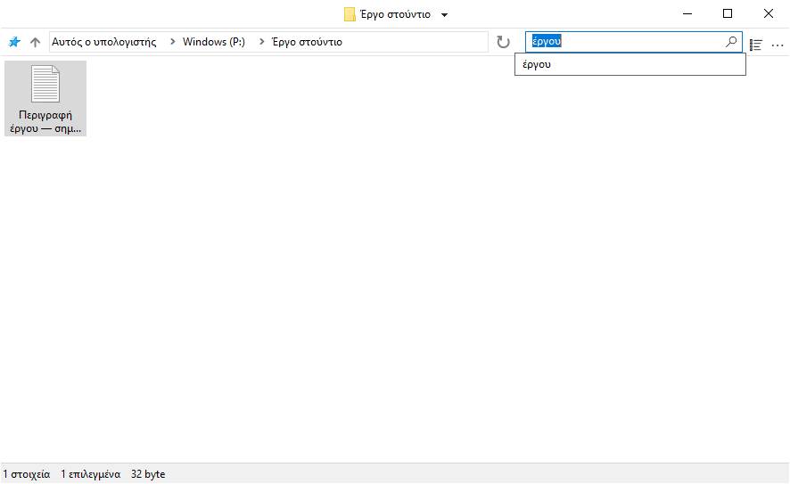

# Χρήση του FileSpacer

## Πλοήγηση μεταξύ παραθύρων

Το FileSpacer προσφέρει ένα εύχρηστο, λιτό και προσαρμόσιμο περιβάλλον εργασίας, βασισμένο στο χωρικό μοντέλο:

- **Ένας φάκελος, ένα παράθυρο.** Το άνοιγμα ενός ήδη ανοιχτού φακέλου φέρνει το παράθυρό του στο προσκήνιο. Η θέση, το μέγεθος, η προβολή και η διάταξη των εικονιδίων διατηρούνται ακόμη και μετά τη μετακίνηση ή τη μετονομασία του φακέλου.
- Το άνοιγμα ενός φακέλου ή του γονικού του κλείνει από προεπιλογή το παράθυρο προέλευσης. Κρατήστε πατημένο το Ctrl για να αντιστρέψετε τη συμπεριφορά μία φορά ή αλλάξτε την προεπιλογή στις **Ρυθμίσεις > Γενικά**. Το άνοιγμα πολλών επιλεγμένων φακέλων διατηρεί ανοιχτό το παράθυρο προέλευσης.
- Το μενού δίπλα στον τίτλο επιτρέπει την εναλλαγή μεταξύ ανοιχτών φακέλων. Η ενέργεια **Κλείσιμο παραθύρων γονικών φακέλων** κλείνει τα ανοιχτά παράθυρα των γονικών φακέλων.
- Το **Ctrl+Shift+T** ανοίγει ξανά τον τελευταίο κλειστό φάκελο με τη διάταξη και την επιλογή του. Η ίδια εντολή υπάρχει στο μενού τίτλου και στη λίστα συντομεύσεων της γραμμής εργασιών· η δεύτερη επιτρέπει την επιστροφή σε παλαιότερα κλεισμένους φακέλους.
- Η λίστα συντομεύσεων της γραμμής εργασιών ανοίγει επίσης τους φακέλους που είναι καρφιτσωμένοι στη Γρήγορη πρόσβαση της Εξερεύνησης αρχείων.

Η μετάβαση στον γονικό φάκελο δεν επιλέγει τον φάκελο από τον οποίο προήλθατε. Ένας ήδη ανοιχτός γονικός φάκελος διατηρεί την επιλογή του.



## Προβολή και διάταξη

### Διάταξη εικονιδίων

Σε προβολή εικονιδίων μπορείτε να τοποθετείτε ελεύθερα αρχεία και υποφακέλους όταν η **Αυτόματη τακτοποίηση εικονιδίων** είναι απενεργοποιημένη. Οι θέσεις τους αποθηκεύονται ανεξάρτητα από το μέγεθος και τη θέση του παραθύρου, ακόμη και όταν η αποθηκευμένη κατάστασή του είναι κλειδωμένη.

### Επιλογές προβολής

Η επιλογή **Εμφάνιση πλήρους ονόματος επιλεγμένου αρχείου**, στις **Ρυθμίσεις > Εμφάνιση**, κάνει πλήρως αναγνώσιμο το όνομα ενός μόνο επιλεγμένου αρχείου στην προβολή εικονιδίων.


Η επιλογή **Προεπισκόπηση λειτουργιών εμφάνισης στο μενού Προβολή** εμφανίζει κάθε λειτουργία όταν ο δείκτης βρίσκεται επάνω της. Ένα κλικ την εφαρμόζει· το Esc ή η έξοδος από την προεπισκόπηση επαναφέρει την αρχική προβολή. Η προεπισκόπηση είναι προσωρινή και δεν αντικαθιστά την αποθηκευμένη διάταξη.

Η επιλογή **Ανάμειξη φακέλων και αρχείων στην ταξινόμηση** τα ταξινομεί μαζί, όπως στο [macOS](https://support.apple.com/en-au/guide/mac-help/mchlp1745/27/mac/27) και στο [Linux](https://www.gnu.org/s/coreutils/manual/html_node/Sorting-the-output.html). Βρίσκεται στις **Ρυθμίσεις > Εμφάνιση > Αρχεία** και αφορά τις προβολές Λεπτομέρειες, Λίστα και τα αυτόματα τακτοποιημένα εικονίδια. Οι εικονικοί φάκελοι και οι αρχειοθήκες διατηρούν τη σειρά των Windows.


### Τοποθέτηση παραθύρων

Οι φάκελοι χωρίς αποθηκευμένη θέση ανοίγουν σε ελεύθερο χώρο ή με μειωμένη επικάλυψη αν ο χώρος δεν επαρκεί. Η ρύθμιση βρίσκεται στις **Ρυθμίσεις > Γενικά > Τοποθέτηση νέων παραθύρων σε ελεύθερο χώρο**.

### Επιλογή και ενεργοποίηση

Με ενεργοποιημένη την επιλογή **Ρυθμίσεις > Γενικά > Διατήρηση επιλογής με κλικ σε ανενεργό παράθυρο**, ένα κλικ στο φόντο ενός ανενεργού φακέλου ενεργοποιεί το παράθυρό του χωρίς να καταργεί την επιλογή. Πατήστε δεύτερη φορά για να ξεκινήσετε ένα ορθογώνιο επιλογής.

## Διαχείριση παραθύρων

### Μετακίνηση και αλλαγή μεγέθους

Ένα παράθυρο μετακινείται ή αλλάζει μέγεθος με σύρσιμο από την περιοχή αρχείων, ακόμη και πάνω σε ένα στοιχείο. Οι προεπιλεγμένες συντομεύσεις είναι:

| Ενέργεια | Συντόμευση |
| --- | --- |
| Μετακίνηση παραθύρου | Alt + σύρσιμο με το αριστερό κουμπί |
| Αλλαγή μεγέθους από την κάτω δεξιά γωνία | Alt + σύρσιμο με το δεξί κουμπί |


Η επιλογή διατηρείται. Το Esc ακυρώνει τη χειρονομία.

Κάθε ενέργεια έχει ξεχωριστή συντόμευση στις **Ρυθμίσεις > Συντομεύσεις**. Το αριστερό και το δεξί κουμπί απαιτούν Alt· το μεσαίο λειτουργεί και χωρίς Alt.

### Κλείδωμα αποθηκευμένης διάταξης

Το κλείδωμα κρατά τη θέση, το μέγεθος και την προβολή ενός φακέλου για το επόμενο άνοιγμα. Η λειτουργία είναι απενεργοποιημένη από προεπιλογή στις **Ρυθμίσεις > Γενικά > Ενεργοποίηση κλειδώματος κατάστασης παραθύρου**. Όταν ενεργοποιηθεί, το **Κλείδωμα κατάστασης παραθύρου** είναι διαθέσιμο δίπλα στον τίτλο του φακέλου. Ένα λουκέτο στο εικονίδιό του δείχνει το κλείδωμα.


Οι προσωρινές αλλαγές παραμένουν δυνατές· το επόμενο άνοιγμα επαναφέρει την κλειδωμένη διάταξη. Οι θέσεις μεμονωμένων εικονιδίων συνεχίζουν να αποθηκεύονται. Το **Ξεκλείδωμα κατάστασης παραθύρου** κρατά την τρέχουσα διάταξη.

Η απενεργοποίηση ζητά επιβεβαίωση και αφαιρεί όλα τα κλειδώματα, ακόμη και από κλειστούς φακέλους. Η επανενεργοποίηση δεν τα επαναφέρει.

### Προσαρμογή του μενού της γραμμής τίτλου

Το μενού προσαρμόζεται από τις **Ρυθμίσεις > Εμφάνιση > Στοιχεία περιβάλλοντος εργασίας > Προσαρμογή μενού γραμμής τίτλου**. Σύρετε μια ενέργεια από τη δεξιά λίστα στο μενού, μετακινήστε ένα στοιχείο για να αλλάξετε τη σειρά του ή σύρετέ το έξω από το μενού για να το αφαιρέσετε.

Τα στοιχεία που ελέγχονται από το Nilesoft Shell δεν μπορούν να τροποποιηθούν εδώ, επειδή οι κανόνες του έχουν προτεραιότητα. Δείτε την [ενσωμάτωση του Nilesoft Shell](#nilesoft-shell).


- Η ενέργεια **Επαναφορά της κλειδωμένης διάταξης** επαναφέρει το παράθυρο στη διάταξη αναφοράς του. Η **Αντικατάσταση της διάταξης αναφοράς** αποθηκεύει την τρέχουσα διάταξη ως νέα κλειδωμένη αναφορά, μετά από επιβεβαίωση.

- Η ενέργεια **Διαγραφή της αποθηκευμένης διάταξης του φακέλου** διαγράφει την αποθηκευμένη διάταξη και το κλείδωμα, διατηρώντας το ιστορικό αναζητήσεων. Η αποθήκευση αναστέλλεται στο τρέχον παράθυρο μέχρι να κλείσει· στο επόμενο άνοιγμα χρησιμοποιούνται οι προεπιλογές. Το κλείδωμα νέας διάταξης ενεργοποιεί ξανά την αποθήκευση.

### Ομάδες φακέλων

Η ενέργεια **Αποθήκευση / άνοιγμα ομάδας φακέλων** αποθηκεύει τους ανοιχτούς φακέλους με ένα όνομα. Η ανάκληση της ομάδας τούς ανοίγει με τις αποθηκευμένες διατάξεις τους.

## Αναζήτηση και ιστορικό

Πληκτρολογήστε ολόκληρο ή μέρος του ονόματος αρχείου ή φακέλου και πατήστε Enter για να φιλτράρετε τον τρέχοντα φάκελο. Η επιλογή **Ρυθμίσεις > Γενικά > Φιλτράρισμα κατά την πληκτρολόγηση** εφαρμόζει το φίλτρο κατά την πληκτρολόγηση.

Το πεδίο προτείνει πρόσφατες αναζητήσεις και, όταν η ενσωμάτωση είναι ενεργή, την ενέργεια **Αναζήτηση στο Everything** για εξωτερική αναζήτηση. Το Enter χωρίς επιλεγμένη πρόταση εφαρμόζει το τοπικό φίλτρο. Το Ctrl+F ενεργοποιεί το πεδίο.

Κάθε φάκελος έχει δικό του ιστορικό. Ο αριθμός των επιβεβαιωμένων αναζητήσεων που διατηρούνται ορίζεται στις γενικές ρυθμίσεις· το 0 καθαρίζει και απενεργοποιεί το ιστορικό. Το [Everything](#everything) επιτρέπει αναζήτηση σε υποφακέλους ή σε όλα τα αρχεία του ευρετηρίου.



## Ενσωμάτωση

### Ενσωμάτωση στα Windows

Το FileSpacer μπορεί να οριστεί ως προεπιλεγμένος διαχειριστής αρχείων κατά την εγκατάσταση ή αργότερα, στις **Ρυθμίσεις > Ενσωμάτωση**, με τον **Ορισμό ως προεπιλεγμένης εφαρμογής διαχείρισης αρχείων**. Η **Επαναφορά προεπιλεγμένης Εξερεύνησης αρχείων** επιστρέφει το άνοιγμα φακέλων στην Εξερεύνηση αρχείων.

Το μενού περιβάλλοντος των φακέλων προσφέρει **Άνοιγμα στο FileSpacer**, ή **Άνοιγμα στην Εξερεύνηση αρχείων των Windows** όταν το FileSpacer είναι προεπιλεγμένο. Ισχύει επίσης για μονάδες δίσκου, φακέλους ZIP, θέσεις δικτύου και φόντα φακέλων, χωρίς να απαιτεί αλλαγή της προεπιλεγμένης εφαρμογής.

**Επιλογές Εξερεύνησης αρχείων** ανοίγουν κοινές προτιμήσεις φακέλων, ορισμένες από τις οποίες ισχύουν και στο FileSpacer.

### PowerToys Grab And Move

Όταν το Grab And Move είναι ενεργοποιημένο στις ρυθμίσεις του PowerToys, οι χειρονομίες μετακίνησης και αλλαγής μεγέθους του FileSpacer αναστέλλονται για τα παράθυρα στα οποία εφαρμόζεται, ακόμη κι αν το PowerToys είναι κλειστό.

Για να παραμείνουν διαθέσιμες οι χειρονομίες του FileSpacer, προσθέστε το `FileSpacer.exe` στις εξαιρούμενες εφαρμογές του Grab And Move ή απενεργοποιήστε το εργαλείο στο PowerToys.

### PowerToys Peek

Η επιλογή **Προεπισκόπηση με Διάστημα**, στις **Ρυθμίσεις > Ενσωμάτωση**, ανοίγει προεπισκόπηση Peek των επιλεγμένων αρχείων ή φακέλων με το **Διάστημα** μόνο του. Είναι απενεργοποιημένη από προεπιλογή.

Το Peek πρέπει να είναι ενεργοποιημένο και στο PowerToys. Η ενσωμάτωση απαιτεί PowerToys 0.96 ή νεότερο και 0.102 ή νεότερο για πολλαπλή επιλογή.

### Everything

Μια υπάρχουσα εγκατάσταση του [Everything](https://www.voidtools.com/) μπορεί να ενσωματωθεί για σύνθετες αναζητήσεις από το πεδίο του FileSpacer. Τα αποτελέσματα ανοίγουν στο Everything.

Η επιλογή ενεργοποιείται στις **Ρυθμίσεις > Ενσωμάτωση**, με αυτόματο εντοπισμό του Everything ή χειροκίνητη επιλογή φορητής έκδοσης. Το εύρος είναι ο τρέχων φάκελος και οι υποφάκελοί του ή **Παντού**· οι εικονικοί φάκελοι απαιτούν Παντού.

Η ενέργεια **Αναζήτηση στο Everything** ξεκινά την εξωτερική αναζήτηση με τη σύνταξη του Everything. Η επιτυχής εκκίνηση καθαρίζει το πεδίο και το τοπικό φίλτρο του FileSpacer.


### Nilesoft Shell

Το [Nilesoft Shell](https://nilesoft.org/) μπορεί να διαμορφώνει την εμφάνιση των μενού του FileSpacer και τις εντολές τους. Συνιστάται προσαρμογή της διαμόρφωσής του για ομοιόμορφη εμφάνιση, ειδικά με ορθές γωνίες στα μενού της γραμμής τίτλου και της γραμμής εργαλείων.

Το FileSpacer συνθέτει πρώτα το μενού της γραμμής τίτλου. Στη συνέχεια, το Nilesoft Shell εφαρμόζει τους κανόνες του, οι οποίοι μπορούν να μετονομάσουν, να μετακινήσουν, να αποκρύψουν ή να προσθέσουν εντολές και επομένως έχουν προτεραιότητα. Τα γκρίζα στοιχεία του προγράμματος επεξεργασίας αλλάζουν στα αρχεία ρυθμίσεων του Nilesoft Shell.

Οι ενέργειες του FileSpacer μπορούν να χρησιμοποιηθούν στη διαμόρφωση του Nilesoft Shell. Ο [οδηγός ρυθμίσεων](nilesoft-shell.md) περιλαμβάνει τις ρυθμίσεις και τα αναγνωριστικά των ενεργειών. Παράδειγμα με τη συνθήκη `filespacer_title` που ορίζεται εκεί:

```nss
item(type='*' mode='multiple' where=filespacer_title
     title='Επαναφορά της κλειδωμένης διάταξης' cmd=window.command(1123))
```

Το θέμα Modern παρακάτω συγκρίνει τις προεπιλεγμένες γωνίες με τις συνιστώμενες ορθές γωνίες.

**Μενού πλοήγησης**

| Προεπιλεγμένες γωνίες | Προτεινόμενες ορθές γωνίες |
| --- | --- |
|  |  |

**Κύριο μενού (…)**

| Προεπιλεγμένες γωνίες | Προτεινόμενες ορθές γωνίες |
| --- | --- |
|  |  |

## Ρυθμίσεις και ενημερώσεις

Το Ctrl+, ανοίγει τις ρυθμίσεις· το F1 ανοίγει τον οδηγό εκτός σύνδεσης. Η γλώσσα του περιβάλλοντος ακολουθεί τη γλώσσα εμφάνισης των Windows· η αλλαγή της απαιτεί επανεκκίνηση της εφαρμογής.

Ο έλεγχος ενημερώσεων γίνεται στις **Ρυθμίσεις > Πληροφορίες**, όπου ενεργοποιούνται και οι προαιρετικοί εβδομαδιαίοι έλεγχοι, απενεργοποιημένοι από προεπιλογή. Η λήψη και η εγκατάσταση απαιτούν επιβεβαίωση. Στη συνέχεια οι προηγουμένως ανοιχτοί φάκελοι επανέρχονται με τις αποθηκευμένες διατάξεις τους.

## Τοπικά δεδομένα

Οι διατάξεις, τα κλειδώματα, τα ιστορικά και οι προτιμήσεις αποθηκεύονται τοπικά. Οι θέσεις αποθήκευσης περιγράφονται στην [τεχνική σημείωση αντιμετώπισης προβλημάτων](../en/README.md#local-data) (στα αγγλικά).

Οι **Ρυθμίσεις > Πληροφορίες > Συντήρηση > Επαναφορά κατάστασης όλων των φακέλων** κλείνουν τα παράθυρα φακέλων και διαγράφουν τις αποθηκευμένες διατάξεις, τα ιστορικά και τα κλειδώματα. Τα αρχεία και οι γενικές προτιμήσεις διατηρούνται.

Για αντιμετώπιση προβλημάτων, το `FileSpacer.exe /reset-options` επαναφέρει τις γενικές προτιμήσεις· το `/reset-all` διαγράφει και την αποθηκευμένη κατάσταση φακέλων. Οι εντολές αυτές διατηρούν τα αρχεία.

## Προστασία προσωπικών δεδομένων

Το FileSpacer δεν περιλαμβάνει τηλεμετρία, παρακολούθηση χρήσης ή διαφημίσεις. Οι αναφορές σφαλμάτων δεν αποστέλλονται αυτόματα. Τυχόν αναφορές διαγνωστικών παραμένουν στο `%LOCALAPPDATA%\FileSpacer`· η κοινοποίησή τους είναι προαιρετική και μπορεί να αποκαλύψει διαδρομές αρχείων ή τμήματα της μνήμης της διεργασίας.

Οι έλεγχοι ενημερώσεων και οι λήψεις επικοινωνούν με το GitHub μέσω HTTPS. Το GitHub λαμβάνει τις συνήθεις πληροφορίες σύνδεσης, όπως διεύθυνση IP και έκδοση εφαρμογής, αλλά καμία κατάσταση φακέλου, διαδρομή αρχείου ή αναφορά διαγνωστικών.

Τα Windows λαμβάνουν και διαχειρίζονται τα διαπιστευτήρια πρόσβασης σε μονάδες δικτύου, όπως στην Εξερεύνηση αρχείων. Το FileSpacer δεν τα διαβάζει ούτε τα αποθηκεύει. Μια αναζήτηση Everything διαβιβάζει το ερώτημα και, αν περιορίζεται στον φάκελο, τη διαδρομή του στην τοπική εφαρμογή Everything.
