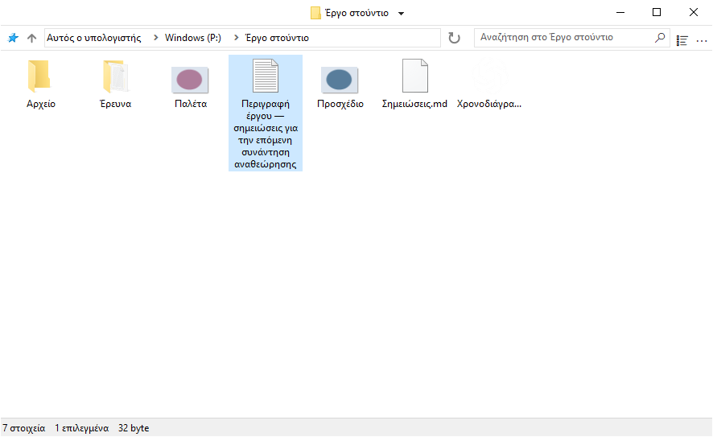
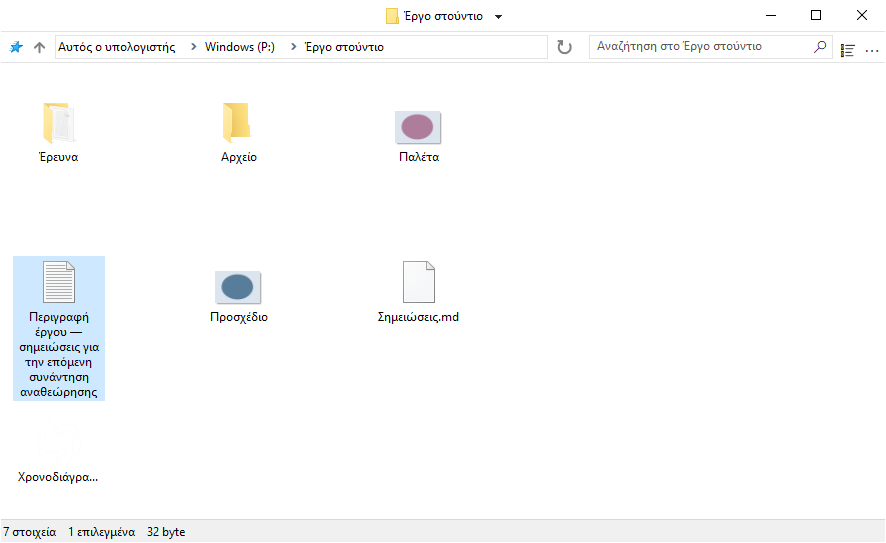
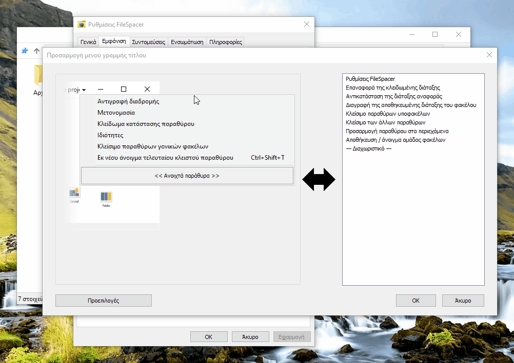
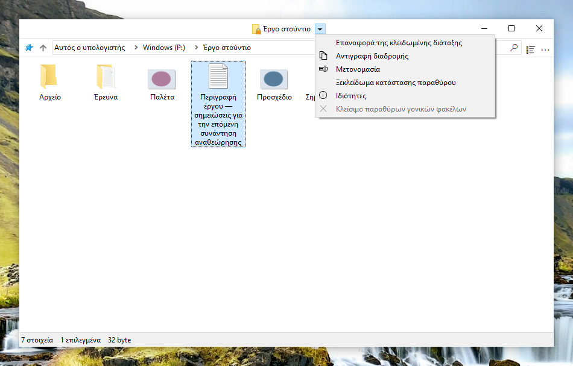
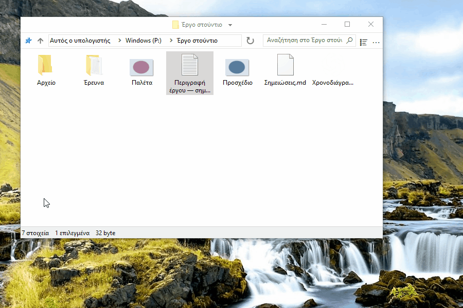
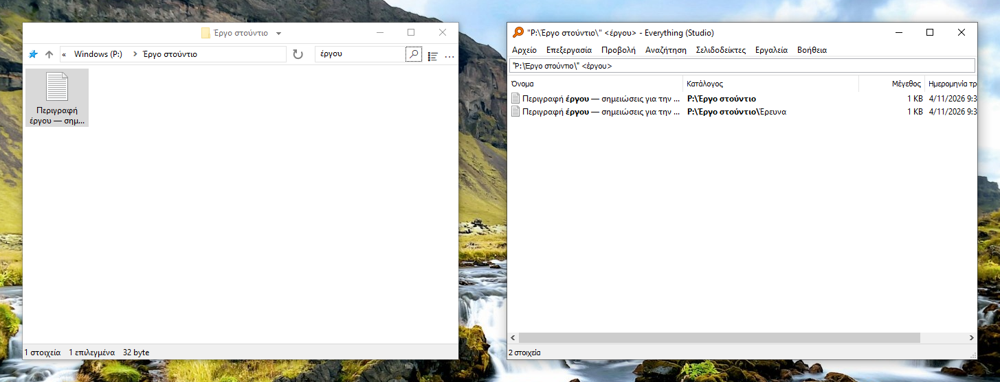
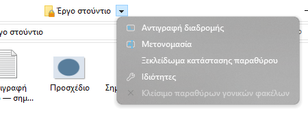
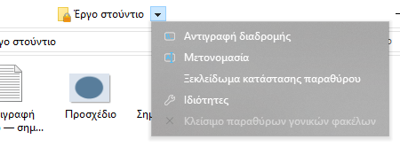
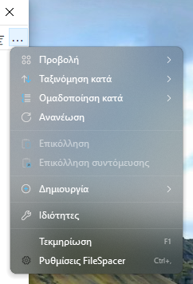

# Χρήση του FileSpacer

Το FileSpacer θυμάται τη θέση και την εμφάνιση κάθε παραθύρου από το ένα άνοιγμα στο επόμενο. Οι φάκελοι επιστρέφουν στη γνώριμη θέση τους και αναγνωρίζονται εύκολα, όπως αντικείμενα τοποθετημένα σε ένα γραφείο. Προσφέρει επίσης ρυθμιζόμενες συντομεύσεις, γρήγορες ενέργειες και ένα λιτό, προσαρμόσιμο περιβάλλον εργασίας.

Το FileSpacer μπορεί να οριστεί ως προεπιλεγμένη εφαρμογή διαχείρισης αρχείων κατά την εγκατάσταση ή από τις **Ρυθμίσεις > Ενσωμάτωση**, με την επιλογή **Ορισμό ως προεπιλεγμένης εφαρμογής διαχείρισης αρχείων**. Το μενού περιβάλλοντος των φακέλων προσφέρει **Άνοιγμα στο FileSpacer** ή **Άνοιγμα στην Εξερεύνηση αρχείων των Windows** όταν το FileSpacer είναι η προεπιλογή.

## Πλοήγηση και διάταξη παραθύρων

**Κάθε φάκελος έχει το δικό του παράθυρο.** Αν είναι ήδη ανοιχτός, το FileSpacer φέρνει το παράθυρό του στο προσκήνιο. Η θέση, το μέγεθος, η προβολή και η διάταξη των εικονιδίων διατηρούνται ακόμη και μετά τη μετακίνηση ή τη μετονομασία του φακέλου. Τα παράθυρα χωρίς αποθηκευμένη θέση τοποθετούνται με περιορισμένη επικάλυψη (επιλογή στις **Ρυθμίσεις > Γενικά**).

**Η τρέχουσα θέση, το μέγεθος και η προβολή ενός φακέλου μπορούν να κλειδωθούν ώστε να επανέρχονται σε κάθε άνοιγμα.** Οι επόμενες αλλαγές παραμένουν προσωρινές. Οι θέσεις των εικονιδίων συνεχίζουν να αποθηκεύονται. Η **κλειδωμένη διάταξη μπορεί να επανέλθει** χωρίς να κλείσει το παράθυρο.

Η επιλογή **Ξεκλείδωμα κατάστασης παραθύρου** διατηρεί την τρέχουσα διάταξη και επιτρέπει ξανά την αποθήκευση αλλαγών.

Το κλείδωμα ενεργοποιείται στις **Ρυθμίσεις > Γενικά**. Έπειτα εμφανίζεται η εντολή **Κλείδωμα κατάστασης παραθύρου** δίπλα στον τίτλο του φακέλου. Ένα λουκέτο στο εικονίδιο υποδεικνύει το κλείδωμα. Η απενεργοποίηση της λειτουργίας καταργεί όλα τα κλειδώματα.

Το άνοιγμα ενός φακέλου ή του γονικού του φακέλου κλείνει από προεπιλογή το παράθυρο προέλευσης. **Κρατώντας πατημένο το Ctrl κατά το άνοιγμα**, το παράθυρο παραμένει ανοιχτό. Η συμπεριφορά ρυθμίζεται στις **Ρυθμίσεις > Γενικά**. Το άνοιγμα πολλών επιλεγμένων φακέλων διατηρεί ανοιχτό το παράθυρο προέλευσης.

Το μενού δίπλα στον τίτλο επιτρέπει την εναλλαγή μεταξύ ανοιχτών φακέλων και το κλείσιμο παραθύρων γονικών φακέλων. Το **Ctrl+Shift+T** ανοίγει ξανά τον τελευταίο κλειστό φάκελο με τη διάταξη και την επιλογή του. Η λίστα συντομεύσεων της γραμμής εργασιών περιλαμβάνει επίσης πρόσφατα κλειστούς φακέλους και φακέλους καρφιτσωμένους στη Γρήγορη πρόσβαση.

Η επιλογή **Αποθήκευση / άνοιγμα ομάδας φακέλων** στο μενού του τίτλου ανοίγει πολλούς φακέλους μαζί με τις αποθηκευμένες διατάξεις τους.

## Εμφάνιση των περιεχομένων των φακέλων

Εκτός από τις κλασικές προβολές της Εξερεύνησης αρχείων, το FileSpacer επιτρέπει την ελεύθερη τοποθέτηση αρχείων και υποφακέλων στην προβολή εικονιδίων, απενεργοποιώντας την **Αυτόματη τακτοποίηση εικονιδίων**. Μπορούν επίσης να ευθυγραμμιστούν στο πλέγμα.

Από προεπιλογή, οι φάκελοι εμφανίζονται πριν από τα αρχεία, όπως στην Εξερεύνηση αρχείων. Η **Ανάμειξη φακέλων και αρχείων στην ταξινόμηση** στις **Ρυθμίσεις > Εμφάνιση** τα ταξινομεί μαζί, όπως στο [macOS](https://support.apple.com/en-au/guide/mac-help/mchlp1745/27/mac/27) και στο [Linux](https://www.gnu.org/s/coreutils/manual/html_node/Sorting-the-output.html). Ισχύει για Λεπτομέρειες, Λίστα και αυτόματα τακτοποιημένα εικονίδια. Οι εικονικοί φάκελοι και τα συμπιεσμένα αρχεία διατηρούν τη σειρά των Windows.

Στις ίδιες ρυθμίσεις, η **Εμφάνιση πλήρους ονόματος επιλεγμένου αρχείου** επιτρέπει να διαβάζεται ολόκληρο το όνομα στην προβολή εικονιδίων, ακόμη και αν είναι πολύ μεγάλο. Ισχύει όταν είναι επιλεγμένο ένα μόνο αρχείο.

Από προεπιλογή, ένα κλικ στο φόντο ανενεργού παραθύρου καταργεί την επιλογή του, όπως στην Εξερεύνηση αρχείων. Η **Διατήρηση επιλογής με κλικ σε ανενεργό παράθυρο** στις **Ρυθμίσεις > Γενικά** επιτρέπει την ενεργοποίησή του χωρίς απώλεια της επιλογής.

## Προσαρμογή

### Αλλαγή του περιβάλλοντος εργασίας

Το **μενού της γραμμής τίτλου** προσαρμόζεται στις **Ρυθμίσεις > Εμφάνιση > Στοιχεία περιβάλλοντος εργασίας**. Οι εντολές προστίθενται και αναδιατάσσονται με μεταφορά και απόθεση. Για την αφαίρεση μιας καταχώρισης, αρκεί να συρθεί έξω από το μενού.

Οι καταχωρίσεις που διαχειρίζεται το Nilesoft Shell αλλάζουν στη δική του διαμόρφωση, επειδή οι κανόνες του έχουν προτεραιότητα έναντι του FileSpacer ([δείτε την ενσωμάτωση παρακάτω](#nilesoft-shell)).

Μπορούν να οριστούν **χειρονομίες ποντικιού για τη μετακίνηση ή την αλλαγή μεγέθους ενός παραθύρου** απευθείας από τα περιεχόμενά του, ακόμη και με σύρσιμο πάνω σε αρχείο. Προεπιλογές:

| Ενέργεια | Χειρονομία |
| --- | --- |
| Μετακίνηση | Alt + σύρσιμο με το αριστερό κουμπί |
| Αλλαγή μεγέθους | Alt + σύρσιμο με το δεξί κουμπί |

Η επιλογή διατηρείται και το Esc ακυρώνει τη χειρονομία. Οι συντομεύσεις προσαρμόζονται στις **Ρυθμίσεις > Συντομεύσεις**. Το αριστερό και το δεξί κουμπί απαιτούν Alt. Το μεσαίο μπορεί να χρησιμοποιηθεί μόνο του.

### Ενσωμάτωση

Το [Everything](https://www.voidtools.com/) είναι εργαλείο αναζήτησης που βρίσκει γρήγορα αρχεία και φακέλους με βάση το όνομά τους. Το FileSpacer επιτρέπει την εκκίνησή του από το πεδίο αναζήτησης ενός φακέλου. Η ενσωμάτωση ενεργοποιείται στις **Ρυθμίσεις > Ενσωμάτωση**, με αυτόματο εντοπισμό ή επιλογή φορητής έκδοσης.

Η **Αναζήτηση στο Everything** εκτελεί [την αναζήτηση](https://www.voidtools.com/support/everything/searching/) στον φάκελο και στους υποφακέλους του ή σε όλα τα [αρχεία του ευρετηρίου](https://www.voidtools.com/support/everything/indexes/) με την επιλογή **Παντού**. Τα αποτελέσματα ανοίγουν στο Everything. Για εικονικούς φακέλους, επιλέγεται Παντού. Η επιτυχής εκκίνηση καθαρίζει το πεδίο και το τοπικό φίλτρο του FileSpacer.

Το [Nilesoft Shell](https://nilesoft.org/) είναι επέκταση των Windows για την προσαρμογή της εμφάνισης και των εντολών των μενού περιβάλλοντος. Αν χρησιμοποιείται, μπορεί να διαχειρίζεται και τα μενού του FileSpacer.

Το FileSpacer συνθέτει το μενού της γραμμής τίτλου και έπειτα το Nilesoft Shell εφαρμόζει τους κανόνες του, που έχουν προτεραιότητα. Οι οπτικές ρυθμίσεις και η πρόσβαση στις ενέργειες του FileSpacer περιγράφονται στην [αναφορά διαμόρφωσης](nilesoft-shell.md).

Συνιστώνται τετράγωνες γωνίες για τα μενού της γραμμής τίτλου και της γραμμής εργαλείων.

**Μενού πλοήγησης**

| Προεπιλεγμένες γωνίες | Προτεινόμενες ορθές γωνίες |
| --- | --- |
|  |  |

**Κύριο μενού (…)**

| Προεπιλεγμένες γωνίες | Προτεινόμενες ορθές γωνίες |
| --- | --- |
|  |  |

Το [PowerToys](https://learn.microsoft.com/el-gr/windows/powertoys/) περιλαμβάνει βοηθητικά εργαλεία της Microsoft για την επέκταση και την προσαρμογή των Windows.

Το **Peek** εμφανίζει προεπισκοπήσεις αρχείων. Στο FileSpacer, η **Προεπισκόπηση με Διάστημα** στις **Ρυθμίσεις > Ενσωμάτωση** το ανοίγει με το Διάστημα. Το Peek πρέπει να είναι ενεργό στο PowerToys. Ελάχιστη έκδοση: 0.96 ή 0.102 για πολλαπλή επιλογή.

Το **Grab And Move** μετακινεί και αλλάζει το μέγεθος παραθύρων από την περιοχή περιεχομένων τους. Όταν είναι ενεργό, οι αντίστοιχες χειρονομίες του FileSpacer αναστέλλονται, ακόμη κι αν το PowerToys είναι κλειστό. Για να διατηρηθούν, το `FileSpacer.exe` μπορεί να εξαιρεθεί στο Grab And Move ή το εργαλείο να απενεργοποιηθεί.

## Ενημερώσεις και αντιμετώπιση προβλημάτων

Οι **Ρυθμίσεις > Πληροφορίες** επιτρέπουν τον έλεγχο ενημερώσεων και την ενεργοποίηση εβδομαδιαίων ελέγχων, που είναι απενεργοποιημένοι από προεπιλογή. Η λήψη και η εγκατάσταση απαιτούν επιβεβαίωση.

Στην ίδια σελίδα, η **Συντήρηση > Επαναφορά κατάστασης όλων των φακέλων** κλείνει τα παράθυρα και διαγράφει τις διατάξεις, το ιστορικό και τα κλειδώματά τους. Τα αρχεία και οι γενικές προτιμήσεις διατηρούνται.

Η επαναφορά προτιμήσεων και η αντιμετώπιση πιο σύνθετων προβλημάτων περιγράφονται στην [τεχνική σημείωση](../en/README.md#local-data), στα αγγλικά.

## Προστασία προσωπικών δεδομένων

Το FileSpacer δεν περιλαμβάνει τηλεμετρία, παρακολούθηση χρήσης ή διαφημίσεις. Οι αναφορές σφαλμάτων δεν αποστέλλονται ποτέ αυτόματα. Η κοινοποίησή τους είναι προαιρετική και μπορεί να αποκαλύψει διαδρομές αρχείων ή τμήματα μνήμης.

Οι ενημερώσεις επικοινωνούν με το GitHub, το οποίο λαμβάνει τη διεύθυνση IP και την έκδοση της εφαρμογής, αλλά όχι διαδρομές αρχείων ή καταστάσεις φακέλων.

Τα διαπιστευτήρια των μονάδων δικτύου τα διαχειρίζονται απευθείας τα Windows. Το FileSpacer δεν τα διαβάζει ούτε τα αποθηκεύει.

Μια αναζήτηση Everything στέλνει το ερώτημα και, όταν περιορίζεται σε φάκελο, τη διαδρομή του στην τοπική εφαρμογή Everything.
