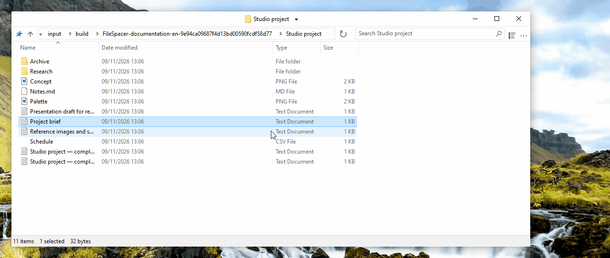

# Using FileSpacer

FileSpacer remembers each window’s position and appearance between visits. Folders return to their familiar places, like objects arranged on a desk. It also offers configurable shortcuts, quick actions and an uncluttered, customizable interface.

FileSpacer can be set as the default file manager during installation, or under **Settings > Integration** with **Set as default browser**. Folder context menus offer **Open in FileSpacer**, or **Open in Windows File Explorer** when FileSpacer is the default.

## Window navigation and layout

**Each folder has its own window.** If it is already open, FileSpacer brings that window forward. Position, size, view settings, icon layout and scroll position are remembered, even after moving or renaming the folder. Windows without a saved position are placed to limit overlap (option under **Settings > General**).

**A folder’s current position, size and view settings can be locked to restore them whenever it is reopened.** Later changes are temporary. Icon positions continue to be saved. The **locked layout can be restored** without closing the window.

**Unlock window state** keeps the current layout and allows changes to be saved again.

Enable locking under **Settings > General**. The same settings let you customize the padlock on the left of the title bar and enable clicking it to lock or unlock the window state. The command can also be [added to the title-bar menu](#customize-the-title-bar-menu). Turning off the feature removes all locks and hides the padlock.

Opening a folder or its parent closes the source window by default. **Hold Ctrl while opening** to keep it open. This behavior can be changed under **Settings > General**. Opening several selected folders keeps the source window open.

The menu beside the title switches between open folders and closes parent windows. **Ctrl+Shift+T** reopens the last closed folder with its layout and selection. The taskbar Jump List also provides recently closed folders and folders pinned in Quick access.

**Save / recall a folder group** in the title menu reopens several folders together with their saved layouts.

## Folder contents and display

FileSpacer lets you arrange a folder’s contents on a grid, as in File Explorer, or freely, as on the Windows desktop. Free placement is available at every icon size and in **Tiles** view. **List** and **Details** views do not support free placement. To choose their positions, turn off **Auto arrange icons**. Alignment to the grid remains available. The **View** menu in each window gives quick access to icon settings, including those specific to FileSpacer.

In **Details** view, columns can automatically fill the entire window width. Allow this under **Settings > Display**, then enable or disable it for each folder from its **View** menu.

**Live updates** are also available in the settings and can make resizing less smooth. As a precaution, avoid enabling them with more than a few dozen files.

By default, folders are grouped before files, as in File Explorer. **Mix folders and files when sorting** under **Settings > Display** sorts them together, as on [macOS](https://support.apple.com/en-au/guide/mac-help/mchlp1745/27/mac/27) and [Linux](https://www.gnu.org/s/coreutils/manual/html_node/Sorting-the-output.html). This applies to Details, List and automatically arranged Icons views. Virtual folders and archives keep Windows’ ordering.

In the same settings, **Show the full name of a selected file** makes the entire name readable in Icons view, even when it is very long. It applies when a single file is selected.

By default, clicking the background of an inactive window clears its selection, as in File Explorer. **Keep the current selection when clicking an inactive window** under **Settings > General** activates it without losing the selection.

## Customization

### Changing the interface

Customize the **title-bar menu** under **Settings > Display > Interface elements**. Drag and drop commands to add or reorder them. Drag an entry out of the menu to remove it.

Entries managed by Nilesoft Shell are changed in its configuration because its rules take priority over FileSpacer’s ([see its integration below](#nilesoft-shell)).

**Mouse shortcuts can be configured to move or resize a window** directly from its contents, including by dragging over a file. Defaults:

| Action | Shortcut |
| --- | --- |
| Move | Alt + left-button drag |
| Resize | Alt + right-button drag |

If files are selected, the selection is preserved. Escape cancels the action. Customize shortcuts under **Settings > Shortcuts**. The left and right buttons require Alt. The middle button can be used alone.

### Integration

[Everything](https://www.voidtools.com/) is a search tool that quickly finds files and folders by name. FileSpacer can launch it from a folder’s search field. Enable this integration under **Settings > Integration**, with automatic detection or a portable version selected manually.

**Search in Everything** runs [the search](https://www.voidtools.com/support/everything/searching/) in the folder and its subfolders, or across all [indexed files](https://www.voidtools.com/support/everything/indexes/) with **Everywhere**. Results open in Everything. Choose Everywhere for virtual folders. A successful launch clears FileSpacer’s search field and local filter.

[Nilesoft Shell](https://nilesoft.org/) is a Windows extension for customizing the appearance and commands of context menus. If used, it can also manage FileSpacer’s menus.

FileSpacer builds the title-bar menu, then Nilesoft Shell applies its rules, which take priority. See the [configuration reference](nilesoft-shell.md) for visual settings and access to FileSpacer actions.

[Square corners](nilesoft-shell.md#recommended-menu-appearance) are recommended for title-bar and toolbar menus.

**Navigation menu**

| Default corners | Recommended square corners |
| --- | --- |
|  |  |

**Main menu**

| Default corners | Recommended square corners |
| --- | --- |
|  |  |

[PowerToys](https://learn.microsoft.com/en-us/windows/powertoys/) is a collection of Microsoft utilities for extending and customizing Windows.

**Peek** previews files. In FileSpacer, **Preview with Space** under **Settings > Integration** opens it with Space. Peek must be enabled in PowerToys. Minimum version: 0.96, or 0.102 for multiple selection.

**Grab And Move** moves and resizes windows from their contents. When enabled, FileSpacer’s equivalent gestures are suspended even if PowerToys is closed. To keep them available, exclude `FileSpacer.exe` in Grab And Move or turn off that tool.

## Updates and troubleshooting

**Settings > About** provides update checks and optional weekly checks, which are off by default. Downloading and installing require confirmation.

On the same page, **Maintenance > Reset all folder state** closes windows and clears their layouts, history and locks. Files and general preferences are preserved.

Preference resets and advanced troubleshooting are covered in the [technical note](README.md#local-data).

## Privacy

FileSpacer has no telemetry, usage tracking or advertising. Crash reports are never sent automatically. Sharing them is optional and may reveal file paths or portions of memory.

Updates contact GitHub, which receives the IP address and application version, but no file paths or folder state.

Network-drive credentials are handled directly by Windows. FileSpacer neither reads nor stores them.

An Everything search sends the query and, when limited to a folder, its path to the local Everything application.
