# Using FileSpacer

## Window navigation

FileSpacer offers a fluid, understated and customizable interface built around the spatial paradigm:

- **One folder, one window.** Reopening an already-open folder brings its window forward. Its position, size, view settings and icon layout are remembered, even after moving or renaming the folder.
- Opening a folder or its parent closes the source window by default. Ctrl reverses this once; the default can be changed in **Settings > General**. Opening several selected folders keeps the source window open.
- The menu beside the folder title switches between open folders. **Close Parent Windows** closes its open ancestors.
- **Ctrl+Shift+T** reopens the last closed folder with its layout and selection. The title menu and taskbar Jump List offer the same command; the latter can go further back through closed folders.
- The taskbar Jump List also opens folders pinned in File Explorer's Quick access.

Going to a parent does not select the folder just left. An already-open parent keeps its selection.

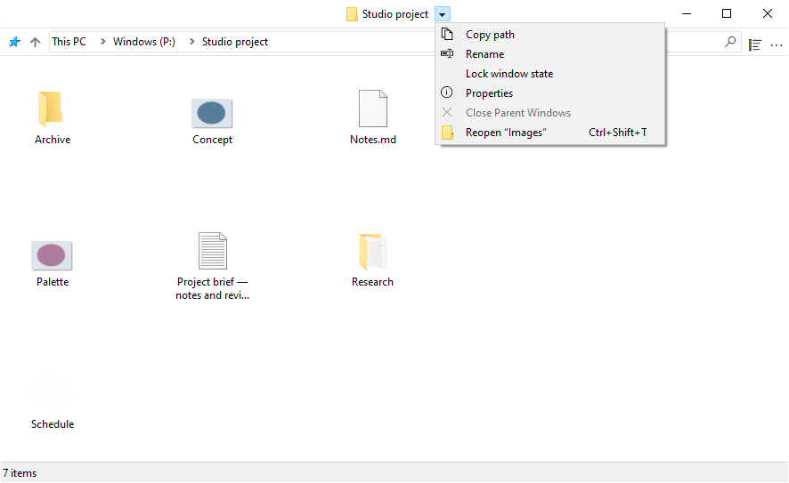

## View and layout

### Icon layout

Icon views allow free placement of files and subfolders when **Auto arrange icons** is off. Icon positions are saved independently of window geometry, including when the window's saved layout is locked.

### View options

**Show the full name of a selected file**, in **Settings > Display**, makes the name of a single selected file fully readable in Icons view.

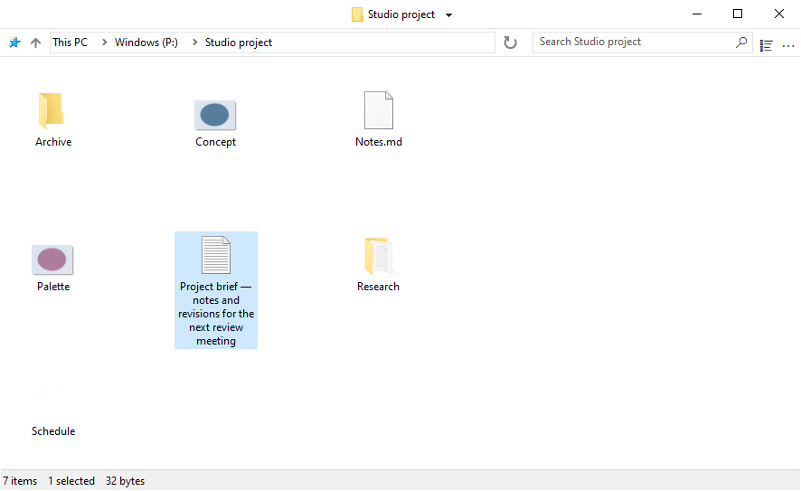

**Preview display modes in the View menu** shows each mode on hover. Clicking keeps it; Escape or leaving the preview restores the initial view. The preview is temporary and does not replace the saved layout.

**Mix folders and files when sorting** sorts both together, as on [macOS](https://support.apple.com/en-au/guide/mac-help/mchlp1745/27/mac/27) and [Linux](https://www.gnu.org/s/coreutils/manual/html_node/Sorting-the-output.html). The option is in **Settings > Display > Files** and applies to Details, List and automatically arranged icon views. Virtual folders and archives keep Windows’ ordering.

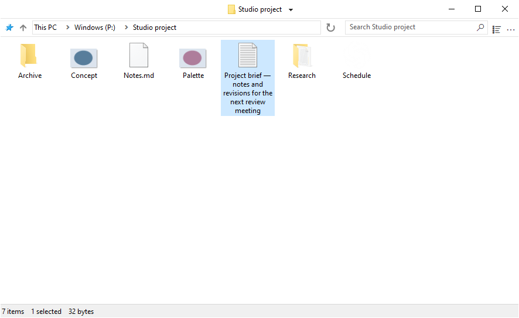

### Window placement

Folders without a saved position open in free space, or with reduced overlap when space runs out. Configure this under **Settings > General > Place new windows in free space**.

### Selection and activation

**Keep the current selection when clicking an inactive window**, in **Settings > General**, lets a background click activate a folder without clearing its selection. A second press starts a selection rectangle.

## Managing windows

### Moving and resizing

A window can be moved or resized by dragging anywhere in its file area, including over an item. The defaults are:

| Action | Shortcut |
| --- | --- |
| Move the window | Alt + left drag |
| Resize from the bottom-right corner | Alt + right drag |

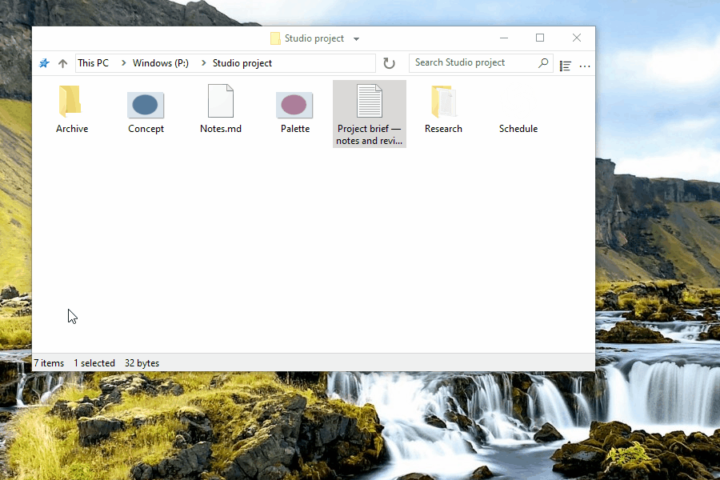

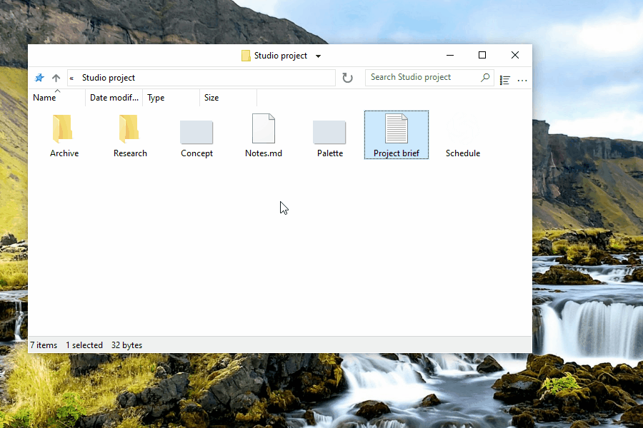

Selection stays intact. Escape cancels the gesture.

Each action has its own configurable shortcut in **Settings > Shortcuts**. Left and right buttons require Alt; the middle button can also be used without it.

### Locking a saved layout

Locking keeps a folder's position, size and view settings as the layout to restore on reopening. The feature is off by default in **Settings > General > Enable window state locking**. Once enabled, **Lock window state** is available beside the folder title. A padlock badge on its folder icon marks a locked layout.


Temporary changes remain possible; reopening restores the locked layout. Individual icon positions still save normally. **Unlock window state** keeps the current layout.

Switching the feature off asks for confirmation and removes all locks, including those on closed folders. Switching it back on does not restore them.

### Customize the title-bar menu

The menu can be customized in **Settings > Display > Interface elements > Customize title bar menu**. Drag an action from the right into the menu, move an entry to reorder it, or drag it outside to remove it.

Entries managed by Nilesoft Shell cannot be changed here because its rules take priority. See [Nilesoft Shell integration](#nilesoft-shell).

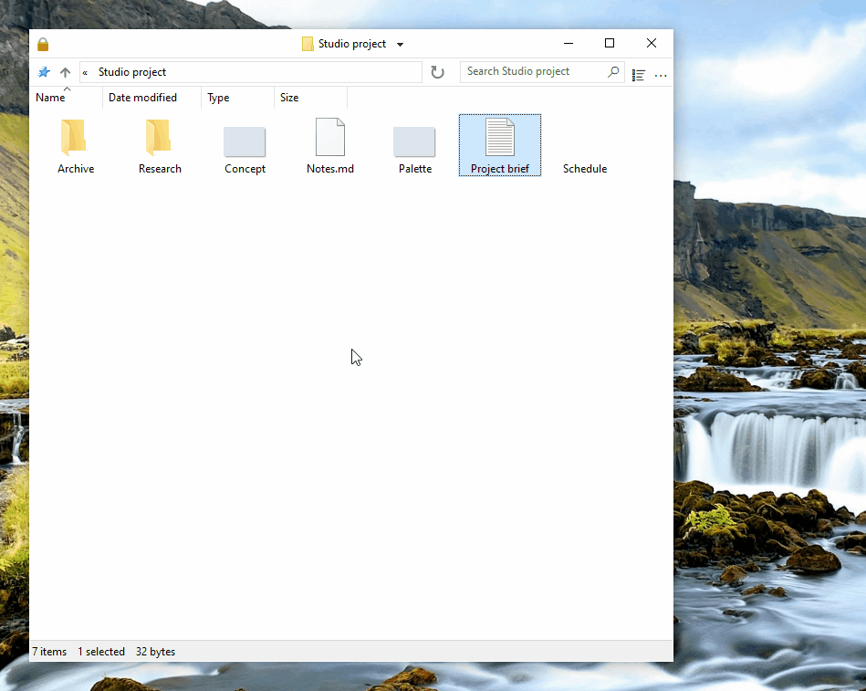

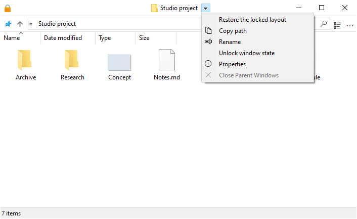

- **Restore the locked layout** returns the window to its reference layout. **Replace the reference layout** saves the current layout as the new locked reference, after confirmation.

- **Forget this folder’s layout** clears its saved layout and lock, preserving search history. Layout saving stays suspended in the current window until it closes; the next opening uses defaults. Locking a new layout resumes saving.

### Folder groups

**Save / recall a folder group** stores the open folders under a name. Recalling the group reopens them with their saved layouts.

## Search and history

Enter all or part of a file or folder name, then press Enter to filter the current folder. **Filter while typing**, in **Settings > General**, applies the filter as text is entered.

The field offers recent searches and, when integration is enabled, **Search in Everything** for an external search. Enter without a selected suggestion applies the local filter. Ctrl+F focuses the field.

History is kept per folder. The number of submitted searches retained is configurable in General settings; 0 clears and disables history. [Everything](#everything) can search subfolders or all indexed files.

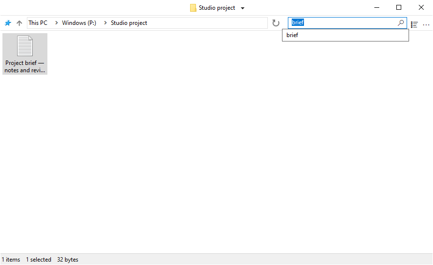

## Integration

### Windows integration

FileSpacer can be set as the default file manager during installation or later in **Settings > Integration** with **Set as default browser**. **Reset default browser** returns folder opening to File Explorer.

The folder context menu offers **Open in FileSpacer**, or **Open in Windows File Explorer** when FileSpacer is the default. This also works on drives, ZIP folders, network locations and folder backgrounds, without requiring a change of default application.

**File Explorer options** opens shared folder preferences, some of which affect FileSpacer too.

### PowerToys Grab And Move

When Grab And Move is enabled in PowerToys settings, FileSpacer’s move and resize gestures are suspended for the affected windows, even if PowerToys is not running.

To keep using FileSpacer’s gestures, add `FileSpacer.exe` to Grab And Move’s excluded apps, or turn that utility off in PowerToys.

### PowerToys Peek

**Preview with Space**, in **Settings > Integration**, opens a Peek preview of selected files or folders with **Space** alone. The option is off by default.

Peek must also be enabled in PowerToys. This integration requires PowerToys 0.96 or later, and 0.102 or later for multiple selections.

### Everything

An existing [Everything](https://www.voidtools.com/) installation can be integrated to run advanced searches from FileSpacer's search field. Results open in Everything.

Enable the option in **Settings > Integration**, with automatic Everything detection or manual selection of a portable copy. The scope is the current folder and its subfolders, or **Everywhere**; virtual folders require Everywhere.

Selecting **Search in Everything** runs the external search using Everything’s syntax. A successful launch clears FileSpacer’s field and local filter.

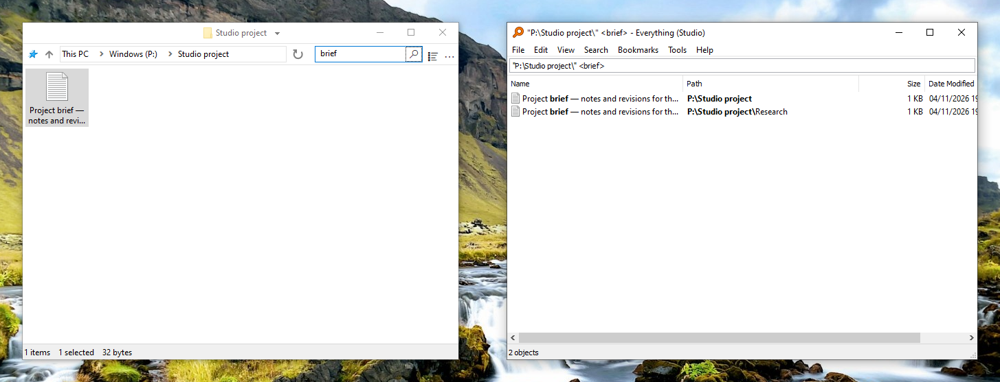

### Nilesoft Shell

[Nilesoft Shell](https://nilesoft.org/) can style FileSpacer's menus and customize their commands. Adapting its configuration is recommended for a consistent appearance, particularly square corners on the title-bar and toolbar menus.

FileSpacer composes the title-bar menu first. Nilesoft Shell then applies its rules, which can rename, move, hide or add commands and therefore take priority. Entries shown in gray in the editor are changed in Nilesoft Shell’s configuration files.

FileSpacer actions can be used in Nilesoft Shell’s configuration. The [configuration reference](nilesoft-shell.md) lists settings and action IDs. For example, using the `filespacer_title` condition defined there:

```nss
item(type='*' mode='multiple' where=filespacer_title
     title='Restore the locked layout' cmd=window.command(1123))
```

The Modern theme below compares its default corners with the recommended square corners.

**Navigation menu**

| Default corners | Recommended square corners |
| --- | --- |
|  | 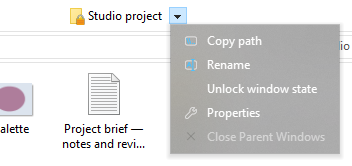 |

**Main menu (…)**

| Default corners | Recommended square corners |
| --- | --- |
|  | 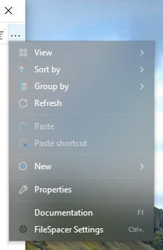 |

## Settings and updates

Ctrl+, opens Settings; F1 opens the offline guide. The interface follows Windows’ display language; a language change needs a restart.

Check for updates in **Settings > About**, where optional weekly checks can also be enabled. They are off by default. Downloading and installing require confirmation. Afterwards, previously open folders return with their saved layouts.

## Local data

Layouts, locks, histories and preferences are stored locally. See the [technical troubleshooting note](README.md#local-data) for storage locations.

**Settings > About > Maintenance > Reset all folder state** closes folder windows and clears their saved layouts, history and locks. Files and general preferences are preserved.

For troubleshooting, `FileSpacer.exe /reset-options` resets general preferences; `/reset-all` also clears saved folder state. These commands preserve files.

## Privacy

FileSpacer has no telemetry, usage tracking or advertising. Crash reports are not sent automatically. Any diagnostic reports stay in `%LOCALAPPDATA%\FileSpacer`; sharing them is optional and may reveal file paths or parts of process memory.

Update checks and downloads contact GitHub over HTTPS. GitHub receives the usual connection information, including the IP address and application version, but no folder state, file paths or diagnostic reports.

Network-drive credentials are entered and handled by Windows, as in File Explorer. FileSpacer does not read or store them. Choosing an Everything search passes the query and, for a folder-scoped search, its path to the local Everything application.
