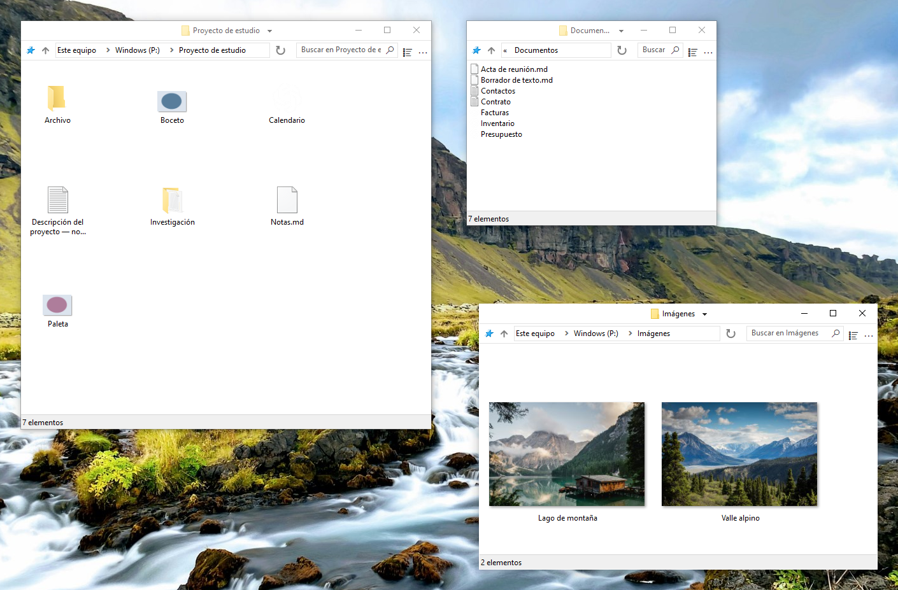

    

# FileSpacer

 &emsp;

FileSpacer es un gestor de archivos para Windows basado en el [paradigma espacial](https://en.wikipedia.org/wiki/Spatial_file_manager): cada carpeta tiene una única ventana que recuerda su posición, tamaño y opciones de visualización. Esto crea [referencias visuales estables](https://www.csse.canterbury.ac.nz/~andy/papers/transforms.pdf) y permite que la [memoria espacial](https://www.microsoft.com/en-us/research/wp-content/uploads/1998/01/p153-robertson.pdf) te ayude a reconocer las carpetas habituales de un vistazo. En un gestor de archivos basado en la navegación, una misma ventana muestra distintas carpetas sucesivamente: su posición y sus dimensiones no bastan para identificar la carpeta abierta, y tienes que mirar su contenido para saber dónde estás. Al conservar referencias distintas para cada carpeta, el enfoque espacial puede reducir el esfuerzo necesario para orientarte entre tus archivos. Las pestañas son incompatibles con el modelo espacial y no se añadirán nunca.

FileSpacer da prioridad a una experiencia ligera y despejada. Para limitar la acumulación de ventanas, un inconveniente conocido del paradigma espacial, FileSpacer cierra de forma predeterminada la ventana de origen al abrir una carpeta. Mantén pulsada Ctrl al abrirla para conservar la ventana de origen cuando quieras trabajar con varias carpetas a la vez. FileSpacer mantiene una interfaz deliberadamente sobria, a diferencia de ciertas interfaces recargadas que dejan justo el espacio entre botones para entrever un archivo.

**Sistema e idiomas:** Windows 10 o posterior, x64. Disponible en diez idiomas: inglés, francés, alemán, italiano, español, portugués (Portugal), griego, polaco, neerlandés y ucraniano.

**Privacidad:** **Sin telemetría, seguimiento del uso ni publicidad.** Las comprobaciones de actualizaciones contactan con GitHub. Las semanales son opcionales y están desactivadas de forma predeterminada. La descarga y la instalación requieren confirmación. [Privacidad](user-guide.md#privacidad).

**Instalación:**

- **Instalación manual:** descargar y ejecutar <a href="https://github.com/LeBenco/FileSpacer/releases/download/v1.3.2/FileSpacer-1.3.2-install.exe" id="last-release-url">el instalador de la última versión</a>.
- **WinGet:** `winget install --id Benco.FileSpacer --exact`
- **Chocolatey** (terminal como administrador): `choco install filespacer -y`

Los paquetes de WinGet y Chocolatey están pendientes de aprobación en sus respectivos catálogos.

**Documentación:**

_FileSpacer es una bifurcación de [ChromaFiler](https://github.com/vanjac/chromafiler), creado originalmente por J. van’t Hoog. Consulta los [agradecimientos](#licencia-y-agradecimientos) más abajo para conocer los detalles._

## Funciones

- **[Una ventana por carpeta](user-guide.md#navegación-entre-ventanas)**. Se guardan la posición, el tamaño, el modo de vista y las posiciones de los iconos. Los iconos se pueden colocar libremente o alinear con la [cuadrícula clásica](user-guide.md#disposición-de-iconos).
- **Organización automática de las ventanas**. Al abrir otra carpeta, la ventana de origen se cierra de forma predeterminada. Las ventanas sin una posición guardada se colocan [limitando la superposición](user-guide.md#colocación-de-ventanas).
- **Gestionar las ventanas**. Mover o cambiar el tamaño de las ventanas mediante [gestos del ratón](user-guide.md#movimiento-y-cambio-de-tamaño). Guardar y volver a abrir [grupos de carpetas](user-guide.md#grupos-de-carpetas). [Bloquear la disposición de las ventanas](user-guide.md#bloqueo-del-estado-guardado).

## Integración

FileSpacer se puede establecer como gestor de archivos predeterminado durante la instalación o después, en la configuración. Los archivos se abren con su aplicación habitual de Windows. Las carpetas de red siguen el funcionamiento de Windows. [Integración con Windows](user-guide.md#integración-con-windows).

Con **Everything** se pueden lanzar búsquedas avanzadas desde el campo de FileSpacer, en la carpeta actual y sus subcarpetas o en todos los archivos indexados. Los resultados se abren en Everything. [Integración y uso](user-guide.md#everything).

Con **Nilesoft Shell**, los menús de FileSpacer pueden usar sus temas y comandos personalizados. Se recomienda adaptar la configuración para lograr una apariencia coherente. [Integración y configuración](user-guide.md#nilesoft-shell).

## Compilación

La compilación usa MSVC/NMAKE, Visual Studio 2022 Build Tools con ATL y un Windows SDK, Inkscape e ImageMagick. El instalador requiere NSIS. SQLite está incluido. Consulta la [guía de compilación](../en/build.md).

Las pruebas de regresión combinan escenarios PowerShell con herramientas C++ y C# para las comprobaciones internas y las pruebas reales de la interfaz de Windows y del shell. El [workflow de regresión de GitHub Actions](https://github.com/LeBenco/FileSpacer/actions/workflows/regression.yml) ejecuta esta suite de la aplicación a petición y automáticamente antes de una publicación. Los mismos casos pueden ejecutarse con `tests.cmd` en un escritorio Windows local o en una VM Hyper-V configurada. La [guía de pruebas](../en/tests/regression/README.md) explica la selección de casos, los requisitos y los resultados.

## Licencia y agradecimientos

### Derechos de autor y licencia
FileSpacer se distribuye bajo la licencia . 
Copyright © 2026 Benco por las modificaciones de FileSpacer. La licencia completa se encuentra en [LICENSE](../../LICENSE) en el código fuente, o en `LICENSE.txt` en la carpeta de instalación. FileSpacer se proporciona sin garantía. Su redistribución y modificación están permitidas según las condiciones de esa licencia.

### Origen del proyecto y agradecimientos
FileSpacer es una bifurcación de [ChromaFiler](https://github.com/vanjac/chromafiler), creado por J. van’t Hoog (vanjac). ¡Muchas gracias a vanjac por esta base! Código original de ChromaFiler © 2023 J. van’t Hoog.

### Avisos sobre componentes de terceros
Consulta los [avisos sobre componentes de terceros](THIRD_PARTY_NOTICES.md) y la [política de privacidad](privacy-policy.md).
