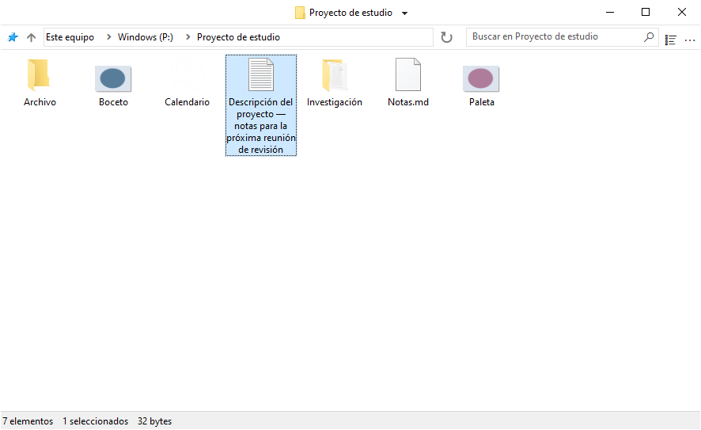
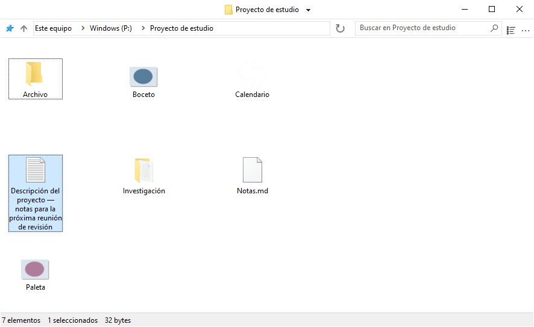
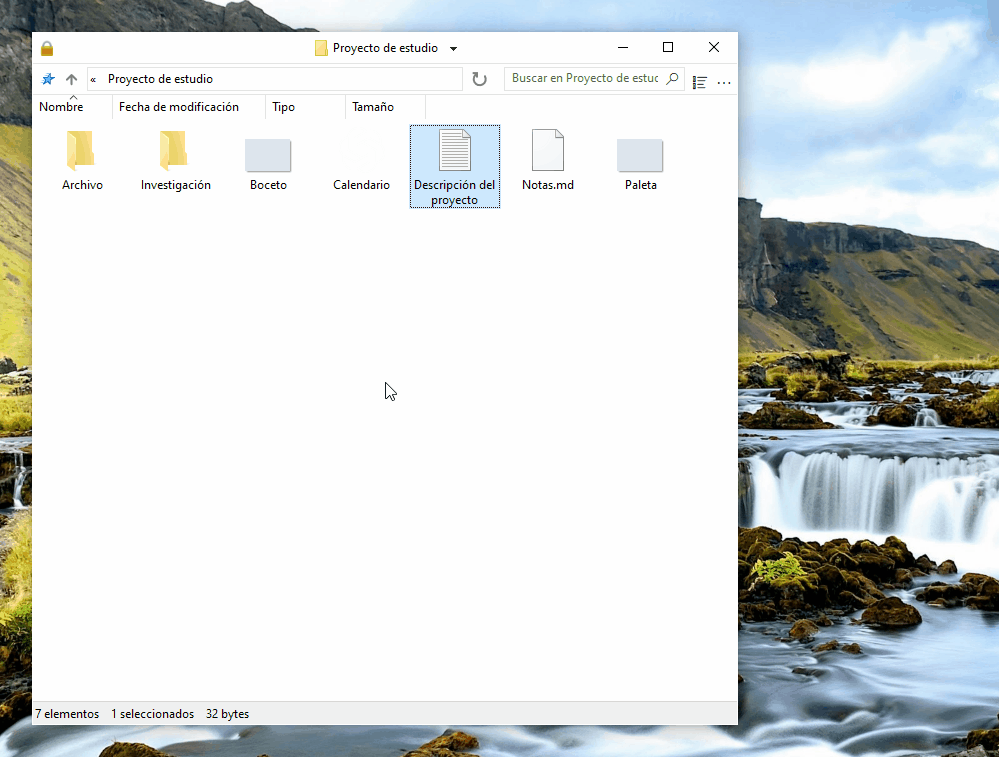
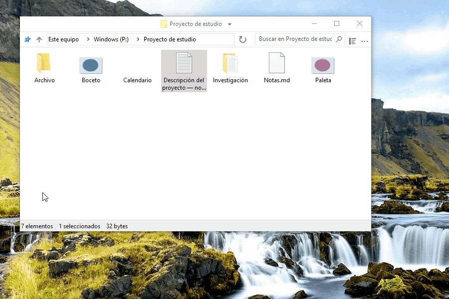
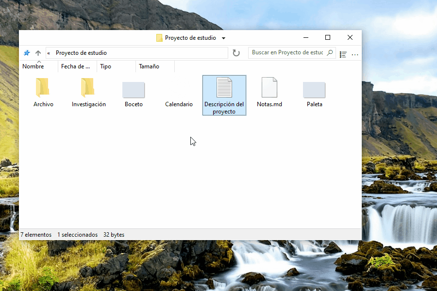

# Usar FileSpacer

FileSpacer recuerda la posición y el aspecto de cada ventana entre aperturas. Las carpetas vuelven a su lugar y resultan reconocibles, como objetos colocados sobre un escritorio. También ofrece atajos configurables, acciones rápidas y una interfaz despejada y personalizable.

FileSpacer se puede definir como gestor de archivos predeterminado durante la instalación o en **Configuración > Integración**, con **Establecer como explorador predeterminado**. El menú contextual de las carpetas ofrece **Abrir en FileSpacer**, o **Abrir en el Explorador de archivos de Windows** cuando FileSpacer es el predeterminado.

## Navegación y disposición de las ventanas

**Cada carpeta tiene su propia ventana.** Si ya está abierta, FileSpacer la trae al primer plano. La posición, el tamaño, la vista, la disposición de los iconos y la posición de desplazamiento se conservan incluso al mover o cambiar de nombre la carpeta. Las ventanas sin una posición guardada se colocan limitando la superposición (opción en **Configuración > General**).

**Se pueden bloquear la posición, el tamaño y la vista actuales de una carpeta para recuperarlos cada vez que se abra.** Los cambios posteriores son temporales. Las posiciones de los iconos siguen guardándose. Se puede **restaurar la disposición bloqueada** sin cerrar la ventana.

**Desbloquear el estado de la ventana** conserva su disposición actual y permite volver a guardar los cambios.

El bloqueo se activa en **Configuración > General**. Después aparece **Bloquear el estado de la ventana** junto al título de la carpeta. Un candado en el icono indica el bloqueo. Desactivar la función elimina todos los bloqueos.

Abrir una carpeta o su carpeta superior cierra de forma predeterminada la ventana de origen. **Mantener pulsada Ctrl al abrirla** permite dejarla abierta. Este comportamiento se configura en **Configuración > General**. Abrir varias carpetas seleccionadas mantiene abierta la ventana de origen.

El menú junto al título permite cambiar entre carpetas abiertas y cerrar las ventanas de las carpetas superiores. **Ctrl+Mayús+T** vuelve a abrir la última carpeta cerrada con su disposición y selección. La lista de accesos directos de la barra de tareas también incluye carpetas cerradas recientemente y ancladas en Acceso rápido.

**Guardar / abrir un grupo de carpetas**, en el menú del título, permite recuperar varias carpetas juntas con sus disposiciones guardadas.

## Visualización del contenido de las carpetas

FileSpacer permite distribuir los elementos de una carpeta en una cuadrícula, como en el Explorador de archivos, o libremente, como en el escritorio de Windows. La colocación libre está disponible con cualquier tamaño de icono y en la vista **Mosaicos**. Las vistas **Lista** y **Detalles** no permiten esta colocación libre. Para elegir sus posiciones, desactivar **Organizar iconos automáticamente**. La alineación con la cuadrícula sigue disponible. El menú **Vista** de cada ventana permite acceder rápidamente a los ajustes de los iconos, incluidas las opciones propias de FileSpacer.

De forma predeterminada, las carpetas se agrupan antes que los archivos, como en el Explorador de archivos. **Mezclar carpetas y archivos al ordenar**, en **Configuración > Visualización**, los ordena juntos, como en [macOS](https://support.apple.com/en-au/guide/mac-help/mchlp1745/27/mac/27) y [Linux](https://www.gnu.org/s/coreutils/manual/html_node/Sorting-the-output.html). Se aplica a Detalles, Lista e Iconos organizados automáticamente. Las carpetas virtuales y los archivos comprimidos mantienen el orden de Windows.

En la misma configuración, **Mostrar el nombre completo del archivo seleccionado** permite leer el nombre entero en la vista Iconos, aunque sea muy largo. Se aplica cuando hay un solo archivo seleccionado.

De forma predeterminada, hacer clic en el fondo de una ventana inactiva borra su selección, como en el Explorador de archivos. **Mantener la selección al hacer clic en una ventana inactiva**, en **Configuración > General**, permite activarla sin perder la selección.

## Personalización

### Modificar la interfaz

El **menú de la barra de título** se personaliza en **Configuración > Visualización > Elementos de la interfaz**. Los comandos se añaden y reorganizan arrastrándolos. Para quitar una entrada, arrastrarla fuera del menú.

Las entradas gestionadas por Nilesoft Shell se modifican en su configuración, ya que sus reglas tienen prioridad sobre las de FileSpacer ([ver su integración más abajo](#nilesoft-shell)).

Se pueden configurar **gestos del ratón para mover o cambiar el tamaño de una ventana** directamente desde su contenido, incluso arrastrando sobre un archivo. Por defecto:

| Acción | Gesto |
| --- | --- |
| Mover | Alt + arrastrar con el botón izquierdo |
| Cambiar tamaño | Alt + arrastrar con el botón derecho |

La selección se conserva y Esc cancela el gesto. Los atajos se personalizan en **Configuración > Métodos abreviados**. Los botones izquierdo y derecho requieren Alt. El central se puede usar solo.

### Integración

[Everything](https://www.voidtools.com/) es una herramienta de búsqueda que encuentra rápidamente archivos y carpetas por su nombre. FileSpacer permite iniciarla desde el campo de búsqueda de una carpeta. La integración se activa en **Configuración > Integración**, con detección automática o elección de una versión portátil.

**Buscar en Everything** inicia [la búsqueda](https://www.voidtools.com/support/everything/searching/) en la carpeta y sus subcarpetas, o en todos los [archivos indexados](https://www.voidtools.com/support/everything/indexes/) con **En todas partes**. Los resultados se abren en Everything. Para las carpetas virtuales, elegir En todas partes. Si se inicia correctamente, se vacían el campo y el filtro local de FileSpacer.

[Nilesoft Shell](https://nilesoft.org/) es una extensión de Windows que permite personalizar el aspecto y los comandos de los menús contextuales. Si se utiliza, también puede gestionar los menús de FileSpacer.

FileSpacer compone el menú de la barra de título y después Nilesoft Shell aplica sus reglas, que tienen prioridad. La [referencia de configuración](nilesoft-shell.md) describe los ajustes visuales y el acceso a las acciones de FileSpacer.

Se recomiendan [esquinas rectas](nilesoft-shell.md#recommended-menu-appearance) en los menús de la barra de título y de la barra de herramientas.

**Menú de navegación**

| Esquinas predeterminadas | Esquinas rectas recomendadas |
| --- | --- |
|  |  |

**Menú principal**

| Esquinas predeterminadas | Esquinas rectas recomendadas |
| --- | --- |
|  |  |

[PowerToys](https://learn.microsoft.com/es-es/windows/powertoys/) reúne utilidades de Microsoft para ampliar y personalizar Windows.

**Peek** muestra una vista previa de los archivos. En FileSpacer, **Vista previa con Espacio**, en **Configuración > Integración**, permite abrirla con Espacio. Peek debe estar activado en PowerToys. Versión mínima: 0.96, o 0.102 para selección múltiple.

**Grab And Move** permite mover y cambiar el tamaño de las ventanas desde su contenido. Cuando está activado, los gestos equivalentes de FileSpacer se suspenden aunque PowerToys esté cerrado. Para conservarlos, excluir `FileSpacer.exe` en Grab And Move o desactivar la herramienta.

## Actualizaciones y solución de problemas

**Configuración > Acerca de** permite buscar actualizaciones y activar las comprobaciones semanales, desactivadas por defecto. La descarga y la instalación requieren confirmación.

En la misma página, **Mantenimiento > Restablecer el estado de todas las carpetas** cierra las ventanas y elimina sus disposiciones, historiales y bloqueos. Se conservan los archivos y las preferencias generales.

El restablecimiento de las preferencias y la solución avanzada de problemas se explican en la [nota técnica](../en/README.md#local-data), en inglés.

## Privacidad

FileSpacer no incluye telemetría, seguimiento de uso ni publicidad. Nunca se envían informes de errores automáticamente. Compartirlos es opcional y puede revelar rutas de archivos o fragmentos de memoria.

Las actualizaciones contactan con GitHub, que recibe la dirección IP y la versión de la aplicación, pero no rutas de archivos ni estados de carpetas.

Windows gestiona directamente las credenciales de las unidades de red. FileSpacer no las lee ni las guarda.

Una búsqueda de Everything envía la consulta y, si se limita a una carpeta, su ruta a la aplicación local de Everything.
