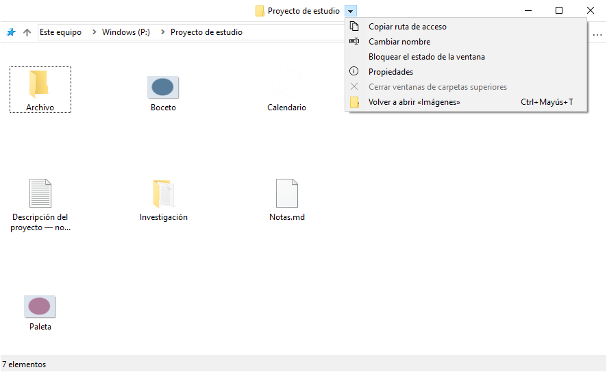
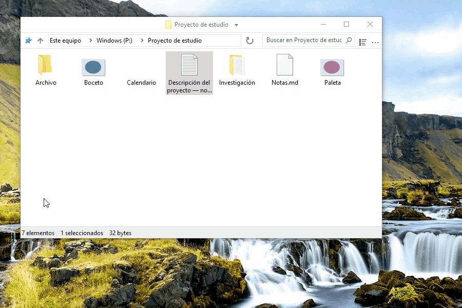
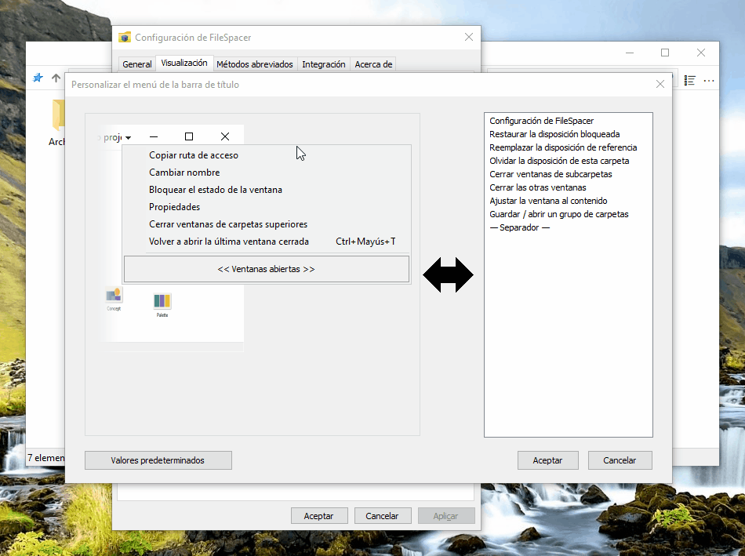
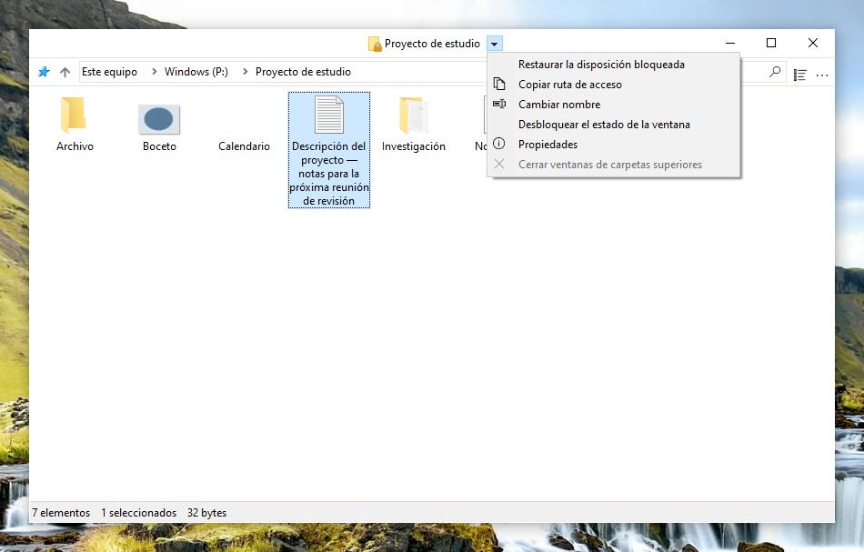
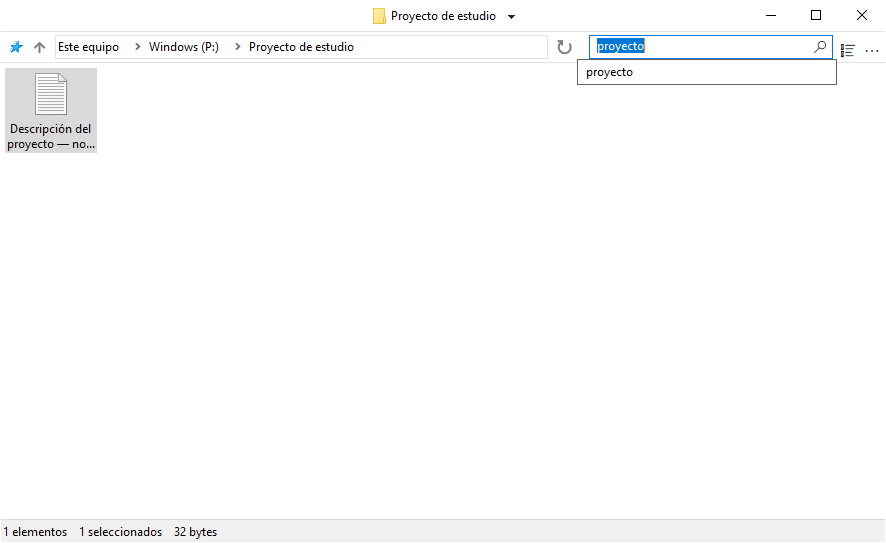
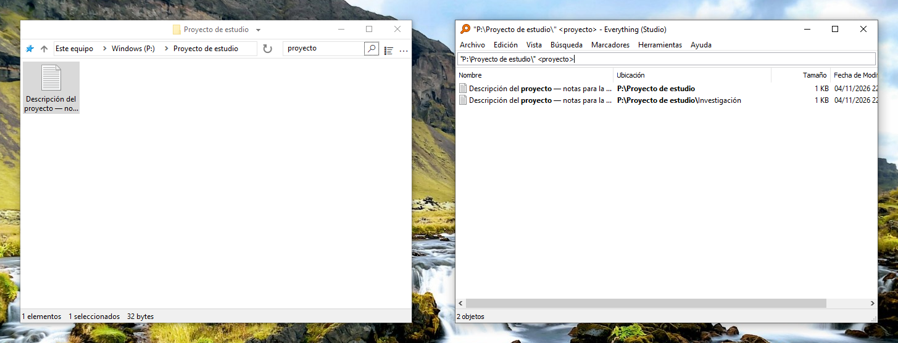
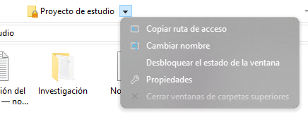
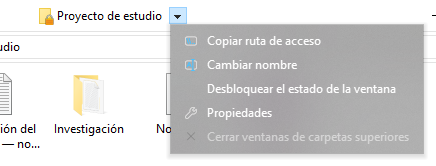
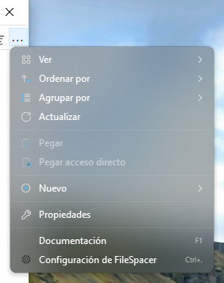
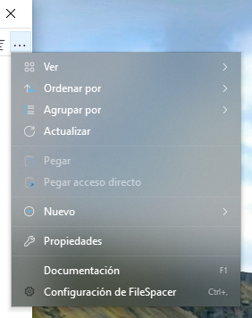

# Usar FileSpacer

## Navegación entre ventanas

FileSpacer ofrece una interfaz fluida, sobria y personalizable, basada en el paradigma espacial:

- **Una carpeta, una ventana.** Volver a abrir una carpeta ya abierta trae su ventana al primer plano. Su posición, tamaño, vista y disposición de iconos se recuerdan incluso después de mover o cambiar el nombre de la carpeta.
- Abrir una carpeta o su carpeta superior cierra de forma predeterminada la ventana de origen. Mantén pulsada Ctrl para invertir este comportamiento una vez, o cambia la opción en **Configuración > General**. Abrir varias carpetas seleccionadas conserva la ventana de origen.
- El menú junto al título permite cambiar entre carpetas abiertas. **Cerrar ventanas de carpetas superiores** cierra las ventanas abiertas de sus carpetas superiores.
- **Ctrl+Mayús+T** vuelve a abrir la última carpeta cerrada con su disposición y selección. El comando también está en el menú del título y en la lista de accesos directos de la barra de tareas; esta última permite recuperar cierres anteriores.
- La lista de accesos directos de la barra de tareas también abre las carpetas ancladas a Acceso rápido en el Explorador de archivos.

Subir a la carpeta superior no selecciona la carpeta de la que vienes. Una carpeta superior que ya está abierta conserva su selección.



## Visualización y disposición

### Disposición de iconos

En una vista de iconos puedes colocar libremente archivos y subcarpetas cuando **Organizar iconos automáticamente** está desactivado. Sus posiciones se guardan de forma independiente del tamaño y la posición de la ventana, incluso cuando su estado guardado está bloqueado.

### Opciones de visualización

**Mostrar el nombre completo del archivo seleccionado**, en **Configuración > Visualización**, permite leer íntegramente el nombre de un único archivo seleccionado en la vista de iconos.


**Vista previa de los modos de presentación en el menú Vista** muestra cada modo al pasar el puntero. Un clic lo conserva; Esc o salir de la vista previa restaura la vista inicial. La vista previa es temporal y no sustituye la disposición guardada.

**Mezclar carpetas y archivos al ordenar** los ordena juntos, como en [macOS](https://support.apple.com/en-au/guide/mac-help/mchlp1745/27/mac/27) y [Linux](https://www.gnu.org/s/coreutils/manual/html_node/Sorting-the-output.html). La opción está en **Configuración > Visualización > Archivos** y se aplica a Detalles, Lista e iconos organizados automáticamente. Las carpetas virtuales y los archivos comprimidos conservan el orden de Windows.


### Colocación de ventanas

Las carpetas sin posición guardada se abren en el espacio libre o con una superposición reducida si falta espacio. Esta función se configura en **Configuración > General > Colocar ventanas nuevas en espacios libres**.

### Selección y activación

Con **Configuración > General > Mantener la selección al hacer clic en una ventana inactiva** activado, hacer clic en el fondo de una carpeta inactiva activa su ventana sin borrar la selección. Pulsa una segunda vez para iniciar un rectángulo de selección.

## Gestión de ventanas

### Movimiento y cambio de tamaño

Las ventanas se pueden mover o redimensionar arrastrando desde el área de archivos, incluso sobre un elemento. Los métodos abreviados predeterminados son:

| Acción | Método abreviado |
| --- | --- |
| Mover la ventana | Alt + arrastrar con el botón izquierdo |
| Cambiar el tamaño desde la esquina inferior derecha | Alt + arrastrar con el botón derecho |




La selección se conserva. Esc cancela el gesto.

Cada acción tiene su propia combinación configurable en **Configuración > Métodos abreviados**. Los botones izquierdo y derecho requieren Alt; el central también funciona sin Alt.

### Bloqueo del estado guardado

El bloqueo conserva la posición, el tamaño y la vista de una carpeta para la próxima apertura. Está desactivado de forma predeterminada en **Configuración > General > Habilitar el bloqueo del estado de ventana**. Una vez activado, **Bloquear el estado de la ventana** aparece junto al título. Un candado sobre el icono de la carpeta señala el bloqueo.


Se permiten cambios temporales; al volver a abrir la carpeta se recupera el estado bloqueado. Las posiciones individuales de los iconos se siguen guardando. **Desbloquear el estado de la ventana** conserva la disposición actual.

Desactivar la función pide confirmación y elimina todos los bloqueos, incluidos los de carpetas cerradas. Volver a activarla no los restaura.

### Personalizar el menú de la barra de título

El menú se personaliza en **Configuración > Visualización > Elementos de la interfaz > Personalizar el menú de la barra de título**. Arrastrar una acción desde la lista de la derecha al menú, mover una entrada para cambiar su orden o arrastrarla fuera para quitarla.

Las entradas gestionadas por Nilesoft Shell no se pueden modificar aquí, ya que sus reglas tienen prioridad. Véase la [integración con Nilesoft Shell](#nilesoft-shell).





- **Restaurar la disposición bloqueada** devuelve la ventana a su disposición de referencia. **Reemplazar la disposición de referencia** guarda la disposición actual como nueva referencia bloqueada, tras confirmarlo.

- **Olvidar la disposición de esta carpeta** borra la disposición guardada y el bloqueo, conservando el historial de búsquedas. El guardado queda suspendido en la ventana actual hasta que se cierre; la siguiente apertura usa los valores predeterminados. Bloquear una nueva disposición reactiva el guardado.

### Grupos de carpetas

**Guardar / abrir un grupo de carpetas** guarda las carpetas abiertas con un nombre. Recuperar el grupo las vuelve a abrir con sus disposiciones guardadas.

## Búsqueda e historial

Escribe todo o parte del nombre de un archivo o carpeta y pulsa Entrar para filtrar la carpeta actual. **Configuración > General > Filtrar mientras se escribe** aplica el filtro a medida que se escribe.

El campo ofrece búsquedas recientes y, si la integración está activada, **Buscar en Everything** para una búsqueda externa. Entrar sin una sugerencia seleccionada aplica el filtro local. Ctrl+F activa el campo.

Cada carpeta tiene su propio historial. El número de búsquedas confirmadas que se conservan se configura en los ajustes generales; 0 vacía y desactiva el historial. [Everything](#everything) permite buscar en las subcarpetas o en todos los archivos indexados.



## Integración

### Integración con Windows

FileSpacer se puede establecer como gestor de archivos predeterminado durante la instalación o después, en **Configuración > Integración**, con **Establecer como explorador predeterminado**. **Restaurar Explorador de archivos predeterminado** devuelve la apertura de carpetas al Explorador de archivos.

El menú contextual de las carpetas ofrece **Abrir en FileSpacer**, o **Abrir en el Explorador de archivos de Windows** cuando FileSpacer es el predeterminado. También funciona en unidades, carpetas ZIP, ubicaciones de red y fondos de carpetas, sin exigir un cambio de aplicación predeterminada.

**Opciones del Explorador de archivos** abre las preferencias compartidas de las carpetas; algunas también afectan a FileSpacer.

### PowerToys Grab And Move

Cuando Grab And Move está activado en la configuración de PowerToys, se suspenden los gestos de FileSpacer para mover y cambiar el tamaño de las ventanas afectadas, aunque PowerToys esté cerrado.

Para seguir usando los gestos de FileSpacer, añadir `FileSpacer.exe` a las aplicaciones excluidas de Grab And Move o desactivar esa utilidad en PowerToys.

### PowerToys Peek

**Vista previa con Espacio**, en **Configuración > Integración**, abre una vista previa Peek de los archivos o carpetas seleccionados pulsando solo **Espacio**. La opción está desactivada de forma predeterminada.

Peek también debe estar activado en PowerToys. La integración requiere PowerToys 0.96 o posterior, y 0.102 o posterior para selecciones múltiples.

### Everything

Una instalación existente de [Everything](https://www.voidtools.com/) se puede integrar para lanzar búsquedas avanzadas desde el campo de FileSpacer. Los resultados se abren en Everything.

La opción se activa en **Configuración > Integración**, con detección automática de Everything o selección manual de una copia portátil. El ámbito es la carpeta actual y sus subcarpetas, o **En todas partes**; las carpetas virtuales requieren En todas partes.

**Buscar en Everything** inicia la búsqueda externa con la sintaxis de Everything. Si se inicia correctamente, se borran el campo y el filtro local de FileSpacer.



### Nilesoft Shell

[Nilesoft Shell](https://nilesoft.org/) puede dar formato a los menús de FileSpacer y personalizar sus comandos. Se recomienda adaptar su configuración para lograr una apariencia coherente, sobre todo con esquinas rectas en los menús de la barra de título y de herramientas.

FileSpacer compone primero el menú de la barra de título. Después, Nilesoft Shell aplica sus reglas, que pueden cambiar el nombre, mover, ocultar o añadir comandos y, por tanto, tienen prioridad. Las entradas en gris del editor se modifican en los archivos de configuración de Nilesoft Shell.

Las acciones de FileSpacer pueden usarse en la configuración de Nilesoft Shell. La [referencia de configuración](nilesoft-shell.md) recoge los ajustes y los identificadores de las acciones. Ejemplo con la condición `filespacer_title` definida allí:

```nss
item(type='*' mode='multiple' where=filespacer_title
     title='Restaurar la disposición bloqueada' cmd=window.command(1123))
```

El tema Modern de abajo compara sus esquinas predeterminadas con las esquinas rectas recomendadas.

**Menú de navegación**

| Esquinas predeterminadas | Esquinas rectas recomendadas |
| --- | --- |
|  |  |

**Menú principal (…)**

| Esquinas predeterminadas | Esquinas rectas recomendadas |
| --- | --- |
|  |  |

## Configuración y actualizaciones

Ctrl+, abre Configuración; F1 abre la guía sin conexión. La interfaz sigue el idioma de visualización de Windows; un cambio de idioma requiere reiniciar la aplicación.

Las actualizaciones se buscan en **Configuración > Acerca de**, donde también pueden activarse las comprobaciones semanales opcionales, desactivadas de forma predeterminada. La descarga y la instalación requieren confirmación. Después se vuelven a abrir las carpetas anteriores con sus disposiciones guardadas.

## Datos locales

Las disposiciones, los bloqueos, los historiales y las preferencias se guardan localmente. Las ubicaciones de almacenamiento figuran en la [nota técnica de solución de problemas](../en/README.md#local-data) (en inglés).

**Configuración > Acerca de > Mantenimiento > Restablecer el estado de todas las carpetas** cierra las ventanas de carpetas y borra sus disposiciones, historiales y bloqueos guardados. Conserva los archivos y las preferencias generales.

Para solucionar problemas, `FileSpacer.exe /reset-options` restablece las preferencias generales; `/reset-all` borra también el estado guardado de las carpetas. Estos comandos conservan los archivos.

## Privacidad

FileSpacer no incluye telemetría, seguimiento del uso ni publicidad. Los informes de errores no se envían automáticamente. Los posibles informes de diagnóstico permanecen en `%LOCALAPPDATA%\FileSpacer`; compartirlos es opcional y puede revelar rutas de archivos o partes de la memoria del proceso.

Las comprobaciones de actualizaciones y las descargas contactan con GitHub mediante HTTPS. GitHub recibe la información habitual de conexión, como la dirección IP y la versión de la aplicación, pero ningún estado de carpeta, ruta de archivo ni informe de diagnóstico.

Windows recoge y gestiona las credenciales de las unidades de red, igual que en el Explorador de archivos. FileSpacer no las lee ni las almacena. Una búsqueda en Everything envía la consulta y, si está limitada a una carpeta, su ruta a la aplicación Everything local.
