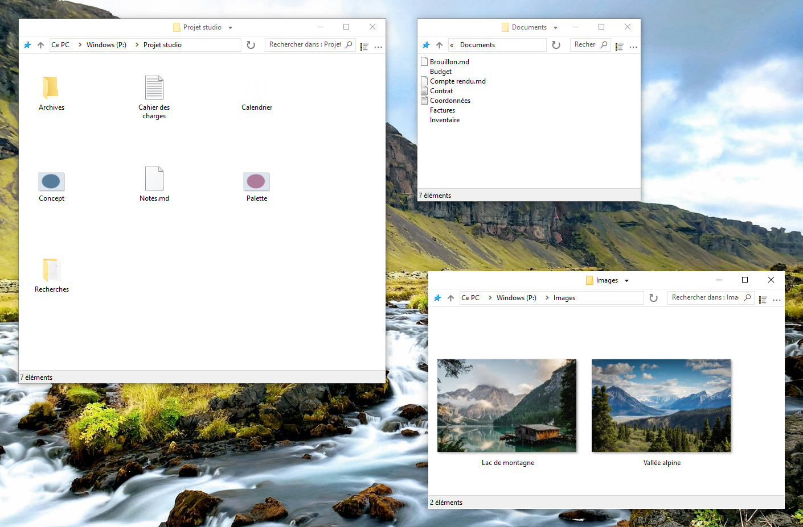

    

# FileSpacer

 &emsp;

FileSpacer est un gestionnaire de fichiers pour Windows fondé sur le [paradigme spatial](https://en.wikipedia.org/wiki/Spatial_file_manager) : chaque dossier possède une seule fenêtre, qui mémorise sa position, sa taille et ses réglages d’affichage. Cela crée des [repères visuels stables](https://www.csse.canterbury.ac.nz/~andy/papers/transforms.pdf) et permet à la [mémoire spatiale](https://www.microsoft.com/en-us/research/wp-content/uploads/1998/01/p153-robertson.pdf) d’aider à reconnaître les dossiers familiers d’un coup d’œil. Dans un gestionnaire de fichiers par navigation, une même fenêtre affiche successivement différents dossiers : sa position et ses dimensions ne suffisent donc pas à identifier le dossier ouvert. Il faut regarder son contenu pour savoir où l’on se trouve. En conservant des repères distincts pour chaque dossier, l’approche spatiale peut alléger l’effort nécessaire pour se retrouver parmi ses fichiers. Les onglets sont incompatibles avec le modèle spatial et ne seront jamais ajoutés.

FileSpacer privilégie une expérience légère et épurée. Pour limiter l’accumulation des fenêtres, un inconvénient connu du paradigme spatial, FileSpacer ferme par défaut la fenêtre source à l’ouverture d’un dossier. Maintenir Ctrl pendant l’ouverture permet de la conserver pour travailler avec plusieurs dossiers à la fois. FileSpacer conserve une interface délibérément sobre, contrairement à certaines interfaces surchargées qui laissent juste assez de place entre les boutons pour entrevoir un fichier.

**Système et langues :** Windows 10 ou version ultérieure, x64. Disponible en dix langues : anglais, français, allemand, italien, espagnol, portugais (Portugal), grec, polonais, néerlandais et ukrainien.

**Confidentialité :** **Aucune télémétrie, aucun suivi d’usage ni publicité.** Les vérifications de mises à jour contactent GitHub ; les vérifications hebdomadaires sont facultatives et désactivées par défaut. Téléchargement et installation demandent confirmation. [Confidentialité](user-guide.md#confidentialité).

**Documentation :**

_FileSpacer est un dérivé de [ChromaFiler](https://github.com/vanjac/chromafiler), créé à l’origine par J. van’t Hoog. Voir les [crédits](#licence-et-crédits) ci-dessous pour plus de détails._

## Fonctionnalités

- **Une fenêtre unique par dossier**, réactivée si le dossier est déjà ouvert. Sa position, sa taille, ses réglages d’affichage et la disposition des icônes sont conservés d’une ouverture à l’autre. [Navigation spatiale](user-guide.md#navigation-entre-les-fenêtres).
- **Disposer les icônes librement**, avec une disposition enregistrée et restaurée pour chaque dossier. [Disposition des icônes](user-guide.md#disposition-des-icônes).
- **Déplacer et redimensionner les fenêtres** depuis la zone des fichiers en conservant la sélection. Les raccourcis souris sont configurables ; par défaut, Alt + glisser gauche et Alt + glisser droit. [Gestes de fenêtre](user-guide.md#déplacement-et-redimensionnement).
- **Passer d’un dossier ouvert à l’autre** depuis le menu de la barre de titre, fermer les fenêtres parentes ou rouvrir la dernière fenêtre fermée avec Ctrl+Maj+T. [Navigation entre les fenêtres](user-guide.md#navigation-entre-les-fenêtres).
- **Verrouiller l’état enregistré d’une fenêtre**, tout en permettant des changements temporaires de position, de taille et d’affichage. [Verrouillage de l’état des fenêtres](user-guide.md#verrouillage-de-létat-enregistré).
- **Filtrer le dossier courant** et réutiliser ses recherches récentes. [Recherche et historique](user-guide.md#recherche-et-historique).
- **Conserver la sélection à l’activation d’une fenêtre** en cliquant sur son arrière-plan. [Sélection et activation](user-guide.md#sélection-et-activation).
- **Réduire le chevauchement des fenêtres** lors de l’ouverture de dossiers sans position enregistrée. [Placement des fenêtres](user-guide.md#placement-des-fenêtres).
- **Personnaliser le menu de la barre de titre** avec des actions sur les fenêtres et leur disposition, et enregistrer des groupes de dossiers ouverts. [Personnalisation du menu](user-guide.md#personnaliser-le-menu-de-la-barre-de-titre) · [Groupes de dossiers](user-guide.md#groupes-de-dossiers).

## Intégration

FileSpacer peut être défini comme gestionnaire de fichiers par défaut à l’installation ou ensuite dans les paramètres. Les fichiers s’ouvrent avec leur application Windows habituelle ; les dossiers réseau suivent le fonctionnement de Windows. [Intégration Windows](user-guide.md#intégration-windows).

Avec **Everything**, on peut lancer des recherches avancées depuis le champ de FileSpacer, dans le dossier courant et ses sous-dossiers ou dans tous les fichiers indexés. Les résultats s’ouvrent dans Everything. [Intégration et utilisation](user-guide.md#everything).

Avec **Nilesoft Shell**, les menus de FileSpacer peuvent reprendre ses thèmes et ses commandes personnalisées. Une adaptation de sa configuration est recommandée pour une bonne intégration visuelle. [Intégration et configuration](user-guide.md#nilesoft-shell).

## Compilation

La compilation utilise MSVC/NMAKE, Visual Studio 2022 Build Tools avec ATL et un SDK Windows, Inkscape et ImageMagick. NSIS est nécessaire pour l’installeur ; SQLite est inclus. Consultez le [guide de compilation](../en/build.md).

Les tests de non-régression associent des scénarios PowerShell à des outils C++ et C# pour les vérifications internes et les tests réels de l’interface Windows et du Shell. Le [workflow de non-régression GitHub Actions](https://github.com/LeBenco/FileSpacer/actions/workflows/regression.yml) exécute cette suite applicative à la demande et automatiquement avant une publication. Les mêmes cas peuvent être lancés avec `tests.cmd` sur un poste Windows local ou dans une VM Hyper-V configurée. Consultez le [guide des tests](../en/tests/regression/README.md) pour la sélection des cas, les prérequis et les résultats.

## Licence et crédits

### Droits d’auteur et licence
FileSpacer est distribué sous la licence . 
Copyright © 2026 Benco pour les modifications de FileSpacer. La licence complète se trouve dans [LICENSE](../../LICENSE) dans les sources, ou `LICENSE.txt` dans le dossier d’installation. FileSpacer est fourni sans garantie ; sa redistribution et sa modification sont autorisées dans les conditions de cette licence.

### Origine du projet et crédits
FileSpacer est un dérivé de [ChromaFiler](https://github.com/vanjac/chromafiler), créé par J. van’t Hoog (vanjac). Un grand merci à vanjac pour cette base ! Code ChromaFiler d’origine © 2023 J. van’t Hoog.

### Composants tiers
Voir les [mentions des composants tiers](THIRD_PARTY_NOTICES.md) et la [politique de confidentialité](privacy-policy.md).
