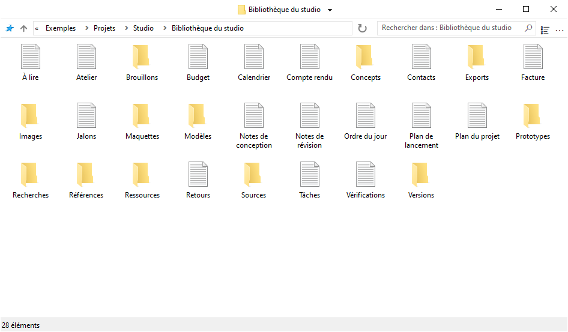
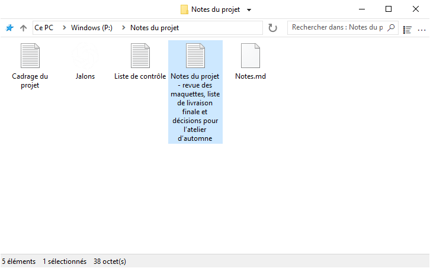
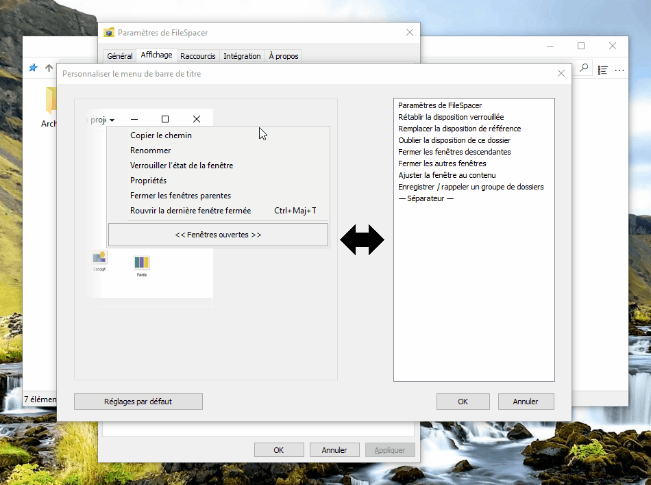
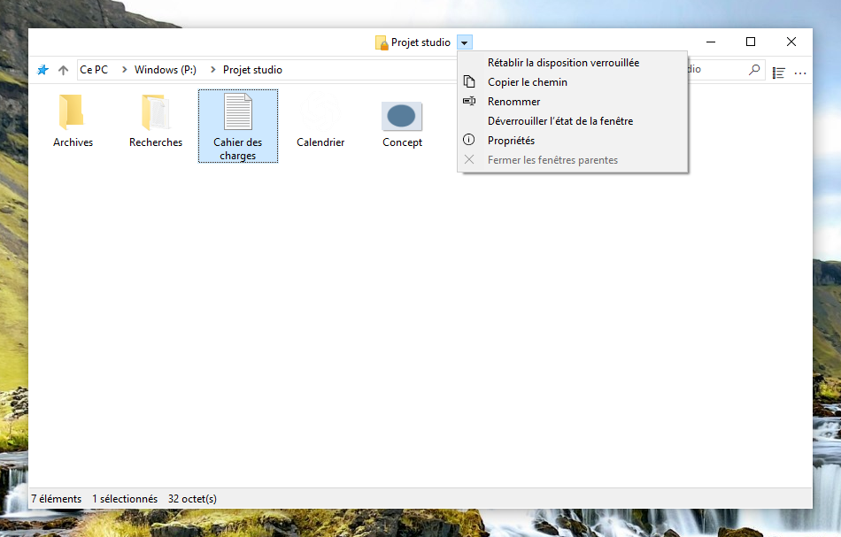
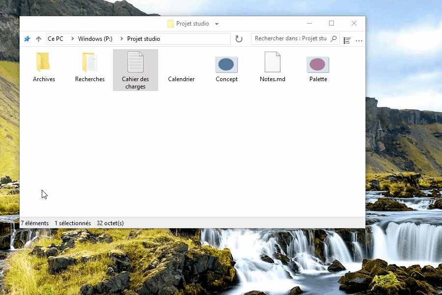
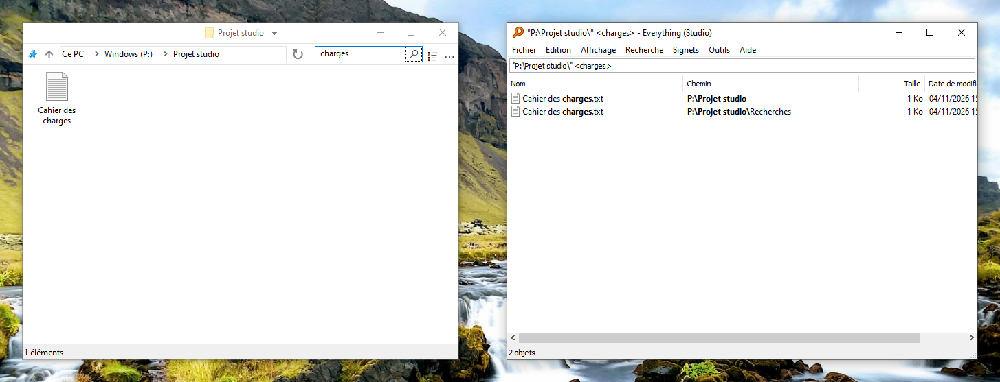
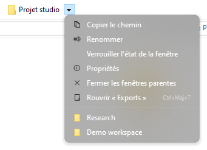
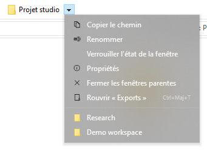
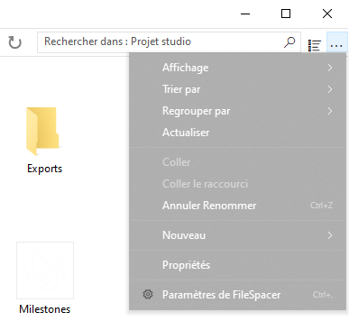

# Utiliser FileSpacer

FileSpacer mémorise la position et l’apparence de chaque fenêtre d’une ouverture à l’autre. Les dossiers retrouvent ainsi leur place et deviennent reconnaissables, à la manière d’objets disposés sur un bureau. Il propose aussi des raccourcis configurables, des actions rapides et une interface épurée et personnalisable.

On peut définir FileSpacer comme gestionnaire de fichiers par défaut lors de l’installation, ou dans **Paramètres > Intégration**, avec **Définir comme explorateur par défaut**. Le menu contextuel des dossiers propose **Ouvrir dans FileSpacer**, ou **Ouvrir dans l’Explorateur de fichiers Windows** lorsque FileSpacer est défini par défaut.

## Navigation et disposition des fenêtres

**Chaque dossier possède sa propre fenêtre.** S’il est déjà ouvert, FileSpacer ramène sa fenêtre au premier plan. Position, taille, affichage et disposition des icônes sont mémorisés, même après déplacement ou renommage du dossier. Les fenêtres sans position mémorisée sont placées en limitant le chevauchement (option dans **Paramètres > Général**).

**On peut verrouiller la position, la taille et l’affichage actuels d’un dossier pour les retrouver à chaque réouverture.** Les modifications faites ensuite restent temporaires. Les positions des icônes continuent de s’enregistrer. On peut par la suite **rétablir la disposition verrouillée** pour retrouver les réglages sauvegardés sans fermer la fenêtre.

**Déverrouiller l’état de la fenêtre** conserve sa disposition actuelle et permet d’enregistrer à nouveau les changements.

La fonction de verrouillage s’active dans **Paramètres > Général**. La commande **Verrouiller l’état de la fenêtre** apparaît ensuite à côté du titre du dossier. Un badge de cadenas signale le verrouillage. Désactiver complètement la fonction supprime tous les verrouillages.

Ouvrir un dossier ou son parent ferme par défaut la fenêtre source. **Maintenir Ctrl pendant l’ouverture** permet de la conserver. Ce comportement se règle dans **Paramètres > Général**. L’ouverture de plusieurs dossiers sélectionnés garde la fenêtre source ouverte.

Le menu à côté du titre permet de passer entre les dossiers ouverts et de fermer les fenêtres parentes. **Ctrl+Maj+T** rouvre le dernier dossier fermé avec sa disposition et sa sélection. La liste de raccourcis de la barre des tâches retrouve aussi les dossiers fermés récemment et ceux épinglés dans l’Accès rapide.

**Enregistrer / rappeler un groupe de dossiers**, dans le menu du titre, permet de retrouver ensemble plusieurs dossiers avec leurs dispositions enregistrées.

## Affichage du contenu des dossiers

En plus des modes d’affichage classiques de l’Explorateur de fichiers, FileSpacer permet de disposer librement les fichiers et sous-dossiers en mode Icônes, en désactivant **Réorganiser automatiquement les icônes**. Ils peuvent aussi être alignés sur la grille.

Par défaut, les dossiers sont regroupés avant les fichiers, comme dans l’Explorateur de fichiers. **Mélanger les dossiers et les fichiers dans le tri**, dans **Paramètres > Affichage**, les classe ensemble, comme sous [macOS](https://support.apple.com/en-au/guide/mac-help/mchlp1745/27/mac/27) et [Linux](https://www.gnu.org/s/coreutils/manual/html_node/Sorting-the-output.html). L’option concerne les modes Détails, Liste et Icônes réorganisées automatiquement. Les dossiers virtuels et les archives gardent l’ordre de Windows.

Dans les mêmes paramètres, **Afficher le nom complet d’un fichier sélectionné** permet de lire entièrement son nom en mode Icônes, même s’il est très long. Cette option s’applique lorsqu’un seul fichier est sélectionné.

Par défaut, cliquer sur l’arrière-plan d’une fenêtre inactive efface sa sélection, comme dans l’Explorateur de fichiers. **Conserver la sélection lors d’un clic sur une fenêtre inactive**, dans **Paramètres > Général**, permet de l’activer sans perdre la sélection.

## Personnalisation

### Modification de l’interface

Le **menu de la barre de titre** se personnalise dans **Paramètres > Affichage > Éléments de l’interface**. Les commandes s’ajoutent et se réorganisent par glisser-déposer. Pour retirer une entrée, la faire glisser hors du menu.

Les entrées gérées par Nilesoft Shell se modifient dans sa configuration, car ses règles sont prioritaires sur celles de FileSpacer ([voir son intégration ci-dessous](#nilesoft-shell)).

On peut définir des **raccourcis souris pour déplacer ou redimensionner une fenêtre** directement depuis son contenu, y compris en faisant glisser sur un fichier. Par défaut :

| Action | Raccourci |
| --- | --- |
| Déplacer | Alt + glisser avec le bouton gauche |
| Redimensionner | Alt + glisser avec le bouton droit |

La sélection est conservée et Échap annule le geste. Les raccourcis se personnalisent dans **Paramètres > Raccourcis**. Les boutons gauche et droit nécessitent Alt, le bouton central peut s’utiliser seul.

### Intégration

[Everything](https://www.voidtools.com/) est un outil de recherche qui retrouve rapidement des fichiers et dossiers par leur nom. FileSpacer permet de le lancer depuis le champ de recherche d’un dossier. Cette intégration s’active dans **Paramètres > Intégration**, avec détection automatique ou choix d’une version portable.

**Rechercher dans Everything** lance [la recherche](https://www.voidtools.com/support/everything/searching/) dans le dossier et ses sous-dossiers, ou dans tous les [fichiers indexés](https://www.voidtools.com/support/everything/indexes/) avec **Partout**. Les résultats s’ouvrent dans Everything. Pour les dossiers virtuels, choisir Partout. Un lancement réussi efface le champ et le filtre local de FileSpacer.

[Nilesoft Shell](https://nilesoft.org/) est une extension Windows qui permet de personnaliser l’apparence et les commandes des menus contextuels. Si elle est utilisée, elle peut également gérer les menus de FileSpacer.

FileSpacer compose le menu de la barre de titre, puis Nilesoft Shell applique ses règles, qui ont priorité. Les réglages visuels et l’accès aux actions de FileSpacer sont décrits dans la [référence de configuration](nilesoft-shell.md).

Des coins carrés sont recommandés pour les menus de la barre de titre et de la barre d’outils.

**Menu de navigation**

| Coins par défaut | Coins carrés recommandés |
| --- | --- |
|  |  |

**Menu principal (…)**

| Coins par défaut | Coins carrés recommandés |
| --- | --- |
|  |  |

[PowerToys](https://learn.microsoft.com/fr-fr/windows/powertoys/) regroupe des utilitaires Microsoft pour enrichir et personnaliser Windows.

**Peek** affiche un aperçu des fichiers. Dans FileSpacer, **Aperçu avec Espace**, dans **Paramètres > Intégration**, permet de l’ouvrir avec Espace. Peek doit être activé dans PowerToys. Version minimale : 0.96, ou 0.102 pour une sélection multiple.

**Grab And Move** permet de déplacer et redimensionner les fenêtres depuis leur contenu. Lorsqu’il est activé, les gestes équivalents de FileSpacer sont suspendus, même si PowerToys est fermé. Pour les conserver, exclure `FileSpacer.exe` dans Grab And Move ou désactiver cet outil.

## Mises à jour et dépannage

**Paramètres > À propos** permet de rechercher des mises à jour et d’activer les vérifications hebdomadaires, désactivées par défaut. Téléchargement et installation demandent confirmation.

Dans cette même page, **Maintenance > Réinitialiser l’état de tous les dossiers** ferme les fenêtres et efface leurs dispositions, historiques et verrouillages. Les fichiers et les préférences générales sont conservés.

La réinitialisation des préférences et le dépannage avancé sont décrits dans la [note technique](../en/README.md#local-data), en anglais.

## Confidentialité

FileSpacer ne contient ni télémétrie, ni suivi d’usage, ni publicité. Aucun rapport de plantage n’est envoyé automatiquement. Leur partage est facultatif et peut révéler des chemins de fichiers ou des portions de mémoire.

Les mises à jour contactent GitHub, qui reçoit l’adresse IP et la version de l’application, mais aucun chemin de fichier ni état de dossier.

Les identifiants d’accès aux lecteurs réseau sont gérés directement par Windows. FileSpacer ne les lit ni ne les enregistre.

Une recherche Everything transmet la requête et, lorsqu’elle est limitée au dossier, son chemin à l’application Everything locale.
