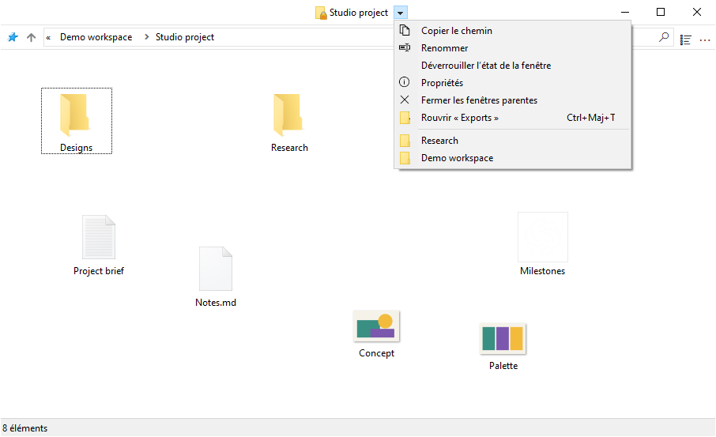
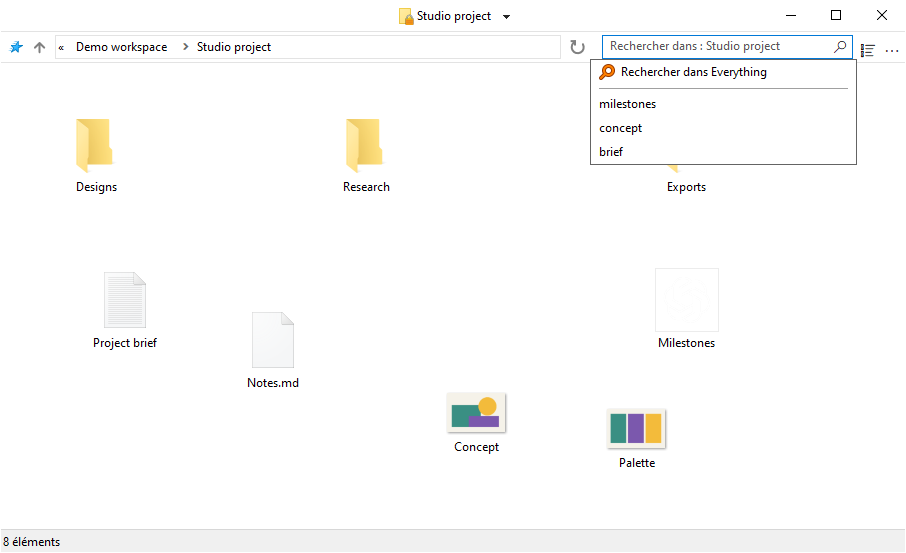

# Utiliser FileSpacer

## Navigation entre les fenêtres

FileSpacer propose une interface fluide, sobre et personnalisable, fondée sur le paradigme spatial :

- **Un dossier, une fenêtre.** Rouvrir un dossier déjà ouvert ramène sa fenêtre au premier plan. Sa position, sa taille, son affichage et la disposition de ses icônes sont mémorisés, même après déplacement ou renommage du dossier.
- Ouvrir un dossier ou son parent ferme par défaut la fenêtre source. Ctrl inverse ce comportement une fois ; le réglage se change dans **Paramètres > Général**. Ouvrir plusieurs dossiers sélectionnés conserve la fenêtre source.
- Le menu à côté du titre permet de passer d’un dossier ouvert à l’autre. **Fermer les fenêtres parentes** ferme ses ancêtres ouverts.
- **Ctrl+Maj+T** rouvre le dernier dossier fermé avec sa disposition et sa sélection. La commande existe aussi dans le menu du titre et la liste de raccourcis de la barre des tâches ; cette dernière permet de remonter plus loin dans les fermetures.
- La liste de raccourcis ouvre également les dossiers épinglés dans l’Accès rapide de l’Explorateur de fichiers.

Revenir au parent ne sélectionne pas le dossier qui vient d’être quitté. Un parent déjà ouvert conserve sa sélection.



## Affichage et disposition

### Disposition des icônes

Les fichiers et sous-dossiers peuvent être disposés librement en mode Icônes lorsque **Réorganiser automatiquement les icônes** est désactivé. Leurs positions sont enregistrées indépendamment des dimensions de la fenêtre, même lorsque son état enregistré est verrouillé.

### Options d’affichage

**Afficher le nom complet d’un fichier sélectionné**, dans **Paramètres > Affichage**, rend entièrement lisible le nom de l’unique fichier sélectionné en mode Icônes.


**Prévisualiser les modes d’affichage dans le menu Affichage** montre chaque mode au survol. Un clic le conserve ; Échap ou la sortie de l’aperçu restaure l’affichage initial. L’aperçu reste temporaire et ne remplace pas la disposition enregistrée.

**Mélanger les dossiers et les fichiers dans le tri** les trie ensemble, comme sous [macOS](https://support.apple.com/en-au/guide/mac-help/mchlp1745/27/mac/27) et [Linux](https://www.gnu.org/s/coreutils/manual/html_node/Sorting-the-output.html). L’option se trouve dans **Paramètres > Affichage > Fichiers** et concerne les modes Détails, Liste et Icônes réorganisées automatiquement. Les dossiers virtuels et les archives gardent l’ordre de Windows.


### Placement des fenêtres

Les dossiers sans position enregistrée s’ouvrent dans l’espace libre, ou avec un chevauchement réduit si la place manque. Ce placement se règle dans **Paramètres > Général > Placer les nouvelles fenêtres dans l’espace libre**.

### Sélection et activation

**Conserver la sélection lors d’un clic sur une fenêtre inactive**, dans **Paramètres > Général**, permet d’activer un dossier par un clic sur son arrière-plan sans effacer sa sélection. Un second appui commence un rectangle de sélection.

## Gestion des fenêtres

### Déplacement et redimensionnement

Une fenêtre peut être déplacée ou redimensionnée en faisant glisser depuis la zone des fichiers, y compris sur un élément. Les raccourcis par défaut sont :

| Action | Raccourci |
| --- | --- |
| Déplacer la fenêtre | Alt + glisser avec le bouton gauche |
| Redimensionner depuis le coin inférieur droit | Alt + glisser avec le bouton droit |


La sélection est conservée. Échap annule le geste.

Chaque action possède son raccourci personnalisable dans **Paramètres > Raccourcis**. Les boutons gauche et droit nécessitent Alt ; le bouton central peut aussi s’utiliser sans Alt.

### Verrouillage de l’état enregistré

Le verrouillage conserve la position, la taille et l’affichage d’un dossier pour les retrouver à sa réouverture. La fonction est désactivée par défaut dans **Paramètres > Général > Activer le verrouillage de l’état des fenêtres**. Une fois activée, **Verrouiller l’état de la fenêtre** est disponible à côté du titre du dossier. Un badge de cadenas sur son icône signale un état verrouillé.


Les changements temporaires restent possibles ; rouvrir le dossier rétablit l’état verrouillé. Les positions individuelles des icônes continuent de s’enregistrer. **Déverrouiller l’état de la fenêtre** conserve la disposition actuelle.

Désactiver la fonction demande confirmation et supprime tous les verrouillages, y compris ceux des dossiers fermés. La réactiver ne les restaure pas.

### Personnaliser le menu de la barre de titre

Le menu se personnalise dans **Paramètres > Affichage > Éléments de l’interface > Modifier le menu de barre de titre**. Faire glisser une action depuis la droite pour l’ajouter au menu, déplacer une entrée pour changer son ordre ou la glisser en dehors pour la retirer.

Les entrées gérées par Nilesoft Shell ne sont pas modifiables ici, car ses règles sont prioritaires. Voir l’[intégration Nilesoft Shell](#nilesoft-shell).


- **Rétablir la disposition verrouillée** ramène la fenêtre à sa disposition de référence. **Remplacer la disposition de référence** enregistre la disposition actuelle comme nouvelle référence verrouillée, après confirmation.

- **Oublier la disposition de ce dossier** efface sa disposition et son verrouillage, en conservant l’historique des recherches. L’enregistrement reste suspendu dans la fenêtre courante jusqu’à sa fermeture ; la prochaine ouverture utilise les réglages par défaut. Verrouiller une nouvelle disposition réactive l’enregistrement.

### Groupes de dossiers

**Enregistrer / rappeler un groupe de dossiers** conserve les dossiers ouverts sous un nom. Rappeler le groupe les rouvre avec leurs dispositions enregistrées.

## Recherche et historique

Saisir tout ou partie d’un nom de fichier ou de dossier, puis appuyer sur Entrée pour filtrer le dossier courant. **Filtrer pendant la saisie**, dans **Paramètres > Général**, applique le filtre au fur et à mesure.

Le champ propose les recherches récentes et, si l’intégration est activée, **Rechercher dans Everything** pour une recherche externe. Entrée sans suggestion sélectionnée applique le filtre local. Ctrl+F active le champ.

L’historique est propre à chaque dossier. Le nombre de recherches validées conservées se règle dans les paramètres généraux ; 0 efface et désactive l’historique. [Everything](#everything) permet de chercher dans les sous-dossiers ou dans tous les fichiers indexés.



## Intégration

### Intégration Windows

FileSpacer peut être défini comme gestionnaire de fichiers par défaut à l’installation ou ensuite dans **Paramètres > Intégration**, avec **Définir comme explorateur par défaut**. **Rétablir l’explorateur par défaut** rend l’ouverture des dossiers à l’Explorateur de fichiers.

Le menu contextuel des dossiers propose **Ouvrir dans FileSpacer**, ou **Ouvrir dans l’Explorateur de fichiers Windows** lorsque FileSpacer est le gestionnaire par défaut. Il fonctionne aussi sur les lecteurs, dossiers ZIP, emplacements réseau et arrière-plans de dossier, sans imposer de changer l’application par défaut.

**Options de l’Explorateur de fichiers** ouvre les préférences de dossiers communes, dont certaines s’appliquent aussi à FileSpacer.

### PowerToys Grab And Move

Lorsque Grab And Move est activé dans les réglages de PowerToys, les gestes FileSpacer de déplacement et de redimensionnement sont suspendus pour les fenêtres concernées, même si PowerToys est fermé.

Pour conserver les gestes de FileSpacer, ajouter `FileSpacer.exe` à la liste des applications exclues de Grab And Move, ou désactiver cet outil dans PowerToys.

### PowerToys Peek

**Aperçu avec Espace**, dans **Paramètres > Intégration**, ouvre un aperçu Peek des fichiers ou dossiers sélectionnés avec **Espace** seul. L’option est désactivée par défaut.

Peek doit aussi être activé dans PowerToys. Cette intégration nécessite PowerToys 0.96 ou plus récent, et 0.102 ou plus récent pour une sélection multiple.

### Everything

Une installation existante d’[Everything](https://www.voidtools.com/) peut être intégrée pour lancer des recherches avancées depuis le champ de FileSpacer. Les résultats s’ouvrent dans Everything.

L’option s’active dans **Paramètres > Intégration**, avec détection automatique d’Everything ou choix manuel d’une version portable. La portée est le dossier courant et ses sous-dossiers, ou **Partout** ; les dossiers virtuels nécessitent Partout.

Choisir **Rechercher dans Everything** lance la recherche externe avec la syntaxe d’Everything. Un lancement réussi efface le champ et le filtre local de FileSpacer.


### Nilesoft Shell

[Nilesoft Shell](https://nilesoft.org/) peut gérer l’apparence des menus de FileSpacer et personnaliser leurs commandes. Une adaptation de sa configuration est recommandée pour une bonne intégration visuelle, notamment des coins carrés pour les menus de la barre de titre et de la barre d’outils.

FileSpacer compose d’abord le menu de la barre de titre. Nilesoft Shell applique ensuite ses règles, qui peuvent renommer, déplacer, masquer ou ajouter des commandes et ont donc priorité. Les entrées grisées dans l’éditeur se modifient dans les fichiers de configuration de Nilesoft Shell.

Les actions de FileSpacer sont utilisables dans la configuration de Nilesoft Shell. La [référence de configuration](nilesoft-shell.md) donne les réglages et les identifiants des actions. Exemple avec la condition `filespacer_title` qui y est définie :

```nss
item(type='*' mode='multiple' where=filespacer_title
     title='Rétablir la disposition verrouillée' cmd=window.command(1123))
```

Le thème Modern ci-dessous compare ses coins par défaut aux coins carrés recommandés.

**Menu de navigation**

| Coins par défaut | Coins carrés recommandés |
| --- | --- |
|  |  |

**Menu principal (…)**

| Coins par défaut | Coins carrés recommandés |
| --- | --- |
|  |  |

## Paramètres et mises à jour

Ctrl+, ouvre les paramètres ; F1 ouvre le guide hors connexion. L’interface suit la langue d’affichage de Windows ; un changement de langue nécessite un redémarrage.

Les mises à jour se recherchent dans **Paramètres > À propos**, où les vérifications hebdomadaires facultatives peuvent aussi être activées. Elles sont désactivées par défaut. Le téléchargement et l’installation nécessitent une confirmation. Les dossiers précédemment ouverts retrouvent ensuite leur disposition enregistrée.

## Données locales

Dispositions, verrouillages, historiques et préférences sont conservés localement. Les emplacements de stockage sont décrits dans la [note technique de dépannage](../en/README.md#local-data) (en anglais).

**Paramètres > À propos > Maintenance > Réinitialiser l’état de tous les dossiers** ferme les fenêtres de dossiers et efface leurs dispositions, historiques et verrouillages. Les fichiers et les préférences générales sont conservés.

Pour le dépannage, `FileSpacer.exe /reset-options` réinitialise les préférences générales ; `/reset-all` efface aussi l’état des dossiers. Ces commandes conservent les fichiers.

## Confidentialité

FileSpacer ne contient ni télémétrie, ni suivi d’usage, ni publicité. Aucun rapport de plantage n’est envoyé automatiquement. Les éventuels rapports restent dans `%LOCALAPPDATA%\FileSpacer` ; leur partage est facultatif et peut révéler des chemins de fichiers ou des portions de mémoire d’un processus.

Les recherches de mises à jour et les téléchargements contactent GitHub en HTTPS. GitHub reçoit les informations habituelles de connexion, dont l’adresse IP et la version de l’application, mais aucun état de dossier, chemin de fichier ou rapport de diagnostic.

Les identifiants d’accès aux lecteurs réseau sont saisis et gérés par Windows, comme dans l’Explorateur de fichiers. FileSpacer ne les lit ni ne les enregistre. Choisir une recherche Everything transmet la requête et, si elle est limitée au dossier, son chemin à l’application Everything locale.
