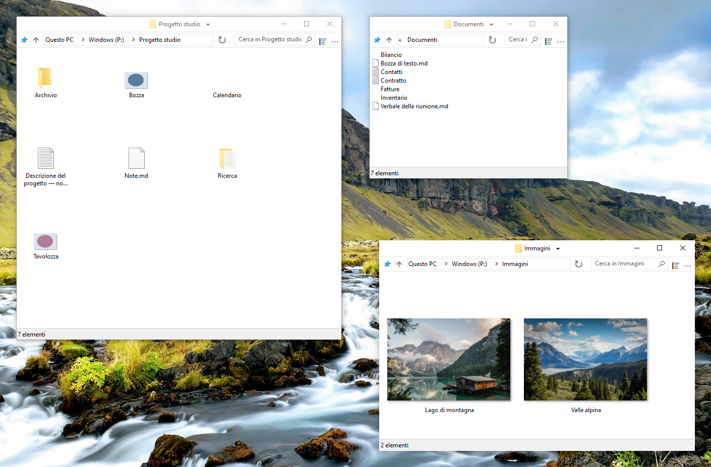

    

# FileSpacer

 &emsp;

FileSpacer è un gestore di file per Windows basato sul [paradigma spaziale](https://en.wikipedia.org/wiki/Spatial_file_manager): ogni cartella ha un’unica finestra che ricorda posizione, dimensioni e impostazioni di visualizzazione. Si creano così [riferimenti visivi stabili](https://www.csse.canterbury.ac.nz/~andy/papers/transforms.pdf), che consentono alla [memoria spaziale](https://www.microsoft.com/en-us/research/wp-content/uploads/1998/01/p153-robertson.pdf) di aiutarti a riconoscere a colpo d’occhio le cartelle familiari. In un gestore di file basato sulla navigazione, la stessa finestra mostra cartelle diverse una dopo l’altra: posizione e dimensioni non bastano quindi a identificare la cartella aperta, e per orientarti devi guardarne il contenuto. Conservando riferimenti distinti per ogni cartella, l’approccio spaziale può ridurre lo sforzo necessario per ritrovarti tra i tuoi file. Le schede sono incompatibili con il modello spaziale e non verranno mai aggiunte.

FileSpacer privilegia un’esperienza leggera e ordinata. Per limitare l’accumulo di finestre, un noto inconveniente del paradigma spaziale, FileSpacer chiude per impostazione predefinita la finestra di origine quando apri una cartella. Tieni premuto Ctrl durante l’apertura per mantenerla aperta quando vuoi lavorare con più cartelle contemporaneamente. FileSpacer mantiene un’interfaccia volutamente sobria, a differenza di certe interfacce sovraccariche che lasciano appena lo spazio tra i pulsanti per intravedere un file.

**Sistema e lingue:** Windows 10 o versioni successive, x64. Disponibile in dieci lingue: inglese, francese, tedesco, italiano, spagnolo, portoghese (Portogallo), greco, polacco, neerlandese e ucraino.

**Privacy:** **Nessuna telemetria, monitoraggio dell’utilizzo o pubblicità.** I controlli degli aggiornamenti contattano GitHub. Quelli settimanali sono facoltativi e disattivati per impostazione predefinita. Scaricamento e installazione richiedono conferma. [Privacy](user-guide.md#privacy).

**Installazione:**

- **Installazione manuale:** scaricare ed eseguire <a href="https://github.com/LeBenco/FileSpacer/releases/download/v1.3.2/FileSpacer-1.3.2-install.exe" id="last-release-url">il programma di installazione dell’ultima versione</a>.
- **WinGet:** `winget install --id Benco.FileSpacer --exact`
- **Chocolatey** (terminale come amministratore): `choco install filespacer -y`

I pacchetti WinGet e Chocolatey sono in attesa di approvazione nei rispettivi cataloghi.

**Documentazione:**

_FileSpacer è un fork di [ChromaFiler](https://github.com/vanjac/chromafiler), creato originariamente da J. van’t Hoog. Per i dettagli, vedi i [riconoscimenti](#licenza-e-riconoscimenti) qui sotto._

## Funzionalità

- **[Una finestra per ogni cartella](user-guide.md#navigazione-tra-finestre)**. Posizione, dimensioni, modalità di visualizzazione e posizioni delle icone vengono memorizzate. Le icone si possono disporre liberamente o allineare alla [griglia classica](user-guide.md#disposizione-delle-icone).
- **Organizzazione automatica delle finestre**. L’apertura di un’altra cartella chiude per impostazione predefinita la finestra di origine. Le finestre senza una posizione salvata vengono collocate [limitando la sovrapposizione](user-guide.md#posizionamento-delle-finestre).
- **Gestire le finestre**. Spostare o ridimensionare le finestre con [gesti del mouse](user-guide.md#spostamento-e-ridimensionamento). Salvare e riaprire [gruppi di cartelle](user-guide.md#gruppi-di-cartelle). [Bloccare la disposizione delle finestre](user-guide.md#blocco-dello-stato-salvato).

## Integrazione

FileSpacer può essere impostato come gestore di file predefinito durante l’installazione o in seguito nelle impostazioni. I file si aprono con la consueta applicazione Windows. Le cartelle di rete seguono il normale funzionamento di Windows. [Integrazione con Windows](user-guide.md#integrazione-con-windows).

Con **Everything** si possono avviare ricerche avanzate dal campo di FileSpacer, nella cartella corrente e nelle sottocartelle oppure in tutti i file indicizzati. I risultati si aprono in Everything. [Integrazione e utilizzo](user-guide.md#everything).

Con **Nilesoft Shell**, i menu di FileSpacer possono usare i suoi temi e comandi personalizzati. Si consiglia di adattare la configurazione per un aspetto coerente. [Integrazione e configurazione](user-guide.md#nilesoft-shell).

## Compilazione

La compilazione usa MSVC/NMAKE, Visual Studio 2022 Build Tools con ATL e un Windows SDK, Inkscape e ImageMagick. Per il programma di installazione è necessario NSIS. SQLite è incluso. Consulta la [guida alla compilazione](../en/build.md).

I test di regressione combinano scenari PowerShell con strumenti C++ e C# per le verifiche interne e i test reali dell’interfaccia Windows e della shell. Il [workflow di regressione GitHub Actions](https://github.com/LeBenco/FileSpacer/actions/workflows/regression.yml) esegue questa suite applicativa su richiesta e automaticamente prima di una pubblicazione. Gli stessi casi possono essere eseguiti con `tests.cmd` su un desktop Windows locale o in una VM Hyper-V configurata. La [guida ai test](../en/tests/regression/README.md) descrive selezione dei casi, prerequisiti e risultati.

## Licenza e riconoscimenti

### Copyright e licenza
FileSpacer è distribuito con la licenza . 
Copyright © 2026 Benco per le modifiche di FileSpacer. La licenza completa si trova in [LICENSE](../../LICENSE) nei sorgenti oppure in `LICENSE.txt` nella cartella di installazione. FileSpacer viene fornito senza garanzia. La ridistribuzione e la modifica sono consentite alle condizioni della licenza.

### Origine del progetto e riconoscimenti
FileSpacer è un fork di [ChromaFiler](https://github.com/vanjac/chromafiler), creato da J. van’t Hoog (vanjac). Un grande grazie a vanjac per questa base! Codice ChromaFiler originale © 2023 J. van’t Hoog.

### Note sui componenti di terze parti
Vedi le [note sui componenti di terze parti](THIRD_PARTY_NOTICES.md) e l’[informativa sulla privacy](privacy-policy.md).
