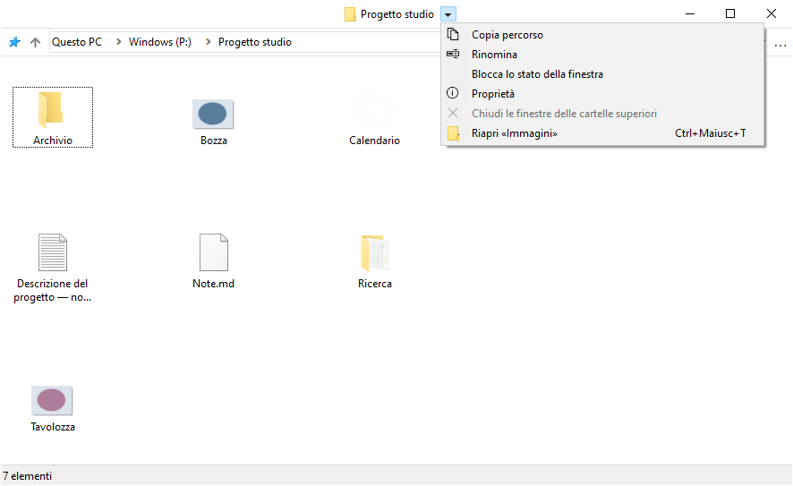
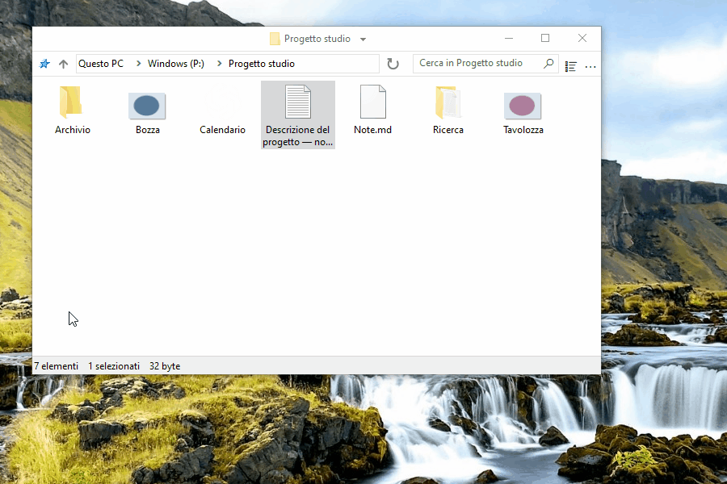
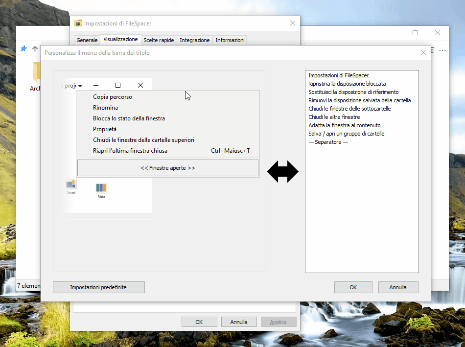
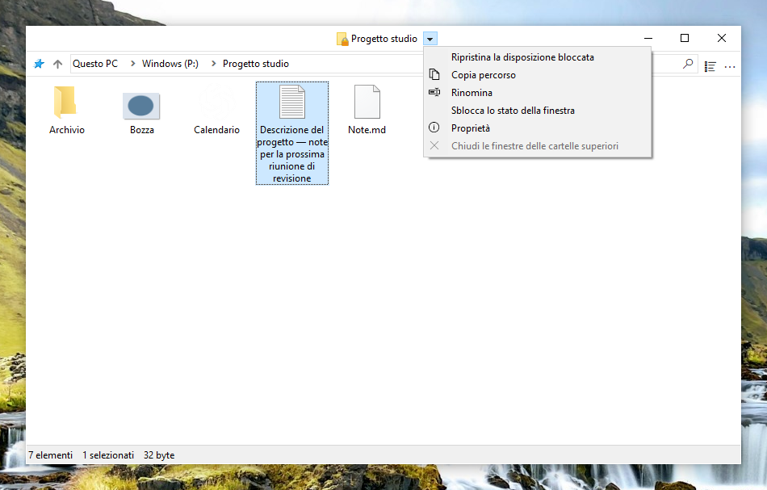
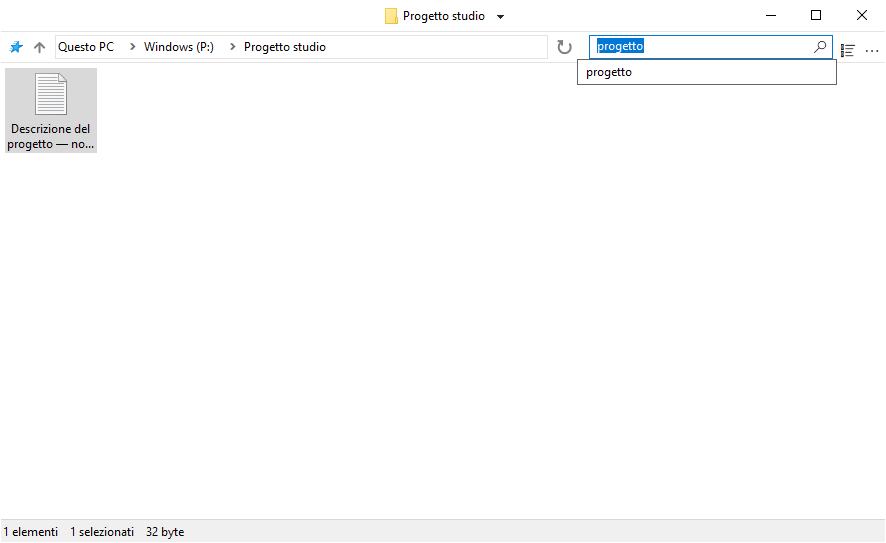
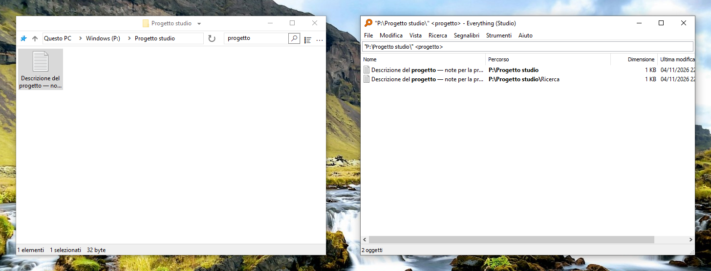
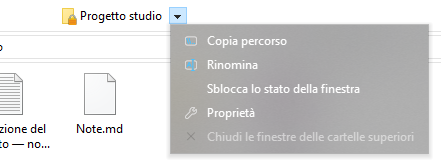
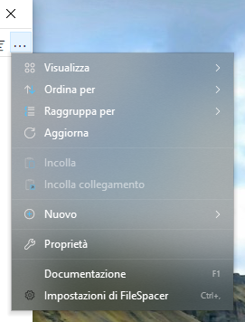

# Usare FileSpacer

## Navigazione tra finestre

FileSpacer offre un’interfaccia fluida, sobria e personalizzabile, basata sul paradigma spaziale:

- **Una cartella, una finestra.** Riaprire una cartella già aperta porta la sua finestra in primo piano. Posizione, dimensioni, vista e disposizione delle icone vengono ricordate anche dopo aver spostato o rinominato la cartella.
- Aprire una cartella o la cartella superiore chiude per impostazione predefinita la finestra di origine. Tieni premuto Ctrl per invertire questo comportamento una volta, oppure cambia l’impostazione in **Impostazioni > Generale**. Aprire più cartelle selezionate mantiene aperta la finestra di origine.
- Il menu accanto al titolo permette di passare tra le cartelle aperte. **Chiudi le finestre delle cartelle superiori** chiude le finestre aperte delle cartelle che la contengono.
- **Ctrl+Maiusc+T** riapre l’ultima cartella chiusa con la sua disposizione e selezione. Il comando è disponibile anche nel menu del titolo e nella Jump List della barra delle applicazioni; quest’ultima permette di risalire alle chiusure precedenti.
- La Jump List della barra delle applicazioni apre anche le cartelle aggiunte ad Accesso rapido in Esplora file.

Passare alla cartella superiore non seleziona quella da cui provieni. Una cartella superiore già aperta conserva la propria selezione.



## Visualizzazione e disposizione

### Disposizione delle icone

Nelle visualizzazioni a icone puoi posizionare liberamente file e sottocartelle quando **Disponi icone automaticamente** è disattivato. Le loro posizioni vengono salvate indipendentemente dalle dimensioni e dalla posizione della finestra, anche quando il suo stato salvato è bloccato.

### Opzioni di visualizzazione

**Mostra il nome completo di un file selezionato**, in **Impostazioni > Visualizzazione**, rende interamente leggibile il nome di un singolo file selezionato nella vista a icone.


**Mostra l’anteprima delle modalità nel menu Visualizza** mostra ogni modalità al passaggio del puntatore. Un clic la conferma; Esc o l’uscita dall’anteprima ripristina la vista iniziale. L’anteprima è temporanea e non sostituisce la disposizione salvata.

**Mescola cartelle e file nell’ordinamento** li ordina insieme, come su [macOS](https://support.apple.com/en-au/guide/mac-help/mchlp1745/27/mac/27) e [Linux](https://www.gnu.org/s/coreutils/manual/html_node/Sorting-the-output.html). L’opzione si trova in **Impostazioni > Visualizzazione > File** e si applica a Dettagli, Elenco e alle icone disposte automaticamente. Cartelle virtuali e archivi mantengono l’ordinamento di Windows.


### Posizionamento delle finestre

Le cartelle senza posizione salvata si aprono nello spazio libero o, se non basta, con una sovrapposizione ridotta. L’impostazione si trova in **Impostazioni > Generale > Disponi le nuove finestre nello spazio libero**.

### Selezione e attivazione

Con **Impostazioni > Generale > Mantieni la selezione facendo clic su una finestra inattiva** attivo, un clic sullo sfondo di una cartella inattiva ne attiva la finestra senza cancellare la selezione. Premi una seconda volta per iniziare un rettangolo di selezione.

## Gestione delle finestre

### Spostamento e ridimensionamento

Una finestra può essere spostata o ridimensionata trascinando nell’area dei file, anche sopra un elemento. Le combinazioni predefinite sono:

| Azione | Scelta rapida |
| --- | --- |
| Spostare la finestra | Alt + trascinamento con il pulsante sinistro |
| Ridimensionare dall’angolo inferiore destro | Alt + trascinamento con il pulsante destro |




La selezione rimane intatta. Esc annulla il gesto.

Ogni azione ha una combinazione personalizzabile in **Impostazioni > Scelte rapide**. I pulsanti sinistro e destro richiedono Alt; quello centrale funziona anche senza Alt.

### Blocco dello stato salvato

Il blocco conserva posizione, dimensioni e vista di una cartella per la successiva apertura. La funzione è disattivata per impostazione predefinita in **Impostazioni > Generale > Abilita il blocco dello stato della finestra**. Una volta attivata, **Blocca lo stato della finestra** è disponibile accanto al titolo. Un lucchetto sull’icona della cartella segnala il blocco.


Sono comunque possibili modifiche temporanee; riaprendo la cartella si ripristina lo stato bloccato. Le posizioni delle singole icone continuano a essere salvate. **Sblocca lo stato della finestra** mantiene la disposizione attuale.

Disattivare la funzione richiede conferma e rimuove tutti i blocchi, anche dalle cartelle chiuse. Riattivarla non li ripristina.

### Personalizzare il menu della barra del titolo

Il menu si personalizza in **Impostazioni > Visualizzazione > Elementi dell’interfaccia > Personalizza il menu della barra del titolo**. Trascinare un’azione dall’elenco a destra nel menu, spostare una voce per cambiarne l’ordine o trascinarla fuori per rimuoverla.

Le voci gestite da Nilesoft Shell non possono essere modificate qui, perché le sue regole hanno la precedenza. Vedere l’[integrazione con Nilesoft Shell](#nilesoft-shell).





- **Ripristina la disposizione bloccata** riporta la finestra alla disposizione di riferimento. **Sostituisci la disposizione di riferimento** salva la disposizione attuale come nuovo riferimento bloccato, dopo conferma.

- **Rimuovi la disposizione salvata della cartella** elimina la disposizione salvata e il blocco, mantenendo la cronologia delle ricerche. Il salvataggio resta sospeso nella finestra corrente fino alla chiusura; all’apertura successiva vengono usati i valori predefiniti. Bloccare una nuova disposizione riattiva il salvataggio.

### Gruppi di cartelle

**Salva / apri un gruppo di cartelle** memorizza le cartelle aperte con un nome. Richiamare il gruppo le riapre con le rispettive disposizioni salvate.

## Ricerca e cronologia

Digitare tutto o parte del nome di un file o di una cartella, quindi premere Invio per filtrare la cartella corrente. **Impostazioni > Generale > Filtra durante la digitazione** applica il filtro durante la digitazione.

Il campo propone le ricerche recenti e, se l’integrazione è attiva, **Cerca in Everything** per una ricerca esterna. Invio senza un suggerimento selezionato applica il filtro locale. Ctrl+F attiva il campo.

La cronologia è distinta per cartella. Il numero di ricerche confermate da conservare si regola nelle impostazioni generali; 0 svuota e disattiva la cronologia. [Everything](#everything) permette di cercare nelle sottocartelle o in tutti i file indicizzati.



## Integrazione

### Integrazione con Windows

FileSpacer può essere impostato come gestore di file predefinito durante l’installazione o in seguito con **Impostazioni > Integrazione > Imposta come gestore di file predefinito**. **Ripristina Esplora file come predefinito** restituisce l’apertura delle cartelle a Esplora file.

Il menu di scelta rapida delle cartelle offre **Apri in FileSpacer**, oppure **Apri in Esplora file di Windows** quando FileSpacer è predefinito. Vale anche per unità, cartelle ZIP, percorsi di rete e sfondi delle cartelle, senza obbligare a cambiare l’applicazione predefinita.

**Opzioni di Esplora file** apre le preferenze comuni delle cartelle, alcune delle quali valgono anche per FileSpacer.

### PowerToys Grab And Move

Quando Grab And Move è attivo nelle impostazioni di PowerToys, i gesti di FileSpacer per spostare e ridimensionare le finestre interessate vengono sospesi, anche se PowerToys è chiuso.

Per continuare a usare i gesti di FileSpacer, aggiungere `FileSpacer.exe` alle applicazioni escluse di Grab And Move oppure disattivare l’utilità in PowerToys.

### PowerToys Peek

**Anteprima con Spazio**, in **Impostazioni > Integrazione**, apre un’anteprima Peek dei file o delle cartelle selezionati premendo solo **Spazio**. L’opzione è disattivata per impostazione predefinita.

Peek deve essere attivato anche in PowerToys. L’integrazione richiede PowerToys 0.96 o successivo e 0.102 o successivo per una selezione multipla.

### Everything

Un’installazione esistente di [Everything](https://www.voidtools.com/) può essere integrata per avviare ricerche avanzate dal campo di FileSpacer. I risultati si aprono in Everything.

L’opzione si attiva in **Impostazioni > Integrazione**, con rilevamento automatico di Everything o scelta manuale di una copia portatile. La ricerca comprende la cartella corrente e le sottocartelle, oppure **Ovunque**; le cartelle virtuali richiedono Ovunque.

**Cerca in Everything** avvia la ricerca esterna con la sintassi di Everything. Un avvio riuscito svuota il campo e il filtro locale di FileSpacer.



### Nilesoft Shell

[Nilesoft Shell](https://nilesoft.org/) può gestire l’aspetto dei menu di FileSpacer e personalizzarne i comandi. Si consiglia di adattarne la configurazione per un aspetto coerente, in particolare con angoli squadrati nei menu della barra del titolo e della barra degli strumenti.

FileSpacer compone prima il menu della barra del titolo. Nilesoft Shell applica poi le proprie regole, che possono rinominare, spostare, nascondere o aggiungere comandi e hanno quindi la precedenza. Le voci in grigio nell’editor si modificano nei file di configurazione di Nilesoft Shell.

Le azioni di FileSpacer possono essere usate nella configurazione di Nilesoft Shell. Il [riferimento di configurazione](nilesoft-shell.md) contiene impostazioni e ID delle azioni. Esempio con la condizione `filespacer_title` definita nel riferimento:

```nss
item(type='*' mode='multiple' where=filespacer_title
     title='Ripristina la disposizione bloccata' cmd=window.command(1123))
```

Il tema Modern qui sotto confronta gli angoli predefiniti con quelli squadrati consigliati.

**Menu di navigazione**

| Angoli predefiniti | Angoli squadrati consigliati |
| --- | --- |
|  |  |

**Menu principale (…)**

| Angoli predefiniti | Angoli squadrati consigliati |
| --- | --- |
|  |  |

## Impostazioni e aggiornamenti

Ctrl+, apre le impostazioni; F1 apre la guida offline. L’interfaccia segue la lingua di visualizzazione di Windows; un cambio di lingua richiede il riavvio.

Gli aggiornamenti si cercano in **Impostazioni > Informazioni**, dove si possono attivare anche i controlli settimanali facoltativi, disattivati per impostazione predefinita. Scaricamento e installazione richiedono conferma. Al termine si riaprono le cartelle precedenti con le disposizioni salvate.

## Dati locali

Disposizioni, blocchi, cronologie e preferenze sono conservati localmente. I percorsi di archiviazione sono descritti nella [nota tecnica per la risoluzione dei problemi](../en/README.md#local-data) (in inglese).

**Impostazioni > Informazioni > Manutenzione > Reimposta lo stato di tutte le cartelle** chiude le finestre delle cartelle e ne cancella disposizioni, cronologia e blocchi salvati. File e preferenze generali vengono conservati.

Per la risoluzione dei problemi, `FileSpacer.exe /reset-options` reimposta le preferenze generali; `/reset-all` cancella anche lo stato salvato delle cartelle. Questi comandi conservano i file.

## Privacy

FileSpacer non contiene telemetria, monitoraggio dell’utilizzo o pubblicità. I rapporti sugli arresti anomali non vengono inviati automaticamente. Gli eventuali rapporti diagnostici rimangono in `%LOCALAPPDATA%\FileSpacer`; condividerli è facoltativo e può rivelare percorsi di file o parti della memoria del processo.

I controlli degli aggiornamenti e i download contattano GitHub tramite HTTPS. GitHub riceve le normali informazioni di connessione, compresi indirizzo IP e versione dell’applicazione, ma nessuno stato di cartella, percorso di file o rapporto diagnostico.

Le credenziali per le unità di rete vengono immesse e gestite da Windows, come in Esplora file. FileSpacer non le legge né le memorizza. Una ricerca Everything passa la query e, se limitata alla cartella, il relativo percorso all’applicazione Everything locale.
