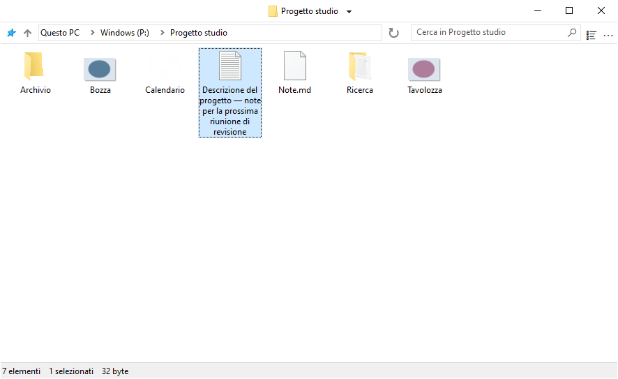
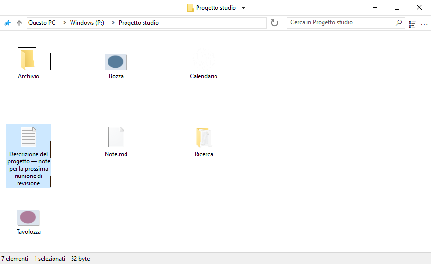
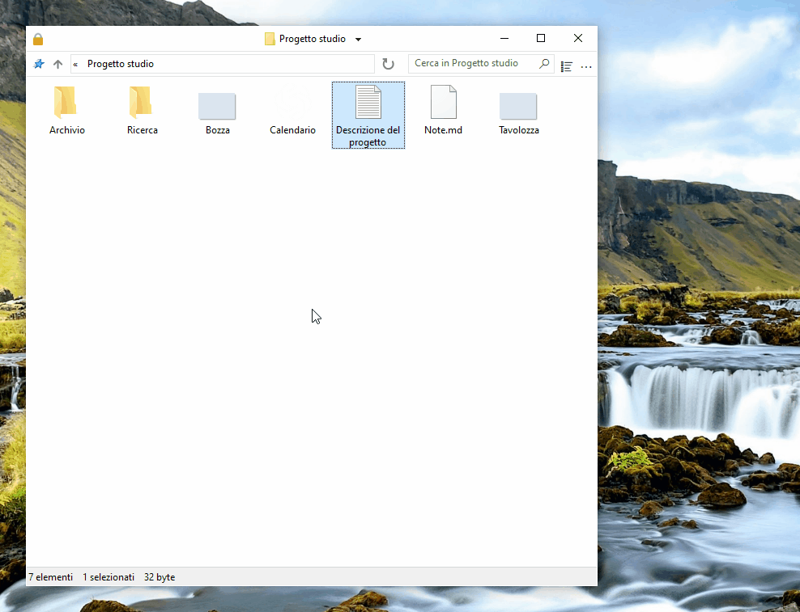
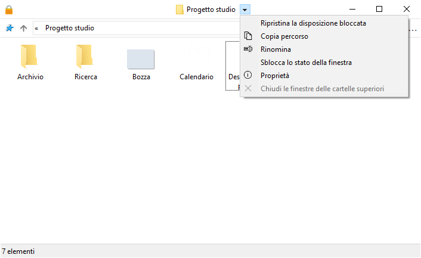
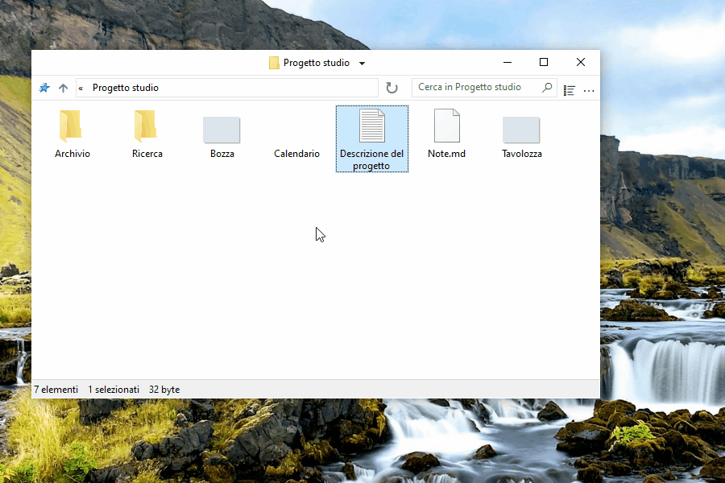
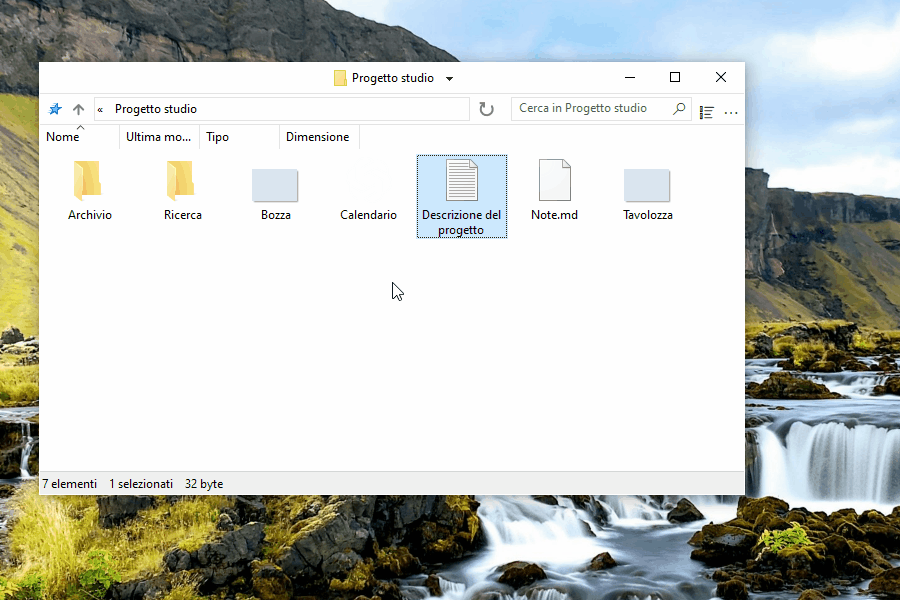
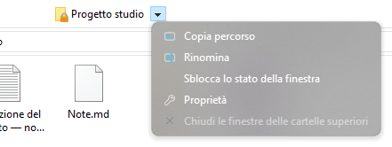

# Usare FileSpacer

FileSpacer ricorda la posizione e l’aspetto di ogni finestra tra un’apertura e l’altra. Le cartelle ritrovano il loro posto e diventano riconoscibili, come oggetti disposti su una scrivania. Offre anche scorciatoie configurabili, azioni rapide e un’interfaccia essenziale e personalizzabile.

FileSpacer si può impostare come gestore di file predefinito durante l’installazione oppure in **Impostazioni > Integrazione**, con **Imposta come gestore di file predefinito**. Il menu contestuale delle cartelle propone **Apri in FileSpacer**, oppure **Apri in Esplora file di Windows** quando FileSpacer è il gestore predefinito.

## Navigazione e disposizione delle finestre

**Ogni cartella ha la propria finestra.** Se è già aperta, FileSpacer la porta in primo piano. Posizione, dimensioni, visualizzazione, disposizione delle icone e posizione di scorrimento vengono memorizzate anche dopo lo spostamento o la ridenominazione della cartella. Le finestre senza posizione salvata vengono collocate limitando la sovrapposizione (opzione in **Impostazioni > Generale**).

**Si possono bloccare la posizione, le dimensioni e la visualizzazione attuali di una cartella per ritrovarle a ogni riapertura.** Le modifiche successive restano temporanee. Le posizioni delle icone continuano a essere salvate. Si può poi **ripristinare la disposizione bloccata** senza chiudere la finestra.

**Sblocca lo stato della finestra** conserva la disposizione attuale e permette di tornare a salvare le modifiche.

Il blocco si attiva in **Impostazioni > Generale**. Qui si può anche personalizzare l’aspetto del lucchetto a sinistra della barra del titolo e abilitarne il clic per bloccare o sbloccare lo stato della finestra. Il comando si può anche [aggiungere al menu della barra del titolo](#customize-the-title-bar-menu). Disattivare la funzione elimina tutti i blocchi e nasconde l’icona.

Aprire una cartella o la cartella superiore chiude per impostazione predefinita la finestra di origine. **Tenere premuto Ctrl durante l’apertura** permette di lasciarla aperta. Il comportamento si imposta in **Impostazioni > Generale**. L’apertura di più cartelle selezionate mantiene aperta la finestra di origine.

Il menu accanto al titolo permette di passare tra le cartelle aperte e chiudere le finestre delle cartelle superiori. **Ctrl+Maiusc+T** riapre l’ultima cartella chiusa con la sua disposizione e selezione. La Jump List della barra delle applicazioni include anche le cartelle chiuse di recente e quelle aggiunte ad Accesso rapido.

**Salva / apri un gruppo di cartelle**, nel menu del titolo, permette di ritrovare più cartelle insieme con le loro disposizioni salvate.

## Visualizzazione del contenuto delle cartelle

FileSpacer permette di disporre gli elementi di una cartella in una griglia, come in Esplora file, oppure liberamente, come sul desktop di Windows. Il posizionamento libero è disponibile con qualsiasi dimensione delle icone e nella vista **Riquadri**. Le viste **Elenco** e **Dettagli** non consentono il posizionamento libero. Per scegliere le posizioni, disattivare **Disponi icone automaticamente**. Resta disponibile l’allineamento alla griglia. Il menu **Visualizza** di ogni finestra offre un accesso rapido alle impostazioni delle icone, comprese quelle specifiche di FileSpacer.

Per impostazione predefinita, le cartelle sono raggruppate prima dei file, come in Esplora file. **Mescola cartelle e file nell’ordinamento**, in **Impostazioni > Visualizzazione**, li ordina insieme, come in [macOS](https://support.apple.com/en-au/guide/mac-help/mchlp1745/27/mac/27) e [Linux](https://www.gnu.org/s/coreutils/manual/html_node/Sorting-the-output.html). L’opzione riguarda Dettagli, Elenco e Icone disposte automaticamente. Cartelle virtuali e archivi mantengono l’ordine di Windows.

Nelle stesse impostazioni, **Mostra il nome completo di un file selezionato** permette di leggere per intero il nome nella vista Icone, anche se è molto lungo. Si applica quando è selezionato un solo file.

Per impostazione predefinita, un clic sullo sfondo di una finestra inattiva ne cancella la selezione, come in Esplora file. **Mantieni la selezione facendo clic su una finestra inattiva**, in **Impostazioni > Generale**, permette di attivarla senza perdere la selezione.

## Personalizzazione

### Modificare l’interfaccia

Il **menu della barra del titolo** si personalizza in **Impostazioni > Visualizzazione > Elementi dell’interfaccia**. I comandi si aggiungono e riordinano trascinandoli. Per rimuovere una voce, trascinarla fuori dal menu.

Le voci gestite da Nilesoft Shell si modificano nella sua configurazione, perché le sue regole hanno priorità su quelle di FileSpacer ([vedere l’integrazione più sotto](#nilesoft-shell)).

Si possono definire **gesti del mouse per spostare o ridimensionare una finestra** direttamente dal suo contenuto, anche trascinando su un file. Impostazioni predefinite:

| Azione | Gesto |
| --- | --- |
| Spostare | Alt + trascinamento con il pulsante sinistro |
| Ridimensionare | Alt + trascinamento con il pulsante destro |

Se ci sono file selezionati, la selezione viene mantenuta. Esc annulla l’azione. Le scorciatoie si personalizzano in **Impostazioni > Scelte rapide**. I pulsanti sinistro e destro richiedono Alt. Il pulsante centrale si può usare da solo.

### Integrazione

[Everything](https://www.voidtools.com/) è uno strumento di ricerca che trova rapidamente file e cartelle per nome. FileSpacer permette di avviarlo dal campo di ricerca di una cartella. L’integrazione si attiva in **Impostazioni > Integrazione**, con rilevamento automatico o scelta di una versione portabile.

**Cerca in Everything** avvia [la ricerca](https://www.voidtools.com/support/everything/searching/) nella cartella e nelle sottocartelle, oppure in tutti i [file indicizzati](https://www.voidtools.com/support/everything/indexes/) con **Ovunque**. I risultati si aprono in Everything. Per le cartelle virtuali, scegliere Ovunque. Un avvio riuscito svuota il campo e rimuove il filtro locale di FileSpacer.

[Nilesoft Shell](https://nilesoft.org/) è un’estensione di Windows che permette di personalizzare l’aspetto e i comandi dei menu contestuali. Se utilizzata, può gestire anche i menu di FileSpacer.

FileSpacer compone il menu della barra del titolo, poi Nilesoft Shell applica le sue regole, che hanno priorità. La [guida di configurazione](nilesoft-shell.md) descrive le impostazioni visive e l’accesso alle azioni di FileSpacer.

Per i menu della barra del titolo e della barra degli strumenti sono consigliati [angoli retti](nilesoft-shell.md#recommended-menu-appearance).

**Menu di navigazione**

| Angoli predefiniti | Angoli squadrati consigliati |
| --- | --- |
|  |  |

**Menu principale**

| Angoli predefiniti | Angoli squadrati consigliati |
| --- | --- |
|  |  |

[PowerToys](https://learn.microsoft.com/it-it/windows/powertoys/) raccoglie utilità Microsoft per ampliare e personalizzare Windows.

**Peek** mostra un’anteprima dei file. In FileSpacer, **Anteprima con Spazio**, in **Impostazioni > Integrazione**, permette di aprirla con Spazio. Peek deve essere attivo in PowerToys. Versione minima: 0.96, oppure 0.102 per la selezione multipla.

**Grab And Move** permette di spostare e ridimensionare le finestre dal loro contenuto. Quando è attivo, i gesti equivalenti di FileSpacer vengono sospesi anche se PowerToys è chiuso. Per mantenerli, escludere `FileSpacer.exe` in Grab And Move o disattivare lo strumento.

## Aggiornamenti e risoluzione dei problemi

**Impostazioni > Informazioni** permette di cercare aggiornamenti e attivare i controlli settimanali, disattivati per impostazione predefinita. Download e installazione richiedono conferma.

Nella stessa pagina, **Manutenzione > Reimposta lo stato di tutte le cartelle** chiude le finestre e cancella disposizioni, cronologie e blocchi. File e preferenze generali vengono mantenuti.

Il ripristino delle preferenze e la risoluzione avanzata dei problemi sono descritti nella [nota tecnica](../en/README.md#local-data), in inglese.

## Privacy

FileSpacer non include telemetria, monitoraggio dell’uso o pubblicità. Nessuna segnalazione di arresto anomalo viene inviata automaticamente. La condivisione è facoltativa e può rivelare percorsi di file o porzioni di memoria.

Gli aggiornamenti contattano GitHub, che riceve l’indirizzo IP e la versione dell’applicazione, ma nessun percorso di file o stato delle cartelle.

Le credenziali delle unità di rete sono gestite direttamente da Windows. FileSpacer non le legge né le salva.

Una ricerca di Everything invia la query e, se limitata a una cartella, il relativo percorso all’applicazione Everything locale.
