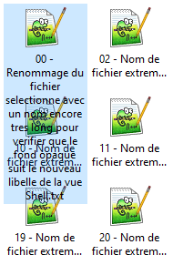
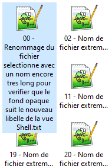
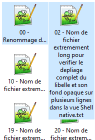
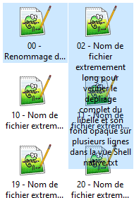

# Noms longs sélectionnés : essai de NM_CUSTOMDRAW

Recherche du 25 octobre 2026, sur `main` à `9550f52` (v1.1.2).
Le code de production n'est pas modifié par cette investigation.

## Résultat

Le raccordement proposé fonctionne sur le système testé : la fenêtre obtenue
par `IShellView::GetWindow` est `SHELLDLL_DefView`, et reçoit `WM_NOTIFY` /
`NM_CUSTOMDRAW` d'un émetteur `SysListView32`. Aucun parcours des descendants
ni sous-classement du ListView n'a été nécessaire.

Le Shell déplie nativement le nom de l'élément ayant le focus. Son fond laisse
voir les icônes et textes des rangées suivantes. Le remplissage préalable de
`LVIR_LABEL` corrige effectivement ce défaut, sans dessiner le texte.

| Variante essayée | Observation |
| --- | --- |
| Traitement natif seul | Nom ayant le focus déplié, avec recouvrements visibles. |
| `clrTextBk = COLOR_WINDOW` | Ne rend pas opaque la surface du libellé sélectionné déplié. |
| Même indication avec `CDRF_NEWFONT` ajouté au résultat natif | Même insuffisance. |
| Couleur témoin magenta, avec et sans `CDRF_NEWFONT` | Modifie les libellés ordinaires, mais ne résout pas le fond de la sélection dépliée. La couleur n'est donc pas globalement ignorée. |
| Remplissage préalable du rectangle natif du libellé réellement sélectionné | Texte déplié lisible, fond opaque ; le contrôle conserve le dessin du texte et de la sélection. |
| Intervention désactivée dans le banc | Retour au rendu standard, avec les recouvrements initiaux. |

Le seul `CDIS_SELECTED` de la notification n'identifie pas suffisamment la
sélection effective : il a aussi été observé sur des éléments non sélectionnés
selon `ListView_GetItemState`. Le prototype de remplissage vérifie cette dernière
avant de remplir un rectangle. Il ne faut pas généraliser l'intervention à tous
les éléments portant ce flag de dessin.

En sélection multiple, seul le nom ayant le focus se déplie complètement ; les
autres restent tronqués. Ce comportement est identique dans le témoin natif.
Le remplissage améliore l'opacité, pas la politique native de dépliage.

## Comparaison visuelle

Captures recadrées sur les deux premières colonnes ; aucune retouche du rendu.
Les fixtures contiennent des noms volontairement très longs et des icônes placées
sous le libellé déplié.

| Natif | Remplissage préalable |
| --- | --- |
|  |  |

| Sélection multiple, remplissage actif | Intervention désactivée |
| --- | --- |
|  |  |

## Protocole et portée de la validation

- Windows 10 Pro N 22H2, build 19045.7807 ; thème courant ; 96 DPI.
- Banc ponctuel C++ utilisant le `ShellViewHost` de production et son profil
  `FVO_CUSTOMPOSITION | FVO_CUSTOMORDERING`, sans `FVO_VISTALAYOUT`.
- Compilation MSVC x64, `/W4`, sans warning lors de la dernière compilation.
- Fixtures locales isolées, jusqu'à 150 fichiers ; aucune base de données ni
  préférence utilisateur modifiée. Aucun enregistrement de vue demandé au Shell
  (`EBO_NOPERSISTVIEWSTATE` comme en production).
- Installation d'un unique `SetWindowSubclass` sur la fenêtre publique de la vue,
  sur le même thread. Retrait à `WM_NCDESTROY` et à la fermeture du banc.
- Identification de la classe de l'émetteur avant lecture de `NMLVCUSTOMDRAW`.
  Transmission au Shell par `DefSubclassProc`, conservation du résultat et ajout
  de `CDRF_NOTIFYITEMDRAW` au stade préparatoire quand nécessaire. Aucun ajout de
  `CDRF_SKIPDEFAULT`. Aucun texte, thème ou placement redéfini.
- Observation des variantes en sélection simple et multiple, désélection,
  changement de focus de sélection, défilement vers le dernier élément,
  rafraîchissement et renommage d'une fixture par `IShellFolder::SetNameOf`.
  Le dernier renommage a renvoyé `S_OK`, puis le banc s'est fermé normalement.
- Comparaison du témoin initial avec le témoin après désactivation : **0 pixel
  différent dans la zone de 95 × 280 pixels du libellé sélectionné**. Cette
  comparaison appartient uniquement au test ; aucun détecteur visuel n'est
  envisagé dans le produit.
- La fermeture a suivi une demande de rafraîchissement. Cela ne démontre pas une
  fermeture réentrante au milieu d'une opération Shell ; ce cas reste à tester.

Une première séquence de renommage a rencontré une collision entre des fixtures
d'un essai antérieur et ouvert un dialogue Shell. Le pilote temporel pouvait
alors rentrer dans son étape courante. Cet essai a été interrompu ; le nom cible
et la garde de réentrance du pilote ont été corrigés avant la dernière exécution.
Ce défaut du banc ne constitue pas un défaut constaté de FileSpacer.

Le contrôle visuel par l'outil de capture de fenêtre a expiré, y compris après
récupération de la fenêtre. Les observations finales reposent sur les captures
GDI prises par le banc, ensuite inspectées. Elles ne constituent pas une
validation manuelle des gestes utilisateur dans FileSpacer.

## Repli implicite et conclusion de conception

La variante limitée à `clrTextBk` ne satisfait pas le besoin observé. Le
remplissage préalable est une piste fonctionnelle pour rendre opaque le nom
que Windows déplie déjà.

Le raccordement peut rester facultatif par construction : si `GetWindow`,
`SetWindowSubclass`, la réception des notifications ou les préconditions du
contrôle ne permettent pas l'intervention, aucune opération graphique
supplémentaire n'est exécutée. Le résultat du Shell continue d'être transmis.
Cela ne nécessite ni détection de réussite du rendu, ni bascule de moteur, ni
reconstruction de vue.

La désactivation volontaire a été éprouvée ; une disparition réelle des
notifications dans une autre version de Windows n'a pas été simulée. Le banc
n'a pas non plus injecté d'échec de `SetWindowSubclass` ou de lecture de rectangle.

Le remplissage reste toutefois dépendant de la géométrie et du protocole de
dessin du contrôle interne. Le constat présent ne garantit pas qu'une future
version conservant ces notifications mais changeant leur sens n'affichera
jamais un rectangle inadéquat. Les contrats Win32 documentent les API, pas cette
intégration au Shell. Cette distinction subsiste même sans détecteur de résultat.

**Bilan : raccordement et correction d'opacité démontrés dans le banc ; indication
`clrTextBk` seule insuffisante ; aucune garantie universelle de compatibilité
future ni de dépliage de tous les noms d'une sélection multiple.**

Restent à valider avant une livraison produit : intégration et durée de vie dans
FileSpacer, préférence existante, éditeur interactif de renommage, fermeture
réentrante, autres thèmes, contraste élevé et autres DPI. Aucun correctif C++
n'est livré ici ; le build de l'application, la suite de régression et les
analyses statiques d'un correctif produit ne sont donc pas annoncés comme passés.
Les sondes temporaires ne sont pas ajoutées au dépôt.

## Recherche complémentaire

Les essais sur le dépliage multiple et un volet de lecture alternatif sont
décrits dans [le compte rendu complémentaire](native-multi-label-investigation.md).

## Contrats documentés consultés

- [IShellView / IOleWindow::GetWindow](https://learn.microsoft.com/en-us/windows/win32/api/oleidl/nf-oleidl-iolewindow-getwindow)
- [SetWindowSubclass](https://learn.microsoft.com/en-us/windows/win32/api/commctrl/nf-commctrl-setwindowsubclass)
- [DefSubclassProc](https://learn.microsoft.com/en-us/windows/win32/api/commctrl/nf-commctrl-defsubclassproc)
- [NM_CUSTOMDRAW pour ListView](https://learn.microsoft.com/en-us/windows/win32/controls/nm-customdraw-list-view)
- [NMLVCUSTOMDRAW et clrTextBk](https://learn.microsoft.com/en-us/windows/win32/api/commctrl/ns-commctrl-nmlvcustomdraw)
- [ListView_GetItemRect](https://learn.microsoft.com/en-us/windows/win32/api/commctrl/nf-commctrl-listview_getitemrect)
