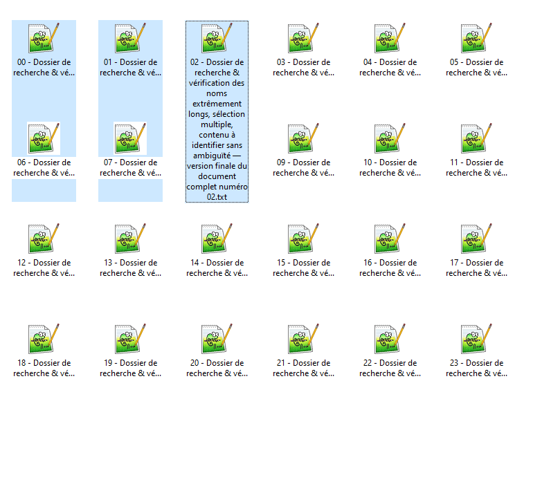
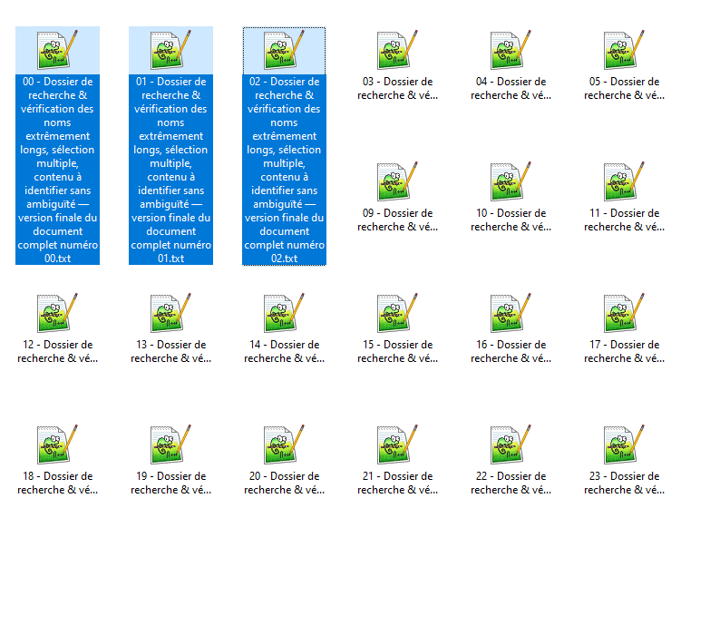
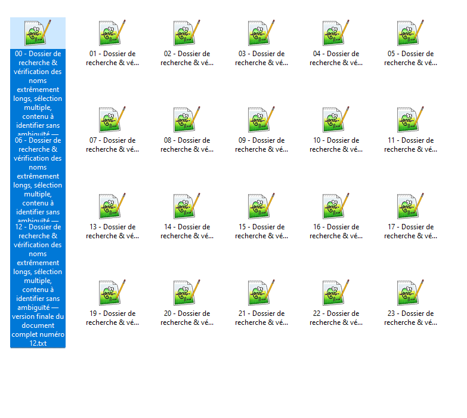
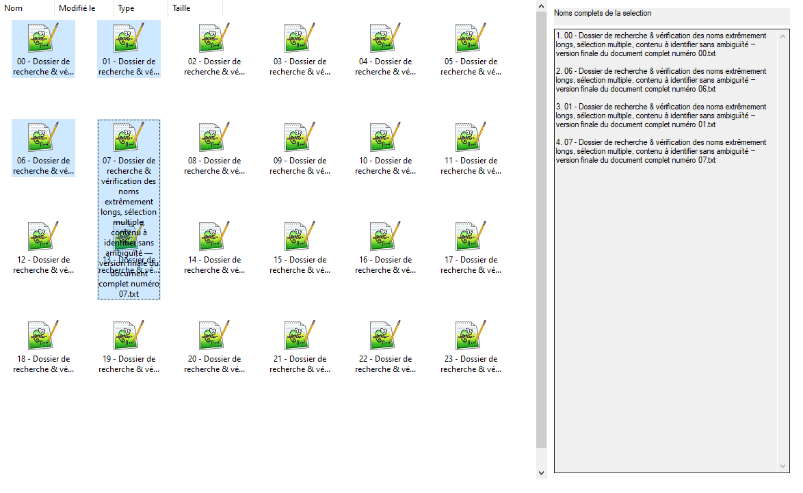
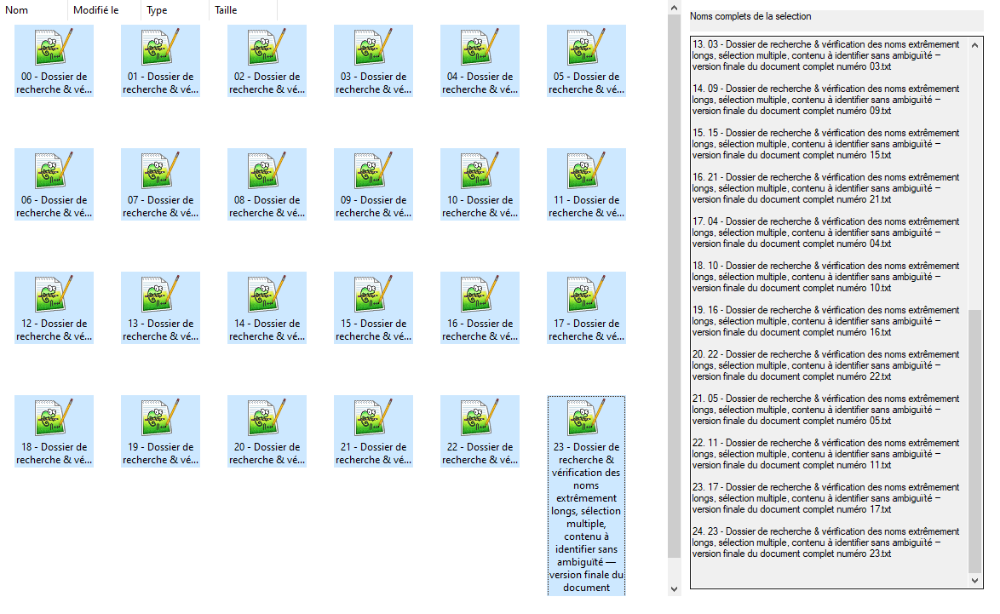
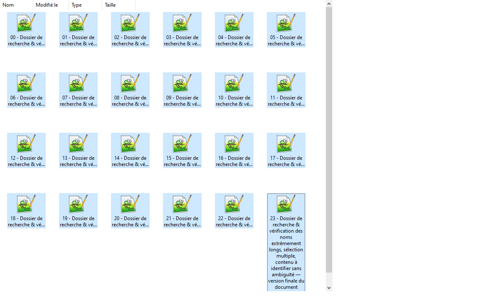

# Noms complets et sélection multiple : essais complémentaires

Recherche du 25 octobre 2026 sur `main`, à partir de `2724d57`.
Suite de [l'essai du fond opaque](native-label-draw-investigation.md).
Aucun code de production n'est modifié.

Décision postérieure à ces essais : le volet n'est pas retenu. L'intégration
choisie limite le fond opaque à une sélection simple et conserve le traitement
natif dans les autres cas ; voir la
[validation du comportement livré](validation-single-selection-labels.md).

## Conclusion

Les essais réalisés ne permettent pas d'étendre le dépliage natif à tous les
éléments sélectionnés au moyen des seules indications `NM_CUSTOMDRAW`.
Le dessin supplémentaire des textes complets fonctionne pour certains
placements, mais devient illisible dès que les libellés se recouvrent.

Une alternative a été effectivement prototypée et testée : **un volet de lecture
qui énumère les noms complets de la sélection**, avec retour à la ligne et
barre de défilement. Il conserve la vue Shell et ses positions d'icônes.
Son alimentation utilise les interfaces COM publiques et fonctionne aussi
lorsque le raccordement à `NM_CUSTOMDRAW` est retiré.

Ce volet répond au besoin de lire et comparer tous les noms sélectionnés.
Il change toutefois leur lieu de lecture : les noms complets figurent dans une
surface dédiée. Ce n'est pas une validation de leur dépliage sous chaque icône.
Le prototype de recherche n'est pas intégré à FileSpacer.

## Essais sur le dessin natif

Un banc temporaire utilise le `ShellViewHost` de production et la configuration
spatiale `FVO_CUSTOMPOSITION | FVO_CUSTOMORDERING`, sans `FVO_VISTALAYOUT`.
Le callback est installé uniquement sur la fenêtre publique de la vue. Il
identifie le ListView à partir de l'émetteur de la notification ; aucun
sous-classement ni parcours des contrôles descendants n'est nécessaire.

Les traitements passent par `DefSubclassProc` et conservent son résultat.
Aucun essai n'ajoute `CDRF_SKIPDEFAULT`, ne déplace le focus réel pour produire
le rendu, ni ne remplace le moteur Shell.

| Essai | Observation sur le système testé |
| --- | --- |
| Remplissage opaque préalable des libellés sélectionnés | Seul le nom ayant le focus est complet ; les autres gardent leur ellipse. |
| Ajout de `CDIS_FOCUS` à l'état du dessin de chaque élément sélectionné | Ne déplie pas les autres noms. |
| Affectation de `rcText` à la hauteur du texte complet et agrandissement de `nmcd.rc` | Étire le fond de sélection, sans obtenir le texte complet des autres éléments. |
| Combinaison de ces indications, avec `CDRF_NEWFONT` | Même insuffisance. |
| Indications appliquées avant le traitement Shell, au lieu d'après | Ne rétablit pas le dépliage multiple. |

Ces manipulations de structures servent à tester une hypothèse d'intégration.
La documentation décrit l'état et le rectangle de dessin ; elle ne promet pas
que leur modification commande le dépliage des libellés Shell.

La documentation de `LVIS_FOCUSED` précise qu'un seul élément peut avoir le focus,
même quand plusieurs éléments sont sélectionnés. Simuler plusieurs noms complets
en déplaçant réellement ce focus introduirait des changements de navigation et
de notifications : cette méthode n'a pas été retenue.

Exemple de combinaison des indications : les deux premiers textes restent
tronqués malgré l'agrandissement du fond.



## Première alternative : dessiner tous les noms après le Shell

Le banc demande `CDDS_POSTPAINT`, mesure les textes avec `DrawTextW` et
`DT_CALCRECT`, puis dessine un fond opaque et le texte intégral. Le dessin natif
est exécuté avant cette intervention.

Trois fichiers côte à côte deviennent effectivement lisibles :



Ce résultat ne se généralise pas aux placements spatiaux. Pour trois fichiers
dans la même colonne, les rectangles nécessaires se recouvrent :

- libellé du premier : `y = 82..292` ;
- libellé du deuxième : `y = 227..437` ;
- intersection verticale : **65 pixels** ;
- deux intersections au total pour les trois éléments sélectionnés.

Le dessin suivant masque une partie du précédent. Les étiquettes couvrent aussi
des icônes non sélectionnées situées dessous. Le fond opaque supprime la
transparence, sans résoudre la concurrence pour la même surface.



**Cette variante n'est pas recommandée comme solution générale.** Agrandir
les cellules ou déplacer les icônes changerait le placement spatial ; conserver
leurs positions et afficher des textes de hauteur arbitraire impose de prévoir
une autre surface de lecture ou une présentation avec gestion des collisions.

## Seconde alternative : volet des noms sélectionnés

Le prototype affiche un contrôle Win32 `EDIT` multiligne, en lecture seule, avec
retour à la ligne et défilement vertical. Chaque entrée présente le nom complet.
Le contrôle conserve les caractères Unicode et les esperluettes des fixtures.

L'alimentation suit ce chemin :

1. `ICommDlgBrowser::OnStateChange(CDBOSC_SELCHANGE)` publie une mise à jour dans
   la boucle UI ; les notifications en attente sont regroupées.
2. `IFolderView::Items(SVGIO_SELECTION | SVGIO_FLAG_VIEWORDER, IID_IShellItemArray)`
   fournit la sélection courante dans l'ordre renvoyé par la vue.
3. Chaque `IShellItem::GetDisplayName(SIGDN_NORMALDISPLAY)` fournit son nom
   d'affichage intégral, sans dépendre du texte tronqué du contrôle interne.
4. Les noms sont assemblés dans une valeur temporaire complète avant publication.
   Le volet apparaît pour une sélection multiple ; il se masque pour zéro ou
   un élément, pour une désactivation explicite et pour une collecte en échec.

Le nom d'affichage conserve les règles du Shell, notamment celles des extensions.
Le prototype ne force pas l'affichage d'une extension masquée par Windows.

Le volet reste fonctionnel **après retrait du callback `NM_CUSTOMDRAW`** :



Le rendu Shell à gauche demeure alors son rendu standard, y compris ses propres
recouvrements. Les noms deviennent lisibles et comparables dans le volet.
Le correctif d'opacité du premier essai peut être évalué séparément pour le nom
nativement déplié ; le volet n'en dépend pas.

Pour une sélection de 24 fichiers, les dernières entrées sont accessibles par
le défilement natif :



### Repli et surface de la vue

Le volet ne supprime aucune étape de dessin du Shell. S'il ne peut pas collecter
la sélection, il s'efface et la vue conserve son rendu. Le test injecte cet échec
avant la collecte ; il ne cherche pas à détecter un succès graphique.



La capture prouve l'effacement du volet. L'échec d'une API Shell réelle n'a pas
été provoqué. Le banc réserve dès sa création une zone à droite de la vue ;
l'apparition du volet ne redimensionne pas celle-ci. Il ne valide donc pas
l'ouverture ou la fermeture d'un volet docké dans une fenêtre FileSpacer
existante. Pour une intégration, la réservation d'espace ou l'emploi d'une
fenêtre auxiliaire temporaire reste un choix de présentation à traiter.

## Validations effectives

Environnement : Windows 10 Pro N 22H2, build 19045.7807, thème courant, 96 DPI.
24 fixtures locales, avec noms très longs et similaires, accents, esperluettes
et tirets Unicode. Les données et préférences utilisateur ne sont pas utilisées.

La dernière compilation MSVC x64 `/W4`, `/MTd`, `/Z7` n'a émis aucun warning.
Le banc s'est fermé normalement après 27 étapes de vérification :

```text
INVARIANTS exactSelection=1 exactFocus=1 expectedCount=24
PANEL count=24 exactText=1 focusUnchanged=1 chars=4383
PANEL SCROLL firstLine=48 focusUnchanged=1
PANEL hidden success=0 publish=1 count=0
RESULT exit=0 failures=0 destroy=00000000
```

Les vérifications portent sur :

- les identités de la sélection, comparées par les noms uniques réels des fixtures
  obtenus depuis les éléments de la vue, et pas uniquement sur leur nombre ;
- le focus d'élément attendu et les positions effectives des 24 icônes, inchangés
  pendant les variantes de dessin et les mises à jour du volet ;
- le texte complet relu depuis le contrôle de lecture, identique au contenu prévu ;
- le focus clavier, inchangé lors des mises à jour et du défilement programmatique ;
- les sélections horizontales, verticales, en carré, remplacées, réduites à un
  élément, vidées, puis étendues à 24 éléments ;
- le volet fonctionnant sans callback de dessin, sa désactivation explicite, sa
  réduction de largeur et son effacement sur échec simulé de collecte ;
- le nettoyage final de l'hébergement Shell.

Les interactions de sélection sont pilotées par les interfaces du vrai Shell.
Il ne s'agit pas d'une validation des gestes Ctrl/Shift ou du glisser-sélection.
Les captures de la vue seule emploient le dessin du ListView dans un HDC de test ;
les captures du volet viennent du rendu réellement affiché après redessin complet.
Une première méthode de capture `PrintWindow` donnait des captures incomplètes de
certains contrôles et a été remplacée pour les images finales du volet.

Le succès des invariants techniques n'annule pas l'échec visuel des variantes de
libellés : les captures ont été inspectées et les collisions mesurées séparément.

## Suite possible et limites

La piste à retenir pour une lecture fiable de toute sélection multiple est le
volet temporaire alimenté par les interfaces publiques. Elle conserve le moteur
Shell et évite de rendre la lecture de tous les noms dépendante de son contrôle
interne. Elle consomme une surface de lecture supplémentaire.

Son intégration produit reste à valider : présentation dans les petites fenêtres,
fermeture et remplacement de vue, changements rapides de sélection, identité de
vue périmée après réentrance COM, accessibilité et navigation clavier, préférence
existante, ressources EN/FR, grands volumes, autres thèmes et DPI.

Aucun correctif C++ n'est livré. Le build Debug de FileSpacer et ses régressions
n'ont pas été relancés pour cette livraison documentaire. L'analyse statique
C++ n'est pas applicable à ces fichiers livrés. Les sondes temporaires ne sont
pas ajoutées au dépôt.

## Sources primaires

- [NM_CUSTOMDRAW et étapes de dessin](https://learn.microsoft.com/en-us/windows/win32/controls/nm-customdraw-list-view)
- [NMLVCUSTOMDRAW](https://learn.microsoft.com/en-us/windows/win32/api/commctrl/ns-commctrl-nmlvcustomdraw)
- [États ListView et unicité du focus](https://learn.microsoft.com/en-us/windows/win32/controls/list-view-item-states)
- [IFolderView::Items](https://learn.microsoft.com/en-us/windows/win32/api/shobjidl_core/nf-shobjidl_core-ifolderview-items)
- [SVGIO_FLAG_VIEWORDER](https://learn.microsoft.com/en-us/windows/win32/api/shobjidl_core/ne-shobjidl_core-_svgio)
- [DrawTextW et DT_CALCRECT](https://learn.microsoft.com/en-us/windows/win32/api/winuser/nf-winuser-drawtextw)
