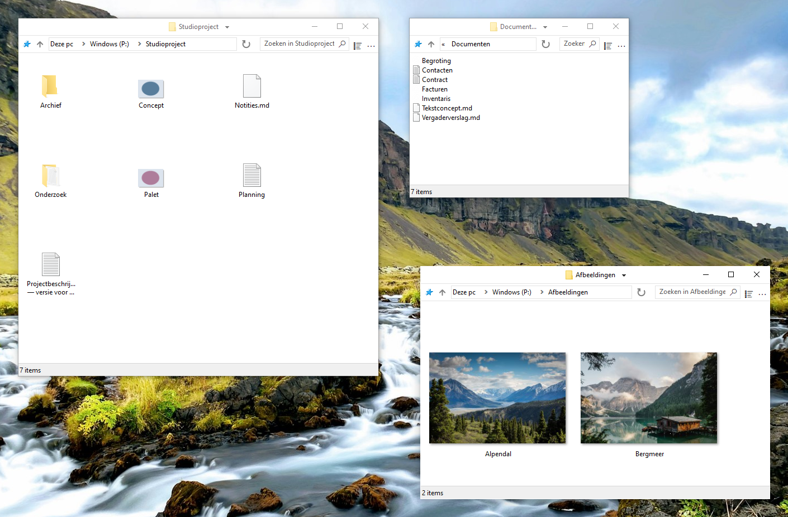

    

# FileSpacer

 &emsp;

FileSpacer is een bestandsbeheerder voor Windows volgens het [ruimtelijke model](https://en.wikipedia.org/wiki/Spatial_file_manager): elke map heeft één venster dat zijn positie, afmetingen en weergave-instellingen onthoudt. Dit biedt [vaste visuele herkenningspunten](https://www.csse.canterbury.ac.nz/~andy/papers/transforms.pdf), waardoor het [ruimtelijk geheugen](https://www.microsoft.com/en-us/research/wp-content/uploads/1998/01/p153-robertson.pdf) vertrouwde mappen in één oogopslag helpt herkennen. In een navigerende bestandsbeheerder toont hetzelfde venster achtereenvolgens verschillende mappen: positie en afmetingen identificeren de huidige map niet, dus moet u naar de inhoud kijken. Door herkenningspunten per map te bewaren kan de ruimtelijke aanpak de cognitieve belasting bij het terugvinden van bestanden verminderen. Tabbladen passen niet bij het ruimtelijke model en zullen nooit worden toegevoegd.

FileSpacer kiest voor een lichte, overzichtelijke ervaring. Om de opeenstapeling van vensters, een bekend nadeel van het ruimtelijke model, te beperken, sluit FileSpacer standaard het bronvenster wanneer een map wordt geopend. Houd Ctrl ingedrukt om het open te houden wanneer u met meerdere mappen wilt werken. De interface blijft bewust bescheiden, anders dan sommige volle interfaces waar tussen de knoppen nog net een bestand te zien is.

**Systeem en talen:** Windows 10 of nieuwer, x64. Tien talen: Engels, Frans, Duits, Italiaans, Spaans, Portugees (Portugal), Grieks, Pools, Nederlands en Oekraïens.

**Privacy:** **Geen telemetrie, gebruiksregistratie of reclame**. Updatecontroles maken contact met GitHub. Wekelijkse controles zijn optioneel en staan standaard uit. Downloaden en installeren vereisen bevestiging. [Privacybeleid](user-guide.md#privacy).

**Installatie:**

- **Handmatige installatie:** download <a href="https://github.com/LeBenco/FileSpacer/releases/download/v1.3.2/FileSpacer-1.3.2-install.exe" id="last-release-url">het installatieprogramma van de nieuwste versie</a> en voer het uit.
- **WinGet:** `winget install --id Benco.FileSpacer --exact`
- **Chocolatey** (terminal als administrator): `choco install filespacer -y`

De WinGet- en Chocolatey-pakketten wachten op goedkeuring in de bijbehorende catalogi.

## Functies

- **Eén venster per map**. Positie, afmetingen, weergavemodus en pictogramposities [worden onthouden](user-guide.md#navigeren-tussen-vensters). Pictogrammen kunnen vrij worden geplaatst of op het [klassieke raster worden uitgelijnd](user-guide.md#pictogramindeling).
- **Vensterindeling**. Bij het openen van een andere map wordt het bronvenster standaard gesloten. Vensters zonder opgeslagen positie worden zo geplaatst dat ze elkaar [zo min mogelijk overlappen](user-guide.md#vensterplaatsing).
- **Vensters beheren**. Vensters verplaatsen of het formaat wijzigen met [muisgebaren](user-guide.md#verplaatsen-en-formaat-wijzigen). [Mapgroepen](user-guide.md#mapgroepen) opslaan en opnieuw openen. [De vensterindeling vergrendelen](user-guide.md#een-opgeslagen-indeling-vergrendelen).

**Documentatie:**

## Integratie

FileSpacer kan tijdens installatie of later in Instellingen als standaardbestandsbeheerder worden ingesteld. Bestanden openen in hun gebruikelijke Windows-toepassingen. Netwerkmappen gebruiken de Windows-afhandeling. [Windows-integratie](user-guide.md#windows-integratie).

Met **Everything** start u geavanceerde zoekopdrachten vanuit het FileSpacer-zoekveld, in de huidige map met submappen of in alle geïndexeerde bestanden. Resultaten openen in Everything. [Integratie en gebruik](user-guide.md#everything).

Met **Nilesoft Shell** kunnen de menu’s thema’s en aangepaste opdrachten gebruiken. Configuratieaanpassingen worden aanbevolen voor een consistent uiterlijk. [Integratie en configuratie](user-guide.md#nilesoft-shell).

## Bouwen

Bouwen gebruikt MSVC/NMAKE, Visual Studio 2022 Build Tools met ATL en een Windows SDK, Inkscape en ImageMagick. NSIS is nodig voor het installatieprogramma. SQLite is meegeleverd. Zie de [bouwhandleiding](build.md).

Regressietests combineren PowerShell-scenario’s met C++- en C#-helpers voor interne controles en echte Windows-interface- en Shell-tests. De [regressieworkflow in GitHub Actions](https://github.com/LeBenco/FileSpacer/actions/workflows/regression.yml) voert deze toepassingstests op verzoek en automatisch vóór een publicatie uit. Dezelfde gevallen kunnen met `tests.cmd` op een lokaal Windows-bureaublad of in een geconfigureerde Hyper-V-VM worden uitgevoerd. De [testhandleiding](tests/regression/README.md) beschrijft de casusselectie, vereisten en resultaten.

## Licentie en dankbetuigingen

### Auteursrecht en licentie
FileSpacer wordt verspreid onder de -licentie. 
Copyright © 2026 Benco voor de wijzigingen aan FileSpacer. De volledige licentie staat in [LICENSE](../../LICENSE) in de broncode, of in `LICENSE.txt` in de installatiemap. FileSpacer wordt zonder garantie geleverd. Verspreiding en wijziging zijn onder deze licentie toegestaan.

### Fork en dank aan het oorspronkelijke project
FileSpacer is een fork van [ChromaFiler](https://github.com/vanjac/chromafiler) (oorspronkelijke ChromaFiler-code © 2023 J. van't Hoog), gemaakt door J. van't Hoog (vanjac). Veel dank aan vanjac voor de basis!

### Vermeldingen van derden
Zie de [vermeldingen van derden](THIRD_PARTY_NOTICES.md) en het [privacybeleid](privacy-policy.md).
