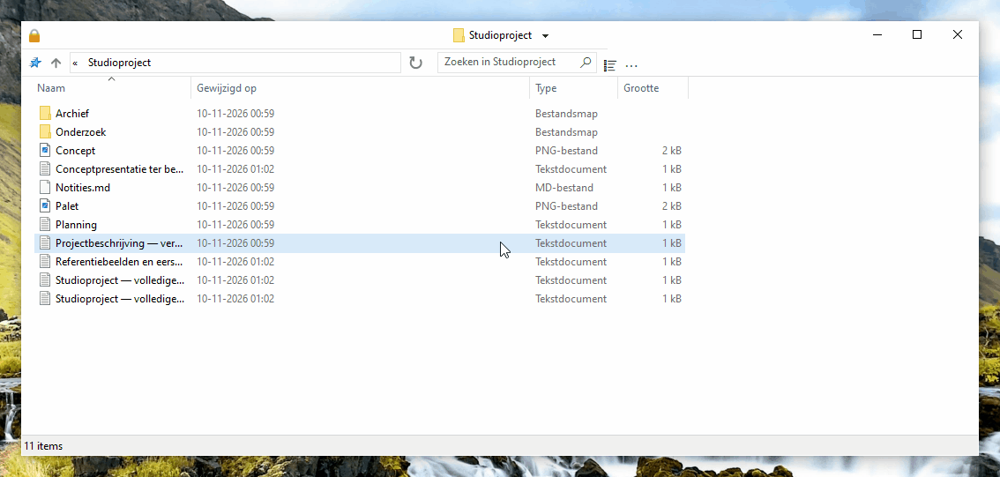
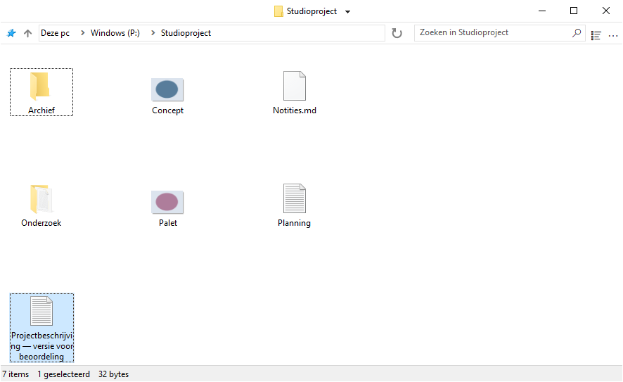
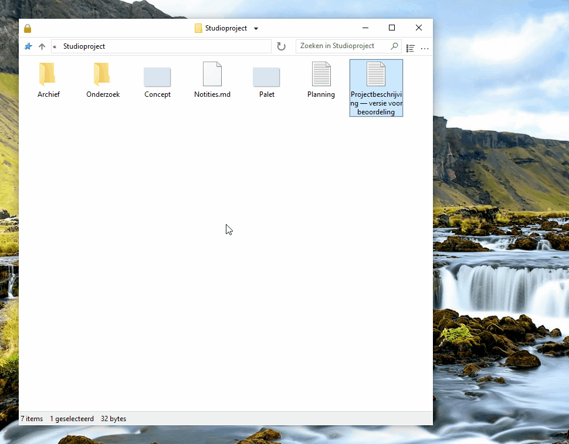
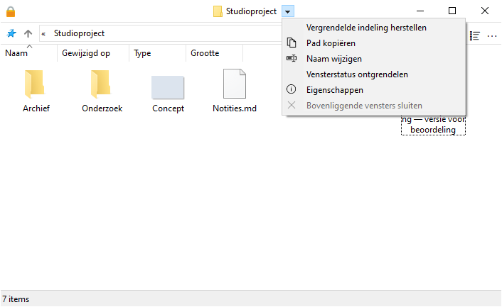
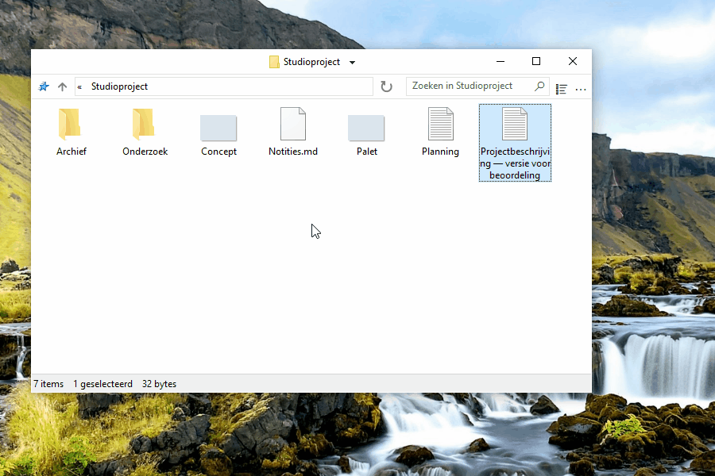
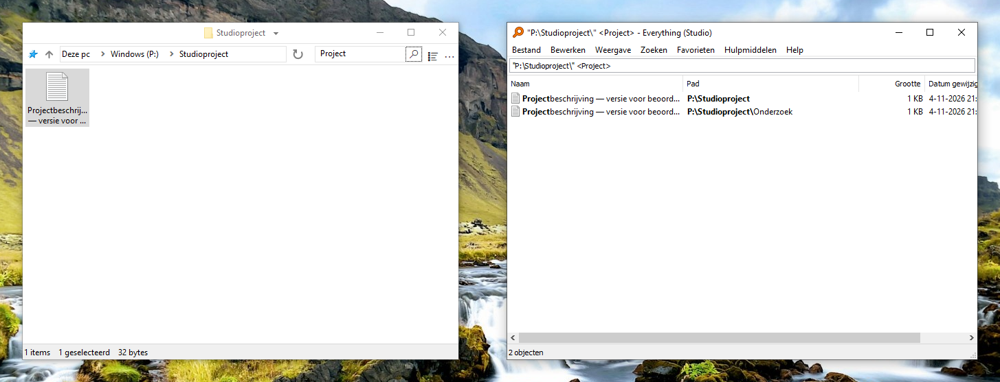
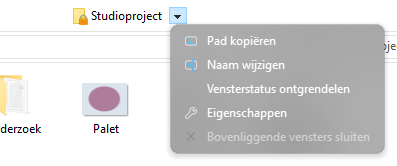
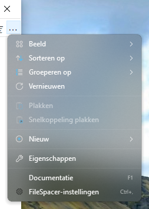

# FileSpacer gebruiken

FileSpacer onthoudt de positie en het uiterlijk van elk venster bij het opnieuw openen. Mappen keren terug naar hun vertrouwde plek, zoals voorwerpen op een bureau. Daarnaast zijn er instelbare sneltoetsen, snelle acties en een rustige, aanpasbare interface.

FileSpacer kan tijdens de installatie of onder **Instellingen > Integratie** met **Instellen als standaardbestandsbeheerder** als standaardbestandsbeheerder worden ingesteld. Het contextmenu van mappen biedt **Openen in FileSpacer**, of **Openen in Windows Bestandenverkenner** als FileSpacer de standaard is.

## Navigatie en vensterindeling

**Elke map heeft een eigen venster.** Is de map al open, dan brengt FileSpacer dat venster naar de voorgrond. Positie, afmetingen, weergave, pictogramindeling en schuifpositie worden onthouden, ook na verplaatsen of hernoemen van de map. Vensters zonder opgeslagen positie worden zo geplaatst dat ze zo min mogelijk overlappen (optie onder **Instellingen > Algemeen**).

**De huidige positie, afmetingen en weergave van een map kunnen worden vergrendeld om ze bij elke opening terug te krijgen.** Latere wijzigingen zijn tijdelijk. Pictogramposities worden nog steeds opgeslagen. De **vergrendelde indeling kan worden hersteld** zonder het venster te sluiten.

**Vensterstatus ontgrendelen** behoudt de huidige indeling en maakt het weer mogelijk wijzigingen op te slaan.

Vergrendeling wordt ingeschakeld onder **Instellingen > Algemeen**. Daar kan ook de weergave van het slot links in de titelbalk worden aangepast en klikken op het pictogram worden ingeschakeld om de vensterstatus te vergrendelen of ontgrendelen. De opdracht kan ook [aan het titelbalkmenu worden toegevoegd](#customize-the-title-bar-menu). Uitschakelen wist alle vergrendelingen en verbergt het pictogram.

Een map of bovenliggende map openen sluit standaard het bronvenster. **Ctrl ingedrukt houden bij het openen** laat het open. Dit gedrag is instelbaar onder **Instellingen > Algemeen**. Meerdere geselecteerde mappen openen houdt het bronvenster open.

Het menu naast de titel wisselt tussen geopende mappen en sluit bovenliggende vensters. **Ctrl+Shift+T** opent de laatst gesloten map opnieuw met haar indeling en selectie. De Jump List op de taakbalk biedt ook recent gesloten mappen en mappen die in Snelle toegang zijn vastgemaakt.

| Sneltoets | Actie |
| --- | --- |
| Ctrl+N | De in Instellingen gekozen startmap openen of het bestaande venster activeren; het bronvenster blijft open. |
| Ctrl+W | Het venster sluiten, ook vanuit het adres- of zoekveld. |
| Backspace | De bovenliggende map openen volgens de instelling voor het openhouden van het bronvenster. |
| Ctrl+Backspace | De bovenliggende map openen of activeren en het bronvenster altijd openhouden. |
| F4, Ctrl+L of Alt+D | Het adres selecteren. |
| F3, Ctrl+E of Ctrl+F | Het zoekveld activeren. |
| F5 of Ctrl+R | De map vernieuwen, ook tijdens het typen in het adres- of zoekveld. |

In de velden voor adres, zoeken en bestandsnamen behouden Backspace en Ctrl+Backspace hun tekstbewerkingsfunctie. Tekstbestanden kunnen nog steeds via het contextmenu **Nieuw** worden gemaakt.

**Mapgroep opslaan / oproepen** in het titelmenu opent meerdere mappen samen met hun opgeslagen indelingen.

## Weergave van de mapinhoud

**Ctrl+muiswiel** doorloopt de pictogramgroottes en weergaven. Het zoomgebaar van het touchpad gebruikt dezelfde actie als Windows het doorgeeft. **Ctrl+Shift+1 tot 8** kiest achtereenvolgens extra grote, grote, middelgrote en kleine pictogrammen, lijst, details, tegels en inhoud. De weergave wordt voor de map onthouden; de vergrendeling van de opgeslagen toestand blijft zoals gebruikelijk werken.

In FileSpacer kunnen de items in een map op een raster worden gerangschikt, zoals in Bestandenverkenner, of vrij worden geplaatst, zoals op het Windows-bureaublad. Vrije plaatsing is beschikbaar bij elke pictogramgrootte en in de weergave **Tegels**. De weergaven **Lijst** en **Details** ondersteunen geen vrije plaatsing. Daarvoor **Pictogrammen automatisch schikken** uitschakelen. Uitlijnen op het raster blijft mogelijk. Het menu **Beeld** in elk venster biedt snelle toegang tot de pictograminstellingen, inclusief de eigen opties van FileSpacer.

In de weergave **Details** kunnen de kolommen automatisch de volledige vensterbreedte vullen. Sta dit toe onder **Instellingen > Weergave** en schakel het daarna voor elke map afzonderlijk in of uit via het menu **Beeld**.

**Continu bijwerken** is ook mogelijk via de instellingen en kan het wijzigen van de grootte minder vloeiend maken. Uit voorzorg wordt inschakelen bij meer dan enkele tientallen bestanden afgeraden.

Standaard staan mappen vóór bestanden, zoals in Bestandenverkenner. **Mappen en bestanden samen sorteren** onder **Instellingen > Weergave** sorteert ze samen, zoals op [macOS](https://support.apple.com/en-au/guide/mac-help/mchlp1745/27/mac/27) en [Linux](https://www.gnu.org/s/coreutils/manual/html_node/Sorting-the-output.html). Dit geldt voor Details, Lijst en automatisch gerangschikte pictogrammen. Virtuele mappen en archieven behouden de Windows-volgorde.

In dezelfde instellingen maakt **Volledige naam van geselecteerd bestand tonen** de hele naam leesbaar in de pictogramweergave, ook als die erg lang is. Dit geldt wanneer één bestand is geselecteerd.

Klikken op de achtergrond van een inactief venster wist standaard de selectie, zoals in Bestandenverkenner. **Selectie behouden bij klikken op een inactief venster** onder **Instellingen > Algemeen** activeert het venster zonder de selectie te verliezen.

## Aanpassen

### De interface aanpassen

Het **titelbalkmenu** is aanpasbaar onder **Instellingen > Weergave > Interface-elementen**. Opdrachten kunnen door slepen worden toegevoegd en verplaatst. Een item uit het menu slepen verwijdert het.

Items die Nilesoft Shell beheert, worden in zijn configuratie aangepast omdat zijn regels voorrang hebben op die van FileSpacer ([zie de integratie hieronder](#nilesoft-shell)).

**Muisgebaren om vensters te verplaatsen of het formaat te wijzigen** zijn instelbaar en werken rechtstreeks vanuit de inhoud, ook door over een bestand te slepen. Standaard:

| Actie | Gebaar |
| --- | --- |
| Verplaatsen | Alt + slepen met de linkermuisknop |
| Formaat wijzigen | Alt + slepen met de rechtermuisknop |

Als er bestanden zijn geselecteerd, blijft de selectie behouden. Escape annuleert de actie. Aanpassen kan onder **Instellingen > Sneltoetsen**. De linker- en rechtermuisknop vereisen Alt. De middelste knop werkt ook zonder Alt.

### Integratie

[Everything](https://www.voidtools.com/) is een zoekprogramma dat bestanden en mappen snel op naam vindt. FileSpacer kan het starten vanuit het zoekveld van een map. De integratie wordt ingeschakeld onder **Instellingen > Integratie**, met automatische detectie of een handmatig gekozen draagbare versie.

**Zoeken in Everything** voert [de zoekopdracht](https://www.voidtools.com/support/everything/searching/) uit in de map en submappen, of met **Overal** in alle [geïndexeerde bestanden](https://www.voidtools.com/support/everything/indexes/). Resultaten openen in Everything. Voor virtuele mappen Overal kiezen. Na geslaagd starten worden het zoekveld en lokale filter van FileSpacer gewist.

[Nilesoft Shell](https://nilesoft.org/) is een Windows-uitbreiding om het uiterlijk en de opdrachten van contextmenu’s aan te passen. Bij gebruik kan het ook de menu’s van FileSpacer beheren.

FileSpacer stelt het titelbalkmenu samen. Daarna past Nilesoft Shell zijn regels toe, die voorrang hebben. De [configuratiereferentie](nilesoft-shell.md) beschrijft de vormgeving en toegang tot FileSpacer-acties.

[Rechte hoeken](nilesoft-shell.md#recommended-menu-appearance) worden aanbevolen voor menu’s van de titelbalk en werkbalk.

**Navigatiemenu**

| Standaardhoeken | Aanbevolen rechte hoeken |
| --- | --- |
|  |  |

**Hoofdmenu**

| Standaardhoeken | Aanbevolen rechte hoeken |
| --- | --- |
|  |  |

[PowerToys](https://learn.microsoft.com/nl-nl/windows/powertoys/) is een verzameling Microsoft-hulpprogramma’s om Windows uit te breiden en aan te passen.

**Peek** toont een bestandsvoorbeeld. In FileSpacer opent **Voorbeeld met spatiebalk** onder **Instellingen > Integratie** dit met de spatiebalk. Peek moet in PowerToys zijn ingeschakeld. Minimumversie: 0.96, of 0.102 voor meervoudige selectie.

**Grab And Move** verplaatst vensters en wijzigt hun formaat vanuit de inhoud. Als het is ingeschakeld, zijn de overeenkomstige FileSpacer-gebaren onderbroken, ook als PowerToys gesloten is. Om ze te behouden, `FileSpacer.exe` uitsluiten in Grab And Move of het hulpmiddel uitschakelen.

## Updates en probleemoplossing

**Instellingen > Info** biedt updatecontroles en optionele wekelijkse controles, die standaard uitstaan. Downloaden en installeren vereisen bevestiging.

Op dezelfde pagina sluit **Onderhoud > Alle mapstatussen opnieuw instellen** de vensters en wist hun indelingen, geschiedenis en vergrendelingen. Bestanden en algemene voorkeuren blijven behouden.

Het herstellen van voorkeuren en geavanceerde probleemoplossing staan in de [technische notitie](../en/README.md#local-data), in het Engels.

## Privacy

FileSpacer bevat geen telemetrie, gebruiksregistratie of advertenties. Crashrapporten worden nooit automatisch verstuurd. Delen is vrijwillig en kan bestandspaden of delen van het geheugen onthullen.

Updates maken verbinding met GitHub, dat het IP-adres en de toepassingsversie ontvangt, maar geen bestandspaden of mapstatus.

Windows beheert de aanmeldgegevens voor netwerkstations rechtstreeks. FileSpacer leest of bewaart deze niet.

Een Everything-zoekopdracht geeft de zoektekst en, bij een zoekopdracht binnen een map, het pad door aan de lokale Everything-toepassing.
