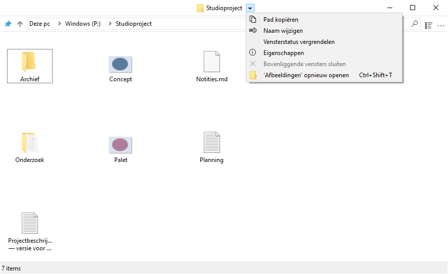
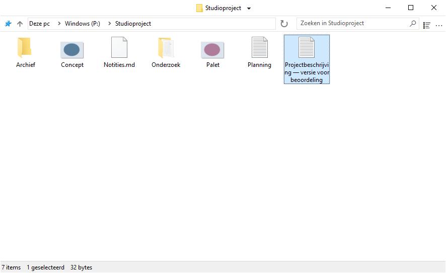
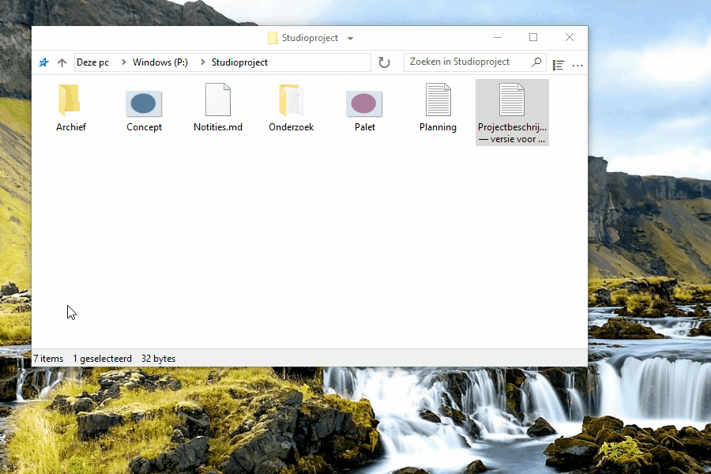
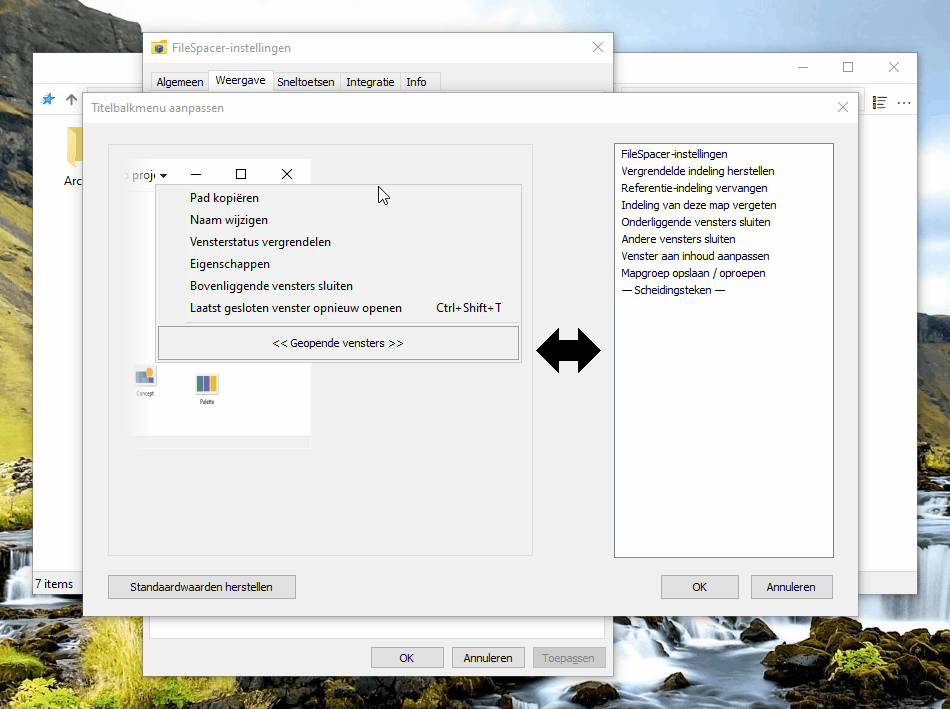
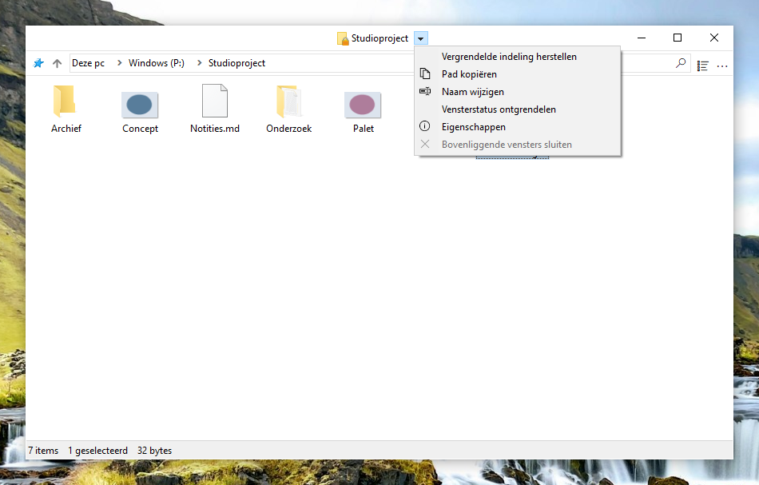
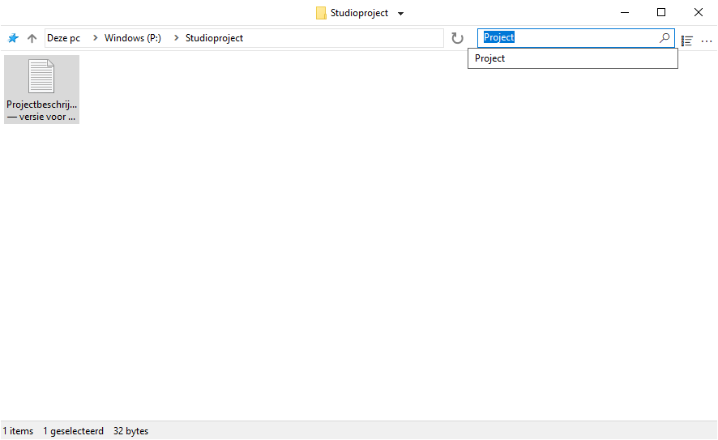
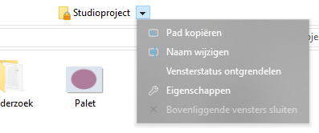
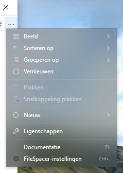

# FileSpacer gebruiken

## Navigeren tussen vensters

Elke map heeft één venster. Een al geopende map opnieuw openen brengt het venster naar voren; positie, afmetingen, weergave-instellingen en pictogramindeling worden onthouden. De indeling blijft behouden als een map wordt verplaatst of hernoemd.

- Een map of bovenliggende map openen sluit standaard het bronvenster. Ctrl keert dit eenmalig om; de standaard is instelbaar onder **Instellingen > Algemeen**. Meerdere geselecteerde mappen openen houdt het bronvenster open.
- Het menu naast de maptitel schakelt tussen geopende mappen. **Bovenliggende vensters sluiten** sluit geopende bovenliggende mappen en houdt andere mappen open.
- **Ctrl+Shift+T** opent de laatst gesloten map zonder de huidige te sluiten. Het titelmenu en de Jump List op de taakbalk bieden dezelfde opdracht; via de laatste kunt u verder teruggaan in gesloten mappen. Indeling en selectie keren terug, evenals de eerste zichtbare rij in de weergaven Details en Lijst.
- De Jump List op de taakbalk opent ook mappen die zijn vastgemaakt aan Snelle toegang in Bestandenverkenner.

Naar een bovenliggende map gaan selecteert de verlaten map niet. Een al geopende bovenliggende map behoudt haar selectie. Het Configuratiescherm opent in een eigen Windows-venster.



## Weergave en indeling

### Pictogramindeling

In pictogramweergaven kunnen bestanden en submappen vrij worden geplaatst wanneer **Pictogrammen automatisch schikken** uitstaat. Pictogramposities worden onafhankelijk van de venstergeometrie opgeslagen, ook als de opgeslagen vensterindeling is vergrendeld.

### Weergaveopties

**Volledige naam van geselecteerd bestand tonen**, onder **Instellingen > Weergave**, houdt één geselecteerde naam volledig leesbaar in de pictogramweergave. Deze optie staat standaard aan en verandert meervoudige selecties of andere weergaven niet.


**Weergavemodi vooraf bekijken in het menu Beeld** staat ook standaard aan en toont elke modus wanneer u erover beweegt. Klikken behoudt de modus; Escape of het verlaten van het voorbeeld herstelt de oorspronkelijke weergave. Een voorbeeld vervangt nooit de opgeslagen indeling.

**Mappen en bestanden samen sorteren** sorteert beide samen, zoals in [macOS](https://support.apple.com/en-au/guide/mac-help/mchlp1745/27/mac/27) en [Linux](https://www.gnu.org/s/coreutils/manual/html_node/Sorting-the-output.html). De optie staat standaard uit onder **Instellingen > Weergave > Bestanden**. Ze geldt voor Details, Lijst en automatisch gerangschikte pictogrammen; vrije indelingen blijven behouden. Virtuele mappen en archieven behouden de Windows-volgorde.



De zichtbaarheid van werkbalk en statusbalk is ook instelbaar.

### Vensterplaatsing

Mappen zonder opgeslagen positie openen in vrije ruimte, of met minder overlap als de ruimte opraakt. Opgeslagen posities hebben voorrang. **Instellingen > Algemeen > Nieuwe vensters in vrije ruimte plaatsen** staat standaard aan; uitschakelen gebruikt de Windows-plaatsing zonder bestaande vensters te verplaatsen.

### Selectie en activering

**Selectie behouden bij klikken op een inactief venster**, onder **Instellingen > Algemeen**, laat een klik op de achtergrond een map activeren zonder de selectie te wissen. Een tweede druk begint een selectierechthoek. Klikken op items, rechtsklikken en venstergebaren blijven zoals gebruikelijk werken.

## Vensters beheren

### Verplaatsen en formaat wijzigen

U kunt een venster verplaatsen of het formaat wijzigen door ergens in het bestandsgebied te slepen, ook boven een item. De standaardgebaren zijn:

| Actie | Sneltoets |
| --- | --- |
| Venster verplaatsen | Alt + slepen met links |
| Formaat wijzigen vanaf de rechteronderhoek | Alt + slepen met rechts |




De selectie blijft intact. Escape annuleert het gebaar. Tekstvelden, kopteksten, schuifbalken, werkbalken en menu’s houden hun normale gedrag; Alt + dubbelklikken opent de Eigenschappen van een item.

Elke actie heeft een eigen instelbare sneltoets onder **Instellingen > Sneltoetsen**. De linker- en rechtermuisknop vereisen Alt; de middelste knop kan ook zonder. Wijzigingstoetsen moeten exact overeenkomen; gereserveerde of dubbele combinaties worden geweigerd. Wijzigingen gelden voor geopende vensters; **Herstellen** keert terug naar de laatst toegepaste sneltoetsen en **Annuleren** verwerpt nog niet toegepaste wijzigingen.

### Een opgeslagen indeling vergrendelen

Vergrendelen bewaart de positie, afmetingen en weergave-instellingen als de indeling die bij opnieuw openen wordt hersteld. De functie staat standaard uit onder **Instellingen > Algemeen > Vensterstatusvergrendeling inschakelen**. Na inschakeling is **Vensterstatus vergrendelen** beschikbaar naast de maptitel. Een slotje op het mappictogram markeert een vergrendelde indeling.


Tijdelijke wijzigingen blijven mogelijk; opnieuw openen herstelt de vergrendelde indeling. Individuele pictogramposities worden normaal opgeslagen. **Vensterstatus ontgrendelen** behoudt de huidige indeling. Het slotje verbergen verwijdert de vergrendeling niet.

De functie uitschakelen vraagt om bevestiging en verwijdert alle vergrendelingen, ook voor gesloten mappen. Opnieuw inschakelen herstelt ze niet.

### Het titelbalkmenu aanpassen

Het menu is aanpasbaar onder **Instellingen > Weergave > Interface-elementen > Titelbalkmenu aanpassen**. Sleep een actie van rechts naar het menu, verplaats een item om de volgorde te wijzigen of sleep het eruit om het te verwijderen. **OK** past de samenstelling toe op alle FileSpacer-vensters; **Annuleren** verwerpt de wijzigingen. **Standaardwaarden herstellen** herstelt het ontwerp; **OK** past het toe.

Items die door Nilesoft Shell worden beheerd, kunnen hier niet worden gewijzigd omdat zijn regels voorrang hebben. Zie [Nilesoft Shell-integratie](#nilesoft-shell).





- **Vergrendelde indeling herstellen** zet het huidige venster terug naar de referentie-indeling zonder het te sluiten of de selectie te veranderen. **Referentie-indeling vervangen** slaat na bevestiging de huidige positie, afmetingen en weergave-instellingen op als nieuwe vergrendelde referentie.
- **Indeling van deze map vergeten** verwijdert de opgeslagen indeling en vergrendeling en behoudt de zoekgeschiedenis. Het huidige venster blijft staan en slaat zijn indeling niet meer op totdat het sluit; bij opnieuw openen gelden de standaardinstellingen. Een nieuwe indeling vergrendelen hervat het opslaan.
- Andere acties sluiten onderliggende vensters, sluiten de andere FileSpacer-vensters of passen het venster aan de inhoud aan.

### Mapgroepen

**Mapgroep opslaan / oproepen** bewaart de momenteel geopende mappen onder een naam. Een groep openen herstelt elke map met haar eigen opgeslagen indeling en houdt andere vensters open. Een groep verwijderen verwijdert alleen de lijst, nooit de mappen.

## Zoeken en geschiedenis

Voer een volledige of gedeeltelijke bestands- of mapnaam in en druk op Enter of klik op het vergrootglas om de huidige map te filteren. **Filteren tijdens het typen**, onder **Instellingen > Algemeen**, past het filter tijdens het invoeren toe. Dit lokale filter start Everything nooit automatisch.

Het veld biedt recente zoekopdrachten en, indien ingeschakeld, **Zoeken in Everything**. Omhoog/Omlaag en Enter kiezen een suggestie; Enter zonder suggestie past het lokale filter toe. Escape sluit de lijst zonder de tekst te wissen en Ctrl+F geeft het veld de focus.

De geschiedenis bewaart standaard vijf verschillende ingediende zoekopdrachten per map. De limiet is instelbaar van 0 tot 20 onder Algemeen; 0 wist en schakelt de geschiedenis uit. Alleen typen voegt geen vermelding toe. [Everything](#everything) kan submappen of alle geïndexeerde bestanden doorzoeken.



## Integratie

### Windows-integratie

FileSpacer kan tijdens installatie of later onder **Instellingen > Integratie** met **Instellen als standaardbestandsbeheerder** worden ingesteld. **Standaardbestandsbeheerder herstellen** laat mappen weer in Bestandenverkenner openen.

Het mapsnelmenu biedt **Openen in FileSpacer**, of **Openen in Windows Bestandenverkenner** wanneer FileSpacer de standaard is. Dit werkt ook op stations, ZIP-mappen, netwerklocaties en mapachtergronden, zonder de standaardtoepassing te hoeven wijzigen.

Bestandstypen openen in hun gebruikelijke Windows-toepassing. Netwerkmappen, voorbeelden en geïnstalleerde snelmenuopdrachten gebruiken ook de normale Windows-afhandeling. **Opties voor Bestandenverkenner** opent gedeelde mapvoorkeuren, waarvan sommige ook voor FileSpacer gelden.

### PowerToys Grab And Move

Wanneer Grab And Move is ingeschakeld in PowerToys, worden de verplaats- en formaatwijzigingsgebaren van FileSpacer opgeschort voor de betrokken vensters, ook als PowerToys niet actief is. De ingestelde sneltoetsen blijven behouden.

Voeg `FileSpacer.exe` toe aan de uitgesloten apps van Grab And Move of schakel de functie uit in PowerToys om de FileSpacer-gebaren te blijven gebruiken. Het bericht onder **Instellingen > Sneltoetsen** linkt rechtstreeks naar de instellingen van Grab And Move.

### PowerToys Peek

**Voorbeeld met spatiebalk**, onder **Instellingen > Integratie**, opent een Peek-voorbeeld van geselecteerde bestanden of mappen op een station of netwerkshare door alleen op de **spatiebalk** te drukken. De optie staat standaard uit; typen en namen wijzigen werken zoals gebruikelijk.

Peek moet ook in PowerToys zijn ingeschakeld; de koppeling **PowerToys** onder de optie opent de instellingen. Deze integratie vereist PowerToys 0.96 of nieuwer, en 0.102 of nieuwer voor meervoudige selecties.

### Everything

Een bestaande installatie van [Everything](https://www.voidtools.com/) kan worden geïntegreerd voor geavanceerde zoekopdrachten vanuit het FileSpacer-zoekveld. Resultaten openen in Everything.

De optie staat onder **Instellingen > Integratie**. Everything wordt automatisch of via **Detecteren** gevonden; een draagbare kopie kan handmatig worden geselecteerd. Het bereik is de huidige map met submappen, of **Overal**; virtuele mappen vereisen Overal.

**Zoeken in Everything** verstuurt de ingevoerde zoekopdracht met de syntaxis van Everything. Na geslaagd starten worden het FileSpacer-veld en lokale filter gewist; bij een fout blijven ze behouden voor een nieuwe poging.


### Nilesoft Shell

[Nilesoft Shell](https://nilesoft.org/) kan de menu’s van FileSpacer vormgeven en opdrachten aanpassen. Aanpassing van de configuratie wordt aanbevolen voor een consistent uiterlijk, met name rechte hoeken op titelbalk- en werkbalkmenu’s.

FileSpacer stelt eerst het titelbalkmenu samen. Daarna past Nilesoft Shell regels toe die opdrachten kunnen hernoemen, verplaatsen, verbergen of toevoegen en dus voorrang hebben. Grijze items in de editor worden gewijzigd in de configuratiebestanden van Nilesoft Shell.

Nieuwe FileSpacer-acties zijn ook bruikbaar in `shell.nss` of een geïmporteerd bestand, met `window.command` en de actie-ID. Bijvoorbeeld met de voorwaarde `filespacer_title` uit de [configuratiereferentie](nilesoft-shell.md):

```nss
item(type='*' mode='multiple' where=filespacer_title
     title='Vergrendelde indeling herstellen' cmd=window.command(1123))
```

De referentie vermeldt de andere acties en hun ID’s.

De [configuratiereferentie](nilesoft-shell.md) beschrijft het toestaan van FileSpacer, het behouden van het thema en het weren van regels die alleen voor Bestandenverkenner bedoeld zijn. Na een wijziging past het afmelden en opnieuw registreren van Nilesoft Shell de configuratie toe op nieuw geopende menu’s.

Het Modern-thema hieronder vergelijkt de standaardhoeken met de aanbevolen rechte hoeken.

**Navigatiemenu**

| Standaardhoeken | Aanbevolen rechte hoeken |
| --- | --- |
|  |  |

**Hoofdmenu (…)**

| Standaardhoeken | Aanbevolen rechte hoeken |
| --- | --- |
|  |  |

## Instellingen en updates

Ctrl+, opent Instellingen, ook met een verborgen werkbalk. De interface volgt de Windows-weergavetaal, met Engels als terugvaltaal; een taalwijziging vereist opnieuw starten. F1 opent de geïnstalleerde handleiding, ook offline beschikbaar.

U controleert updates onder **Instellingen > Info**. Downloaden en installeren vereisen bevestiging; installatie gebeurt nooit automatisch. Daarna keren eerder geopende mappen terug met hun opgeslagen indeling. Optionele wekelijkse controles staan standaard uit en kunnen onder Info worden ingeschakeld.

## Lokale gegevens

Mapindelingen, venstervergrendelingen, zoekopdrachten en de geschiedenis van gesloten mappen worden lokaal opgeslagen in `%LOCALAPPDATA%\FileSpacer\folder-state.sqlite3`. Algemene voorkeuren, het titelbalkmenu en mapgroepen staan in het Windows-register onder `HKEY_CURRENT_USER\Software\FileSpacer`. Opgeslagen status kan mappaden bevatten, ook netwerkpaden. Tijdelijke updatebestanden en de lijst met opnieuw te openen mappen blijven in `%TEMP%\FileSpacerUpdate-{GUID}`.

**Instellingen > Info > Onderhoud > Alle mapstatussen opnieuw instellen** sluit mapvensters en wist hun opgeslagen indeling, geschiedenis en vergrendelingen. Bestanden en algemene voorkeuren blijven behouden.

Voor probleemoplossing stelt `FileSpacer.exe /reset-options` algemene voorkeuren opnieuw in; `/reset-all` wist ook opgeslagen mapstatussen. Geen van beide verwijdert bestanden, wijzigt Windows-bestandskoppelingen of verwijdert bestaande diagnostische rapporten.

## Privacy

FileSpacer bevat geen telemetrie, gebruiksregistratie of reclame. Crashrapporten worden niet automatisch verstuurd. Diagnostische rapporten blijven in `%LOCALAPPDATA%\FileSpacer`; delen is optioneel en kan bestandspaden of delen van het procesgeheugen onthullen.

Updatecontroles en downloads maken via HTTPS contact met GitHub. GitHub ontvangt de gebruikelijke verbindingsinformatie, waaronder het IP-adres en de toepassingsversie, maar geen mapstatussen, bestandspaden of diagnostische rapporten.

Referenties voor netwerkstations worden door Windows ingevoerd en verwerkt, zoals in Bestandenverkenner. FileSpacer leest of bewaart ze niet. Een Everything-zoekopdracht kiezen geeft de zoekopdracht en, bij mapgebonden zoeken, het pad door aan de lokale Everything-toepassing.
