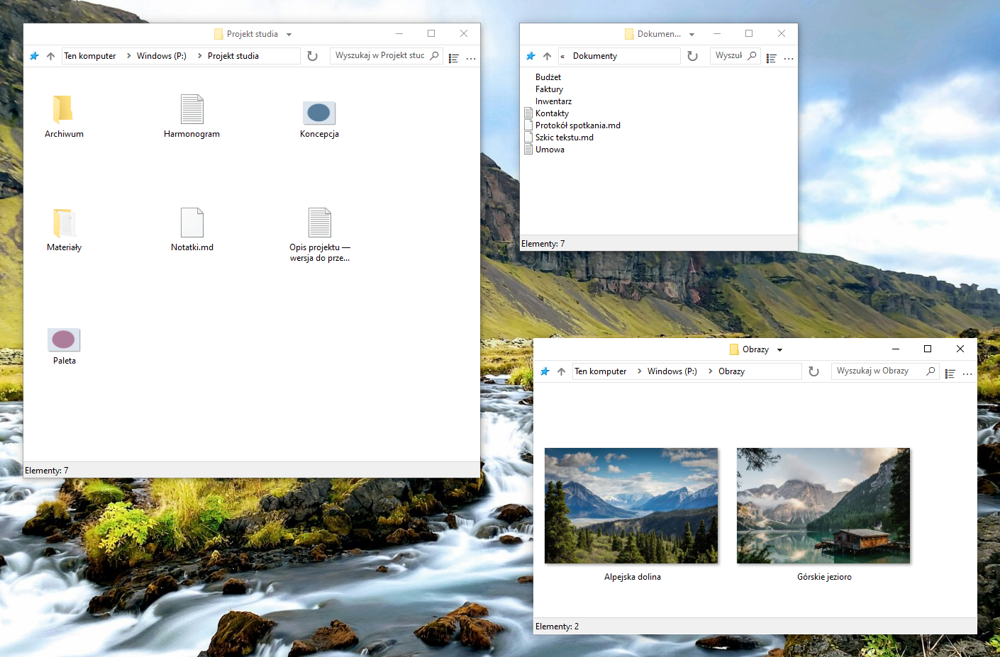

    

# FileSpacer

 &emsp;

FileSpacer to menedżer plików dla Windows oparty na [paradygmacie przestrzennym](https://en.wikipedia.org/wiki/Spatial_file_manager): każdy folder ma jedno okno zapamiętujące położenie, rozmiar i ustawienia widoku. Zapewnia to [stałe punkty orientacyjne](https://www.csse.canterbury.ac.nz/~andy/papers/transforms.pdf), dzięki którym [pamięć przestrzenna](https://www.microsoft.com/en-us/research/wp-content/uploads/1998/01/p153-robertson.pdf) pomaga natychmiast rozpoznawać znane foldery. W nawigacyjnym menedżerze to samo okno kolejno wyświetla różne foldery: samo położenie i rozmiar nie identyfikują folderu, więc trzeba spojrzeć na zawartość. Stałe punkty odniesienia dla każdego folderu mogą ograniczyć obciążenie poznawcze podczas poruszania się po plikach. Karty są niezgodne z modelem przestrzennym i nigdy nie zostaną dodane.

FileSpacer stawia na lekkość i przejrzystość. Aby ograniczyć gromadzenie okien, znaną wadę modelu przestrzennego, domyślnie zamyka okno źródłowe przy otwieraniu folderu. Przytrzymaj Ctrl, aby je zachować i pracować z kilkoma folderami. Interfejs celowo pozostaje dyskretny — w odróżnieniu od tych, w których między przyciskami ledwo można dostrzec plik.

**System i języki:** Windows 10 lub nowszy, x64. Dziesięć języków: angielski, francuski, niemiecki, włoski, hiszpański, portugalski (Portugalia), grecki, polski, niderlandzki i ukraiński.

**Prywatność:** **Bez telemetrii, śledzenia użycia i reklam**. Sprawdzanie aktualizacji łączy się z GitHub. Cotygodniowe sprawdzanie jest opcjonalne i domyślnie wyłączone. Pobieranie i instalacja wymagają potwierdzenia. [Polityka prywatności](user-guide.md#privacy).

**Instalacja:**

- **Instalacja ręczna:** pobierz i uruchom <a href="https://github.com/LeBenco/FileSpacer/releases/download/v1.4.0/FileSpacer-1.4.0-install.exe" id="last-release-url">instalator najnowszej wersji</a>.
- **WinGet:** `winget install --id Benco.FileSpacer --exact`
- **Chocolatey** (terminal uruchomiony jako administrator): `choco install filespacer -y`

Pakiety WinGet oczekują na zatwierdzenie w katalogu.

## Funkcje

- **Jedno okno na folder**. Położenie, rozmiar, tryb widoku i pozycje ikon [są zapamiętywane](user-guide.md#window-navigation). Ikony można rozmieszczać dowolnie lub wyrównywać do [klasycznej siatki](user-guide.md#icon-layout).
- **Rozmieszczanie okien**. Otwarcie innego folderu domyślnie zamyka okno źródłowe. Okna bez zapisanego położenia są rozmieszczane tak, aby [ograniczyć ich nakładanie się](user-guide.md#window-placement).
- **Zarządzanie oknami**. Przenoszenie i zmiana rozmiaru okien za pomocą [gestów myszy](user-guide.md#moving-and-resizing). Zapisywanie i ponowne otwieranie [grup folderów](user-guide.md#folder-groups). [Blokowanie układu okien](user-guide.md#locking-a-saved-layout).

**Dokumentacja:**

## Integracja

FileSpacer można ustawić jako domyślny menedżer plików podczas instalacji lub później w ustawieniach. Pliki otwierają się w zwykłych aplikacjach Windows. Foldery sieciowe korzystają z obsługi Windows. [Integracja z Windows](user-guide.md#windows-integration).

**Everything** umożliwia zaawansowane wyszukiwanie z pola FileSpacer w bieżącym folderze i podfolderach lub we wszystkich indeksowanych plikach. Wyniki otwierają się w Everything. [Integracja i użycie](user-guide.md#everything).

**Nilesoft Shell** nadaje menu FileSpacer motywy i własne polecenia. Zaleca się dostosowanie konfiguracji dla spójnego wyglądu. [Integracja i konfiguracja](user-guide.md#nilesoft-shell).

## Kompilacja

Kompilacja wymaga MSVC/NMAKE, Visual Studio 2022 Build Tools z ATL i Windows SDK, Inkscape oraz ImageMagick. Instalator wymaga NSIS. SQLite jest dołączony. Zobacz [przewodnik kompilacji](build.md).

Testy regresji łączą scenariusze PowerShell z pomocnikami C++ i C# do kontroli wewnętrznych oraz rzeczywistych testów interfejsu i powłoki Windows. [Przepływ pracy regresji w GitHub Actions](https://github.com/LeBenco/FileSpacer/actions/workflows/regression.yml) uruchamia ten zestaw testów aplikacji na żądanie i automatycznie przed wydaniem. Te same przypadki można uruchomić przez `tests.cmd` na lokalnym pulpicie Windows lub w skonfigurowanej maszynie wirtualnej Hyper-V. [Przewodnik testów](tests/regression/README.md) opisuje wybór przypadków, wymagania i wyniki.

## Licencja i podziękowania

### Prawa autorskie i licencja
FileSpacer jest udostępniany na licencji . 
Copyright © 2026 Benco za modyfikacje FileSpacer. Pełny tekst licencji znajduje się w pliku [LICENSE](../../LICENSE) w źródłach lub `LICENSE.txt` w folderze instalacyjnym. FileSpacer jest dostarczany bez gwarancji. Redystrybucja i modyfikacje są dozwolone na warunkach tej licencji.

### Fork i podziękowania dla oryginalnego projektu
FileSpacer jest forkiem [ChromaFiler](https://github.com/vanjac/chromafiler) (oryginalny kod ChromaFiler © 2023 J. van't Hoog), którego autorem jest J. van't Hoog (vanjac). Dziękujemy vanjac za tę podstawę!

### Informacje o składnikach innych firm
Zobacz [informacje o składnikach innych firm](THIRD_PARTY_NOTICES.md) oraz [politykę prywatności](privacy-policy.md).
