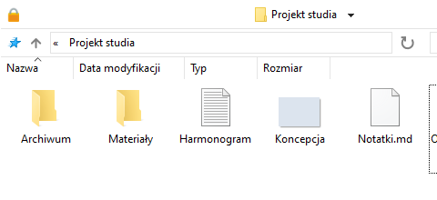
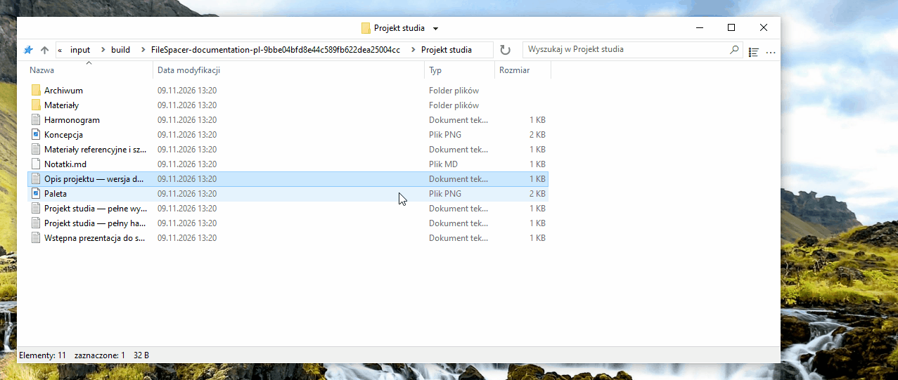
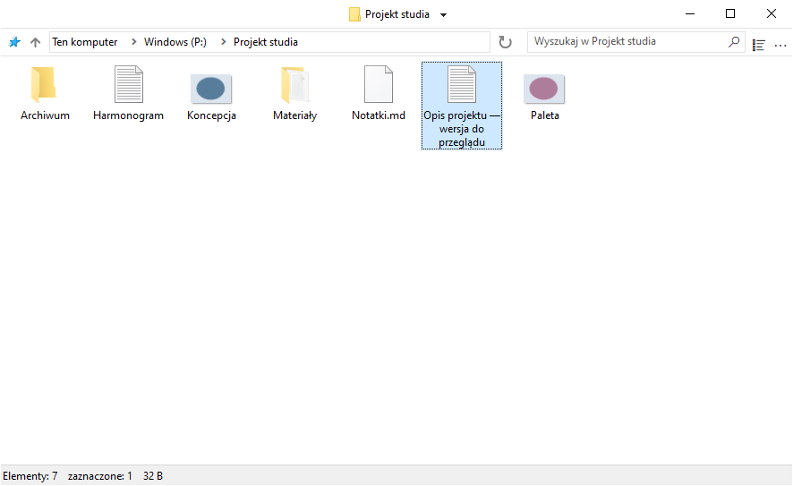
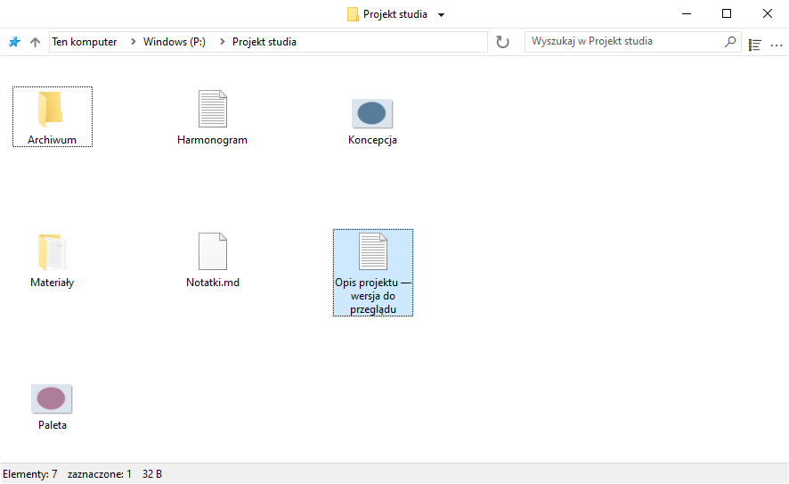
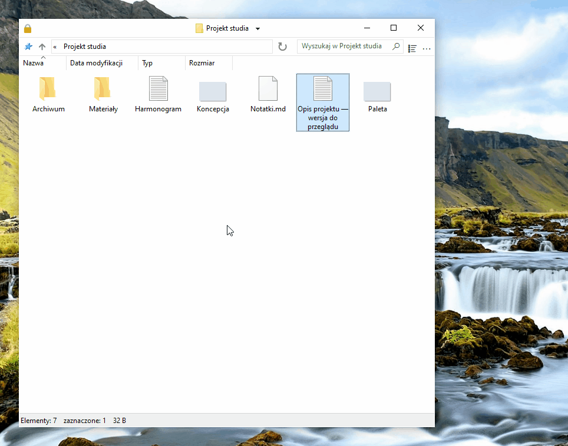
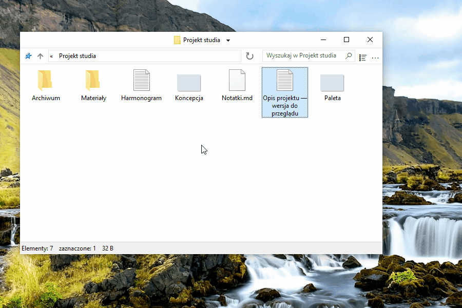
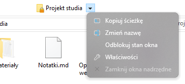

# Korzystanie z FileSpacer

FileSpacer zapamiętuje położenie i wygląd każdego okna między kolejnymi otwarciami. Foldery wracają na swoje miejsca i łatwo je rozpoznać, podobnie jak przedmioty ułożone na biurku. Program oferuje też konfigurowalne skróty, szybkie działania i przejrzysty interfejs, który można dostosować.

FileSpacer można ustawić jako domyślny menedżer plików podczas instalacji lub w **Ustawienia > Integracja**, wybierając **Ustaw jako domyślny menedżer**. Menu kontekstowe folderów zawiera **Otwórz w FileSpacer**, a gdy FileSpacer jest domyślny, **Otwórz w Eksploratorze plików Windows**.

## Nawigacja i rozmieszczenie okien

**Każdy folder ma własne okno.** Jeśli jest już otwarty, FileSpacer przenosi jego okno na pierwszy plan. Położenie, rozmiar, widok, układ ikon i pozycja przewijania są zapamiętywane nawet po przeniesieniu folderu lub zmianie jego nazwy. Okna bez zapisanego położenia są rozmieszczane tak, aby ograniczyć nakładanie się (opcja w **Ustawienia > Ogólne**).

**Można zablokować bieżące położenie, rozmiar i widok folderu, aby przywracać je przy każdym otwarciu.** Późniejsze zmiany są tymczasowe. Pozycje ikon nadal są zapisywane. Można **przywrócić zablokowany układ** bez zamykania okna.

**Odblokuj stan okna** zachowuje bieżący układ i ponownie umożliwia zapisywanie zmian.

Blokowanie włącza się w **Ustawienia > Ogólne**. Można tam również dostosować wyświetlanie kłódki po lewej stronie paska tytułu i włączyć blokowanie lub odblokowywanie stanu okna kliknięciem tej ikony. Polecenie można też [dodać do menu paska tytułu](#customize-the-title-bar-menu). Wyłączenie funkcji usuwa wszystkie blokady i ukrywa ikonę.

Otwarcie folderu lub folderu nadrzędnego domyślnie zamyka okno źródłowe. **Przytrzymanie Ctrl podczas otwierania** pozostawia je otwarte. Zachowanie można ustawić w **Ustawienia > Ogólne**. Otwarcie kilku zaznaczonych folderów pozostawia okno źródłowe otwarte.

Menu obok tytułu pozwala przełączać otwarte foldery i zamykać okna nadrzędne. **Ctrl+Shift+T** otwiera ostatnio zamknięty folder z jego układem i zaznaczeniem. Lista szybkiego dostępu na pasku zadań zawiera też ostatnio zamknięte foldery i foldery przypięte do Szybkiego dostępu.

**Zapisz / przywołaj grupę folderów** w menu tytułu pozwala otworzyć kilka folderów razem z ich zapisanymi układami.

## Wyświetlanie zawartości folderów

FileSpacer pozwala rozmieszczać elementy folderu w siatce, jak w Eksploratorze plików, lub dowolnie, jak na pulpicie systemu Windows. Dowolne rozmieszczanie jest dostępne przy każdym rozmiarze ikon oraz w widoku **Kafelki**. Widoki **Lista** i **Szczegóły** nie obsługują dowolnego rozmieszczania. Aby wybrać pozycje, wyłączyć opcję **Autorozmieszczanie ikon**. Wyrównywanie do siatki pozostaje dostępne. Menu **Widok** w każdym oknie zapewnia szybki dostęp do ustawień ikon, w tym opcji dostępnych w FileSpacer.

W widoku **Szczegóły** kolumny mogą automatycznie wypełniać całą szerokość okna. Można na to zezwolić w **Ustawienia > Wyświetlanie**, a następnie włączać lub wyłączać tę opcję osobno dla każdego folderu w menu **Widok**.

**Odświeżanie na bieżąco**, dostępne także w ustawieniach, może zmniejszyć płynność zmiany rozmiaru. Dla ostrożności nie zaleca się włączania go przy więcej niż kilkudziesięciu plikach.

Domyślnie foldery są zgrupowane przed plikami, jak w Eksploratorze plików. **Sortuj foldery i pliki razem** w **Ustawienia > Wyświetlanie** sortuje je razem, jak w [macOS](https://support.apple.com/en-au/guide/mac-help/mchlp1745/27/mac/27) i [Linuksie](https://www.gnu.org/s/coreutils/manual/html_node/Sorting-the-output.html). Dotyczy to widoków Szczegóły, Lista i automatycznie rozmieszczanych ikon. Foldery wirtualne i archiwa zachowują kolejność systemu Windows.

W tych samych ustawieniach **Pokaż pełną nazwę zaznaczonego pliku** pozwala odczytać całą nazwę w widoku ikon, nawet bardzo długą. Dotyczy to pojedynczego zaznaczonego pliku.

Domyślnie kliknięcie tła nieaktywnego okna usuwa jego zaznaczenie, jak w Eksploratorze plików. **Zachowaj zaznaczenie po kliknięciu nieaktywnego okna** w **Ustawienia > Ogólne** pozwala je aktywować bez utraty zaznaczenia.

## Dostosowywanie

### Zmiana interfejsu

**Menu paska tytułu** można dostosować w **Ustawienia > Wyświetlanie > Elementy interfejsu**. Polecenia dodaje się i przestawia przez przeciąganie. Przeciągnięcie wpisu poza menu usuwa go.

Wpisy obsługiwane przez Nilesoft Shell zmienia się w jego konfiguracji, ponieważ jego reguły mają pierwszeństwo przed regułami FileSpacer ([zobacz integrację poniżej](#nilesoft-shell)).

Można skonfigurować **gesty myszy do przenoszenia i zmiany rozmiaru okna** bezpośrednio z jego zawartości, również przeciągając po pliku. Domyślnie:

| Działanie | Gest |
| --- | --- |
| Przenoszenie | Alt + przeciągnięcie lewym przyciskiem |
| Zmiana rozmiaru | Alt + przeciągnięcie prawym przyciskiem |

Jeśli zaznaczono pliki, zaznaczenie zostaje zachowane. Esc anuluje działanie. Skróty ustawia się w **Ustawienia > Skróty**. Lewy i prawy przycisk wymagają Alt. Środkowego można używać samodzielnie.

### Integracja

[Everything](https://www.voidtools.com/) to narzędzie do szybkiego wyszukiwania plików i folderów po nazwie. FileSpacer pozwala uruchamiać je z pola wyszukiwania folderu. Integrację włącza się w **Ustawienia > Integracja**, z automatycznym wykrywaniem lub wyborem wersji przenośnej.

**Wyszukaj w Everything** uruchamia [wyszukiwanie](https://www.voidtools.com/support/everything/searching/) w folderze i podfolderach lub we wszystkich [zindeksowanych plikach](https://www.voidtools.com/support/everything/indexes/) po wybraniu **Wszędzie**. Wyniki otwierają się w Everything. Dla folderów wirtualnych wybrać Wszędzie. Udane uruchomienie czyści pole i lokalny filtr FileSpacer.

[Nilesoft Shell](https://nilesoft.org/) to rozszerzenie systemu Windows do zmiany wyglądu i poleceń menu kontekstowych. Jeśli jest używane, może też obsługiwać menu FileSpacer.

FileSpacer tworzy menu paska tytułu, a następnie Nilesoft Shell stosuje własne reguły, które mają pierwszeństwo. [Dokumentacja konfiguracji](nilesoft-shell.md) opisuje wygląd i dostęp do działań FileSpacer.

Dla menu paska tytułu i paska narzędzi zalecane są [prostokątne narożniki](nilesoft-shell.md#recommended-menu-appearance).

**Menu nawigacji**

| Domyślne narożniki | Zalecane prostokątne narożniki |
| --- | --- |
|  |  |

**Menu główne**

| Domyślne narożniki | Zalecane prostokątne narożniki |
| --- | --- |
|  |  |

[PowerToys](https://learn.microsoft.com/pl-pl/windows/powertoys/) to zestaw narzędzi Microsoft do rozszerzania i dostosowywania systemu Windows.

**Peek** wyświetla podgląd plików. W FileSpacer opcja **Podgląd klawiszem Spacja** w **Ustawienia > Integracja** otwiera go klawiszem Spacja. Peek musi być włączony w PowerToys. Minimalna wersja: 0.96 lub 0.102 dla wielu zaznaczonych elementów.

**Grab And Move** przenosi okna i zmienia ich rozmiar z obszaru zawartości. Po jego włączeniu odpowiednie gesty FileSpacer są wstrzymywane, nawet gdy PowerToys jest zamknięty. Aby je zachować, wykluczyć `FileSpacer.exe` w Grab And Move lub wyłączyć narzędzie.

## Aktualizacje i rozwiązywanie problemów

**Ustawienia > Informacje** pozwala sprawdzać aktualizacje i włączyć cotygodniowe sprawdzanie, domyślnie wyłączone. Pobieranie i instalacja wymagają potwierdzenia.

Na tej samej stronie **Konserwacja > Zresetuj stan wszystkich folderów** zamyka okna i usuwa ich układy, historię oraz blokady. Pliki i ustawienia ogólne pozostają zachowane.

Resetowanie ustawień i zaawansowane rozwiązywanie problemów opisano w [notatce technicznej](../en/README.md#local-data) po angielsku.

## Prywatność

FileSpacer nie zawiera telemetrii, śledzenia użycia ani reklam. Raporty awarii nigdy nie są wysyłane automatycznie. Ich udostępnienie jest dobrowolne i może ujawnić ścieżki plików lub fragmenty pamięci.

Aktualizacje łączą się z GitHubem, który otrzymuje adres IP i wersję aplikacji, ale nie ścieżki plików ani stan folderów.

Poświadczeniami dysków sieciowych zarządza bezpośrednio Windows. FileSpacer ich nie odczytuje ani nie zapisuje.

Wyszukiwanie Everything przekazuje zapytanie i, jeśli jest ograniczone do folderu, jego ścieżkę do lokalnej aplikacji Everything.
