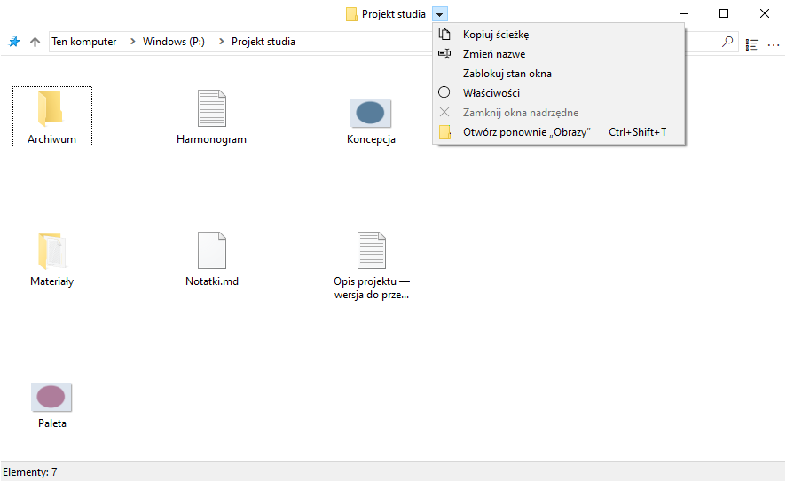
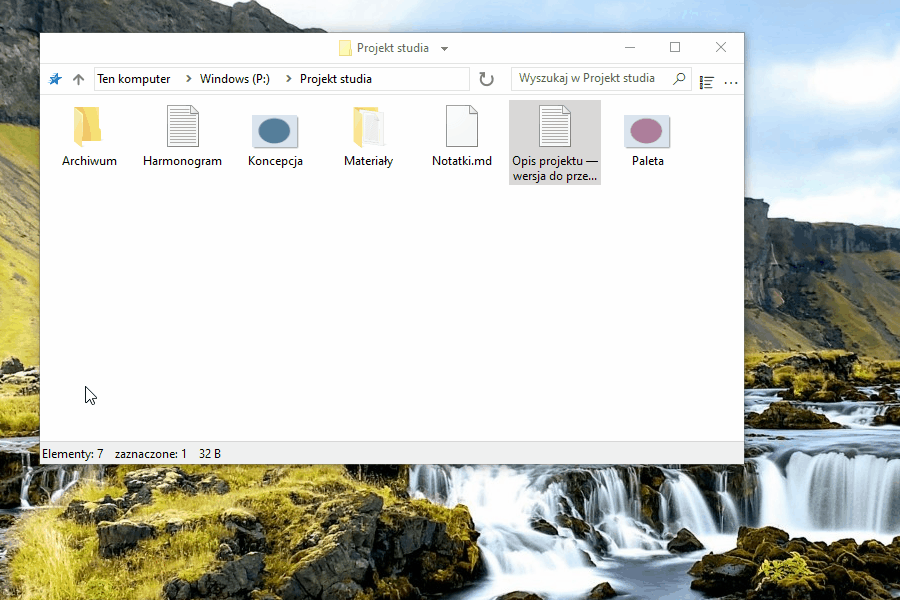
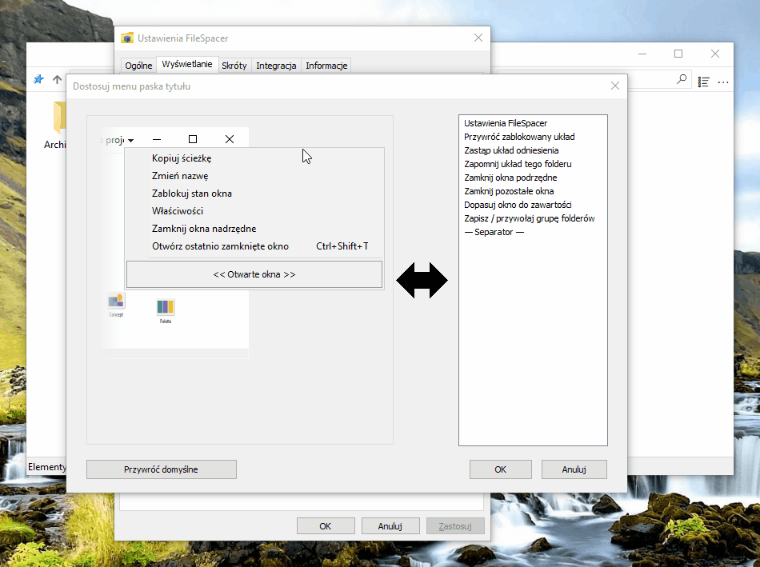
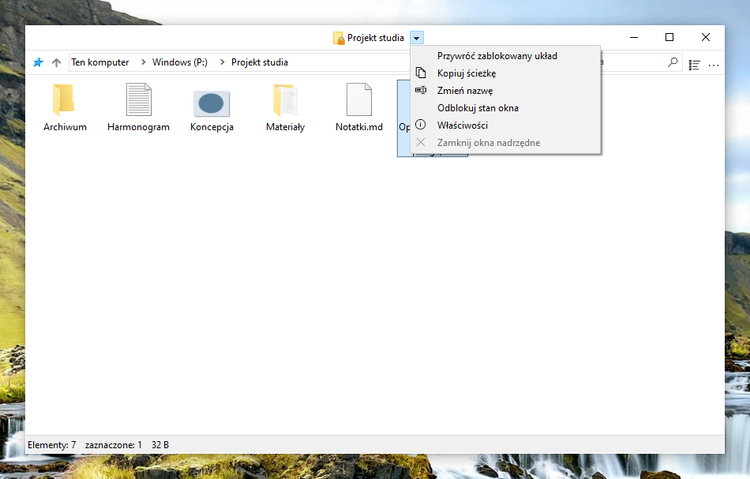
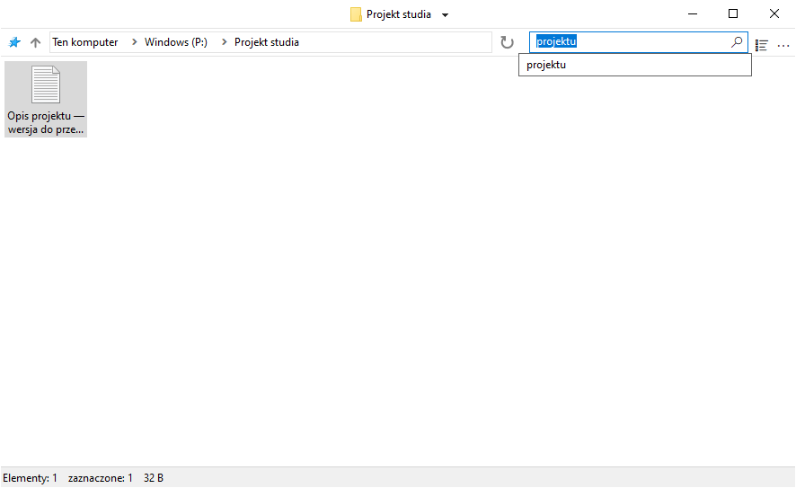
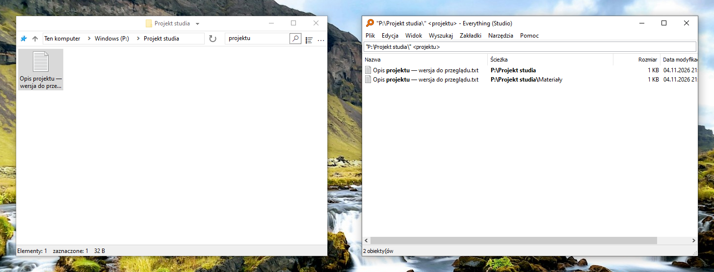
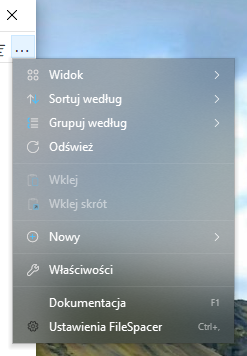

# Korzystanie z FileSpacer

## Nawigacja między oknami

Jeden folder ma jedno okno. Ponowne otwarcie już otwartego folderu przenosi jego okno na pierwszy plan; położenie, rozmiar, ustawienia widoku i układ ikon są zapamiętywane. Przeniesienie folderu lub zmiana jego nazwy zachowuje układ.

- Otwarcie folderu lub folderu nadrzędnego domyślnie zamyka okno źródłowe. Ctrl jednorazowo odwraca to zachowanie; ustawienie domyślne można zmienić w **Ustawienia > Ogólne**. Otwarcie kilku zaznaczonych folderów zachowuje okno źródłowe.
- Menu obok tytułu folderu przełącza między otwartymi folderami. **Zamknij okna nadrzędne** zamyka otwarte foldery nadrzędne, pozostawiając pozostałe okna.
- **Ctrl+Shift+T** otwiera ostatnio zamknięty folder bez zamykania bieżącego. To samo polecenie jest dostępne w menu tytułu i na liście szybkiego dostępu na pasku zadań; ta ostatnia pozwala sięgnąć do starszych zamkniętych folderów. Przywracane są układ, zaznaczenie i pierwszy widoczny wiersz w widokach Szczegóły i Lista.
- Lista szybkiego dostępu na pasku zadań otwiera też foldery przypięte w Szybkim dostępie Eksploratora plików.

Przejście do folderu nadrzędnego nie zaznacza właśnie opuszczonego folderu. Już otwarty folder nadrzędny zachowuje zaznaczenie. Panel sterowania otwiera się we własnym oknie Windows.



## Widok i układ

### Układ ikon

Widoki ikon pozwalają dowolnie rozmieszczać pliki i podfoldery, gdy **Autorozmieszczanie ikon** jest wyłączone. Położenia ikon są zapisywane niezależnie od geometrii okna, również przy zablokowanym zapisanym układzie.

### Opcje widoku

**Pokaż pełną nazwę zaznaczonego pliku** w **Ustawienia > Wyświetlanie** zapewnia pełną czytelność jednej zaznaczonej nazwy w widoku Ikony. Opcja jest domyślnie włączona; nie zmienia wielu zaznaczonych elementów ani innych widoków.


**Podgląd trybów wyświetlania w menu Widok**, również domyślnie włączony, pokazuje tryb po wskazaniu go myszą. Kliknięcie go zachowuje; Escape lub opuszczenie podglądu przywraca pierwotny widok. Podgląd nigdy nie zastępuje zapisanego układu.

**Sortuj foldery i pliki razem** stosuje wspólną kolejność, jak w [macOS](https://support.apple.com/en-au/guide/mac-help/mchlp1745/27/mac/27) i [Linuksie](https://www.gnu.org/s/coreutils/manual/html_node/Sorting-the-output.html). Opcja jest domyślnie wyłączona w **Ustawienia > Wyświetlanie > Pliki**. Dotyczy widoków Szczegóły, Lista i automatycznie rozmieszczanych ikon; swobodne układy pozostają zachowane. Foldery wirtualne i archiwa zachowują kolejność Windows.


Widoczność paska narzędzi i paska stanu również można zmienić w ustawieniach.

### Rozmieszczanie okien

Foldery bez zapisanego położenia otwierają się w wolnym miejscu lub z ograniczonym nakładaniem, gdy miejsca brakuje. Zapisane położenia mają pierwszeństwo. **Ustawienia > Ogólne > Umieszczaj nowe okna w wolnym miejscu** jest domyślnie włączone; wyłączenie używa rozmieszczania Windows bez przesuwania istniejących okien.

### Zaznaczenie i aktywacja

**Zachowaj zaznaczenie po kliknięciu nieaktywnego okna** w **Ustawienia > Ogólne** pozwala kliknięciem tła aktywować folder bez utraty zaznaczenia. Drugie naciśnięcie rozpoczyna prostokąt zaznaczenia. Kliknięcia elementów, prawym przyciskiem i gesty okna działają jak zwykle.

## Zarządzanie oknami

### Przenoszenie i zmiana rozmiaru

Okno można przenieść lub zmienić jego rozmiar, przeciągając w dowolnym miejscu obszaru plików, również nad elementem. Domyślne gesty:

| Działanie | Skrót |
| --- | --- |
| Przenieś okno | Alt + przeciągnięcie lewym przyciskiem |
| Zmień rozmiar od prawego dolnego rogu | Alt + przeciągnięcie prawym przyciskiem |




Zaznaczenie pozostaje bez zmian. Escape anuluje gest. Pola tekstowe, nagłówki, paski przewijania, paski narzędzi i menu zachowują zwykłe działanie; Alt + dwukrotne kliknięcie otwiera Właściwości elementu.

Każde działanie ma osobny skrót w **Ustawienia > Skróty**. Lewy i prawy przycisk wymagają Alt; środkowy działa też bez niego. Modyfikatory muszą pasować dokładnie; kombinacje zarezerwowane i powtórzone są odrzucane. Zmiany dotyczą otwartych okien; **Cofnij** przywraca ostatnio zastosowane skróty, a **Anuluj** odrzuca oczekujące zmiany.

### Blokowanie zapisanego układu

Blokada zachowuje położenie, rozmiar i ustawienia widoku folderu do przywrócenia przy ponownym otwarciu. Funkcja jest domyślnie wyłączona w **Ustawienia > Ogólne > Włącz blokowanie stanu okien**. Po włączeniu polecenie **Zablokuj stan okna** pojawia się obok tytułu folderu. Kłódka na ikonie folderu oznacza zablokowany układ.


Tymczasowe zmiany pozostają możliwe; ponowne otwarcie przywraca zablokowany układ. Położenia poszczególnych ikon nadal zapisują się normalnie. **Odblokuj stan okna** zachowuje bieżący układ. Ukrycie kłódki nie usuwa blokady.

Wyłączenie funkcji wymaga potwierdzenia i usuwa wszystkie blokady, także dla zamkniętych folderów. Ponowne włączenie ich nie przywraca.

### Dostosowanie menu paska tytułu

Menu można dostosować w **Ustawienia > Wyświetlanie > Elementy interfejsu > Dostosuj menu paska tytułu**. Przeciągnij działanie z prawej strony do menu, przesuń pozycję, aby zmienić kolejność, lub wyciągnij ją poza menu, aby usunąć. **OK** stosuje układ do wszystkich okien FileSpacer; **Anuluj** odrzuca zmiany. **Przywróć domyślne** resetuje projekt; **OK** go stosuje.

Pozycji zarządzanych przez Nilesoft Shell nie można zmieniać tutaj, ponieważ jego reguły mają pierwszeństwo. Zobacz [integrację Nilesoft Shell](#nilesoft-shell).





- **Przywróć zablokowany układ** przywraca bieżącemu oknu układ odniesienia bez zamykania go ani zmiany zaznaczenia. **Zastąp układ odniesienia** zapisuje po potwierdzeniu bieżące położenie, rozmiar i ustawienia widoku jako nowy zablokowany wzorzec.
- **Zapomnij układ tego folderu** usuwa zapisany układ i blokadę, zachowując historię wyszukiwania. Bieżące okno pozostaje na miejscu i przestaje zapisywać układ do zamknięcia; następne otwarcie używa ustawień domyślnych. Zablokowanie nowego układu wznawia zapis.
- Pozostałe działania zamykają okna podrzędne, pozostałe okna FileSpacer lub dopasowują okno do zawartości.

### Grupy folderów

**Zapisz / przywołaj grupę folderów** zapisuje obecnie otwarte foldery pod nazwą. Otwarcie grupy przywraca każdy folder z jego zapisanym układem, pozostawiając pozostałe okna. Usunięcie grupy usuwa tylko listę, nigdy foldery.

## Wyszukiwanie i historia

Wpisz całą nazwę pliku lub folderu albo jej część, następnie naciśnij Enter lub kliknij lupę, aby przefiltrować bieżący folder. **Filtruj podczas pisania** w **Ustawienia > Ogólne** stosuje filtr podczas wprowadzania tekstu. Ten lokalny filtr nigdy automatycznie nie uruchamia Everything.

Pole proponuje ostatnie wyszukiwania i, po włączeniu, **Wyszukaj w Everything**. Strzałki w górę/w dół i Enter wybierają sugestię; Enter bez sugestii stosuje filtr lokalny. Escape zamyka listę bez kasowania tekstu, a Ctrl+F przenosi fokus do pola.

Historia domyślnie zachowuje pięć różnych zatwierdzonych wyszukiwań na folder. Limit wynosi od 0 do 20 w ustawieniach ogólnych; 0 czyści i wyłącza historię. Samo pisanie nie dodaje wpisu. [Everything](#everything) przeszukuje podfoldery lub wszystkie indeksowane pliki.



## Integracja

### Integracja z Windows

FileSpacer można ustawić jako domyślny menedżer plików podczas instalacji lub w **Ustawienia > Integracja**, wybierając **Ustaw jako domyślny menedżer**. **Przywróć domyślny menedżer** przywraca otwieranie folderów w Eksploratorze plików.

Menu kontekstowe folderów udostępnia **Otwórz w FileSpacer** lub **Otwórz w Eksploratorze plików Windows**, gdy FileSpacer jest domyślny. Działa to także dla dysków, folderów ZIP, lokalizacji sieciowych i tła folderów bez konieczności zmiany aplikacji domyślnej.

Pliki otwierają się w zwykłych aplikacjach Windows. Foldery sieciowe, podglądy i zainstalowane polecenia menu kontekstowego również korzystają z obsługi Windows. **Opcje Eksploratora plików** otwierają wspólne ustawienia folderów, z których część dotyczy też FileSpacer.

### PowerToys Grab And Move

Gdy Grab And Move jest włączony w ustawieniach PowerToys, gesty przenoszenia i zmiany rozmiaru FileSpacer są wstrzymane dla objętych nim okien, nawet jeśli PowerToys nie działa. Skonfigurowane skróty pozostają zachowane.

Aby nadal używać gestów FileSpacer, dodaj `FileSpacer.exe` do wykluczonych aplikacji Grab And Move lub wyłącz tę funkcję w PowerToys. Powiadomienie w **Ustawienia > Skróty** prowadzi bezpośrednio do ustawień Grab And Move.

### PowerToys Peek

**Podgląd klawiszem Spacja** w **Ustawienia > Integracja** otwiera podgląd Peek zaznaczonych plików lub folderów na dysku lub w udziale sieciowym po naciśnięciu samej **Spacji**. Opcja jest domyślnie wyłączona; pisanie i zmiana nazw działają jak zwykle.

Peek musi być też włączony w PowerToys; łącze **PowerToys** pod opcją otwiera jego ustawienia. Integracja wymaga PowerToys 0.96 lub nowszego, a dla wielu zaznaczonych elementów — 0.102 lub nowszego.

### Everything

Istniejącą instalację [Everything](https://www.voidtools.com/) można zintegrować, aby wykonywać zaawansowane wyszukiwania z pola FileSpacer. Wyniki otwierają się w Everything.

Opcję włącza się w **Ustawienia > Integracja**. Everything jest wykrywany automatycznie lub przez **Wykryj**; wersję przenośną można wybrać ręcznie. Zakres to bieżący folder z podfolderami lub **Wszędzie**; foldery wirtualne wymagają opcji Wszędzie.

Wybranie **Wyszukaj w Everything** wysyła wpisane zapytanie w składni Everything. Udane uruchomienie czyści pole i filtr lokalny FileSpacer; błąd zachowuje je do ponownej próby.



### Nilesoft Shell

[Nilesoft Shell](https://nilesoft.org/) zmienia wygląd menu FileSpacer i dostosowuje polecenia. Zaleca się dostosowanie konfiguracji dla spójnego wyglądu, zwłaszcza prostokątnych narożników menu tytułu i paska narzędzi.

FileSpacer najpierw składa menu tytułu. Następnie Nilesoft Shell stosuje swoje reguły, które mogą zmieniać nazwy, przenosić, ukrywać i dodawać polecenia, więc mają pierwszeństwo. Szare pozycje edytora zmienia się w plikach konfiguracji Nilesoft Shell.

Nowe działania FileSpacer można też wykorzystać w `shell.nss` lub importowanym pliku, używając `window.command` i identyfikatora działania. Przykład z warunkiem `filespacer_title` z [opisu konfiguracji](nilesoft-shell.md):

```nss
item(type='*' mode='multiple' where=filespacer_title
     title='Przywróć zablokowany układ' cmd=window.command(1123))
```

Opis zawiera pozostałe działania i ich identyfikatory.

[Opis konfiguracji](nilesoft-shell.md) wyjaśnia dopuszczenie FileSpacer, zachowanie motywu i wykluczenie reguł przeznaczonych wyłącznie dla Eksploratora. Po zmianie konfiguracji wyrejestrowanie i ponowne zarejestrowanie Nilesoft Shell stosuje ją do nowo otwieranych menu.

Poniższy motyw Modern porównuje domyślne narożniki z zalecanymi prostokątnymi.

**Menu nawigacji**

| Domyślne narożniki | Zalecane prostokątne narożniki |
| --- | --- |
|  |  |

**Menu główne (…)**

| Domyślne narożniki | Zalecane prostokątne narożniki |
| --- | --- |
|  |  |

## Ustawienia i aktualizacje

Ctrl+, otwiera ustawienia, także przy ukrytym pasku narzędzi. Interfejs używa języka wyświetlania Windows, z angielskim jako językiem zastępczym; zmiana języka wymaga ponownego uruchomienia. F1 otwiera zainstalowany przewodnik, dostępny również offline.

Aktualizacje sprawdza się w **Ustawienia > Informacje**. Pobieranie i instalacja wymagają potwierdzenia; instalacja nigdy nie jest automatyczna. Potem wcześniej otwarte foldery wracają z zapisanymi układami. Opcjonalne cotygodniowe sprawdzanie jest domyślnie wyłączone; można je włączyć w Informacjach.

## Dane lokalne

Układy folderów, blokady okien, wyszukiwania i historia zamkniętych folderów są przechowywane lokalnie w `%LOCALAPPDATA%\FileSpacer\folder-state.sqlite3`. Ustawienia ogólne, menu tytułu i grupy folderów znajdują się w rejestrze Windows: `HKEY_CURRENT_USER\Software\FileSpacer`. Zapisany stan może zawierać ścieżki folderów, także sieciowe. Tymczasowe pliki aktualizacji i lista folderów do ponownego otwarcia pozostają w `%TEMP%\FileSpacerUpdate-{GUID}`.

**Ustawienia > Informacje > Konserwacja > Zresetuj stan wszystkich folderów** zamyka okna folderów i usuwa ich zapisane układy, historię i blokady. Pliki i ustawienia ogólne pozostają zachowane.

Do rozwiązywania problemów `FileSpacer.exe /reset-options` resetuje ustawienia ogólne; `/reset-all` usuwa też zapisany stan folderów. Żadne z poleceń nie usuwa plików, nie zmienia skojarzeń Windows ani nie usuwa istniejących raportów diagnostycznych.

## Prywatność

FileSpacer nie stosuje telemetrii, śledzenia użycia ani reklam. Raporty awarii nie są wysyłane automatycznie. Raporty diagnostyczne pozostają w `%LOCALAPPDATA%\FileSpacer`; ich udostępnianie jest opcjonalne i może ujawniać ścieżki plików lub fragmenty pamięci procesu.

Sprawdzanie aktualizacji i pobieranie łączą się z GitHub przez HTTPS. GitHub otrzymuje zwykłe informacje o połączeniu, w tym adres IP i wersję aplikacji, ale nie stan folderów, ścieżki plików ani raporty diagnostyczne.

Poświadczenia dysków sieciowych wprowadza i obsługuje Windows, tak jak w Eksploratorze plików. FileSpacer ich nie odczytuje ani nie przechowuje. Wybranie wyszukiwania Everything przekazuje zapytanie i, przy wyszukiwaniu w folderze, jego ścieżkę do lokalnej aplikacji Everything.
