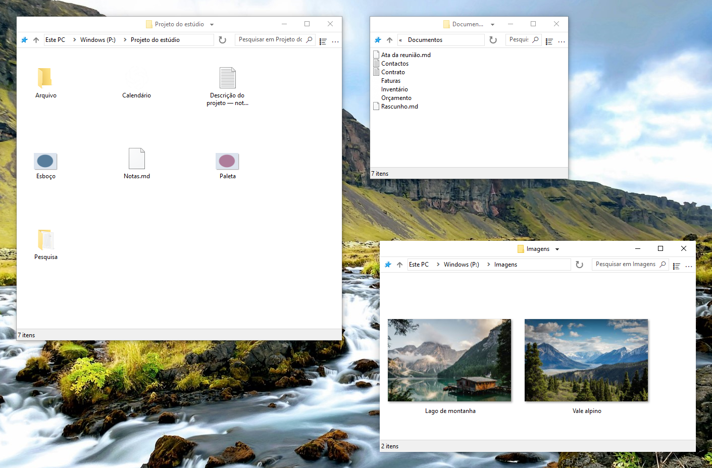

    

# FileSpacer

 &emsp;

O FileSpacer é um gestor de ficheiros para Windows baseado no [paradigma espacial](https://en.wikipedia.org/wiki/Spatial_file_manager): cada pasta tem uma única janela que memoriza a posição, o tamanho e as definições de apresentação. Isto cria [referências visuais estáveis](https://www.csse.canterbury.ac.nz/~andy/papers/transforms.pdf), permitindo que a [memória espacial](https://www.microsoft.com/en-us/research/wp-content/uploads/1998/01/p153-robertson.pdf) ajude a reconhecer as pastas familiares de relance. Num gestor de ficheiros baseado na navegação, a mesma janela mostra sucessivamente pastas diferentes: a posição e as dimensões, por si só, não identificam a pasta aberta, pelo que é preciso olhar para o conteúdo para saber onde se está. Ao conservar referências distintas para cada pasta, a abordagem espacial pode reduzir o esforço necessário para se orientar entre os seus ficheiros. Os separadores são incompatíveis com o modelo espacial e nunca serão adicionados.

O FileSpacer privilegia uma experiência leve e descomplicada. Para limitar a acumulação de janelas, uma desvantagem conhecida do paradigma espacial, o FileSpacer fecha por predefinição a janela de origem ao abrir uma pasta. Mantenha Ctrl premido durante a abertura para a conservar quando quiser trabalhar com várias pastas ao mesmo tempo. O FileSpacer mantém uma interface deliberadamente sóbria, ao contrário de certas interfaces sobrecarregadas que mal deixam espaço entre os botões para se vislumbrar um ficheiro.

**Sistema e idiomas:** Windows 10 ou posterior, x64. Disponível em dez idiomas: inglês, francês, alemão, italiano, espanhol, português (Portugal), grego, polaco, neerlandês e ucraniano.

**Privacidade:** **Sem telemetria, monitorização de utilização ou publicidade.** As verificações de atualizações contactam o GitHub. As semanais são opcionais e estão desativadas por predefinição. A transferência e a instalação exigem confirmação. [Privacidade](user-guide.md#privacy).

**Instalação:**

- **Instalação manual:** transferir e executar <a href="https://github.com/LeBenco/FileSpacer/releases/download/v1.4.1/FileSpacer-1.4.1-install.exe" id="last-release-url">o instalador da versão mais recente</a>.
- **WinGet:** `winget install --id Benco.FileSpacer --exact`
- **Chocolatey** (terminal como administrador): `choco install filespacer -y`

Os pacotes WinGet aguardam aprovação no catálogo.

## Funcionalidades

- **Uma janela por pasta**. A posição, o tamanho, o modo de apresentação e as posições dos ícones [são memorizados](user-guide.md#window-navigation). Os ícones podem ser dispostos livremente ou alinhados pela [grelha clássica](user-guide.md#icon-layout).
- **Organização das janelas**. Ao abrir outra pasta, a janela de origem é fechada por predefinição. As janelas sem posição guardada são colocadas de forma a [limitar a sobreposição](user-guide.md#window-placement).
- **Gerir as janelas**. Mover ou redimensionar as janelas com [gestos do rato](user-guide.md#moving-and-resizing). Guardar e reabrir [grupos de pastas](user-guide.md#folder-groups). [Bloquear a disposição das janelas](user-guide.md#locking-a-saved-layout).

**Documentação:**

## Integração

O FileSpacer pode ser definido como gestor de ficheiros predefinido na instalação ou mais tarde nas definições. Os ficheiros abrem na aplicação habitual do Windows. As pastas de rede seguem o funcionamento normal do Windows. [Integração com o Windows](user-guide.md#windows-integration).

Com o **Everything**, é possível iniciar pesquisas avançadas a partir do campo do FileSpacer, na pasta atual e nas subpastas ou em todos os ficheiros indexados. Os resultados abrem no Everything. [Integração e utilização](user-guide.md#everything).

Com o **Nilesoft Shell**, os menus do FileSpacer podem usar os seus temas e comandos personalizados. Recomenda-se adaptar a configuração para uma integração visual coerente. [Integração e configuração](user-guide.md#nilesoft-shell).

## Compilação

A compilação utiliza MSVC/NMAKE, Visual Studio 2022 Build Tools com ATL e um Windows SDK, Inkscape e ImageMagick. O instalador requer o NSIS. O SQLite está incluído. Consulte o [guia de compilação](../en/build.md).

Os testes de regressão combinam cenários PowerShell com ferramentas C++ e C# para verificações internas e testes reais da interface do Windows e da Shell. O [workflow de regressão do GitHub Actions](https://github.com/LeBenco/FileSpacer/actions/workflows/regression.yml) executa esta suite da aplicação a pedido e automaticamente antes de uma publicação. Os mesmos casos podem ser executados com `tests.cmd` num ambiente de trabalho Windows local ou numa VM Hyper-V configurada. O [guia dos testes](../en/tests/regression/README.md) explica a seleção de casos, os pré-requisitos e os resultados.

## Licença e agradecimentos

### Direitos de autor e licença
O FileSpacer é distribuído ao abrigo da licença . 
Copyright © 2026 Benco pelas alterações do FileSpacer. A licença completa encontra-se em [LICENSE](../../LICENSE) no código-fonte, ou em `LICENSE.txt` na pasta de instalação. O FileSpacer é fornecido sem garantia. A redistribuição e a modificação são permitidas nos termos dessa licença.

### Origem do projeto e agradecimentos
O FileSpacer é uma derivação do [ChromaFiler](https://github.com/vanjac/chromafiler), criado por J. van’t Hoog (vanjac). Muito obrigado ao vanjac por esta base! Código original do ChromaFiler © 2023 J. van’t Hoog.

### Avisos relativos a componentes de terceiros
Consulte os [avisos relativos a componentes de terceiros](THIRD_PARTY_NOTICES.md) e a [política de privacidade](privacy-policy.md).
