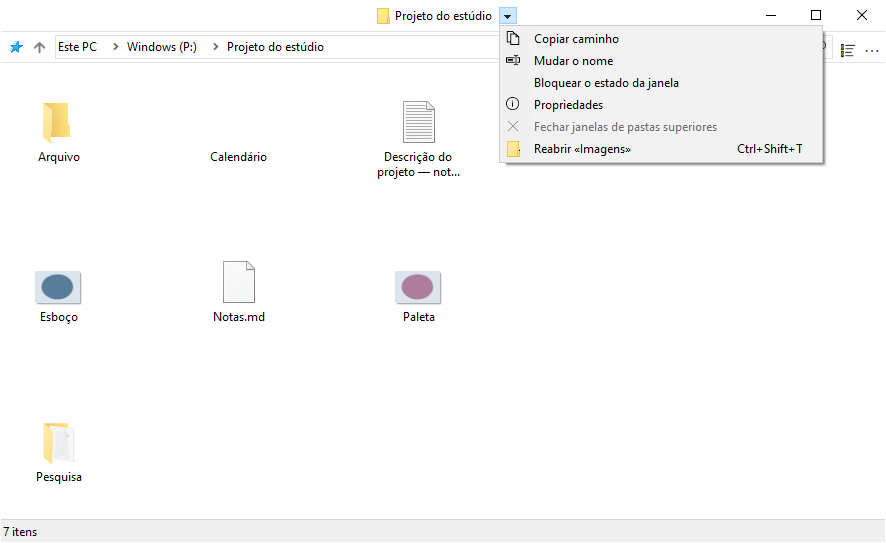
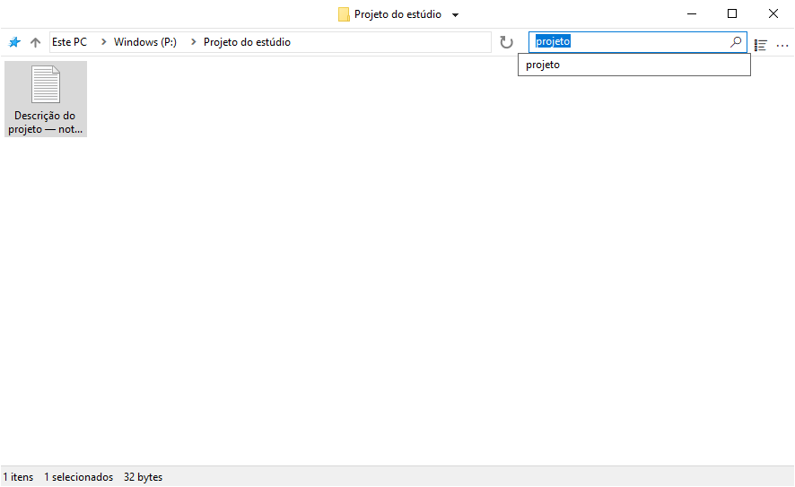

# Utilizar o FileSpacer

## Navegação entre janelas

O FileSpacer oferece uma interface fluida, sóbria e personalizável, baseada no paradigma espacial:

- **Uma pasta, uma janela.** Reabrir uma pasta já aberta traz a sua janela para primeiro plano. A posição, as dimensões, a vista e a disposição dos ícones são memorizadas, mesmo depois de mover ou mudar o nome da pasta.
- Abrir uma pasta ou a pasta superior fecha por predefinição a janela de origem. Mantenha Ctrl premido para inverter o comportamento uma vez, ou altere a predefinição em **Definições > Geral**. Abrir várias pastas selecionadas mantém a janela de origem aberta.
- O menu junto ao título permite alternar entre pastas abertas. **Fechar janelas de pastas superiores** fecha as janelas abertas das pastas que a contêm.
- **Ctrl+Shift+T** reabre a última pasta fechada com a respetiva disposição e seleção. O comando também está no menu do título e na Lista de Atalhos da barra de tarefas; esta permite recuar a pastas fechadas anteriormente.
- A Lista de Atalhos da barra de tarefas também abre as pastas afixadas no Acesso rápido do Explorador de Ficheiros.

Subir à pasta superior não seleciona a pasta de onde veio. Uma pasta superior já aberta conserva a sua seleção.



## Apresentação e disposição

### Disposição dos ícones

Num modo de ícones, pode posicionar livremente ficheiros e subpastas quando **Dispor ícones automaticamente** está desativado. As posições são guardadas independentemente do tamanho e da posição da janela, mesmo quando o estado guardado está bloqueado.

### Opções de apresentação

**Mostrar o nome completo do ficheiro selecionado**, em **Definições > Apresentação**, torna totalmente legível o nome de um único ficheiro selecionado na vista de ícones.


**Pré-visualizar modos de apresentação no menu Ver** mostra cada modo ao passar o ponteiro. Um clique confirma-o; Esc ou sair da pré-visualização repõe a vista inicial. A pré-visualização é temporária e não substitui a disposição guardada.

**Misturar pastas e ficheiros na ordenação** ordena ambos em conjunto, como no [macOS](https://support.apple.com/en-au/guide/mac-help/mchlp1745/27/mac/27) e no [Linux](https://www.gnu.org/s/coreutils/manual/html_node/Sorting-the-output.html). A opção está em **Definições > Apresentação > Ficheiros** e aplica-se a Detalhes, Lista e ícones organizados automaticamente. As pastas virtuais e os arquivos mantêm a ordenação do Windows.


### Posicionamento das janelas

As pastas sem posição guardada abrem no espaço livre ou com sobreposição reduzida quando falta espaço. Esta opção configura-se em **Definições > Geral > Colocar novas janelas em espaço livre**.

### Seleção e ativação

Com **Definições > Geral > Manter a seleção ao clicar numa janela inativa** ativado, clicar no fundo de uma pasta inativa ativa a respetiva janela sem limpar a seleção. Prima uma segunda vez para iniciar um retângulo de seleção.

## Gestão das janelas

### Movimento e redimensionamento

É possível mover ou redimensionar uma janela arrastando a partir da área de ficheiros, incluindo sobre um elemento. Os atalhos predefinidos são:

| Ação | Atalho |
| --- | --- |
| Mover a janela | Alt + arrastar com o botão esquerdo |
| Redimensionar a partir do canto inferior direito | Alt + arrastar com o botão direito |


A seleção é preservada. Esc cancela o gesto.

Cada ação tem o seu atalho configurável em **Definições > Atalhos**. Os botões esquerdo e direito exigem Alt; o botão do meio também funciona sem Alt.

### Bloqueio do estado guardado

O bloqueio guarda a posição, o tamanho e a vista de uma pasta para a próxima abertura. Está desativado por predefinição em **Definições > Geral > Ativar bloqueio do estado da janela**. Depois de ativado, **Bloquear o estado da janela** fica disponível junto ao título da pasta. Um cadeado sobre o ícone da pasta assinala o bloqueio.


Continuam a ser possíveis alterações temporárias; ao reabrir a pasta, regressa o estado bloqueado. As posições individuais dos ícones continuam a ser guardadas. **Desbloquear o estado da janela** mantém a disposição atual.

Desativar a função pede confirmação e remove todos os bloqueios, incluindo os das pastas fechadas. Voltar a ativá-la não os repõe.

### Personalizar o menu da barra de título

O menu personaliza-se em **Definições > Apresentação > Elementos da interface > Personalizar o menu da barra de título**. Arrastar uma ação da lista à direita para o menu, mover uma entrada para alterar a ordem ou arrastá-la para fora para a remover.

As entradas geridas pelo Nilesoft Shell não podem ser alteradas aqui, porque as suas regras têm prioridade. Consultar a [integração com o Nilesoft Shell](#nilesoft-shell).


- **Repor a disposição bloqueada** devolve a janela à disposição de referência. **Substituir a disposição de referência** guarda a disposição atual como nova referência bloqueada, após confirmação.

- **Esquecer a disposição desta pasta** elimina a disposição guardada e o bloqueio, mantendo o histórico de pesquisas. A gravação fica suspensa na janela atual até esta fechar; a abertura seguinte usa as predefinições. Bloquear uma nova disposição reativa a gravação.

### Grupos de pastas

**Guardar / abrir um grupo de pastas** guarda as pastas abertas com um nome. Reabrir o grupo recupera-as com as respetivas disposições guardadas.

## Pesquisa e histórico

Introduzir todo ou parte do nome de um ficheiro ou pasta e premir Enter para filtrar a pasta atual. **Definições > Geral > Filtrar enquanto escreve** aplica o filtro à medida que se escreve.

O campo sugere pesquisas recentes e, se a integração estiver ativa, **Pesquisar no Everything** para uma pesquisa externa. Enter sem uma sugestão selecionada aplica o filtro local. Ctrl+F ativa o campo.

O histórico é próprio de cada pasta. O número de pesquisas confirmadas a guardar define-se nas definições gerais; 0 limpa e desativa o histórico. O [Everything](#everything) permite pesquisar nas subpastas ou em todos os ficheiros indexados.



## Integração

### Integração com o Windows

O FileSpacer pode ser definido como gestor de ficheiros predefinido durante a instalação ou mais tarde, em **Definições > Integração**, com **Definir como gestor de ficheiros predefinido**. **Repor o Explorador de Ficheiros predefinido** devolve a abertura de pastas ao Explorador de Ficheiros.

O menu de contexto das pastas oferece **Abrir no FileSpacer**, ou **Abrir no Explorador de Ficheiros do Windows** quando o FileSpacer é o predefinido. Também funciona em unidades, pastas ZIP, localizações de rede e fundos de pastas, sem obrigar a mudar a aplicação predefinida.

**Opções do Explorador de Ficheiros** abre preferências de pastas partilhadas, algumas das quais também se aplicam ao FileSpacer.

### PowerToys Grab And Move

Quando o Grab And Move está ativado nas definições do PowerToys, os gestos do FileSpacer para mover e redimensionar as janelas abrangidas ficam suspensos, mesmo que o PowerToys esteja fechado.

Para continuar a usar os gestos do FileSpacer, adicionar `FileSpacer.exe` às aplicações excluídas do Grab And Move ou desativar esse utilitário no PowerToys.

### PowerToys Peek

**Pré-visualização com Espaço**, em **Definições > Integração**, abre uma pré-visualização Peek dos ficheiros ou pastas selecionados premindo apenas **Espaço**. A opção está desativada por predefinição.

O Peek também tem de estar ativado no PowerToys. A integração requer o PowerToys 0.96 ou posterior e 0.102 ou posterior para uma seleção múltipla.

### Everything

Uma instalação existente do [Everything](https://www.voidtools.com/) pode ser integrada para iniciar pesquisas avançadas a partir do campo do FileSpacer. Os resultados abrem no Everything.

A opção ativa-se em **Definições > Integração**, com deteção automática do Everything ou escolha manual de uma cópia portátil. O âmbito é a pasta atual e as subpastas, ou **Em todo o lado**; as pastas virtuais requerem Em todo o lado.

**Pesquisar no Everything** inicia a pesquisa externa com a sintaxe do Everything. Um arranque bem-sucedido limpa o campo e o filtro local do FileSpacer.


### Nilesoft Shell

O [Nilesoft Shell](https://nilesoft.org/) pode definir o aspeto dos menus do FileSpacer e personalizar os seus comandos. Recomenda-se adaptar a configuração para uma integração visual coerente, sobretudo com cantos retos nos menus da barra de título e da barra de ferramentas.

O FileSpacer compõe primeiro o menu da barra de título. O Nilesoft Shell aplica depois as suas regras, que podem mudar o nome, mover, ocultar ou adicionar comandos e, por isso, têm prioridade. As entradas a cinzento no editor alteram-se nos ficheiros de configuração do Nilesoft Shell.

As ações do FileSpacer podem ser usadas na configuração do Nilesoft Shell. A [referência de configuração](nilesoft-shell.md) contém as definições e os identificadores das ações. Exemplo com a condição `filespacer_title` aí definida:

```nss
item(type='*' mode='multiple' where=filespacer_title
     title='Repor a disposição bloqueada' cmd=window.command(1123))
```

O tema Modern abaixo compara os cantos predefinidos com os cantos retos recomendados.

**Menu de navegação**

| Cantos predefinidos | Cantos retos recomendados |
| --- | --- |
|  |  |

**Menu principal (…)**

| Cantos predefinidos | Cantos retos recomendados |
| --- | --- |
|  |  |

## Definições e atualizações

Ctrl+, abre as definições; F1 abre o guia offline. A interface segue o idioma de apresentação do Windows; uma mudança de idioma requer o reinício da aplicação.

As atualizações procuram-se em **Definições > Acerca de**, onde também se podem ativar as verificações semanais opcionais, desativadas por predefinição. A transferência e a instalação requerem confirmação. Depois, as pastas anteriormente abertas recuperam as disposições guardadas.

## Dados locais

Disposições, bloqueios, históricos e preferências são guardados localmente. As localizações de armazenamento estão descritas na [nota técnica de resolução de problemas](../en/README.md#local-data) (em inglês).

**Definições > Acerca de > Manutenção > Repor o estado de todas as pastas** fecha as janelas das pastas e elimina as disposições, históricos e bloqueios guardados. Os ficheiros e as preferências gerais são preservados.

Para resolver problemas, `FileSpacer.exe /reset-options` repõe as preferências gerais; `/reset-all` elimina também o estado guardado das pastas. Estes comandos preservam os ficheiros.

## Privacidade

O FileSpacer não inclui telemetria, monitorização de utilização ou publicidade. Não envia automaticamente relatórios de falhas. Os eventuais relatórios de diagnóstico permanecem em `%LOCALAPPDATA%\FileSpacer`; a partilha é opcional e pode revelar caminhos de ficheiros ou partes da memória do processo.

As verificações de atualizações e as transferências contactam o GitHub por HTTPS. O GitHub recebe as informações habituais da ligação, incluindo o endereço IP e a versão da aplicação, mas nenhum estado de pasta, caminho de ficheiro ou relatório de diagnóstico.

As credenciais de acesso a unidades de rede são introduzidas e geridas pelo Windows, tal como no Explorador de Ficheiros. O FileSpacer não as lê nem guarda. Uma pesquisa no Everything transmite a consulta e, se limitada à pasta, o respetivo caminho à aplicação Everything local.
