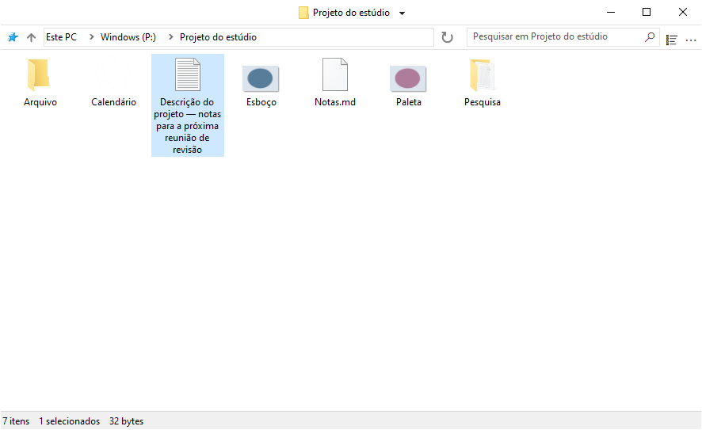
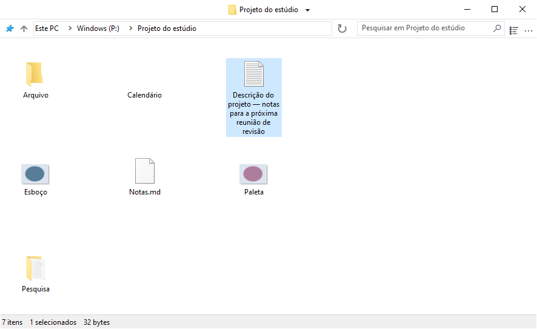
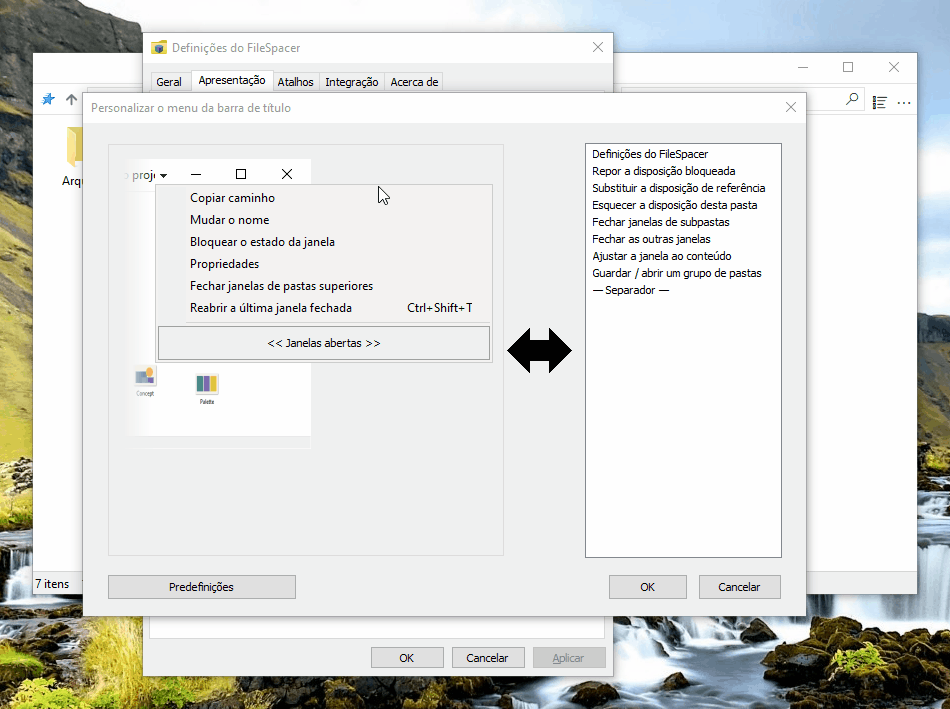
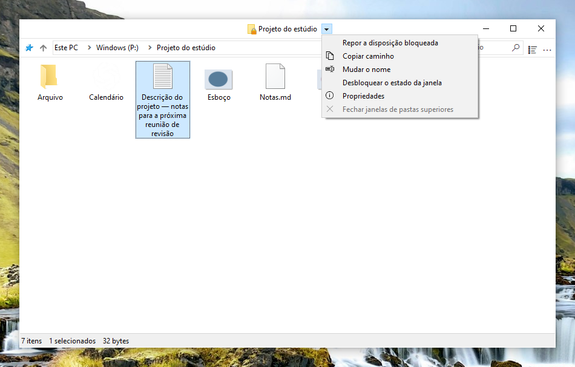
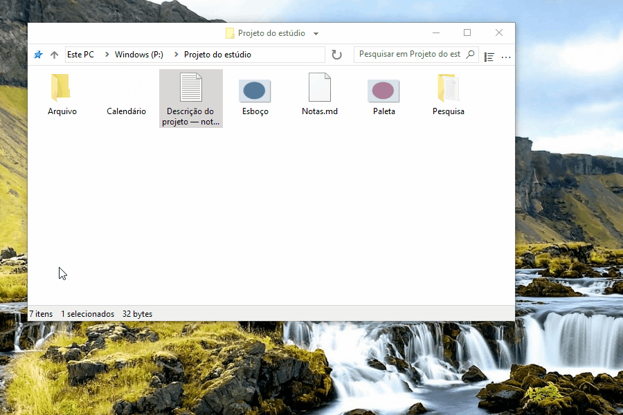
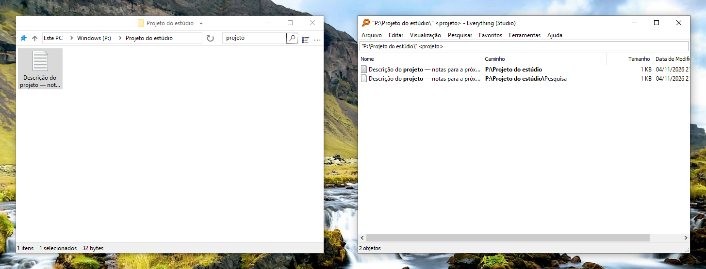
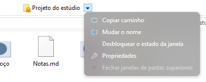
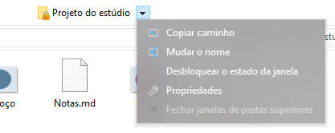
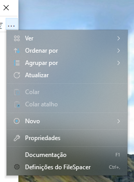

# Utilizar o FileSpacer

O FileSpacer memoriza a posição e o aspeto de cada janela entre aberturas. As pastas voltam ao seu lugar e tornam-se reconhecíveis, como objetos dispostos numa secretária. Oferece também atalhos configuráveis, ações rápidas e uma interface simples e personalizável.

O FileSpacer pode ser definido como gestor de ficheiros predefinido durante a instalação ou em **Definições > Integração**, com **Definir como gestor de ficheiros predefinido**. O menu de contexto das pastas apresenta **Abrir no FileSpacer**, ou **Abrir no Explorador de Ficheiros do Windows** quando o FileSpacer é o gestor predefinido.

## Navegação e disposição das janelas

**Cada pasta tem a sua própria janela.** Se já estiver aberta, o FileSpacer traz a janela para primeiro plano. A posição, o tamanho, a apresentação, a disposição dos ícones e a posição de deslocamento são memorizados, mesmo depois de mover ou mudar o nome da pasta. As janelas sem posição guardada são colocadas de forma a limitar a sobreposição (opção em **Definições > Geral**).

**É possível bloquear a posição, o tamanho e a apresentação atuais de uma pasta para os recuperar em cada abertura.** As alterações posteriores são temporárias. As posições dos ícones continuam a ser guardadas. É possível **repor a disposição bloqueada** sem fechar a janela.

**Desbloquear o estado da janela** mantém a disposição atual e permite voltar a guardar as alterações.

O bloqueio ativa-se em **Definições > Geral**. O comando **Bloquear o estado da janela** aparece depois junto ao título da pasta. Um cadeado no ícone assinala o bloqueio. Desativar a função elimina todos os bloqueios.

Abrir uma pasta ou a pasta superior fecha a janela de origem por predefinição. **Manter Ctrl premido durante a abertura** permite deixá-la aberta. Este comportamento configura-se em **Definições > Geral**. Abrir várias pastas selecionadas mantém a janela de origem aberta.

O menu junto ao título permite alternar entre pastas abertas e fechar as janelas das pastas superiores. **Ctrl+Shift+T** reabre a última pasta fechada com a sua disposição e seleção. A lista de atalhos da barra de tarefas também inclui pastas fechadas recentemente e afixadas no Acesso rápido.

**Guardar / abrir um grupo de pastas**, no menu do título, permite recuperar várias pastas em conjunto com as respetivas disposições guardadas.

## Apresentação do conteúdo das pastas

O FileSpacer permite dispor os elementos de uma pasta numa grelha, como no Explorador de Ficheiros, ou livremente, como no ambiente de trabalho do Windows. A disposição livre está disponível com qualquer tamanho de ícones e na vista **Mosaicos**. As vistas **Lista** e **Detalhes** não permitem esta disposição livre. Para escolher as posições, desativar **Dispor ícones automaticamente**. O alinhamento pela grelha continua disponível. O menu **Ver** de cada janela dá acesso rápido às definições dos ícones, incluindo as opções próprias do FileSpacer.

Por predefinição, as pastas são agrupadas antes dos ficheiros, como no Explorador de Ficheiros. **Misturar pastas e ficheiros na ordenação**, em **Definições > Apresentação**, ordena ambos em conjunto, como no [macOS](https://support.apple.com/en-au/guide/mac-help/mchlp1745/27/mac/27) e no [Linux](https://www.gnu.org/s/coreutils/manual/html_node/Sorting-the-output.html). A opção aplica-se a Detalhes, Lista e ícones organizados automaticamente. As pastas virtuais e os arquivos mantêm a ordenação do Windows.

Nas mesmas definições, **Mostrar o nome completo do ficheiro selecionado** permite ler o nome inteiro na vista de ícones, mesmo que seja muito comprido. Aplica-se quando está selecionado um único ficheiro.

Por predefinição, clicar no fundo de uma janela inativa limpa a seleção, como no Explorador de Ficheiros. **Manter a seleção ao clicar numa janela inativa**, em **Definições > Geral**, permite ativá-la sem perder a seleção.

## Personalização

### Alterar a interface

O **menu da barra de título** personaliza-se em **Definições > Apresentação > Elementos da interface**. Os comandos são adicionados e reordenados por arrastar e largar. Para remover uma entrada, arrastá-la para fora do menu.

As entradas geridas pelo Nilesoft Shell alteram-se na sua configuração, pois as suas regras têm prioridade sobre as do FileSpacer ([ver a integração abaixo](#nilesoft-shell)).

É possível definir **gestos do rato para mover ou redimensionar uma janela** diretamente a partir do conteúdo, incluindo ao arrastar sobre um ficheiro. Por predefinição:

| Ação | Gesto |
| --- | --- |
| Mover | Alt + arrastar com o botão esquerdo |
| Redimensionar | Alt + arrastar com o botão direito |

A seleção é mantida e Esc cancela o gesto. Os atalhos personalizam-se em **Definições > Atalhos**. Os botões esquerdo e direito exigem Alt. O botão central pode ser utilizado sozinho.

### Integração

O [Everything](https://www.voidtools.com/) é uma ferramenta de pesquisa que encontra rapidamente ficheiros e pastas pelo nome. O FileSpacer permite iniciá-lo a partir do campo de pesquisa de uma pasta. A integração ativa-se em **Definições > Integração**, com deteção automática ou escolha de uma versão portátil.

**Pesquisar no Everything** inicia [a pesquisa](https://www.voidtools.com/support/everything/searching/) na pasta e nas subpastas, ou em todos os [ficheiros indexados](https://www.voidtools.com/support/everything/indexes/) com **Em todo o lado**. Os resultados abrem no Everything. Para pastas virtuais, escolher Em todo o lado. Um arranque bem-sucedido limpa o campo e o filtro local do FileSpacer.

O [Nilesoft Shell](https://nilesoft.org/) é uma extensão do Windows que permite personalizar o aspeto e os comandos dos menus de contexto. Se for utilizado, também pode gerir os menus do FileSpacer.

O FileSpacer compõe o menu da barra de título e o Nilesoft Shell aplica depois as suas regras, que têm prioridade. A [referência de configuração](nilesoft-shell.md) descreve as definições visuais e o acesso às ações do FileSpacer.

São recomendados cantos retos para os menus da barra de título e da barra de ferramentas.

**Menu de navegação**

| Cantos predefinidos | Cantos retos recomendados |
| --- | --- |
|  |  |

**Menu principal (…)**

| Cantos predefinidos | Cantos retos recomendados |
| --- | --- |
|  |  |

O [PowerToys](https://learn.microsoft.com/pt-pt/windows/powertoys/) reúne utilitários da Microsoft para complementar e personalizar o Windows.

O **Peek** apresenta uma pré-visualização dos ficheiros. No FileSpacer, **Pré-visualização com Espaço**, em **Definições > Integração**, permite abri-la com Espaço. O Peek tem de estar ativo no PowerToys. Versão mínima: 0.96, ou 0.102 para seleção múltipla.

O **Grab And Move** permite mover e redimensionar janelas a partir do conteúdo. Quando está ativo, os gestos equivalentes do FileSpacer são suspensos, mesmo que o PowerToys esteja fechado. Para os manter, excluir `FileSpacer.exe` no Grab And Move ou desativar a ferramenta.

## Atualizações e resolução de problemas

**Definições > Acerca de** permite procurar atualizações e ativar as verificações semanais, desativadas por predefinição. A transferência e a instalação exigem confirmação.

Na mesma página, **Manutenção > Repor o estado de todas as pastas** fecha as janelas e elimina as suas disposições, históricos e bloqueios. Os ficheiros e as preferências gerais são mantidos.

A reposição das preferências e a resolução avançada de problemas estão descritas na [nota técnica](../en/README.md#local-data), em inglês.

## Privacidade

O FileSpacer não inclui telemetria, acompanhamento da utilização nem publicidade. Nenhum relatório de falha é enviado automaticamente. A partilha é facultativa e pode revelar caminhos de ficheiros ou partes da memória.

As atualizações contactam o GitHub, que recebe o endereço IP e a versão da aplicação, mas nenhum caminho de ficheiro ou estado de pasta.

As credenciais das unidades de rede são geridas diretamente pelo Windows. O FileSpacer não as lê nem guarda.

Uma pesquisa do Everything envia a consulta e, quando limitada a uma pasta, o respetivo caminho para a aplicação Everything local.
