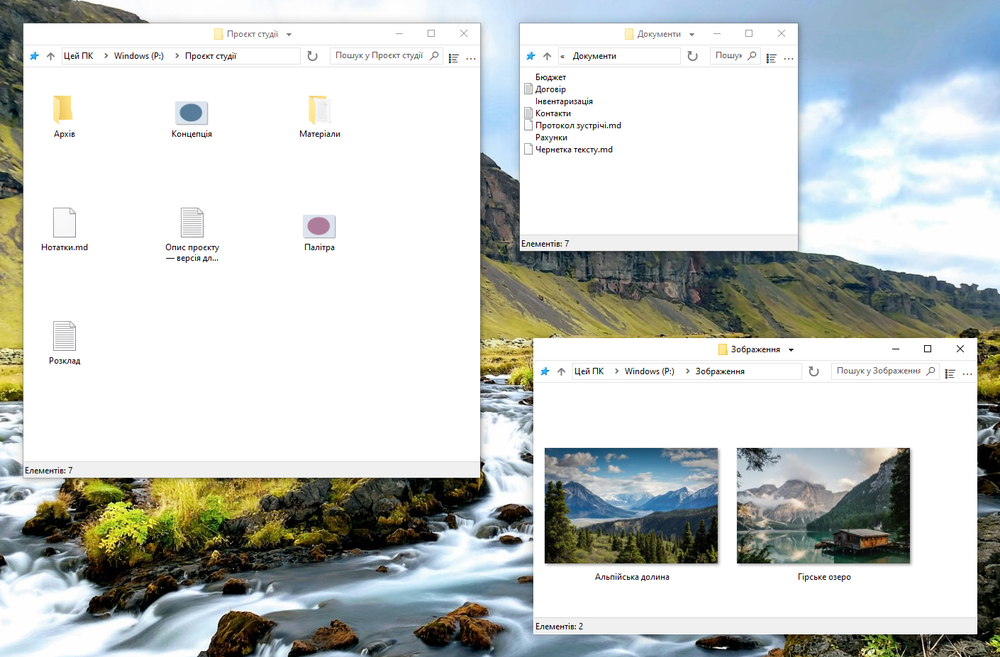

    

# FileSpacer

 &emsp;

FileSpacer — файловий менеджер для Windows на основі [просторової парадигми](https://en.wikipedia.org/wiki/Spatial_file_manager): кожна папка має одне вікно, що запам’ятовує положення, розмір і настройки подання. Це створює [сталі візуальні орієнтири](https://www.csse.canterbury.ac.nz/~andy/papers/transforms.pdf), завдяки яким [просторова пам’ять](https://www.microsoft.com/en-us/research/wp-content/uploads/1998/01/p153-robertson.pdf) допомагає впізнавати знайомі папки з першого погляду. У навігаційному файловому менеджері те саме вікно послідовно показує різні папки: лише положення й розмір не визначають поточну папку, тому потрібно дивитися на вміст. Зберігаючи окремі орієнтири для кожної папки, просторова модель може зменшити когнітивне навантаження під час пошуку шляху серед файлів. Вкладки несумісні з просторовою моделлю й ніколи не будуть додані.

FileSpacer надає перевагу легкості й простоті. Щоб обмежити накопичення вікон, відомий недолік просторової парадигми, він за замовчуванням закриває вихідне вікно під час відкриття папки. Утримуйте Ctrl, щоб залишити його відкритим для роботи з кількома папками. Інтерфейс навмисно стриманий — на відміну від перевантажених інтерфейсів, де між кнопками ледь видно файл.

**Система й мови:** Windows 10 або новіша, x64. Десять мов: англійська, французька, німецька, італійська, іспанська, португальська (Португалія), грецька, польська, нідерландська й українська.

**Конфіденційність:** **Без телеметрії, відстеження використання чи реклами**. Перевірки оновлень звертаються до GitHub; щотижневі перевірки необов’язкові й за замовчуванням вимкнені. Завантаження й інсталяція потребують підтвердження. [Політика конфіденційності](user-guide.md#конфіденційність).

**Документація:**

_FileSpacer — відгалуження [ChromaFiler](https://github.com/vanjac/chromafiler), оригінальний автор — J. van't Hoog. Докладніше в [подяках](#ліцензія-й-подяки)._

## Можливості

- **Одне вікно на папку**, повторно використовується, якщо папку вже відкрито. Між відвідуваннями відновлюються положення, розмір, настройки подання й розташування піктограм. [Просторова навігація](user-guide.md#навігація-між-вікнами).
- **Вільне розташування піктограм** зі збереженням і відновленням положень для кожної папки. [Розташування піктограм](user-guide.md#розташування-піктограм).
- **Переміщення й змінення розміру вікон** будь-де в області файлів зі збереженням вибору. Жести миші налаштовуються; стандартні — Alt + перетягування лівою та правою кнопкою. [Жести вікна](user-guide.md#переміщення-та-змінення-розміру).
- **Перемикання між відкритими папками** через меню заголовка, закриття батьківських вікон і повторне відкриття останнього закритого вікна через Ctrl+Shift+T. [Навігація](user-guide.md#навігація-між-вікнами).
- **Блокування збереженого розташування вікна** з можливістю тимчасово змінювати положення, розмір і подання. [Блокування](user-guide.md#блокування-збереженого-розташування).
- **Фільтрування поточної папки** й повторне використання останніх запитів. [Пошук і журнал](user-guide.md#пошук-і-журнал).
- **Збереження вибору під час активації вікна** клацанням тла. [Вибір і активація](user-guide.md#вибір-і-активація).
- **Зменшення перекриття вікон** для папок без збереженого положення. [Розміщення](user-guide.md#розміщення-вікон).
- **Налаштування меню рядка заголовка** діями розташування й вікон та збереження іменованих груп папок. [Меню](user-guide.md#налаштування-меню-рядка-заголовка) · [Групи папок](user-guide.md#групи-папок).

## Інтеграція

FileSpacer можна зробити файловим менеджером за замовчуванням під час інсталяції або пізніше в настройках. Файли відкриваються у звичних програмах Windows; мережеві папки використовують звичайну обробку Windows. [Інтеграція з Windows](user-guide.md#інтеграція-з-windows).

З **Everything** можна запускати розширений пошук із поля FileSpacer у поточній папці та вкладених папках або серед усіх індексованих файлів. Результати відкриваються в Everything. [Інтеграція й використання](user-guide.md#everything).

З **Nilesoft Shell** меню FileSpacer можуть використовувати теми й власні команди. Для узгодженого вигляду рекомендовано адаптувати конфігурацію. [Інтеграція й конфігурація](user-guide.md#nilesoft-shell).

## Збирання

Збирання використовує MSVC/NMAKE, Visual Studio 2022 Build Tools з ATL і Windows SDK, Inkscape та ImageMagick. Для інсталятора потрібен NSIS; SQLite включено. Див. [посібник зі збирання](build.md).

Регресійні тести поєднують сценарії PowerShell із допоміжними програмами C++ і C# для внутрішніх перевірок і справжніх тестів інтерфейсу та оболонки Windows. [Робочий процес регресії GitHub Actions](https://github.com/LeBenco/FileSpacer/actions/workflows/regression.yml) запускає цей набір тестів програми на вимогу й автоматично перед випуском. Ті самі випадки можна запускати через `tests.cmd` на локальному робочому столі Windows або в налаштованій ВМ Hyper-V. [Посібник із тестування](tests/regression/README.md) описує вибір випадків, вимоги й результати.

## Ліцензія й подяки

### Авторське право та ліцензія
FileSpacer поширюється за ліцензією . 
Copyright © 2026 Benco за зміни FileSpacer. Повний текст ліцензії — у [LICENSE](../../LICENSE) у вихідному коді або `LICENSE.txt` у папці інсталяції. FileSpacer постачається без гарантій; поширення й зміни дозволено на умовах цієї ліцензії.

### Відгалуження та подяки оригінальному проєкту
FileSpacer — відгалуження [ChromaFiler](https://github.com/vanjac/chromafiler) (оригінальний код ChromaFiler © 2023 J. van't Hoog), створеного J. van't Hoog (vanjac). Дякуємо vanjac за основу!

### Повідомлення про сторонні компоненти
Див. [повідомлення про сторонні компоненти](THIRD_PARTY_NOTICES.md) і [політику конфіденційності](privacy-policy.md).
