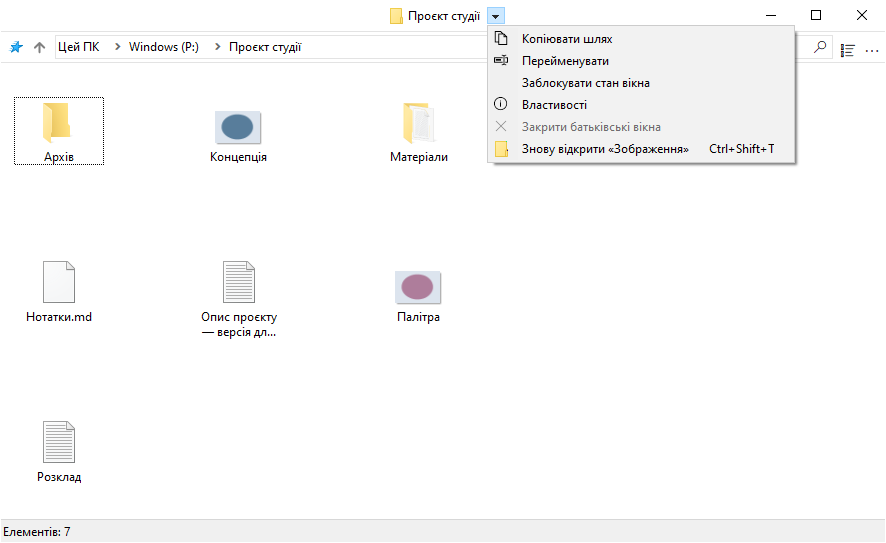
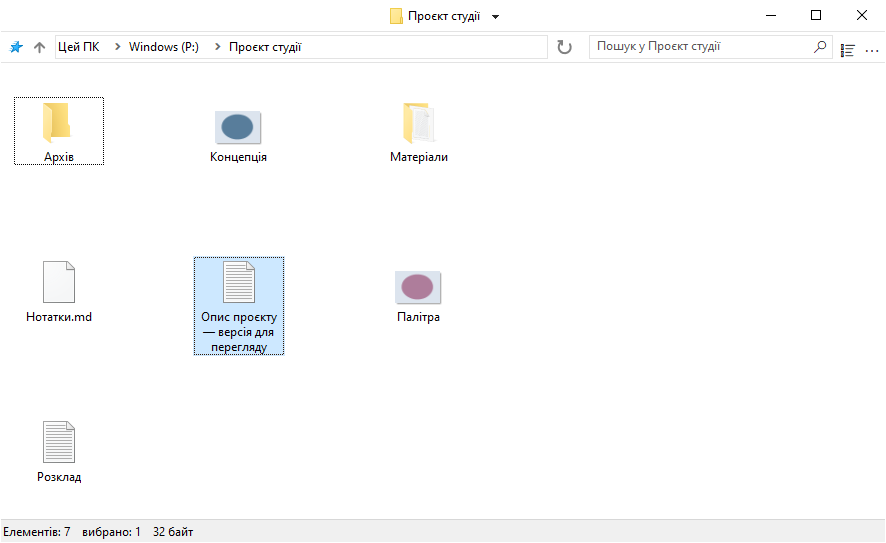
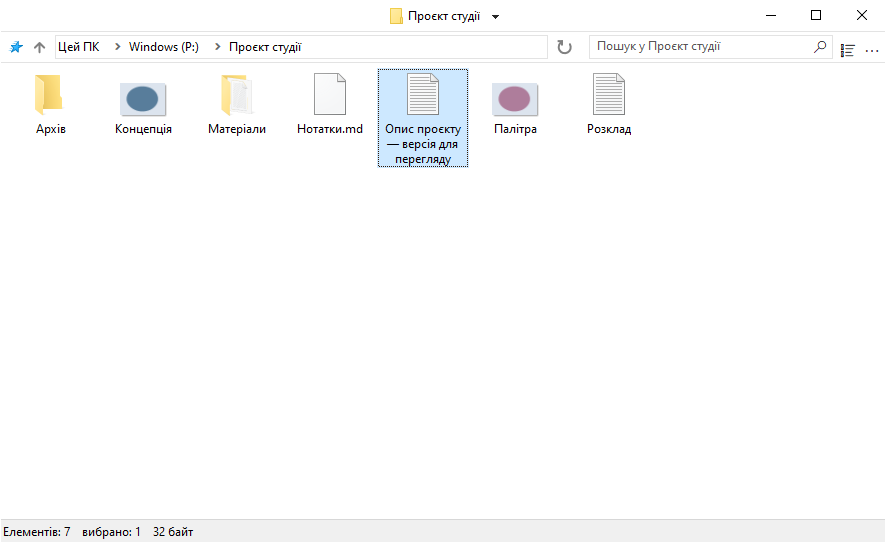
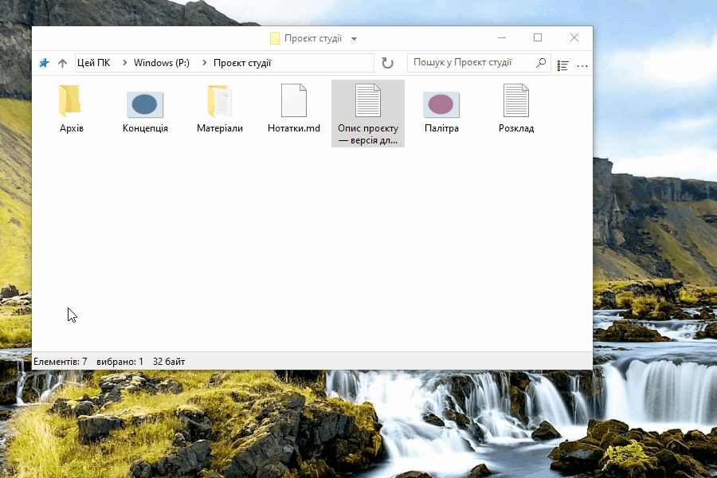
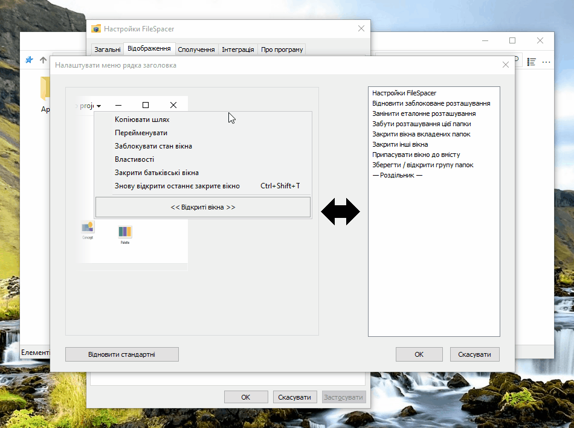
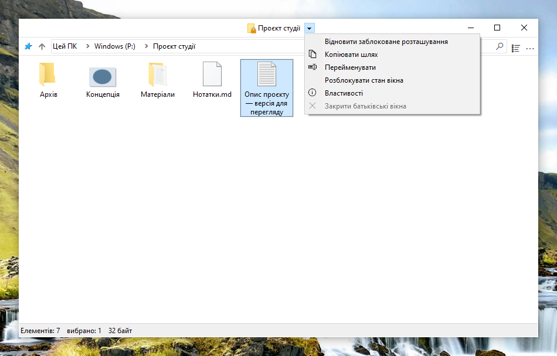
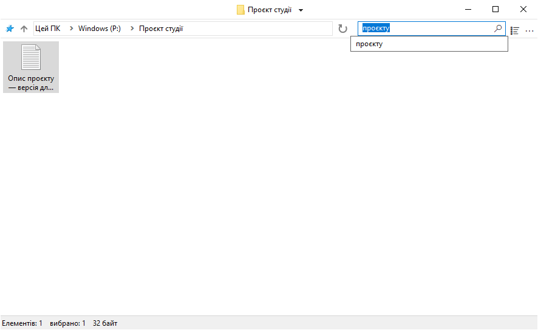
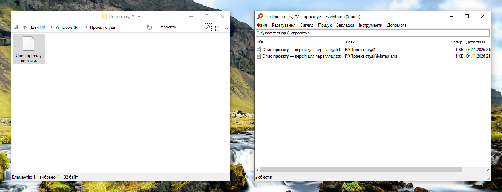
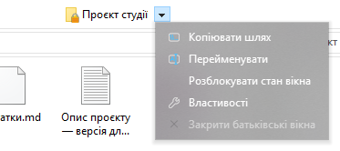
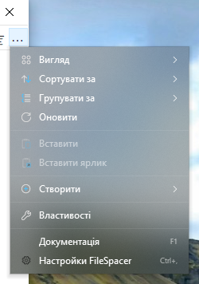

# Використання FileSpacer

## Навігація між вікнами

Одна папка має одне вікно. Повторне відкриття вже відкритої папки виводить її вікно на передній план; положення, розмір, настройки подання й розташування піктограм запам’ятовуються. Переміщення або перейменування папки зберігає її розташування.

- Відкриття папки або батьківської папки за замовчуванням закриває вихідне вікно. Ctrl одноразово змінює це на протилежне; типову поведінку можна змінити в **Настройки > Загальні**. Відкриття кількох вибраних папок залишає вихідне вікно відкритим.
- Меню біля заголовка папки перемикає між відкритими папками. **Закрити батьківські вікна** закриває відкриті вікна папок-предків, залишаючи інші відкритими.
- **Ctrl+Shift+T** знову відкриває останню закриту папку, не закриваючи поточну. Ця команда також є в меню заголовка й списку переходів на панелі завдань; останній дає змогу повернутися до давніших закритих папок. Відновлюються розташування, вибір і перший видимий рядок у поданнях «Таблиця» та «Список».
- Список переходів на панелі завдань також відкриває папки, закріплені у Швидкому доступі Файлового провідника.

Перехід до батьківської папки не вибирає щойно залишену папку. Уже відкрита батьківська папка зберігає свій вибір. Панель керування відкривається у власному вікні Windows.



## Подання та розташування

### Розташування піктограм

Подання піктограм дають змогу вільно розміщувати файли й вкладені папки, коли **Упорядковувати піктограми автоматично** вимкнено. Положення піктограм зберігаються незалежно від геометрії вікна, зокрема коли його збережене розташування заблоковано.

### Параметри подання

**Показувати повне ім’я вибраного файлу** в **Настройки > Відображення** забезпечує повну читабельність одного вибраного імені в поданні піктограм. Параметр увімкнено за замовчуванням; він не змінює кілька вибраних елементів або інші подання.



**Попередній перегляд режимів відображення в меню Подання**, також увімкнений за замовчуванням, показує режим під час наведення. Клацання зберігає його; Escape або вихід із попереднього перегляду повертає початкове подання. Попередній перегляд ніколи не замінює збережене розташування.

**Сортувати папки й файли разом** застосовує спільний порядок, як у [macOS](https://support.apple.com/en-au/guide/mac-help/mchlp1745/27/mac/27) та [Linux](https://www.gnu.org/s/coreutils/manual/html_node/Sorting-the-output.html). Параметр за замовчуванням вимкнено в **Настройки > Відображення > Файли**. Він діє в поданнях «Таблиця», «Список» і автоматично впорядкованих піктограм; вільні розташування зберігаються. Віртуальні папки й архіви зберігають порядок Windows.



Видимість панелі інструментів і рядка стану також можна змінити в настройках.

### Розміщення вікон

Папки без збереженого положення відкриваються на вільному місці або з меншим перекриттям, якщо місця бракує. Збережені положення мають пріоритет. **Настройки > Загальні > Розміщувати нові вікна на вільному місці** ввімкнено за замовчуванням; вимкнення використовує розміщення Windows, не пересуваючи наявних вікон.

### Вибір і активація

**Зберігати вибір під час клацання неактивного вікна** в **Настройки > Загальні** дає змогу активувати папку клацанням тла, не скидаючи вибір. Друге натискання починає прямокутник вибору. Клацання елементів, правою кнопкою та жести вікна працюють як зазвичай.

## Керування вікнами

### Переміщення та змінення розміру

Вікно можна перемістити або змінити його розмір перетягуванням будь-де в області файлів, зокрема над елементом. Стандартні жести:

| Дія | Сполучення |
| --- | --- |
| Перемістити вікно | Alt + перетягування лівою кнопкою |
| Змінити розмір від правого нижнього кута | Alt + перетягування правою кнопкою |




Вибір зберігається. Escape скасовує жест. Текстові поля, заголовки, смуги прокручування, панелі інструментів і меню працюють як зазвичай; Alt + подвійне клацання відкриває Властивості елемента.

Кожна дія має окреме сполучення в **Настройки > Сполучення**. Ліва й права кнопки потребують Alt; середню можна використовувати й без нього. Клавіші-модифікатори мають точно збігатися; зарезервовані та повторні сполучення відхиляються. Зміни діють для відкритих вікон; **Повернути** відновлює останні застосовані сполучення, а **Скасувати** відкидає незастосовані зміни.

### Блокування збереженого розташування

Блокування зберігає положення, розмір і настройки подання папки для відновлення під час наступного відкриття. Функцію за замовчуванням вимкнено в **Настройки > Загальні > Увімкнути блокування стану вікон**. Після ввімкнення команда **Заблокувати стан вікна** доступна біля заголовка папки. Замок на піктограмі папки позначає заблоковане розташування.


Тимчасові зміни залишаються можливими; повторне відкриття відновлює заблоковане розташування. Положення окремих піктограм зберігаються як зазвичай. **Розблокувати стан вікна** залишає поточне розташування. Приховування замка не знімає блокування.

Вимкнення функції потребує підтвердження й видаляє всі блокування, зокрема для закритих папок. Повторне ввімкнення їх не відновлює.

### Налаштування меню рядка заголовка

Меню можна налаштувати в **Настройки > Відображення > Елементи інтерфейсу > Налаштувати меню рядка заголовка**. Перетягніть дію справа до меню, перемістіть пункт для зміни порядку або перетягніть за межі меню для видалення. **OK** застосовує склад меню до всіх вікон FileSpacer; **Скасувати** відкидає зміни. **Відновити стандартні** скидає чернетку; **OK** застосовує її.

Пункти під керуванням Nilesoft Shell тут змінити не можна, оскільки його правила мають пріоритет. Див. [інтеграцію Nilesoft Shell](#nilesoft-shell).





- **Відновити заблоковане розташування** повертає поточне вікно до еталонного розташування, не закриваючи його й не змінюючи вибір. **Замінити еталонне розташування** після підтвердження зберігає поточні положення, розмір і настройки подання як новий заблокований еталон.
- **Забути розташування цієї папки** видаляє збережене розташування й блокування, залишаючи журнал пошуку. Поточне вікно залишається на місці й не зберігає розташування до закриття; наступне відкриття використовує стандартні настройки. Блокування нового розташування відновлює збереження.
- Інші дії закривають вікна вкладених папок, інші вікна FileSpacer або припасовують вікно до вмісту.

### Групи папок

**Зберегти / відкрити групу папок** зберігає поточні відкриті папки під іменем. Відкриття групи повертає кожну папку з її збереженим розташуванням, залишаючи інші вікна відкритими. Видалення групи видаляє лише список, а не самі папки.

## Пошук і журнал

Введіть ім’я файлу або папки повністю чи частково й натисніть Enter або лупу, щоб відфільтрувати поточну папку. **Фільтрувати під час введення** в **Настройки > Загальні** застосовує фільтр одразу під час введення тексту. Цей локальний фільтр ніколи автоматично не запускає Everything.

Поле пропонує останні запити й, коли ввімкнено, **Пошук в Everything**. Стрілки вгору/вниз і Enter вибирають пропозицію; Enter без неї застосовує локальний фільтр. Escape закриває список, не стираючи текст, а Ctrl+F переводить фокус до поля.

Журнал за замовчуванням зберігає п’ять різних підтверджених запитів на папку. Обмеження від 0 до 20 задається в загальних настройках; 0 очищує та вимикає журнал. Саме введення тексту не додає запису. [Everything](#everything) може шукати у вкладених папках або серед усіх індексованих файлів.



## Інтеграція

### Інтеграція з Windows

FileSpacer можна зробити файловим менеджером за замовчуванням під час інсталяції або пізніше в **Настройки > Інтеграція**, вибравши **Зробити менеджером за замовчуванням**. **Відновити менеджер за замовчуванням** повертає відкриття папок до Файлового провідника.

Контекстне меню папок пропонує **Відкрити у FileSpacer** або **Відкрити у Файловому провіднику Windows**, коли FileSpacer є типовим. Це також діє для дисків, ZIP-папок, мережевих розташувань і тла папок, не вимагаючи змінювати програму за замовчуванням.

Типи файлів відкриваються у звичних програмах Windows. Мережеві папки, попередній перегляд і встановлені команди контекстного меню також використовують звичайну обробку Windows. **Параметри Файлового провідника** відкриває спільні параметри папок, деякі з яких впливають і на FileSpacer.

### PowerToys Grab And Move

Коли Grab And Move ввімкнено в настройках PowerToys, жести переміщення й змінення розміру FileSpacer призупиняються для відповідних вікон, навіть якщо PowerToys не запущено. Налаштовані сполучення зберігаються.

Щоб далі використовувати жести FileSpacer, додайте `FileSpacer.exe` до виключених програм Grab And Move або вимкніть цю утиліту в PowerToys. Повідомлення в **Настройки > Сполучення** веде безпосередньо до настройок Grab And Move.

### PowerToys Peek

**Перегляд за допомогою пробілу** в **Настройки > Інтеграція** відкриває попередній перегляд Peek вибраних файлів або папок на диску чи мережевому спільному ресурсі натисканням лише **пробілу**. Параметр за замовчуванням вимкнено; введення тексту й перейменування працюють як зазвичай.

Peek також потрібно ввімкнути в PowerToys; посилання **PowerToys** під параметром відкриває його настройки. Інтеграція потребує PowerToys 0.96 або новішої версії, а для кількох вибраних елементів — 0.102 або новішої.

### Everything

Наявну інсталяцію [Everything](https://www.voidtools.com/) можна інтегрувати для розширеного пошуку з поля FileSpacer. Результати відкриваються в Everything.

Параметр вмикається в **Настройки > Інтеграція**. Everything виявляється автоматично або кнопкою **Виявити**; переносну копію можна вибрати вручну. Область — поточна папка з вкладеними або **Усюди**; для віртуальних папок потрібен варіант Усюди.

Вибір **Пошук в Everything** надсилає введений запит у синтаксисі Everything. Успішний запуск очищує поле й локальний фільтр FileSpacer; у разі помилки вони зберігаються для повторної спроби.



### Nilesoft Shell

[Nilesoft Shell](https://nilesoft.org/) може змінювати вигляд меню FileSpacer і налаштовувати команди. Для узгодженого вигляду рекомендовано адаптувати конфігурацію, зокрема зробити прямі кути в меню заголовка й панелі інструментів.

FileSpacer спочатку формує меню заголовка. Потім Nilesoft Shell застосовує свої правила, що можуть перейменовувати, переміщувати, приховувати й додавати команди, тому мають пріоритет. Сірі пункти редактора змінюються у файлах конфігурації Nilesoft Shell.

Нові дії FileSpacer також можна використовувати в `shell.nss` або імпортованому файлі через `window.command` та ідентифікатор дії. Наприклад, з умовою `filespacer_title`, визначеною в [довіднику конфігурації](nilesoft-shell.md):

```nss
item(type='*' mode='multiple' where=filespacer_title
     title='Відновити заблоковане розташування' cmd=window.command(1123))
```

У довіднику наведено решту дій та їхні ідентифікатори.

[Довідник конфігурації](nilesoft-shell.md) описує дозвіл для FileSpacer, збереження теми й виключення з його меню правил лише для Провідника. Після зміни конфігурації скасування реєстрації та повторна реєстрація Nilesoft Shell застосовують її до нових меню.

Нижче тема Modern порівнює стандартні кути з рекомендованими прямими.

**Меню навігації**

| Стандартні кути | Рекомендовані прямі кути |
| --- | --- |
|  |  |

**Головне меню (…)**

| Стандартні кути | Рекомендовані прямі кути |
| --- | --- |
|  |  |

## Настройки й оновлення

Ctrl+, відкриває Настройки, навіть коли панель інструментів приховано. Інтерфейс використовує мову відображення Windows з англійською як резервною; зміна мови потребує перезапуску. F1 відкриває інстальований посібник, доступний також без підключення до мережі.

Оновлення перевіряються в **Настройки > Про програму**. Завантаження й інсталяція потребують підтвердження; інсталяція ніколи не відбувається автоматично. Після цього раніше відкриті папки повертаються зі збереженим розташуванням. Необов’язкові щотижневі перевірки за замовчуванням вимкнено; їх можна ввімкнути на сторінці Про програму.

## Локальні дані

Розташування папок, блокування вікон, запити й журнал закритих папок зберігаються локально в `%LOCALAPPDATA%\FileSpacer\folder-state.sqlite3`. Загальні настройки, меню заголовка й групи папок містяться в реєстрі Windows за адресою `HKEY_CURRENT_USER\Software\FileSpacer`. Збережений стан може містити шляхи папок, зокрема мережеві. Тимчасові файли оновлення та список папок для повторного відкриття залишаються в `%TEMP%\FileSpacerUpdate-{GUID}`.

**Настройки > Про програму > Обслуговування > Скинути стан усіх папок** закриває вікна папок і очищує їхні збережені розташування, журнал і блокування. Файли й загальні настройки зберігаються.

Для усунення несправностей `FileSpacer.exe /reset-options` скидає загальні настройки; `/reset-all` також очищує збережений стан папок. Жодна команда не видаляє файлів, не змінює зіставлень файлів Windows і не видаляє наявних діагностичних звітів.

## Конфіденційність

FileSpacer не має телеметрії, відстеження використання чи реклами. Звіти про аварії не надсилаються автоматично. Діагностичні звіти залишаються в `%LOCALAPPDATA%\FileSpacer`; їх передавання добровільне й може розкрити шляхи файлів або частини пам’яті процесу.

Перевірки оновлень і завантаження звертаються до GitHub через HTTPS. GitHub отримує звичайні відомості про з’єднання, зокрема IP-адресу й версію програми, але не стан папок, шляхи файлів чи діагностичні звіти.

Облікові дані мережевих дисків вводяться й обробляються Windows, як у Файловому провіднику. FileSpacer їх не читає та не зберігає. Вибір пошуку Everything передає запит і, для пошуку в папці, її шлях до локальної програми Everything.
