# Using FileSpacer

## Window navigation

One folder has one window. Reopening an already-open folder brings its window forward; position, size, view settings and icon layout are remembered. Moving or renaming a folder preserves its layout.

- Opening a folder or its parent closes the source window by default. Ctrl reverses this once; the default can be changed in **Settings > General**. Opening several selected folders keeps the source window open.
- The menu beside the folder title switches between open folders. **Close Parent Windows** closes its open ancestors, leaving other folders open.
- **Ctrl+Shift+T** reopens the last closed folder without closing the current one. The title menu and taskbar Jump List offer the same command; the latter can go further back through closed folders. Layout and selection return, along with the first visible row in Details and List views.
- The taskbar Jump List also opens folders pinned in File Explorer's Quick access.

Going to a parent does not select the folder just left. An already-open parent keeps its selection. Control Panel opens in its own Windows window.

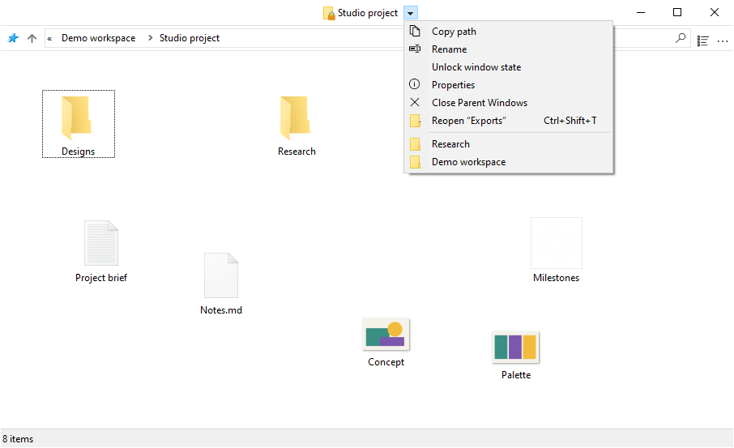

## View and layout

### Icon layout

Icon views allow free placement of files and subfolders when **Auto arrange icons** is off. Icon positions are saved independently of window geometry, including when the window's saved layout is locked.

### View options

**Show the full name of a selected file**, in **Settings > Display**, keeps one selected name fully readable in Icons view. It is on by default and does not change multiple selections or other views.

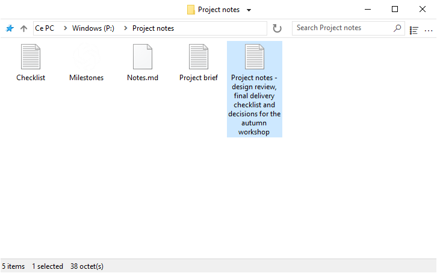

**Preview display modes in the View menu**, also on by default, shows each mode on hover. Clicking keeps it; Escape or leaving the preview restores the initial view. A preview never replaces the saved layout.

**Mix folders and files when sorting** sorts both together, as on [macOS](https://support.apple.com/en-au/guide/mac-help/mchlp1745/27/mac/27) and [Linux](https://www.gnu.org/s/coreutils/manual/html_node/Sorting-the-output.html). The option is off by default in **Settings > Display > Files**. It applies to Details, List and automatically arranged icon views; free layouts are preserved. Virtual folders and archives keep Windows' ordering.

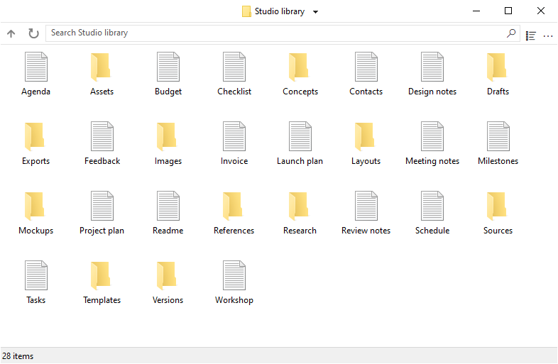

Toolbar and status-bar visibility can also be changed in Settings.

### Window placement

Folders without a saved position open in free space, or with reduced overlap when space runs out. Saved positions take priority. **Settings > General > Place new windows in free space** is on by default; switching it off uses Windows' placement without moving existing windows.

### Selection and activation

**Keep the current selection when clicking an inactive window**, in **Settings > General**, lets a background click activate a folder without clearing its selection. A second press starts a selection rectangle. Item clicks, right-clicks and window gestures keep their usual behavior.

## Managing windows

### Moving and resizing

A window can be moved or resized by dragging anywhere in its file area, including over an item. The defaults are:

| Action | Shortcut |
| --- | --- |
| Move the window | Alt + left drag |
| Resize from the bottom-right corner | Alt + right drag |

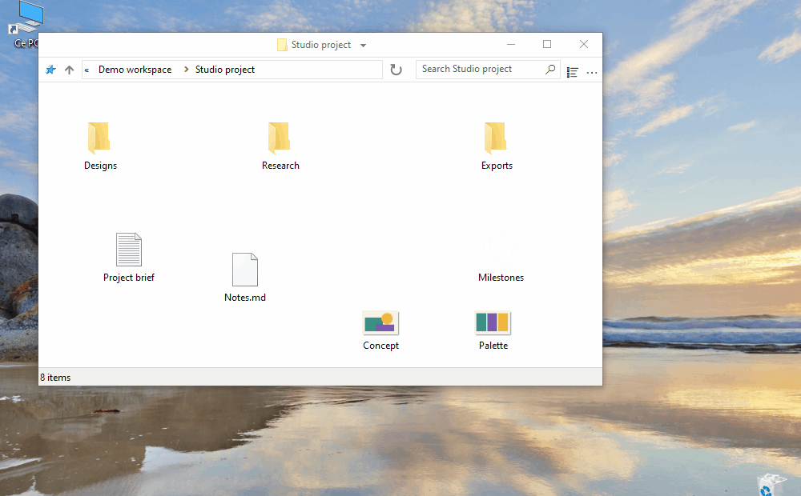

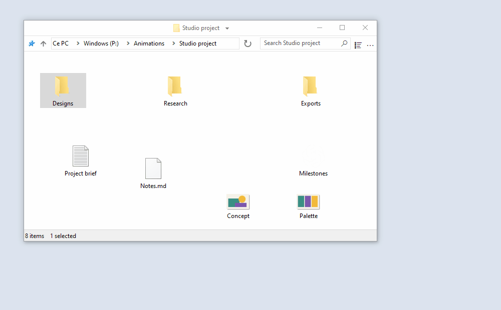

Selection stays intact. Escape cancels the gesture. Text fields, headers, scrollbars, toolbars and menus keep their normal behavior; Alt + double-click opens an item's Properties.

Each action has its own configurable shortcut in **Settings > Shortcuts**. Left and right buttons require Alt; the middle button can also be used without it. Modifiers must match exactly, and reserved or duplicate combinations are refused. Changes apply to open windows; Revert returns to the last applied shortcuts, and Cancel discards pending edits.

### Locking a saved layout

Locking keeps a folder's position, size and view settings as the layout to restore on reopening. The feature is off by default in **Settings > General > Enable window state locking**. Once enabled, **Lock window state** is available beside the folder title. A padlock badge on its folder icon marks a locked layout.

Temporary changes remain possible; reopening restores the locked layout. Individual icon positions still save normally. **Unlock window state** keeps the current layout. Hiding the badge does not remove the lock.

Switching the feature off asks for confirmation and removes all locks, including those on closed folders. Switching it back on does not restore them.

## Search and history

Enter all or part of a file or folder name, then press Enter or click the magnifier to filter the current folder. **Filter while typing**, in **Settings > General**, applies it as text is entered. This local filter never launches Everything automatically.

The field offers recent searches and, when enabled, **Search in Everything**. Up/Down and Enter select a suggestion; Enter without one applies the local filter. Escape closes the list without erasing the text, and Ctrl+F focuses the field.

History keeps five distinct submitted searches per folder by default. Its limit is adjustable from 0 to 20 in General settings; 0 clears and disables it. Typing alone does not add an entry. [Everything](#everything) can search subfolders or all indexed files.

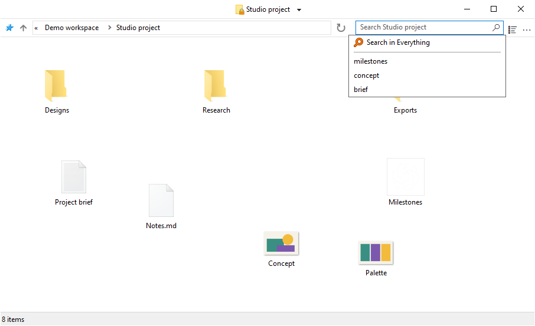

## Integration

### Windows integration

FileSpacer can be set as the default file manager during installation or later in **Settings > Integration** with **Set as default browser**. **Reset default browser** returns folder opening to File Explorer.

The folder context menu offers **Open in FileSpacer**, or **Open in Windows File Explorer** when FileSpacer is the default. This also works on drives, ZIP folders, network locations and folder backgrounds, without requiring a change of default application.

File types open with their usual Windows application. Network folders, previews and installed context-menu commands also use Windows' usual handling. **File Explorer options** opens shared folder preferences, some of which affect FileSpacer too.

### Everything

An existing [Everything](https://www.voidtools.com/) installation can be integrated to run advanced searches from FileSpacer's search field. Results open in Everything.

The option is enabled in **Settings > Integration**. Everything can be found automatically or with **Detect**; a portable copy can be selected manually. The scope is the current folder and its subfolders, or **Everywhere**; virtual folders require Everywhere.

Selecting **Search in Everything** sends the entered query, using Everything's syntax. A successful launch clears FileSpacer's field and local filter; an error keeps them for another attempt.

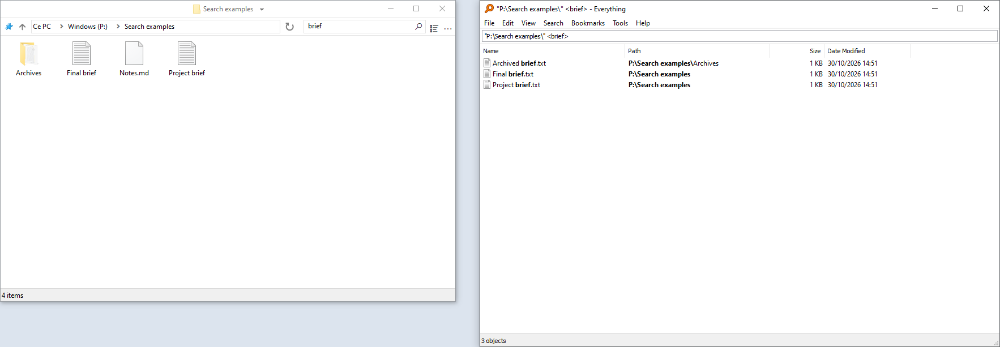

### Nilesoft Shell

[Nilesoft Shell](https://nilesoft.org/) can style FileSpacer's menus and customize their commands. Adapting its configuration is recommended for a consistent appearance, particularly square corners on the title-bar and toolbar menus.

The [configuration reference](nilesoft-shell.md) covers allowing FileSpacer, retaining the theme and keeping Explorer-only rules out of its menus. After a configuration change, unregistering and registering Nilesoft Shell applies it to newly opened menus.

The Modern theme below compares its default corners with the recommended square corners.

**Navigation menu**

| Default corners | Recommended square corners |
| --- | --- |
| 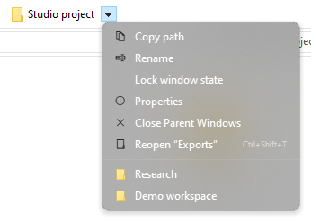 | 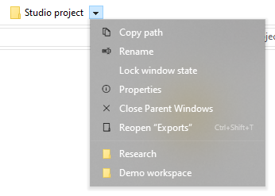 |

**Main menu (…)**

| Default corners | Recommended square corners |
| --- | --- |
| 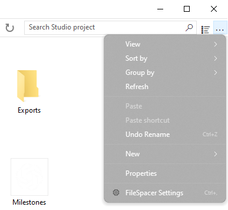 | 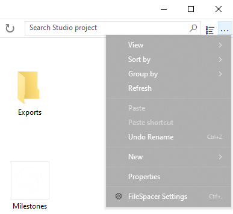 |

## Settings and updates

Ctrl+, opens Settings, even with the toolbar hidden. The interface follows Windows' display language, with English as fallback; a language change needs a restart. F1 opens the installed guide, also available offline.

Updates are checked in **Settings > About**. Downloading and installing require confirmation; installation is never automatic. Afterwards, previously open folders return with their saved layouts. Optional weekly checks are off by default and can be enabled in About.

## Local data

Folder layouts, window locks, searches and closed-folder history are stored locally in `%LOCALAPPDATA%\FileSpacer\folder-state.sqlite3`. General preferences are in the Windows Registry at `HKEY_CURRENT_USER\Software\FileSpacer`. Saved state can contain folder paths, including network paths. Temporary update files and the list of folders to reopen stay in `%TEMP%\FileSpacerUpdate-{GUID}`.

**Settings > About > Maintenance > Reset all folder state** closes folder windows and clears their saved layouts, history and locks. Files and general preferences are preserved.

For troubleshooting, `FileSpacer.exe /reset-options` resets general preferences; `/reset-all` also clears saved folder state. Neither deletes files, changes Windows file associations or removes existing diagnostic reports.

## Privacy

FileSpacer has no telemetry, usage tracking or advertising. Crash reports are not sent automatically. Any diagnostic reports stay in `%LOCALAPPDATA%\FileSpacer`; sharing them is optional and may reveal file paths or parts of process memory.

Update checks and downloads contact GitHub over HTTPS. GitHub receives the usual connection information, including the IP address and application version, but no folder state, file paths or diagnostic reports.

Network-drive credentials are entered and handled by Windows, as in File Explorer. FileSpacer does not read or store them. Choosing an Everything search passes the query and, for a folder-scoped search, its path to the local Everything application.
